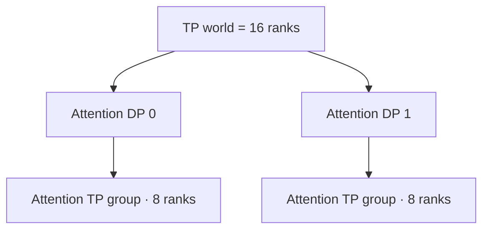
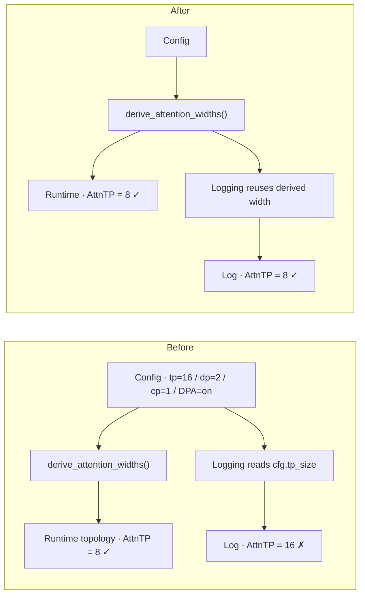

# 日志里的 TP16 为什么应是 TP8：SGLang PR #39871

配置 `tp_size=16、dp_size=2`，打开 DP Attention，`attn_cp_size=1`，Attention 实际按 TP8 运行，日志却打印 TP16。原始 tp_size 没错，错在 warning 用它描述了派生后的 Attention Group。

[PR #39871](https://github.com/sgl-project/sglang/pull/39871) 修复的就是这条日志。补丁很小，沿它回看配置派生过程，可以看见 Runtime 已经算对，信息输出却落后了一步。

本文固定阅读 `sgl-project/sglang@803f0c93d20104cf19ff6a95f7ef580b9fe449a2`，只展开补丁相关宽度。WORLD、Rank、Group、DPA、MoE EP 的背景见[《SGLang 里的 Rank 和 Group 到底是什么？》](../distributed/sglang-rank-group-deepseek-v4.md)。

## 一、日志里的宽度与实际运行值

PR 给出的旧日志为：

```text
DSA with TP mode is active,
dp_size=2,
tp_size=16,
attn_tp_size=16,
attention weights will be sharded across 16 ranks.
```

最后两处 `16` 应为 Attention 使用的宽度 8。

warning 位于 DSA 模型的调整分支：`dp_size < tp_size`，未进入 Prefill CP，平台为 CUDA / ROCm。它直接插入 `cfg.tp_size`，把 8-way Attention TP 写成 16-way。

拿这条日志排查权重分片、通信，就会去找实际不存在的 Group 宽度。

## 二、从 TP16 / DP2 推导 Attention TP8

运行时宽度来自：

[`derive_attention_widths()`](https://github.com/sgl-project/sglang/blob/803f0c93d20104cf19ff6a95f7ef580b9fe449a2/python/sglang/srt/runtime_context.py#L138-L148)

merge commit 中实现为：

```python
def derive_attention_widths(
    *, tp_size: int, attn_cp_size: int, dp_size: int, enable_dp_attention: bool
) -> tuple:
    attn_dp_size = dp_size if enable_dp_attention else 1
    return attn_dp_size, tp_size // attn_dp_size // attn_cp_size
```

开启 DP Attention，取 `attn_dp_size=dp_size`；未开启则取 1。随后计算 `attn_tp_size=tp_size/attn_dp_size/attn_cp_size`，合法配置满足：

```text
tp_size = attn_dp_size × attn_cp_size × attn_tp_size
```

代入本例，attn_dp_size=2、attn_cp_size=1，得到 `attn_tp_size=16/2/1=8`。

分组关系为：



`tp_size = 16` 是总体配置，`attn_tp_size = 8` 是 Attention 使用的派生宽度，两者同时成立。

即使 `attn_tp_size==1`，其他模型模块也仍按自己的 TP/EP 布局执行。

因此日志描述 Attention 时，需要读经过 DPA、CP 规则解释的宽度。

## 三、派生规则与错误日志的来源

派生函数已经存在，旧日志为什么还读原参数，要从稍早的配置重构看起。

约在 #39871 前两周合入的 [PR #38113](https://github.com/sgl-project/sglang/pull/38113)，将 `attn_tp_size` 等 parallel quotients 明确为 configured leaves 的派生值，并把算术集中到统一来源。

Runtime 随后经统一入口解释配置，warning 却还用 `cfg.tp_size`。#39871 将剩下这处消费者接回派生函数。

Runtime helper 的注释为：

```text
Split out because the rank computation in
dp_attention.compute_dp_attention_world_info
needs the same two numbers and must not carry
a second copy of the arithmetic.
```

它读取 `cfg.tp_size`、`cfg.dp_size`、`cfg.attn_cp_size`、`cfg.enable_dp_attention`，返回 attn_dp_size、attn_tp_size。本例后者为 8。

旧 warning 则使用：



日志虽然打印了真实配置值，却绕开了 Attention 实际使用的宽度。

Rank / Group 构建、日志共同读取同一派生规则：

规则也覆盖其他配置，无需单独修补 `16 → 8`。

## 四、补丁怎样复用统一计算入口

改动位于 [`model_hook.py`](https://github.com/sgl-project/sglang/blob/803f0c93d20104cf19ff6a95f7ef580b9fe449a2/python/sglang/srt/arg_groups/model_hook.py#L285-L300)。

补丁先取得既有结果，再交给 warning。

调用为：

```python
_, attn_tp_size = derive_attention_widths(
    tp_size=cfg.tp_size,
    attn_cp_size=cfg.attn_cp_size,
    dp_size=cfg.dp_size,
    enable_dp_attention=cfg.enable_dp_attention,
)
```

warning 用结果替换 `cfg.tp_size`，到此结束。Process Group、Attention Kernel、Collective、Weight Sharding 继续走原路径。

<a id="cfgtp_size-cfgdp_size"></a>

### 复用 derive_attention_widths 的原因

直接写 `cfg.tp_size // cfg.dp_size` 也能算对本例，却把派生逻辑又复制了一份。

完整规则还包括 `enable_dp_attention`、`attn_cp_size`。一处只除 dp，一处再除 cp，另一处才看开关，后续修改就要逐一找到这些消费者。

复用 `derive_attention_widths()`，Rank 计算和日志便随同一规则变化。

## 五、验证结果与适用平台

该补丁改 1 个文件，`+8/-2`。当时 Head Lint 通过，较广 PR Test 仍有失败记录；没有新增专门拓扑 Runtime 测试，也未运行性能、精度 Benchmark。

diff 确认的是 warning 开始使用 Runtime 同一套宽度规则。验证证据与改动范围对应到日志输出。

### 补丁的行为范围

外层平台判断为：

```python
if not get_platform().is_npu and not get_platform().is_xpu:
    # CUDA or ROCm GPU
```

所以 #39871 处理 CUDA / ROCm 的 partial DP Attention warning。Ascend NPU、XPU 跳过这条调整分支。

<a id="_6"></a>

原始 `tp_size` 保存配置，`attn_tp_size` 描述解释之后的 Attention 宽度。需要输出运行拓扑的消费者，复用后者才能跟上配置规则。

这次补丁没有改变并行计算，却修正了排查并行计算时依赖的一条信息。

<a id="_7"></a>

### PR 固定源码与延伸阅读

- [SGLang PR #39871](https://github.com/sgl-project/sglang/pull/39871)
- [PR #38113：parallel quotients / derived config 的前置设计背景](https://github.com/sgl-project/sglang/pull/38113)
- [`model_hook.py`：修复后的 warning](https://github.com/sgl-project/sglang/blob/803f0c93d20104cf19ff6a95f7ef580b9fe449a2/python/sglang/srt/arg_groups/model_hook.py#L285-L300)
- [`runtime_context.py`：`derive_attention_widths()`](https://github.com/sgl-project/sglang/blob/803f0c93d20104cf19ff6a95f7ef580b9fe449a2/python/sglang/srt/runtime_context.py#L138-L148)
- [`runtime_context.py`：parallel width derivation](https://github.com/sgl-project/sglang/blob/803f0c93d20104cf19ff6a95f7ef580b9fe449a2/python/sglang/srt/runtime_context.py#L151-L205)
- [《SGLang 里的 Rank 和 Group 到底是什么？》](../distributed/sglang-rank-group-deepseek-v4.md)
