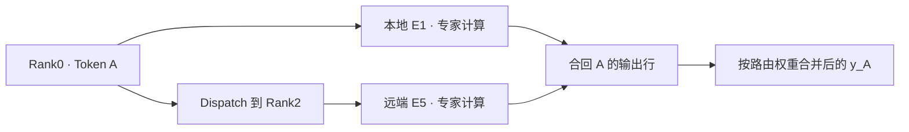

# DeepSeek-V4 MoE：Token 从路由到专家计算，再回到原位置

Token A 在 Rank0，选中的 E1 位于本地，E5 却在 Rank2。MoE 要把输入送到 E5，还要将两位专家的贡献合回 A 的输出行。专家权重分散后，这条路径必须同时处理计算、远端交换和结果归属。

下面用四 Rank、八专家的教学布局跟踪 A，再对照 DeepSeek-V4 实现。Router 先给出选择，Dispatch 准备专家输入，Expert 进行前馈计算，Combine 恢复输出。后端可以分别暴露这几个阶段，也可以把其中的工作融合执行。

<details markdown="1">
<summary>源码版本与阅读范围</summary>

> 源码固定到 `sgl-project/sglang @ 5c69e32abe013fa1b913022682a3104c79105f37`，核对日期为 2026-09-20。主线是 DeepSeek-V4 target model 的普通 MoE forward。配置类默认值仍可能被具体 checkpoint 覆盖；4 Rank / 8 Expert 只用于说明路由和通信。

</details>

## 一、DeepSeek-V4 复用的 MoE 实现

Decoder Layer 在 Attention 后通过 mHC、归一化准备 MoE 输入，再进入 `_run_moe_ffn_dp_sync()`。这个函数还衔接两阶段布局，接收 hidden states、`ForwardBatch`，并按路径传入 input IDs。前文及代码入口见 [Attention](deepseek-v4-attention-source-analysis.md) [`DeepseekV4DecoderLayer.forward()`](https://github.com/sgl-project/sglang/blob/5c69e32abe013fa1b913022682a3104c79105f37/python/sglang/srt/models/deepseek_v4.py#L3006-L3189) [`_run_moe_ffn_dp_sync()`](https://github.com/sgl-project/sglang/blob/5c69e32abe013fa1b913022682a3104c79105f37/python/sglang/srt/models/deepseek_v4.py#L3748-L3915)。

构造过程创建的是 `DeepseekV2MoE`，同时设置 `is_deepseek_v4=True`。类名保留了复用来源，实际配置与分支由 V4 标记参与选择。因此需要把构造条件和 forward 接起来看，不能凭文件名判断执行语义。[DeepSeek-V4 Decoder Layer 构造](https://github.com/sgl-project/sglang/blob/5c69e32abe013fa1b913022682a3104c79105f37/python/sglang/srt/models/deepseek_v4.py#L2643-L2654)

### 先把真实默认配置和 toy example 分开

固定版本 `DeepSeekV4Config` 的默认值如下，部署时应以 Checkpoint 实际配置为准。[DeepSeekV4Config](https://github.com/sgl-project/sglang/blob/5c69e32abe013fa1b913022682a3104c79105f37/python/sglang/srt/configs/deepseek_v4.py)

| 配置 | 默认值 |
| --- | ---: |
| `n_routed_experts` | 256 |
| `n_shared_experts` | 1 |
| `num_experts_per_tok` | 6 |
| `n_hash_layers` | 3 |
| `scoring_func` | `sqrtsoftplus` |

为了画清数据去向，后文缩小为四 Rank、八个 routed experts，每 Token 选两个，权重取 0.7、0.3。这些数值都是教学设定，不是 DeepSeek-V4 的实际配置或某轮推理的路由记录。

### Shared expert 不保证永远是一条独立分支

routed expert 由路由选择，shared expert 提供模型语义中的共享计算。实现先判断 shared expert 是否融合：可以把它放进 FusedMoE / TopK 布局，也可以单独构造 `DeepseekV2MLP`，之后再合并。所以配置有一个 shared expert，并不保证时间线上存在独立同名分支。[DeepseekV2MoE](https://github.com/sgl-project/sglang/blob/5c69e32abe013fa1b913022682a3104c79105f37/python/sglang/srt/models/deepseek_v2.py#L560-L850)

部分 DeepEP-family / MegaMoE 融合路径使用 per-rank physical shared slots，相关 helper 不适用于 Ascend FuseEP。统计布局时，逻辑专家数、物理槽位数、每 Token 路由宽度需分别看，不能把某个后端的槽位规则推广到全部实现。[源码 helper](https://github.com/sgl-project/sglang/blob/5c69e32abe013fa1b913022682a3104c79105f37/python/sglang/srt/layers/moe/utils.py#L629-L648)

后面的教学过程先不计 shared expert，只跟踪 routed experts 的选择和执行。

## 二、Router、TopK 与 HashTopK

普通 learned-router 先用 hidden states 计算专家分数。`MoEGate` 权重形状为 `[n_routed_experts,hidden_size]`，输出专家维 logits，TopK 再按评分及配置产生选择。标准结果含 `topk_ids`、`topk_weights`、`router_logits`。[MoEGate](https://github.com/sgl-project/sglang/blob/5c69e32abe013fa1b913022682a3104c79105f37/python/sglang/srt/models/deepseek_v2.py#L458-L555) [StandardTopKOutput](https://github.com/sgl-project/sglang/blob/5c69e32abe013fa1b913022682a3104c79105f37/python/sglang/srt/layers/moe/topk.py#L313-L335)

专家 ID 表示输入应交给谁，路由 weight 表示贡献怎样参与输出。Router 到这里还只产生选择信息，跨设备分发要等后续布局与执行路径完成。

DeepSeek-V4 的 learned TopK 构造设置 `use_grouped_topk=False`，并使用相应评分配置。表中 `scoring_func=sqrtsoftplus` 是该配置类默认值，不能直接沿用其他 DeepSeek 模型的 grouped routing 条件。[DeepseekV2MoE](https://github.com/sgl-project/sglang/blob/5c69e32abe013fa1b913022682a3104c79105f37/python/sglang/srt/models/deepseek_v2.py#L560-L850)

### 固定默认下，target model 前 3 层走 HashTopK

路由还按层变化。默认 `n_hash_layers=3` 时，target 模型 layer 0、1、2 进入 `HashTopK`；Checkpoint 改变该值，层范围也随之变化。NextN 另有判断，这里只讨论 target 主线。[DeepseekV2MoE](https://github.com/sgl-project/sglang/blob/5c69e32abe013fa1b913022682a3104c79105f37/python/sglang/srt/models/deepseek_v2.py#L560-L850)

`HashTopK` 用 `tid2eid` 将 Token ID 映射到 routed expert ID。它取得选择信息的方式不同，但后续仍用当前 hidden states 做专家计算。不能因为专家编号由 Token ID 查得，就认为整个 MoE 不再使用 Token 表示。[HashTopK](https://github.com/sgl-project/sglang/blob/5c69e32abe013fa1b913022682a3104c79105f37/python/sglang/srt/layers/moe/hash_topk.py)

默认 `num_experts_per_tok=6` 统计 routed experts。shared-expert fusion 可以增加内部槽位宽度，例如六个 routed slots 加一个 shared slot 形成七；这不等于选择七个 routed experts，也不决定每个 Rank 常驻多少专家。

## 三、从专家编号找到持有权重的 Rank

Router 选出逻辑专家后，还需找到权重持有位置。`FusedMoE` 保存 `moe_ep_size`、`moe_ep_rank` 等信息，并按 EP storage size 计算本地 routed expert 数，建立逻辑专家与存储位置的对应。[FusedMoE](https://github.com/sgl-project/sglang/blob/5c69e32abe013fa1b913022682a3104c79105f37/python/sglang/srt/layers/moe/fused_moe_triton/layer.py#L294-L572)

先假设固定、均匀且无冗余副本的布局：

| EP Rank | 持有的专家 |
| --- | --- |
| Rank0 | E0、E1 |
| Rank1 | E2、E3 |
| Rank2 | E4、E5 |
| Rank3 | E6、E7 |

A 从 Rank0 选中 E1、E5，权重为 0.7、0.3，于是产生 `(A,E1)`、`(A,E5)` 两份任务：一份本地计算，一份需要送到 Rank2。这里的 token-expert assignment 表示逻辑计算任务，不保证对应独立 Tensor 副本或单独 Python 消息。

实际 backend 会批量打包、排序，并按需要量化和交换任务。多个源 Rank 可以向多个目标发送，形成 All-to-All 交换语义，但并不要求每对 Rank 发送等量数据，Profiler 也未必单列一个同名窗口。

E5 在 Rank2 计算，不改变结果最终属于 A 的事实。分发时必须保留这个关系，之后才能把各专家贡献放回原行。

## 四、Dispatch、专家计算与 Combine

通用 `FusedMoE.forward_impl()` 依次交给 Dispatcher、MoE Core 和 Combine。省略预取、对齐及结果处理分支后，可见主要交接如下：[FusedMoE.forward_impl](https://github.com/sgl-project/sglang/blob/5c69e32abe013fa1b913022682a3104c79105f37/python/sglang/srt/layers/moe/fused_moe_triton/layer.py#L1562-L1599)

```python
dispatch_output = self._dispatch_with_pre_quant(
    hidden_states, topk_output, pre_quant_input
)
combine_input = self.run_moe_core(dispatch_output=dispatch_output)
final_hidden_states = self.dispatcher.combine(combine_input=combine_input)
```

Dispatch 按目标 Rank、专家重排输入，让同一专家收到的任务便于一起计算。因此专家侧排列可以不同于原 batch，也可能把不同请求的 Token 放进同一输入组。

再加入同来自 Rank0 的 B，令它选择 E5、E1，权重为 0.4、0.6。原 batch 按 A、B 排列，专家侧却可以按下表组织；这是教学布局，实际排序和存储仍由后端决定。

| 专家侧的一组任务 | 包含的原输入与权重 | 结果最后归谁 |
| --- | --- | --- |
| E1 的输入组 | A / 0.7，B / 0.6 | 分别回到 A、B |
| E5 的输入组 | A / 0.3，B / 0.4 | 分别回到 A、B |

E5 此时得到两行，并未把 A、B 合成一条请求。前馈网络分别作用于每行，历史访问仍由此前的 Attention 处理。Combine 需要保留原 Token 对应关系，只记专家编号无法恢复正确输出。

专家前馈的语义为 `W2(SiLU(W1x) ⊙ W3x)`。SGLang 合并 gate/up 为 `w13_weight`，down projection 存为 `w2_weight`；`run_moe_core()` 经 `quant_method.apply()` 接入具体实现，使用何种 Grouped / Fused GEMM 则取决于量化方法及 MoE Runner。[权重映射](https://github.com/sgl-project/sglang/blob/5c69e32abe013fa1b913022682a3104c79105f37/python/sglang/srt/layers/moe/fused_moe_triton/layer.py#L1649-L1738) [run_moe_core](https://github.com/sgl-project/sglang/blob/5c69e32abe013fa1b913022682a3104c79105f37/python/sglang/srt/layers/moe/fused_moe_triton/layer.py#L1642-L1647)

gate 分支经过 SiLU 激活，再与 up 分支的投影结果逐元素相乘，最后通过 down projection 返回输出维度。`w13_weight` 将两路权重放在一起，便于组织计算；上式中的逐元素乘法仍然保留。分析量化时，还需进一步区分权重格式及 scale 处理。

本例 E1、E5 各有两行，E0、E2 等专家则没有这两枚 Token 的任务。单专家行数决定相应 GEMM 形状，不能用 batch 总 Token 数替代。路由分布能解释工作量如何划分，设备上的实际性能仍需另外测量。

专家计算结束，再将贡献合回原行。忽略 shared expert 和其他配置缩放，本例可写成：

```text
y_A = 0.7 × E1(x_A) + 0.3 × E5(x_A)
```

两份结果都归 A，路由权重也可能被提前应用或融合执行；这个式子表达最终加权关系，并非规定通信后才在 Python 中逐项相乘。DeepEP-family 暴露的阶段较便于逐段追踪。[DeepEPMoE](https://github.com/sgl-project/sglang/blob/5c69e32abe013fa1b913022682a3104c79105f37/python/sglang/srt/layers/moe/ep_moe/layer.py#L63-L365)



图中画的是任务归属，没有给出设备耗时。实际运行还包括其他 Token、可能的共享专家和并行归约，无法据此数出完整部署的通信次数。

## 五、Ascend FuseEP 怎样融合执行阶段

这三个阶段也可以由后端融合承接。选择 `--moe-a2a-backend ascend_fuseep` 时，固定版本的 `FusedMoE.forward()` 直接进入 `forward_fuseep()`，无需依次走过上面的三个独立 Python 调用。[FusedMoE.forward](https://github.com/sgl-project/sglang/blob/5c69e32abe013fa1b913022682a3104c79105f37/python/sglang/srt/layers/moe/fused_moe_triton/layer.py#L1521-L1560)

`forward_fuseep()` 调用 buffer 的 `fused_deep_moe()`，传入 hidden states、专家 ID、路由权重、两组专家权重与 scale，以及容量和执行模式。一次上层调用承接了分发、计算、合并职责，主要输入如下，并非完整可运行片段：[forward_fuseep](https://github.com/sgl-project/sglang/blob/5c69e32abe013fa1b913022682a3104c79105f37/python/sglang/srt/hardware_backend/npu/moe/fuseep.py)

```python
hidden_states, _ = buf.fused_deep_moe(
    hidden_states,
    topk_idx=topk_output.topk_ids,
    topk_weights=topk_output.topk_weights,
    # 还需传入专家权重、scale、容量和 fuse_mode 等参数。
)
```

A 仍需得到所选专家的贡献并回到自己的输出行，改变的是后端如何组织这些工作。因此，没有独立 Dispatch / Combine 事件不代表没有通信，一次 Python 调用也不代表只启动一个设备算子。

看 FuseEP 性能时，先确认 backend 和模式，再核对事件及计时范围。这里的固定源码只能说明入口和参数交接，没有提供融合收益或通信占比的实测。

## 六、EP 宽度与后端约束

EP 分配专家，TP 分片张量计算，运行时还会限制两者的组合。固定版本将 `deepep`、`deepep_v2`、`megamoe`、`ascend_fuseep` 等列入 `_A2A_EP_SPANNING_BACKENDS`，选中相应后端后会在参数后处理时将 `ep_size` 调整为 `tp_size`。完整集合及规则见 [A2A EP size override](https://github.com/sgl-project/sglang/blob/5c69e32abe013fa1b913022682a3104c79105f37/python/sglang/srt/arg_groups/overrides.py#L1630-L1673)。

所以遇到 EP、TP 最终相等，还需找到触发调整的规则。这是该版本后端与拓扑的约束，Expert Parallel 本身并不定义二者必须相等。`none` 使用不同宽度规则，固定文档将其描述为基于 All-Reduce / All-Gather 的 dispatch。[官方 EP 文档](https://github.com/sgl-project/sglang/blob/5c69e32abe013fa1b913022682a3104c79105f37/docs/docs/advanced_features/expert_parallelism.mdx)

Attention 请求与 head 分组也未必等于 MoE 专家布局。`_run_moe_ffn_dp_sync()` 可按分支组织 DP gather、reduce-scatter、A2A scatter 等转换，再恢复下一阶段的排列。A 回到原行这一语义，在不同配置下可以由不同通信完成。[`_run_moe_ffn_dp_sync()`](https://github.com/sgl-project/sglang/blob/5c69e32abe013fa1b913022682a3104c79105f37/python/sglang/srt/models/deepseek_v4.py#L3748-L3915)

读这条路径时，可以一直跟踪 A：逻辑专家是谁、布局中由谁持有、专家侧收到什么、结果如何恢复。下一篇继续进入层间布局转换，见 [分布式 Forward](deepseek-v4-distributed-parallel-source-analysis.md)。

### 源码阅读入口

| 目标 | 固定版本入口 |
| --- | --- |
| DeepSeek-V4 创建 MoE | [Decoder Layer init](https://github.com/sgl-project/sglang/blob/5c69e32abe013fa1b913022682a3104c79105f37/python/sglang/srt/models/deepseek_v4.py#L2643-L2654) |
| Decoder Layer 进入 MoE | [Decoder Layer forward](https://github.com/sgl-project/sglang/blob/5c69e32abe013fa1b913022682a3104c79105f37/python/sglang/srt/models/deepseek_v4.py#L3006-L3189) |
| DP / TP / MoE 边界 | [_run_moe_ffn_dp_sync](https://github.com/sgl-project/sglang/blob/5c69e32abe013fa1b913022682a3104c79105f37/python/sglang/srt/models/deepseek_v4.py#L3748-L3915) |
| V4 默认 MoE / Hash 配置 | [DeepSeekV4Config](https://github.com/sgl-project/sglang/blob/5c69e32abe013fa1b913022682a3104c79105f37/python/sglang/srt/configs/deepseek_v4.py) |
| MoE 主类 / shared fusion | [DeepseekV2MoE](https://github.com/sgl-project/sglang/blob/5c69e32abe013fa1b913022682a3104c79105f37/python/sglang/srt/models/deepseek_v2.py#L560-L850) |
| Router / Gate | [MoEGate](https://github.com/sgl-project/sglang/blob/5c69e32abe013fa1b913022682a3104c79105f37/python/sglang/srt/models/deepseek_v2.py#L458-L555) |
| HashTopK | [hash_topk.py](https://github.com/sgl-project/sglang/blob/5c69e32abe013fa1b913022682a3104c79105f37/python/sglang/srt/layers/moe/hash_topk.py) |
| FusedMoE / Expert ownership | [FusedMoE](https://github.com/sgl-project/sglang/blob/5c69e32abe013fa1b913022682a3104c79105f37/python/sglang/srt/layers/moe/fused_moe_triton/layer.py#L294-L572) |
| Dispatch → Core → Combine | [FusedMoE.forward_impl](https://github.com/sgl-project/sglang/blob/5c69e32abe013fa1b913022682a3104c79105f37/python/sglang/srt/layers/moe/fused_moe_triton/layer.py#L1562-L1599) |
| DeepEP EP 实现 | [DeepEPMoE](https://github.com/sgl-project/sglang/blob/5c69e32abe013fa1b913022682a3104c79105f37/python/sglang/srt/layers/moe/ep_moe/layer.py#L63-L365) |
| Ascend FuseEP | [fuseep.py](https://github.com/sgl-project/sglang/blob/5c69e32abe013fa1b913022682a3104c79105f37/python/sglang/srt/hardware_backend/npu/moe/fuseep.py) |
| shared-slot backend 判断 | [moe utils](https://github.com/sgl-project/sglang/blob/5c69e32abe013fa1b913022682a3104c79105f37/python/sglang/srt/layers/moe/utils.py#L629-L648) |
| A2A backend 强制 EP=TP | [overrides.py](https://github.com/sgl-project/sglang/blob/5c69e32abe013fa1b913022682a3104c79105f37/python/sglang/srt/arg_groups/overrides.py#L1630-L1673) |
