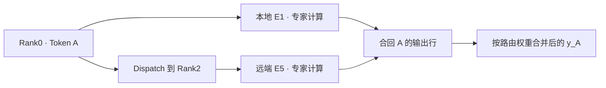

# DeepSeek-V4 MoE：Token 从路由到专家计算，再回到原位置

Rank0 的 Token A 选中了两个专家，E1 在本地，E5 在 Rank2。A 的输入要送到 E5，算出的贡献还得回到 A 的输出行。MoE 将专家权重分散以后，除了前馈计算，还要一直保留这份结果归属。

下面用四 Rank、八专家的布局跟着 A 走一遍，再对照 DeepSeek-V4 源码。Router 产生选择，Dispatch 整理输入，专家计算后由 Combine 恢复输出；实际后端也可以将几项工作融合。

<details markdown="1">
<summary>源码版本与阅读范围</summary>

> 源码固定到 `sgl-project/sglang @ 5c69e32abe013fa1b913022682a3104c79105f37`，核对日期为 2026-09-20。主线是 DeepSeek-V4 target model 的普通 MoE forward。配置类默认值仍可能被具体 checkpoint 覆盖；4 Rank / 8 Expert 只用于说明路由和通信。

</details>

## 一、DeepSeek-V4 复用的 MoE 实现

Attention 之后，Decoder Layer 经过 mHC、归一化准备 MoE 输入，进入 `_run_moe_ffn_dp_sync()`。这个入口衔接两阶段布局，接收 hidden states、`ForwardBatch`，部分路径还会传 input IDs。[Attention](deepseek-v4-attention-source-analysis.md) [`DeepseekV4DecoderLayer.forward()`](https://github.com/sgl-project/sglang/blob/5c69e32abe013fa1b913022682a3104c79105f37/python/sglang/srt/models/deepseek_v4.py#L3006-L3189) [`_run_moe_ffn_dp_sync()`](https://github.com/sgl-project/sglang/blob/5c69e32abe013fa1b913022682a3104c79105f37/python/sglang/srt/models/deepseek_v4.py#L3748-L3915)

构造时复用 `DeepseekV2MoE`，并设 `is_deepseek_v4=True`。V4 的配置与分支由这个标记参与选择，类名则保留了原来的复用来源。[DeepSeek-V4 Decoder Layer 构造](https://github.com/sgl-project/sglang/blob/5c69e32abe013fa1b913022682a3104c79105f37/python/sglang/srt/models/deepseek_v4.py#L2643-L2654)

<a id="toy-example"></a>

### Config 默认值与四 Rank 算例

固定版本的 `DeepSeekV4Config` 默认值如下，实际部署还会读取 Checkpoint 配置。[DeepSeekV4Config](https://github.com/sgl-project/sglang/blob/5c69e32abe013fa1b913022682a3104c79105f37/python/sglang/srt/configs/deepseek_v4.py)

| 配置 | 默认值 |
| --- | ---: |
| `n_routed_experts` | 256 |
| `n_shared_experts` | 1 |
| `num_experts_per_tok` | 6 |
| `n_hash_layers` | 3 |
| `scoring_func` | `sqrtsoftplus` |

后面的算例缩成四 Rank、八个 routed experts，每 Token 选两个，权重取 0.7、0.3。它只用来画数据去向，这些数值不是 DeepSeek-V4 实际配置，也不是一次推理的路由记录。

### Shared expert 的两种实现方式

routed expert 由路由选取，shared expert 提供共享计算。实现会先判断 shared expert 能否融合，放进 FusedMoE / TopK 布局；另一条路径单独创建 `DeepseekV2MLP`，算完再合并。因此模型配置里的一个 shared expert，在执行时间线上未必单列为一个分支。[DeepseekV2MoE](https://github.com/sgl-project/sglang/blob/5c69e32abe013fa1b913022682a3104c79105f37/python/sglang/srt/models/deepseek_v2.py#L560-L850)

部分 DeepEP-family / MegaMoE 融合路径使用 per-rank physical shared slots，相应 helper 不适用于 Ascend FuseEP。逻辑专家数、物理槽位和每 Token 路由宽度，要按具体后端的规则分别计算。[源码 helper](https://github.com/sgl-project/sglang/blob/5c69e32abe013fa1b913022682a3104c79105f37/python/sglang/srt/layers/moe/utils.py#L629-L648)

算例暂不加入 shared expert，只观察 routed experts。

## 二、Router、TopK 与 HashTopK

普通 learned-router 先给专家打分。`MoEGate` 的权重为 `[n_routed_experts,hidden_size]`，输出专家维 logits，TopK 根据评分和配置给出选择。标准结果包含 `topk_ids`、`topk_weights` 和 `router_logits`。[MoEGate](https://github.com/sgl-project/sglang/blob/5c69e32abe013fa1b913022682a3104c79105f37/python/sglang/srt/models/deepseek_v2.py#L458-L555) [StandardTopKOutput](https://github.com/sgl-project/sglang/blob/5c69e32abe013fa1b913022682a3104c79105f37/python/sglang/srt/layers/moe/topk.py#L313-L335)

专家 ID 指出这行输入交给谁，路由 weight 决定输出如何加权。选择信息到这里已经有了，任务还没送到远端，后面要经过布局和执行路径。

DeepSeek-V4 learned TopK 构造设置 `use_grouped_topk=False`，评分也按本模型配置选择，表中的 `scoring_func=sqrtsoftplus` 是配置类默认值。其他 DeepSeek 模型的 grouped routing 条件不直接适用。[DeepseekV2MoE](https://github.com/sgl-project/sglang/blob/5c69e32abe013fa1b913022682a3104c79105f37/python/sglang/srt/models/deepseek_v2.py#L560-L850)

### 固定默认下，target model 前 3 层走 HashTopK

target 模型的默认 `n_hash_layers=3`，layer 0、1、2 使用 `HashTopK`，Checkpoint 修改这个值，层范围就随之变化。NextN 另有判断，这里仍跟 target 主线。[DeepseekV2MoE](https://github.com/sgl-project/sglang/blob/5c69e32abe013fa1b913022682a3104c79105f37/python/sglang/srt/models/deepseek_v2.py#L560-L850)

`HashTopK` 从 `tid2eid` 将 Token ID 映射到 routed expert ID。专家编号由查表得到，专家计算的输入仍是当前 hidden states，Token 表示并没有被跳过。[HashTopK](https://github.com/sgl-project/sglang/blob/5c69e32abe013fa1b913022682a3104c79105f37/python/sglang/srt/layers/moe/hash_topk.py)

默认 `num_experts_per_tok=6` 计 routed experts。融合 shared expert 时，内部可以用六个 routed slots 加一个 shared slot，形成七个槽位；其中 routed 选择仍是六个。每 Rank 常驻多少专家，还得看存储布局。

## 三、从专家编号找到持有权重的 Rank

选出逻辑专家，还要找到它的权重。`FusedMoE` 保存 `moe_ep_size`、`moe_ep_rank`，按 EP storage size 计算本地 routed expert 数，建立逻辑专家与本地存储位置的对应。[FusedMoE](https://github.com/sgl-project/sglang/blob/5c69e32abe013fa1b913022682a3104c79105f37/python/sglang/srt/layers/moe/fused_moe_triton/layer.py#L294-L572)

假设专家固定、均匀分布，没有冗余副本。

| EP Rank | 持有的专家 |
| --- | --- |
| Rank0 | E0、E1 |
| Rank1 | E2、E3 |
| Rank2 | E4、E5 |
| Rank3 | E6、E7 |

A 在 Rank0，E1、E5 的权重为 0.7、0.3，产生 `(A,E1)` 和 `(A,E5)` 两项任务，前者本地执行，后者送到 Rank2。token-expert assignment 描述逻辑任务，落到后端可以批量处理，不保证每项都对应独立 Tensor 副本或 Python 消息。

backend 将这些任务批量打包、排序，按需要量化和交换。多个源 Rank 可以发往多个目标，形成 All-to-All 语义，发送量却未必两两相同，Profiler 也可能没有一个独立的同名窗口。

E5 算完的结果仍属于 A。分发时留下原 Token 关系，才能在后面恢复这行输出。

## 四、Dispatch、专家计算与 Combine

通用 `FusedMoE.forward_impl()` 依次交给 Dispatcher、MoE Core、Combine。省略预取、对齐和结果处理分支，主要交接如下。[FusedMoE.forward_impl](https://github.com/sgl-project/sglang/blob/5c69e32abe013fa1b913022682a3104c79105f37/python/sglang/srt/layers/moe/fused_moe_triton/layer.py#L1562-L1599)

```python
dispatch_output = self._dispatch_with_pre_quant(
    hidden_states, topk_output, pre_quant_input
)
combine_input = self.run_moe_core(dispatch_output=dispatch_output)
final_hidden_states = self.dispatcher.combine(combine_input=combine_input)
```

Dispatch 按目标 Rank、专家重排输入，把同一专家要做的任务聚在一起。专家侧的排列因而可以不同于原 batch，不同请求的 Token 也可能同组执行。

再从 Rank0 加入 B，选 E5、E1，权重为 0.4、0.6。原 batch 顺序是 A、B，专家侧可以排成下面这样，具体排序与存储仍由 backend 决定。

| 专家侧的一组任务 | 包含的原输入与权重 | 结果最后归谁 |
| --- | --- | --- |
| E1 的输入组 | A / 0.7，B / 0.6 | 分别回到 A、B |
| E5 的输入组 | A / 0.3，B / 0.4 | 分别回到 A、B |

E5 收到两行，前馈网络逐行计算，A、B 并没有合成同一请求，历史访问已经由前面的 Attention 处理。Combine 则需要每行原 Token 的对应关系，只有专家编号还不足以还原输出。

专家前馈写成 `W2(SiLU(W1x) ⊙ W3x)`。SGLang 将 gate/up 合进 `w13_weight`，down projection 存成 `w2_weight`，`run_moe_core()` 经 `quant_method.apply()` 进入具体实现。选 Grouped 还是 Fused GEMM，还随量化方法和 MoE Runner 而变。[权重映射](https://github.com/sgl-project/sglang/blob/5c69e32abe013fa1b913022682a3104c79105f37/python/sglang/srt/layers/moe/fused_moe_triton/layer.py#L1649-L1738) [run_moe_core](https://github.com/sgl-project/sglang/blob/5c69e32abe013fa1b913022682a3104c79105f37/python/sglang/srt/layers/moe/fused_moe_triton/layer.py#L1642-L1647)

gate 经 SiLU 激活，与 up 的投影逐元素相乘，最后由 down projection 送回输出维度。`w13_weight` 只是把两路权重放在一起组织计算，逐元素乘法仍在；量化路径还要处理各自格式与 scale。

本例 E1、E5 各收到两行，E0、E2 等专家没有这两枚 Token 的任务。各专家自己的行数决定对应 GEMM 形状，batch 总 Token 数无法替代这份分布。它说明工作量怎样分，实际性能要在设备上测。

专家算完，将贡献合回原行。暂不计 shared expert 和其他配置缩放，A 的输出可以写为下面的加权关系。

```text
y_A = 0.7 × E1(x_A) + 0.3 × E5(x_A)
```

两项都合到 A。路由权重也可能提前应用或融合进实现，这个式子只规定最后的加权结果，不规定通信后还得在 Python 逐项相乘。DeepEP-family 的阶段接口比较便于追踪这些交接。[DeepEPMoE](https://github.com/sgl-project/sglang/blob/5c69e32abe013fa1b913022682a3104c79105f37/python/sglang/srt/layers/moe/ep_moe/layer.py#L63-L365)



图只画任务归属，没有标设备时间。实际运行还有其他 Token、可能的共享专家及并行归约，完整部署的通信次数也不能直接按图数出来。

## 五、Ascend FuseEP 怎样融合执行阶段

选 `--moe-a2a-backend ascend_fuseep`，固定版本的 `FusedMoE.forward()` 直接进入 `forward_fuseep()`。上面的分发、计算和合并交给后端承接，不再逐个走三个独立 Python 调用。[FusedMoE.forward](https://github.com/sgl-project/sglang/blob/5c69e32abe013fa1b913022682a3104c79105f37/python/sglang/srt/layers/moe/fused_moe_triton/layer.py#L1521-L1560)

`forward_fuseep()` 调 buffer 的 `fused_deep_moe()`，将 hidden states、专家 ID、路由权重、两组专家权重与 scale，以及容量、模式一并传入。下面只列主要输入，省略其他参数。[forward_fuseep](https://github.com/sgl-project/sglang/blob/5c69e32abe013fa1b913022682a3104c79105f37/python/sglang/srt/hardware_backend/npu/moe/fuseep.py)

```python
hidden_states, _ = buf.fused_deep_moe(
    hidden_states,
    topk_idx=topk_output.topk_ids,
    topk_weights=topk_output.topk_weights,
    # 还需传入专家权重、scale、容量和 fuse_mode 等参数。
)
```

A 仍从所选专家拿到贡献，回到自己的输出行。一次 Python 入口可以承接多个执行阶段，也可能启动多个设备算子；没有独立 Dispatch / Combine 事件，并不表示跳过了通信。

这里追到的是 FuseEP 入口与参数交接。融合收益、通信占比需要结合实际 backend、模式、事件范围测量，本文没有这部分实测。

## 六、EP 宽度与后端约束

EP 分配专家，TP 分片张量计算，运行时会进一步限制组合。固定版本把 `deepep`、`deepep_v2`、`megamoe`、`ascend_fuseep` 等放进 `_A2A_EP_SPANNING_BACKENDS`，选这些后端，参数后处理便将 `ep_size` 调整为 `tp_size`。完整集合与规则见 [A2A EP size override](https://github.com/sgl-project/sglang/blob/5c69e32abe013fa1b913022682a3104c79105f37/python/sglang/srt/arg_groups/overrides.py#L1630-L1673)。

这解释了该版本一些配置中 EP、TP 最终相等的来源。Expert Parallel 的定义本身没有要求两者相等，`none` 则有不同宽度规则，固定文档将它描述为基于 All-Reduce / All-Gather 的 dispatch。[官方 EP 文档](https://github.com/sgl-project/sglang/blob/5c69e32abe013fa1b913022682a3104c79105f37/docs/docs/advanced_features/expert_parallelism.mdx)

Attention 的请求、head 分组，也可能与专家布局不同。`_run_moe_ffn_dp_sync()` 按分支组织 DP gather、reduce-scatter、A2A scatter 等转换，再恢复下一阶段排列，A 回到原行可以由不同通信完成。[`_run_moe_ffn_dp_sync()`](https://github.com/sgl-project/sglang/blob/5c69e32abe013fa1b913022682a3104c79105f37/python/sglang/srt/models/deepseek_v4.py#L3748-L3915)

层间为什么还需要这些布局转换，在 [分布式 Forward](deepseek-v4-distributed-parallel-source-analysis.md) 一篇继续展开。这里 A 已经从 Rank0 的输入，经过本地 E1、Rank2 的 E5，再恢复成属于自己的输出。

### 源码阅读入口

| 目标 | 固定版本入口 |
| --- | --- |
| DeepSeek-V4 创建 MoE | [Decoder Layer init](https://github.com/sgl-project/sglang/blob/5c69e32abe013fa1b913022682a3104c79105f37/python/sglang/srt/models/deepseek_v4.py#L2643-L2654) |
| Decoder Layer 进入 MoE | [Decoder Layer forward](https://github.com/sgl-project/sglang/blob/5c69e32abe013fa1b913022682a3104c79105f37/python/sglang/srt/models/deepseek_v4.py#L3006-L3189) |
| DP / TP / MoE 边界 | [_run_moe_ffn_dp_sync](https://github.com/sgl-project/sglang/blob/5c69e32abe013fa1b913022682a3104c79105f37/python/sglang/srt/models/deepseek_v4.py#L3748-L3915) |
| V4 默认 MoE / Hash 配置 | [DeepSeekV4Config](https://github.com/sgl-project/sglang/blob/5c69e32abe013fa1b913022682a3104c79105f37/python/sglang/srt/configs/deepseek_v4.py) |
| MoE 主类 / shared fusion | [DeepseekV2MoE](https://github.com/sgl-project/sglang/blob/5c69e32abe013fa1b913022682a3104c79105f37/python/sglang/srt/models/deepseek_v2.py#L560-L850) |
| Router / Gate | [MoEGate](https://github.com/sgl-project/sglang/blob/5c69e32abe013fa1b913022682a3104c79105f37/python/sglang/srt/models/deepseek_v2.py#L458-L555) |
| HashTopK | [hash_topk.py](https://github.com/sgl-project/sglang/blob/5c69e32abe013fa1b913022682a3104c79105f37/python/sglang/srt/layers/moe/hash_topk.py) |
| FusedMoE / Expert ownership | [FusedMoE](https://github.com/sgl-project/sglang/blob/5c69e32abe013fa1b913022682a3104c79105f37/python/sglang/srt/layers/moe/fused_moe_triton/layer.py#L294-L572) |
| Dispatch → Core → Combine | [FusedMoE.forward_impl](https://github.com/sgl-project/sglang/blob/5c69e32abe013fa1b913022682a3104c79105f37/python/sglang/srt/layers/moe/fused_moe_triton/layer.py#L1562-L1599) |
| DeepEP EP 实现 | [DeepEPMoE](https://github.com/sgl-project/sglang/blob/5c69e32abe013fa1b913022682a3104c79105f37/python/sglang/srt/layers/moe/ep_moe/layer.py#L63-L365) |
| Ascend FuseEP | [fuseep.py](https://github.com/sgl-project/sglang/blob/5c69e32abe013fa1b913022682a3104c79105f37/python/sglang/srt/hardware_backend/npu/moe/fuseep.py) |
| shared-slot backend 判断 | [moe utils](https://github.com/sgl-project/sglang/blob/5c69e32abe013fa1b913022682a3104c79105f37/python/sglang/srt/layers/moe/utils.py#L629-L648) |
| A2A backend 强制 EP=TP | [overrides.py](https://github.com/sgl-project/sglang/blob/5c69e32abe013fa1b913022682a3104c79105f37/python/sglang/srt/arg_groups/overrides.py#L1630-L1673) |
