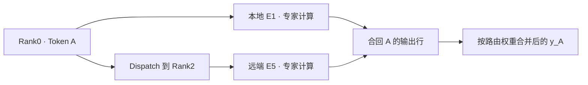

# DeepSeek-V4 MoE：Token 从路由到专家计算，再回到原位置

假设一枚 Token 位于 Rank0，路由结果选中两个专家：E1 在本地，E5 在 Rank2。接下来既要把输入送到 E5，也要在两个专家算完后收齐结果，合成这枚 Token 的一行输出。专家分散存放后，MoE 就同时涉及计算与数据归属。

下面用四个 Rank、八个专家的教学布局跟住这枚 Token，再对照 DeepSeek-V4 的实现。Router 决定选择谁，Dispatch 组织输入，Expert 执行前馈计算，Combine 恢复原 Token 的输出。各后端可以分别暴露这些阶段，也可以将其中的工作融合。

<details markdown="1">
<summary>源码版本与阅读范围</summary>

> **源码与适用范围**：本文基于 `sgl-project/sglang @ 5c69e32abe013fa1b913022682a3104c79105f37`，核对日期为 2026-09-20。主线分析 DeepSeek-V4 target model 的普通 MoE forward。具体 checkpoint 可以覆盖配置类默认值；文中用 4 Rank / 8 Expert 的教学例子演示路由与通信。

</details>

## 一、DeepSeek-V4 复用的 MoE 实现

在[Attention](deepseek-v4-attention-source-analysis.md)之后，Decoder Layer 通过 mHC 与归一化准备输入，再进入 `_run_moe_ffn_dp_sync()`。这个入口除了调用 MoE，还负责衔接 Attention 与 MoE 之间的数据布局。它接收 hidden states、`ForwardBatch`，并在需要的路径上传递 input IDs。[`DeepseekV4DecoderLayer.forward()`](https://github.com/sgl-project/sglang/blob/5c69e32abe013fa1b913022682a3104c79105f37/python/sglang/srt/models/deepseek_v4.py#L3006-L3189) [`_run_moe_ffn_dp_sync()`](https://github.com/sgl-project/sglang/blob/5c69e32abe013fa1b913022682a3104c79105f37/python/sglang/srt/models/deepseek_v4.py#L3748-L3915)

顺着构造继续找，会进入 `DeepseekV2MoE`，并带上 `is_deepseek_v4=True`。这个名字来自代码复用，里面会按 V4 标记选择相应配置与分支。理解一层如何执行，需要连着看构造条件与 forward，不能只根据文件名判断模型架构。[DeepSeek-V4 Decoder Layer 构造](https://github.com/sgl-project/sglang/blob/5c69e32abe013fa1b913022682a3104c79105f37/python/sglang/srt/models/deepseek_v4.py#L2643-L2654)

### 先把真实默认配置和 toy example 分开

固定提交的 `DeepSeekV4Config` 类使用以下默认值。Checkpoint 可以覆盖它们，分析具体部署时仍应读取实际配置：[DeepSeekV4Config](https://github.com/sgl-project/sglang/blob/5c69e32abe013fa1b913022682a3104c79105f37/python/sglang/srt/configs/deepseek_v4.py)

| 配置 | 默认值 |
| --- | ---: |
| `n_routed_experts` | 256 |
| `n_shared_experts` | 1 |
| `num_experts_per_tok` | 6 |
| `n_hash_layers` | 3 |
| `scoring_func` | `sqrtsoftplus` |

后文的四个 Rank、八个 routed experts、每 Token 选两个专家，是为看清数据走向而缩小的例子，不是把 DeepSeek-V4 的真实专家数量改成八。例子里的 0.7、0.3 也只是便于计算的路由权重，不是某次模型推理的测量结果。

### Shared expert 不保证永远是一条独立分支

routed expert 由路由选择，shared expert 在模型语义中提供共享计算。运行时会先决定是否融合 shared expert：可能将它放进 FusedMoE / TopK 的布局，也可能在未融合时构造独立的 `DeepseekV2MLP`，随后再合并结果。配置里有一个 shared expert，不代表设备时间线上一定出现一条独立、同名的分支。[DeepseekV2MoE](https://github.com/sgl-project/sglang/blob/5c69e32abe013fa1b913022682a3104c79105f37/python/sglang/srt/models/deepseek_v2.py#L560-L850)

部分 DeepEP-family / MegaMoE 的融合路径还使用 per-rank physical shared slots，Ascend FuseEP 不属于这个 helper 的适用后端。因此，统计专家槽位时需要区分逻辑专家、物理槽位和每 Token 路由宽度，不能把一处布局规则直接套给所有后端。[源码 helper](https://github.com/sgl-project/sglang/blob/5c69e32abe013fa1b913022682a3104c79105f37/python/sglang/srt/layers/moe/utils.py#L629-L648)

先记住这项区别即可。下面暂不计 shared expert，沿 routed experts 的选择和执行把例子走完。

## 二、Router、TopK 与 HashTopK

普通 learned-router 路径用当前 Token 的 hidden states 计算专家分数。`MoEGate` 的权重形状是 `[n_routed_experts,hidden_size]`，输出对应专家维的 logits。TopK 再根据评分和配置组织选择结果，标准输出包含 `topk_ids`、`topk_weights` 与 `router_logits`。[MoEGate](https://github.com/sgl-project/sglang/blob/5c69e32abe013fa1b913022682a3104c79105f37/python/sglang/srt/models/deepseek_v2.py#L458-L555) [StandardTopKOutput](https://github.com/sgl-project/sglang/blob/5c69e32abe013fa1b913022682a3104c79105f37/python/sglang/srt/layers/moe/topk.py#L313-L335)

对后面的专家执行而言，ID 说明要把输入交给哪些专家，weight 说明这些专家的贡献怎样参与最终输出。不能把 Router 直接看成跨卡通信：它先产生选择信息，数据如何送到持有权重的设备，还需要后续布局与分发。

DeepSeek-V4 的 learned TopK 构造会将 `use_grouped_topk` 设为 `False`，并使用相应评分配置。前面表中的 `scoring_func=sqrtsoftplus` 是固定配置类的默认值，不能将其他 DeepSeek 模型常用的 grouped routing 条件直接搬到这条 V4 分支。[DeepseekV2MoE](https://github.com/sgl-project/sglang/blob/5c69e32abe013fa1b913022682a3104c79105f37/python/sglang/srt/models/deepseek_v2.py#L560-L850)

### 固定默认下，target model 前 3 层走 HashTopK

路由选择还有按层区分。固定默认 `n_hash_layers=3` 时，target 模型的 layer 0、1、2 满足 Hash 路由条件，使用 `HashTopK`；Checkpoint 修改该字段后，层范围也会随之变化。NextN 的判断另有条件，这里只沿 target 模型主线解释。[DeepseekV2MoE](https://github.com/sgl-project/sglang/blob/5c69e32abe013fa1b913022682a3104c79105f37/python/sglang/srt/models/deepseek_v2.py#L560-L850)

`HashTopK` 内有 `tid2eid`，用 Token ID 映射到 routed expert ID。它与普通 learned TopK 的选择路径不同，但产出专家 ID 与权重后，仍交给后面的 MoE 执行。不要把“由 Token ID 取得专家映射”延伸成整个 MoE 不再使用 hidden states，专家计算仍以该 Token 的当前表示为输入。[HashTopK](https://github.com/sgl-project/sglang/blob/5c69e32abe013fa1b913022682a3104c79105f37/python/sglang/srt/layers/moe/hash_topk.py)

默认 `num_experts_per_tok=6` 描述 routed experts 数量。若启用 shared-expert fusion，内部宽度还可能额外加入 shared slot，例如六个 routed slots 加一个 shared slot 形成宽度七。这与“选了七个 routed experts”含义不同，也不单独决定每个 Rank 存放多少专家权重。

## 三、从专家编号找到持有权重的 Rank

Router 产出的是专家编号，权重却分布在设备上。`FusedMoE` 维护 `moe_ep_size`、`moe_ep_rank` 等信息，并根据 EP storage size 计算本地 routed expert 数，形成逻辑专家到持有位置的关系。[FusedMoE](https://github.com/sgl-project/sglang/blob/5c69e32abe013fa1b913022682a3104c79105f37/python/sglang/srt/layers/moe/fused_moe_triton/layer.py#L294-L572)

先使用一个固定、均匀、没有冗余副本的教学布局：

| EP Rank | 持有的专家 |
| --- | --- |
| Rank0 | E0、E1 |
| Rank1 | E2、E3 |
| Rank2 | E4、E5 |
| Rank3 | E6、E7 |

Token A 原本位于 Rank0，选择 E1、E5，权重分别为 0.7、0.3。它形成两份 token-expert assignments：`(A,E1)` 可以交给本地专家，`(A,E5)` 则需要将数据送往 Rank2。这里的一份 assignment 表示一次专家计算任务，不必对应一块独立复制的 Tensor 或一条 Python 消息。

真实后端会把很多 Token 的任务一起打包、排序、按需要量化，再批量交换数据。当多个源 Rank 都可能向多个目标 Rank 发送输入时，就形成 All-to-All 的交换语义。它不意味着每对 Rank 在每轮都发送等量数据，也不要求 Profiler 中一定出现一个名为 All-to-All 的独立窗口。

对同一枚 Token 来说，专家所在位置与最终输出归属仍是两回事。E5 在 Rank2 上计算，贡献却还要回到 A 的输出行；把这一关系保留下来，才能在分发后恢复原有顺序。

## 四、Dispatch、专家计算与 Combine

通用 `FusedMoE.forward_impl()` 将工作交给 Dispatcher、MoE Core，再交回 Combine。下面只保留对应交接，省略预取、对齐和结果处理等分支：[FusedMoE.forward_impl](https://github.com/sgl-project/sglang/blob/5c69e32abe013fa1b913022682a3104c79105f37/python/sglang/srt/layers/moe/fused_moe_triton/layer.py#L1562-L1599)

```python
dispatch_output = self._dispatch_with_pre_quant(
    hidden_states, topk_output, pre_quant_input
)
combine_input = self.run_moe_core(dispatch_output=dispatch_output)
final_hidden_states = self.dispatcher.combine(combine_input=combine_input)
```

Dispatch 按目的 Rank 和专家重新组织 Token，使专家侧得到适合计算的局部输入。经过这一步，输入行的排列可以与原 batch 不同：同一专家收到的任务被放在一起，来自不同请求的 Token 也可能一起进入该专家的计算。

把例子扩到两枚 Token，更容易看出为什么需要恢复映射。假设 B 也来自 Rank0，选择 E5、E1，路由权重分别为 0.4、0.6。原输入按 A、B 排列，按专家组织任务后，可以画成下面的教学布局；真实后端的排序、打包和存储方式以其实现为准。

| 专家侧的一组任务 | 包含的原输入与权重 | 结果最后归谁 |
| --- | --- | --- |
| E1 的输入组 | A / 0.7，B / 0.6 | 分别回到 A、B |
| E5 的输入组 | A / 0.3，B / 0.4 | 分别回到 A、B |

现在 E5 收到两行输入，但没有把 A、B 合成一条请求。专家前馈计算分别作用在各 Token 的表示上，跨请求的历史访问仍由前面的 Attention 管理。Combine 需要恢复的不只是设备归属，还有每份专家贡献对应哪个原始 Token；如果只保留专家编号而丢掉这个关系，算出的结果就无法放回正确的输出行。

专家仍执行前馈网络。用原文的符号表示，语义为 `W2(SiLU(W1x) ⊙ W3x)`；SGLang 将 gate/up 权重合并存为 `w13_weight`，down projection 使用 `w2_weight`。`run_moe_core()` 再由 `quant_method.apply()` 接到具体实现，Grouped / Fused GEMM 的选择取决于量化方法和 MoE Runner 后端。[权重映射](https://github.com/sgl-project/sglang/blob/5c69e32abe013fa1b913022682a3104c79105f37/python/sglang/srt/layers/moe/fused_moe_triton/layer.py#L1649-L1738) [run_moe_core](https://github.com/sgl-project/sglang/blob/5c69e32abe013fa1b913022682a3104c79105f37/python/sglang/srt/layers/moe/fused_moe_triton/layer.py#L1642-L1647)

式子里的两路投影分别提供 gate 与 up 表示，经激活和逐元素相乘后，再通过 down projection 回到后续需要的输出维度。把 gate/up 权重放进同一份 `w13_weight`，是执行侧对权重和计算的组织，并没有把两个作用改成求和。阅读量化路径时，也要将这层模型语义与实际的权重格式、scale 处理分开。

专家侧的输入行数还会随路由分布变化。本例 E1、E5 各收到两行，E0、E2 等专家没有接到这两枚 Token。真实负载中，每位专家的输入行数会影响它对应的计算形状，所以 batch 中有多少 Token 与某一专家实际处理多少行不能混为一谈。这是查看 Grouped GEMM 输入和专家负载时需要对齐的量，不是仅凭路由图就能得到的设备性能结论。

算完之后，Combine 要将专家输出合到原 Token 对应的行。暂时忽略 shared expert 与其他配置缩放，本例的教学表达式是：

```text
y_A = 0.7 × E1(x_A) + 0.3 × E5(x_A)
```

两份专家贡献最终属于同一枚 A。权重应用可以提前或融合进后端实现，这个表达式说明最终的加权合并关系，不代表 Python 中一定在通信之后才逐项相乘。DeepEP-family 路径暴露的 Dispatch、计算和 Combine 边界较容易逐段追踪。[DeepEPMoE](https://github.com/sgl-project/sglang/blob/5c69e32abe013fa1b913022682a3104c79105f37/python/sglang/srt/layers/moe/ep_moe/layer.py#L63-L365)



图表示任务归属，不是设备耗时图。系统还需要处理其他 Token，以及按配置可能存在的共享专家和并行结果归约；不能把这张两专家图当作完整部署的通信次数。

## 五、Ascend FuseEP 怎样融合执行阶段

上述三阶段有助于理解数据流，但后端可以用不同方式承接它们。固定版本选择 `--moe-a2a-backend ascend_fuseep` 时，`FusedMoE.forward()` 会直接进入 `forward_fuseep()`，不必沿刚才那三次独立 Python 调用逐一执行。[FusedMoE.forward](https://github.com/sgl-project/sglang/blob/5c69e32abe013fa1b913022682a3104c79105f37/python/sglang/srt/layers/moe/fused_moe_triton/layer.py#L1521-L1560)

`forward_fuseep()` 最终调用 buffer 的 `fused_deep_moe()`，传入 hidden states、专家 ID、路由权重、两组专家权重及 scale，以及容量和执行模式等参数。它对上层暴露一次调用，承担分发、专家计算和合并的职责。下面保留主要输入，作为阅读入口，不是完整可运行片段：[forward_fuseep](https://github.com/sgl-project/sglang/blob/5c69e32abe013fa1b913022682a3104c79105f37/python/sglang/srt/hardware_backend/npu/moe/fuseep.py)

```python
hidden_states, _ = buf.fused_deep_moe(
    hidden_states,
    topk_idx=topk_output.topk_ids,
    topk_weights=topk_output.topk_weights,
    # 还需传入专家权重、scale、容量和 fuse_mode 等参数。
)
```

Token A 的执行语义没有改变：它仍要得到所选专家的贡献，并合回自己的输出行。变化的是这些职责在后端如何组合。因此，Profiler 中没有独立的 Dispatch 或 Combine 条目，不能直接推断通信被省掉；反过来，仅凭一次 Python 调用也不能断言只启动一个设备算子。

分析 FuseEP 性能时，需要先确认实际后端与模式，再看它暴露的事件和计时范围。这里能从固定源码确认的是入口与参数交接，不给出未测量的融合收益或通信占比。

## 六、EP 宽度与后端约束

最后回到配置。EP 描述专家怎样分布，TP 描述张量计算怎样分片，但一份运行时可以对它们的组合施加限制。固定版本将 `deepep`、`deepep_v2`、`megamoe`、`ascend_fuseep` 等列入 `_A2A_EP_SPANNING_BACKENDS`；选中集合内的后端后，参数后处理会把 `ep_size` 调整为 `tp_size`。完整后端集合以对应源码为准。[A2A EP size override](https://github.com/sgl-project/sglang/blob/5c69e32abe013fa1b913022682a3104c79105f37/python/sglang/srt/arg_groups/overrides.py#L1630-L1673)

因此，看到 EP 与 TP 最终相等，应继续追问是哪条配置规则要求它们相等。这个限制属于固定版本的后端和拓扑组合，不是 Expert Parallel 的定义。`none` 使用另一套宽度规则，固定版本文档将它描述为基于 All-Reduce / All-Gather 的 dispatch。[官方 EP 文档](https://github.com/sgl-project/sglang/blob/5c69e32abe013fa1b913022682a3104c79105f37/docs/docs/advanced_features/expert_parallelism.mdx)

Attention 侧的请求与 head 分组，也未必等于 MoE 侧的专家布局。进入专家执行前后，`_run_moe_ffn_dp_sync()` 还可能组织 DP gather、reduce-scatter、A2A scatter 等工作，再恢复后续计算所需的排列。这些转换要放在具体分支里看，不能把“专家结果回到 Token”简化为所有配置都使用同一套通信。[`_run_moe_ffn_dp_sync()`](https://github.com/sgl-project/sglang/blob/5c69e32abe013fa1b913022682a3104c79105f37/python/sglang/srt/models/deepseek_v4.py#L3748-L3915)

读一条 MoE 路径时，可以沿 Token A 逐项核对：路由选中了哪些逻辑专家，当前布局把它们放在哪里，专家侧收到什么输入，贡献又怎样回到 A 的输出行。下一篇 [分布式 Forward](deepseek-v4-distributed-parallel-source-analysis.md) 继续看 Attention 与 MoE 改变分工时，这些 Token 行如何在不同布局之间转换。

### 源码阅读入口

| 目标 | 固定版本入口 |
| --- | --- |
| DeepSeek-V4 创建 MoE | [Decoder Layer init](https://github.com/sgl-project/sglang/blob/5c69e32abe013fa1b913022682a3104c79105f37/python/sglang/srt/models/deepseek_v4.py#L2643-L2654) |
| Decoder Layer 进入 MoE | [Decoder Layer forward](https://github.com/sgl-project/sglang/blob/5c69e32abe013fa1b913022682a3104c79105f37/python/sglang/srt/models/deepseek_v4.py#L3006-L3189) |
| DP / TP / MoE 边界 | [_run_moe_ffn_dp_sync](https://github.com/sgl-project/sglang/blob/5c69e32abe013fa1b913022682a3104c79105f37/python/sglang/srt/models/deepseek_v4.py#L3748-L3915) |
| V4 默认 MoE / Hash 配置 | [DeepSeekV4Config](https://github.com/sgl-project/sglang/blob/5c69e32abe013fa1b913022682a3104c79105f37/python/sglang/srt/configs/deepseek_v4.py) |
| MoE 主类 / shared fusion | [DeepseekV2MoE](https://github.com/sgl-project/sglang/blob/5c69e32abe013fa1b913022682a3104c79105f37/python/sglang/srt/models/deepseek_v2.py#L560-L850) |
| Router / Gate | [MoEGate](https://github.com/sgl-project/sglang/blob/5c69e32abe013fa1b913022682a3104c79105f37/python/sglang/srt/models/deepseek_v2.py#L458-L555) |
| HashTopK | [hash_topk.py](https://github.com/sgl-project/sglang/blob/5c69e32abe013fa1b913022682a3104c79105f37/python/sglang/srt/layers/moe/hash_topk.py) |
| FusedMoE / Expert ownership | [FusedMoE](https://github.com/sgl-project/sglang/blob/5c69e32abe013fa1b913022682a3104c79105f37/python/sglang/srt/layers/moe/fused_moe_triton/layer.py#L294-L572) |
| Dispatch → Core → Combine | [FusedMoE.forward_impl](https://github.com/sgl-project/sglang/blob/5c69e32abe013fa1b913022682a3104c79105f37/python/sglang/srt/layers/moe/fused_moe_triton/layer.py#L1562-L1599) |
| DeepEP EP 实现 | [DeepEPMoE](https://github.com/sgl-project/sglang/blob/5c69e32abe013fa1b913022682a3104c79105f37/python/sglang/srt/layers/moe/ep_moe/layer.py#L63-L365) |
| Ascend FuseEP | [fuseep.py](https://github.com/sgl-project/sglang/blob/5c69e32abe013fa1b913022682a3104c79105f37/python/sglang/srt/hardware_backend/npu/moe/fuseep.py) |
| shared-slot backend 判断 | [moe utils](https://github.com/sgl-project/sglang/blob/5c69e32abe013fa1b913022682a3104c79105f37/python/sglang/srt/layers/moe/utils.py#L629-L648) |
| A2A backend 强制 EP=TP | [overrides.py](https://github.com/sgl-project/sglang/blob/5c69e32abe013fa1b913022682a3104c79105f37/python/sglang/srt/arg_groups/overrides.py#L1630-L1673) |
