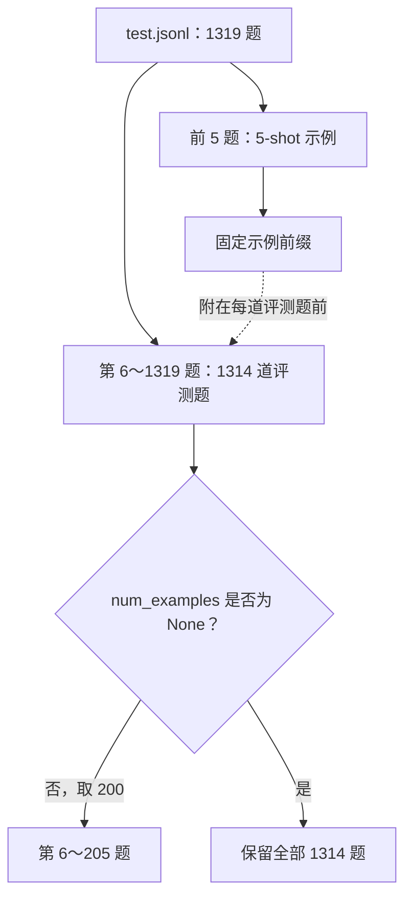

# GSM8K 精度排查：从 200 题失败到全量与逐题对照

DeepSeek-V2-Lite-W8A8 的一轮 GSM8K CI 得分为 0.33，低于 0.34 阈值。本地复现 B071 时，200 题答对 61 道，得分 0.305；切换通信模式和 Dispatch 输出精度后，结果在 0.305～0.320 之间，仍未过线。

扩大评测后，两轮分别答对 472/1314 和 474/1314，均高于原阈值；从这两轮筛出原来那 200 题，得分却分别是 0.310 和 0.340。问题因此需要分开处理：评测覆盖是否足够，以及同一配置的逐题输出为什么仍有变化。

下面按复现、配置对照、评测器核查和逐题分析记录这次排查。当前结果支持扩大验收覆盖，并继续调查输出稳定性；尚未定位到引入问题的 PR。

本文的数据来自本次复现、配置对照和两轮全量实验记录；评测实现固定到 `Ascend/sglang @ e3b41a477eac11cbd40cdaf839dfd6b9175991d5`。文末的用例修改建议另以 2026-10-10 核对的 `testcases` 分支快照为依据。这里的“全量”指该 5-shot 评测器排除示例题后剩下的 1314 题。

## 一、复现 200 题失败并固定基线

CI 的 0.33、本地的 0.305，都能说明当轮没有满足断言，却还不能说明失败发生在哪一层。请求可能没有正常完成，生成可能被截断，答案提取可能与预期不同，模型也可能确实算错了。总分把这些情况压在了一起。

基线使用 B071 镜像中的 DeepSeek-V2-Lite-W8A8，服务和客户端的关键设置如下。这些条件也用于后续 TP8/DP8 主线实验；改变配置的对照组会单独注明。

| 项目 | 设置 |
| --- | --- |
| 模型与后端 | DeepSeek-V2-Lite-W8A8，Ascend NPU |
| 并行 | TP8、DP8，开启 DP Attention |
| MoE 通信 | DeepEP，`deepep-mode=auto` |
| 执行设置 | `--disable-cuda-graph`，`chunked-prefill-size=1024`，`mem-fraction-static=0.7` |
| 评测接口 | Completion API |
| 提示词 | 5-shot |
| 客户端 | 128 个工作线程 |
| 生成 | `temperature=0`，`max_tokens=512` |
| 初始题数与阈值 | 200 题，准确率至少 0.34 |

这里的 128 是客户端线程数，不等于每一刻服务端都在运行 128 条请求。请求到达顺序、排队和组批还由实际运行决定。比较两次实验时，需要保留这些设置，也需要保存服务日志，不能只留下最后一行分数。

200 题的 0.305 对应 61 道正确答案，0.34 对应 68 道。差距是 7 道题；每道题就能让准确率移动 0.005，也就是半个百分点。仅从这一次结果看，确实有失败，但还不知道这 7 道的差距代表了什么。

如果此时直接开始二分历史提交，每个版本都只跑一遍，很可能把运行间的变化当成版本间的差异。寻找引入提交仍然有价值，只是需要先确认复现和比较方法足够可靠。

## 二、通信配置对照与逐题翻转

第一批实验围绕 DeepEP 模式和 dispatcher 输出类型展开。原配置之外，分别尝试 BF16 dispatcher、显式 normal 和显式 low_latency，其余评测条件保持一致。

| 配置 | 200 题准确率 | 正确题数 |
| --- | ---: | ---: |
| 原始 auto | 0.305 | 61 |
| auto，加 `--dispatcher-output-dtype bf16` | 0.320 | 64 |
| normal | 0.315 | 63 |
| low_latency | 0.320 | 64 |

BF16 和 low_latency 都比原配置多答对了 3 道，但仍未达到 0.34。结果可以支持“这些配置下的输出发生了变化”，还不足以支持“auto 路径存在已确认的精度缺陷”。要判断后一件事，需要看变化集中在哪里，以及同一配置重复运行时是否也会变化。

把 Original 与 BF16 的答案按同一题目对齐后，情况比总分呈现的复杂：

| 逐题结果 | 题数 |
| --- | ---: |
| 两组都正确 | 47 |
| 两组都错误 | 122 |
| Original 错、BF16 对 | 17 |
| Original 对、BF16 错 | 14 |

BF16 的净收益是 3 道题，背后却有 31 道题发生了正确与错误的翻转。如果只看 61→64，会忽略原来答对、修改后答错的那 14 道。这个对照还需要同配置重复实验作为参照，才能判断变化是否与所改参数有稳定关系。

原始回答也暴露了另一类现象。有的题目一直重复短语直到输出长度耗尽，有的不断生成数字，有的回答正常结束但算术或单位换算错误。Original 中有 15 条回答缺少 `####`，BF16 中有 10 条。它们值得检查，却不能直接当作答案提取失败数：这套评分器并不强制要求回答包含 `####`。

配置对照之后，下一步核查评分规则，并用相同配置重复实验，区分参数变化与运行间输出变化。

## 三、核对题集、提示词和评分规则

GSM8K 在这套用例中的主要路径是 `GSM8KAscendMixin.test_gsm8k` 调用 `run_eval`，构造 `GSM8KEval`，再通过 `CompletionSampler` 请求服务。每层都影响最终分数：Mixin 决定参数，Eval 决定题目与提示词，Sampler 决定请求及异常处理。

[B071 对应的 Mixin](https://github.com/Ascend/sglang/blob/e3b41a477eac11cbd40cdaf839dfd6b9175991d5/python/sglang/test/ascend/gsm8k_ascend_mixin.py) 默认设置 `num_questions = 200`，并把它作为 `num_examples` 传给评测入口。进入 GSM8K 评测路径后，[`run_eval`](https://github.com/Ascend/sglang/blob/e3b41a477eac11cbd40cdaf839dfd6b9175991d5/python/sglang/test/run_eval.py) 使用的是 5-shot Completion 评测器。

题数的关键处理位于 [`GSM8KEval.__init__`](https://github.com/Ascend/sglang/blob/e3b41a477eac11cbd40cdaf839dfd6b9175991d5/python/sglang/test/simple_eval_mixed_prefix_gsm8k.py)。它先把前 `num_shots` 道题用于提示词，再取后面的题目作为评测集合。以下节选省略了周围初始化代码和注释：

```python
all_lines = list(read_jsonl(filename))
pool_size = self._setup_prefix_pool(all_lines, num_shots)
self._lines = all_lines[pool_size:]
if num_examples is not None:
    self._lines = self._lines[:num_examples]
```

因此，这里的 200 题是排除示例题后取前 200 道，没有随机抽样。数据文件一共 1319 行，5-shot 消耗前 5 行，剩余 1314 行才参与评分。把这个口径画出来，后面的结果就容易对齐了：



这只是本文所用评测器的划分方式。换成从训练集提供示例的另一套 GSM8K 评测，题数和提示词口径可能不同，不能只凭名称相同就比较分数。

答案提取也有一个容易误读的细节。同一文件里的 `get_answer_value` 会去掉逗号，用正则查找数字，再取最后一个数字作为答案。`####` 并不是必需标记。一个被截断的回答，只要已经生成了数字，也可能得到可解析的答案；但这个数字未必是模型原本打算给出的最终答案。

所以，“没有无效答案”“没有截断”“回答正确”是三个不同的统计。HTTP 请求成功也只说明服务返回了响应，不能替代其中任何一个判断。

异常处理同样要看源码。[`CompletionSampler`](https://github.com/Ascend/sglang/blob/e3b41a477eac11cbd40cdaf839dfd6b9175991d5/python/sglang/test/simple_eval_common.py) 对一般请求异常有重试逻辑；Bad Request 或重试耗尽时可能返回空字符串，`GSM8KEval` 也会在 sampler 抛出异常时把回答置空。只看评测是否执行到最后，可能漏掉请求失败带来的零分题。

后续实验以原评测器的提示词、请求参数和判分规则为基准，核对冻结客户端与原评测器的提示词和评分口径一致，再将每轮 HTML、JSON、客户端日志和服务日志分别归档。`run_eval` 的默认报告文件名由评测名和模型名生成，多轮顺序执行会写入同一路径，必须在下一轮开始前保存。这样才能避免诊断脚本悄悄换了提示词格式、停止词或提取规则。

## 四、同一轮中的子集与全量结果

全量实验回到原始 TP8/DP8、DeepEP auto 服务，保留 5-shot、128 线程、`temperature=0` 和 `max_tokens=512`。每轮开始前确认 `flush_cache` 成功。两轮提示词逐题比对一致，报告记录的空回答、无效答案和请求失败均为 0。

这里需要分清两种比较。前面的配置对照是各自运行的 200 题实验；下面的 200 题成绩，是从每轮全量输出中按题目筛出的原 CI 子集。它们使用相同题目，但执行时的请求队列和组批过程未必相同，不能把跨阶段的分数变化全部归因于题数。

| 同一轮输出中的题目范围 | 题数 | 第一轮 | 第二轮 |
| --- | ---: | ---: | ---: |
| 原 CI 的固定子集 | 200 | 62/200 = 0.3100 | 68/200 = 0.3400 |
| 扩展后新增的题目 | 1114 | 410/1114 = 0.3680 | 406/1114 = 0.3645 |
| 全部可评测题目 | 1314 | 472/1314 = 0.3592 | 474/1314 = 0.3607 |

全量两轮都高于 0.34。原来的 200 题则一轮低于阈值，一轮恰好达到阈值；新增的 1114 题在两轮中都取得了更高的准确率。由同一轮输出划分子集，可以清楚看到固定前 200 题与其余题目的成绩差异。

这支持扩大正式验收范围。至于具体的回退归因，仅凭固定前 200 题的单轮失败仍不够。两轮结果也没有证明题目难度是全部原因：扩展评测会改变实际请求序列，而且输出本身还存在轮间变化。

仅做一个量级估算，假设每道题都是独立同分布的伯努利观测，且正确概率约为 0.36，准确率的标准误差为 `sqrt(p(1-p)/n)`。200 题约为 3.4 个百分点，1314 题约为 1.3 个百分点。这个估算解释了更多样本为什么有助于观察总体成绩。

实际用例采用固定切片，请求还可能受调度与执行过程影响，并不满足上述假设。这个数字不能拿来宣布 CI 失败“属于正常波动”。处理意见的依据仍然是两轮实测，以及同轮子集与全量结果的对照。

## 五、两轮全量结果仍有哪些变化

如果到全量过线就结束，排查会遗漏一个仍未解决的现象：两轮正确题数只差 2 道，但有 168 道题的正确与错误发生翻转，占评测集合约 12.8%。

根据两轮正确题数和翻转总数，可以算出第一轮错、第二轮对的有 85 道，第一轮对、第二轮错的有 83 道。它们在总分中几乎抵消了。总体准确率接近，并不意味着每道题的输出稳定。

`temperature=0` 约束的是采样行为，无法保证不同运行中的数值执行过程完全相同。并发请求可能组成不同批次，计算路径与浮点运算的细节也可能影响后续选词。在自回归生成中，一旦某个 token 不同，后续上下文也随之改变。本次还没有捕获到首个分歧位置，因此无法把 168 道翻转直接归因于 DeepEP 或某个算子。

两轮还分别有 51 和 50 条回答以长度上限结束。它们可以正常返回，也可以提取到数字，因此与“空回答和无效答案均为 0”并不矛盾。继续分析时，需要把截断回答单独拿出来，看重复生成是否集中在这些题目中、截断是否影响最终答案。

这也给下一步实验划出了较小的范围。优先选取两轮评分翻转的题目，冻结完整 prompt 和生成参数，用同配置重复请求与低并发对照确认变化是否仍然存在。若变化持续出现，再比较首个分歧 token；需要深入数值路径时，进一步观察该位置的候选 logits。固定 DP rank 的实验则可以检查变化是否与特定执行实例相关。

这些是继续定位的方法，不是本次已经完成的修复证据。全量实验回答了当前评测门禁是否能过线，逐题翻转则保留了输出稳定性这个后续问题。

## 六、验收覆盖与后续定位怎样推进

本次建议是在正式精度验收中评测全部可用题目。下面保留 0.34 作为与原门禁对照的起点；正式切换题集时，还应使用稳定的全量基线重新核对阈值。具体改动放在 auto 用例的测试类里，覆盖它从 Mixin 继承的题数设置，不去修改所有 Ascend 用例的公共默认值。

核对的文件是 [`test_npu_deepep_auto_deepseek_v2.py`](https://github.com/Ascend/sglang/blob/4d45c4878a981407c10bed2dfa928f47bd27e837/test/registered/npu/basic_function/parallel_strategy/expert_parallelism/test_npu_deepep_auto_deepseek_v2.py)，属于 `testcases` 分支快照 `4d45c4878a981407c10bed2dfa928f47bd27e837`。下面给出建议改法，省略了类中其余配置。新增的是 `num_questions = None`，合入状态仍需以测试仓库为准：

```python
class TestDeepEpDeepseek(GSM8KAscendMixin, CustomTestCase):
    model = DEEPSEEK_V2_LITE_W8A8_WEIGHTS_PATH
    accuracy = 0.34
    num_questions = None
```

这项建议的传递关系可以从源码核对：Mixin 将 `self.num_questions` 传为 `num_examples`，`GSM8KEval` 在它为 `None` 时不再做 200 题切片。对本文的 1319 行文件和 5-shot 配置，实际评分题数应为 1314。测试分支中还有提前返回的 PR smoke 路径；题数设置只影响真正进入 GSM8K 精度评测的路径，验收时要确认执行的是哪一种。

修改后应检查实际评分题数、5-shot 提示词、生成参数和阈值，而不是只检查断言是否通过。全量评测的运行时间也会变化，需要重新实测用例耗时。文件中的 MMLU 是独立测试方法，使用自己的 `num_examples=128`；这一行不改变它的评测范围，GSM8K 过线也不能代替 MMLU 的结果。

200 题仍可以保留为较快的检查，但用它作正式精度门禁，需要另行标定题集和阈值。它与全量评测可以承担不同职责，不能未经验证就共用同一个分数解释。

回到最初的问题，目前有证据支持的处理意见是：B071 原配置在两轮全量评测中均高于 0.34，固定前 200 题的成绩偏低且在阈值附近变化，因此建议扩大该用例的验收范围。已有实验没有定位到一个可以认定为根因的引入 PR；168 道逐题评分翻转和约 50 条长度截断，仍需要保留在后续分析中。

下一轮应从这 168 道翻转题继续，保留首个分歧 token 和对应运行条件。用例覆盖可以通过全量评测改善，输出变化则要沿实际执行路径寻找解释。两项工作分别验收，才能让“精度通过”这四个字有明确的含义。
