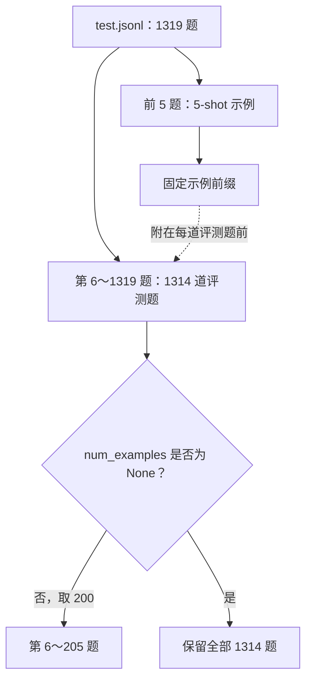

# GSM8K 精度排查：从 200 题失败到全量与逐题对照

DeepSeek-V2-Lite-W8A8 的 GSM8K CI 为 0.33，低于 0.34 阈值。本地 B071 复现 200 题正确 61 道、0.305，调整通信和 Dispatch 精度后为 0.305～0.320，仍未通过。

将题集扩大到 1314 题后，两轮分别答对 472、474 题，都超过阈值。但从这两份输出中筛回原来的 200 题，准确率又分别只有 0.310、0.340。总分达标之后，还有两个问题需要分开看：门禁覆盖了哪些题，同一题的答案为何在重复运行中变化。

这次尚未定位到引入问题的 PR。全量过线反映了同一配置在更大题集上的表现，还没有解释逐题变化。下面按复现、配置对照和评分实现展开这次排查。

数值来自本次原复现、配置对照及两轮全量。评测器固定 `Ascend/sglang @ e3b41a477eac11cbd40cdaf839dfd6b9175991d5`，用例建议另据 2026-10-10 核对的 testcases 快照。全量指本 5-shot 实现扣除示例后可评分的 1314 题。

## 一、复现 200 题失败并固定基线

CI 与本地都未过阈值。先逐题检查请求完成、长度、提取和计算错误，再判断总分差来自哪里。

基线为 B071 内的 DeepSeek-V2-Lite-W8A8，以下条件沿用到 TP8/DP8 主线，变更组另行注明：

| 项目 | 设置 |
| --- | --- |
| 模型与后端 | DeepSeek-V2-Lite-W8A8，Ascend NPU |
| 并行 | TP8、DP8，开启 DP Attention |
| MoE 通信 | DeepEP，`deepep-mode=auto` |
| 执行设置 | `--disable-cuda-graph`，`chunked-prefill-size=1024`，`mem-fraction-static=0.7` |
| 评测接口 | Completion API |
| 提示词 | 5-shot |
| 客户端 | 128 个工作线程 |
| 生成 | `temperature=0`，`max_tokens=512` |
| 初始题数与阈值 | 200 题，准确率至少 0.34 |

128 是客户端工作线程数，不代表服务端每个 batch 都有 128 条请求。请求到达、排队和组批仍会变化，因此比较配置时，还要一起保存逐题输出与服务日志。

0.305 对应 61 道，0.34 对应 68 道，差 7 题；200 题中每题就是 0.005、半个百分点。这轮确实失败，但尚不清楚差额是否稳定。

如果每个版本只跑一次就开始二分，轮间变化可能被误判成版本差异。进入提交定位前，需要先重复同一配置，确认比较方法能够辨认稳定的退化。

## 二、通信配置对照与逐题翻转

第一批分别尝试 BF16 dispatcher、显式 normal、low_latency，除这些设置外保持评测一致：

| 配置 | 200 题准确率 | 正确题数 |
| --- | ---: | ---: |
| 原始 auto | 0.305 | 61 |
| auto，加 `--dispatcher-output-dtype bf16` | 0.320 | 64 |
| normal | 0.315 | 63 |
| low_latency | 0.320 | 64 |

BF16 与 low_latency 各比原配置多 3 道，仍低于 0.34。需要展开净增来自哪些题，再重复同配置判断是否稳定。

将 Original 和 BF16 按同一题对齐：

| 逐题结果 | 题数 |
| --- | ---: |
| 两组都正确 | 47 |
| 两组都错误 | 122 |
| Original 错、BF16 对 | 17 |
| Original 对、BF16 错 | 14 |

`47 + 14 = 61`、`47 + 17 = 64` 可以还原两组总分。净增 3 道的背后，有 31 道题朝相反方向翻转：17 道改善，14 道退化。只有再与原配置自身的重复变化对照，才能判断 BF16 是否带来稳定改善。

原始回答中还出现了重复短语、连续输出数字，以及正常结束但算术或单位错误的情况。Original 有 15 条、BF16 有 10 条回答缺少 `####`，不过评分器并不强制这个标记；是否因此失分，还要检查实际提取出的答案。

因此下一步先查评分规则，再回到原配置重复运行，将参数作用与轮间变化分开。

## 三、核对题集、提示词和评分规则

用例从 `GSM8KAscendMixin.test_gsm8k` 调 `run_eval`，再由 `GSM8KEval` 经 `CompletionSampler` 请求。Mixin 决定参数，Eval 选择题目并组织提示词，Sampler 处理请求传输与异常。这三层都会影响最终成绩。

[B071 Mixin](https://github.com/Ascend/sglang/blob/e3b41a477eac11cbd40cdaf839dfd6b9175991d5/python/sglang/test/ascend/gsm8k_ascend_mixin.py)默认 `num_questions = 200`，传为 `num_examples`；[`run_eval`](https://github.com/Ascend/sglang/blob/e3b41a477eac11cbd40cdaf839dfd6b9175991d5/python/sglang/test/run_eval.py)在此选择 5-shot Completion 评测。

[`GSM8KEval.__init__`](https://github.com/Ascend/sglang/blob/e3b41a477eac11cbd40cdaf839dfd6b9175991d5/python/sglang/test/simple_eval_mixed_prefix_gsm8k.py)先取前 `num_shots` 题作为提示示例，再使用后续题目，节选如下：

```python
all_lines = list(read_jsonl(filename))
pool_size = self._setup_prefix_pool(all_lines, num_shots)
self._lines = all_lines[pool_size:]
if num_examples is not None:
    self._lines = self._lines[:num_examples]
```

这里没有随机抽样：文件共 1319 行，前 5 题用于 5-shot，剩余 1314 题可评分；初始 200 题就是这部分题目的前 200 道。



其他实现可能从训练集取示例，比较 GSM8K 分数前应先对齐来源、题数和提示，不能只看名称。

`get_answer_value`会去逗号、查数字并尝试解析最后一项，无匹配或失败才无效，不要求 `####`。例如“总共有 12 个，每个 3 元”会提取最后的 `3`，不会补乘法。截断回答也可能留下可解析的中间数，因此有效提取不等于完成作答。

逐题记录状态、截断、提取与正确性，才能分开传输失败、中间数字被判分和完整作答算错，它们需要不同处理。

[`CompletionSampler`](https://github.com/Ascend/sglang/blob/e3b41a477eac11cbd40cdaf839dfd6b9175991d5/python/sglang/test/simple_eval_common.py)会重试一般异常，Bad Request 或耗尽时可能返回空串，Eval 遇 sampler 异常也置空。因此评测执行结束未必代表全部请求成功。

后续评测沿用并核对原提示词、生成参数和评分规则，冻结客户端实现，每轮分别归档 HTML、JSON 以及客户端和服务端日志。`run_eval`默认报告名依评测名和模型生成，多轮会覆盖，应在下一次之前保存，也防止诊断脚本变更格式、停止词或提取。

## 四、同一轮中的子集与全量结果

两轮全量评测都恢复原来的 TP8/DP8、DeepEP auto，沿用 5-shot、128 线程、`temperature=0`、`max_tokens=512`，并在每轮前确认执行 `flush_cache`。两轮 prompt 逐题一致，空回答、无效答案和请求失败均为 0。

下面 200 题是从各轮全量输出筛回原 CI 子集，不是重发 200 题。它与前述独立短测题目相同，整轮请求序列与组批却可能不同，因此先看同一份输出内的范围对照。

| 同一轮输出中的题目范围 | 题数 | 第一轮 | 第二轮 |
| --- | ---: | ---: | ---: |
| 原 CI 的固定子集 | 200 | 62/200 = 0.3100 | 68/200 = 0.3400 |
| 扩展后新增的题目 | 1114 | 410/1114 = 0.3680 | 406/1114 = 0.3645 |
| 全部可评测题目 | 1314 | 472/1314 = 0.3592 | 474/1314 = 0.3607 |

两轮全量准确率都高于 0.34，原 200 题子集则一轮未过、一轮刚好达标；新增 1114 题的准确率两轮都更高。第一轮的 `62 + 410 = 472` 只是在同一份答案中改变汇总范围，并没有让模型重新作答。这说明前 200 题在当前两轮中表现较低，还不能证明它们在所有配置中都更难，更不能把扩大统计范围解读为服务精度提高。

这些结果支持扩大验收覆盖。这次未过线的原因，仍要沿固定子集、请求过程和逐题差异继续调查。

只作量级估算，若将各题视为独立同分布伯努利、正确概率约 0.36，标准误 `sqrt(p(1-p)/n)` 在 200 题约 3.4 个百分点、1314 题约 1.3 个百分点，可说明样本量的作用。

但实际为固定切片，不满足这个随机抽样前提。处理意见主要基于两轮同输出的范围对照，稳定性仍需重复检查。

## 五、两轮全量结果仍有哪些变化

两轮总正确数仅差 2 题，却有 168 题判分翻转，约占 12.8%。全量过线之后，这个现象仍需单独定位。

其中错→对 85 题、对→错 83 题，合计 168 题，净增只有 2 题，正反变化几乎在总分中抵消。这个计数只覆盖正确性翻转；两轮都对或都错的文本也可能不同，所以全部输出差异可能更多。

`temperature=0` 限定采样方式，不能保证重复运行具有完全相同的数值过程。并发 batch、路径与浮点差别可能影响选词，首个 token 不同又会改变后续上下文。本次尚未抓首处分歧，无法直接归因 DeepEP 或某算子。

两轮分别有 51、50 条回答达到长度上限。这些请求仍可能正常返回，评分器也可能提取到数字，所以与“空回答、无效答案均为 0”并不矛盾。后续还要单独检查这些截断回答是否集中在重复输出，以及截断是否影响最终答案。

下一轮先选翻转题，冻结完整 prompt 与生成参数，做同配置重复和低并发。若仍有差异，再追首 token 及必要时的候选 logits；固定 DP rank 还可检查实例关联。

已有两轮只证明原配置在该集合中均过线，不足以证明长期稳定。逐题翻转继续作为独立问题，不能因总分达标而关闭。

## 六、验收覆盖与后续定位怎样推进

建议正式用例覆盖全部可评分题，先保留 0.34 作为原门禁对照，再根据稳定的全量基线重新标定。实现时只在 auto 测试类中覆盖继承的题数，避免连带改变所有 Ascend 用例的公共默认值。

文件为 testcases 快照 `4d45c4878a981407c10bed2dfa928f47bd27e837` 的 [`test_npu_deepep_auto_deepseek_v2.py`](https://github.com/Ascend/sglang/blob/4d45c4878a981407c10bed2dfa928f47bd27e837/test/registered/npu/basic_function/parallel_strategy/expert_parallelism/test_npu_deepep_auto_deepseek_v2.py)。以下建议只增加 `num_questions = None`，省略其余配置，合入状态仍需查测试仓库：

```python
class TestDeepEpDeepseek(GSM8KAscendMixin, CustomTestCase):
    model = DEEPSEEK_V2_LITE_W8A8_WEIGHTS_PATH
    accuracy = 0.34
    num_questions = None
```

Mixin 将 `self.num_questions` 传给 `num_examples`，值为 `None` 时，Eval 不再切出前 200 题；对这份 1319 行数据和 5-shot 设置，应实际评分 1314 题。该分支还有会提前返回的 PR smoke 路径，验收时需要确认真正进入了 GSM8K 评测。

修改后核实际题数、提示、生成与阈值，并测完整耗时。MMLU 是独立方法，使用 `num_examples=128`，这项题数覆盖不改变其范围。

200 题仍可用作快检，但覆盖和门槛应另行标定，不能因都叫准确率就直接共享阈值。

当前证据支持扩大覆盖：B071 全量两轮都超过 0.34，固定前 200 较低且在阈值附近波动。根因 PR 尚未定位，168 题翻转和约 50 条截断仍保留为后续问题。

下一轮从翻转题的首个分歧 token 及运行条件继续。扩大题集改善验收，逐题对照解释变化，两项工作各有未完成部分。
