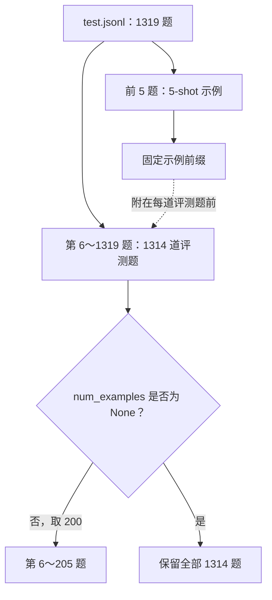

# GSM8K 精度排查：从 200 题失败到全量与逐题对照

1314 道题，两轮分别答对 472、474 道，总分只差两题。逐题对齐，却有 168 道从对变错、或从错变对。全量都过了门禁，生成过程仍有变化需要解释。

这次排查起于 DeepSeek-V2-Lite-W8A8 的 GSM8K CI：0.33，低于 0.34 阈值。B071 本地 200 题复现为 61 道、0.305，通信与 Dispatch 精度对照也只到 0.305～0.320。随后才扩大题集，并将同轮输出筛回原来的 200 题。

根因 PR 尚未定位。以下先回到短测复现，再看配置对照、评分实现和两轮全量结果。扩大覆盖与解释逐题变化，是这批证据指向的两项后续工作。

数据来自原复现、配置对照、两轮全量。评测器固定 `Ascend/sglang @ e3b41a477eac11cbd40cdaf839dfd6b9175991d5`；用例建议采用 2026-10-10 核对的 testcases 快照。“全量”指本 5-shot 实现扣除示例后可评分的 1314 题。

## 一、复现 200 题失败并固定基线

CI、本地都未过阈值，接下来需要从请求是否完成、是否截断、提取和计算错误，核回逐题失分。

基线为 B071 中的 DeepSeek-V2-Lite-W8A8。TP8/DP8 主线沿用这些条件，其他组单独标出改动：

| 项目 | 设置 |
| --- | --- |
| 模型与后端 | DeepSeek-V2-Lite-W8A8，Ascend NPU |
| 并行 | TP8、DP8，开启 DP Attention |
| MoE 通信 | DeepEP，`deepep-mode=auto` |
| 执行设置 | `--disable-cuda-graph`，`chunked-prefill-size=1024`，`mem-fraction-static=0.7` |
| 评测接口 | Completion API |
| 提示词 | 5-shot |
| 客户端 | 128 个工作线程 |
| 生成 | `temperature=0`，`max_tokens=512` |
| 初始题数与阈值 | 200 题，准确率至少 0.34 |

128 数客户端线程，不表示服务端每 batch 恒为 128 条。到达、排队、组批都可能变化，逐题输出与服务日志因而一起保留。

0.305 是 61 道，0.34 是 68 道，差 7 道。200 题每道占 0.005，即半个百分点。这次失败已确定，差额是否能稳定复现还未知。

单次成绩就开始二分，容易把轮间变化当成版本差异。提交定位之前，先要确认同配置重复的波动有多大。

## 二、通信配置对照与逐题翻转

第一批分别切 BF16 dispatcher、显式 normal、low_latency，其余评测条件保持一致：

| 配置 | 200 题准确率 | 正确题数 |
| --- | ---: | ---: |
| 原始 auto | 0.305 | 61 |
| auto，加 `--dispatcher-output-dtype bf16` | 0.320 | 64 |
| normal | 0.315 | 63 |
| low_latency | 0.320 | 64 |

BF16、low_latency 各多答对 3 道，仍不到 0.34。

将 Original、BF16 的题目对齐：

| 逐题结果 | 题数 |
| --- | ---: |
| 两组都正确 | 47 |
| 两组都错误 | 122 |
| Original 错、BF16 对 | 17 |
| Original 对、BF16 错 | 14 |

共同答对 47 道，Original 另对 14 道、BF16 另对 17 道，还原为 `47 + 14 = 61`、`47 + 17 = 64`。净增 3 道，实际有 31 道反向翻转：17 改善、14 退化。它是否超出原配置自身的波动，需要重复对照。

原回答还包含短语重复、连续数字，以及正常结束但算术、单位错误。Original 有 15 条缺少 `####`，BF16 有 10 条；评分器并不强制该标记，实际是否失分还要看它提取了什么。

因此先沿评分代码核对这些答案，再与同配置重复结果比较。

## 三、核对题集、提示词和评分规则

用例从 `GSM8KAscendMixin.test_gsm8k` 调 `run_eval`，再由 `GSM8KEval` 通过 `CompletionSampler` 发请求。Mixin 配参数，Eval 选题、拼提示，Sampler 处理传输、异常。

[B071 Mixin](https://github.com/Ascend/sglang/blob/e3b41a477eac11cbd40cdaf839dfd6b9175991d5/python/sglang/test/ascend/gsm8k_ascend_mixin.py) 默认 `num_questions = 200`，传作 `num_examples`；[`run_eval`](https://github.com/Ascend/sglang/blob/e3b41a477eac11cbd40cdaf839dfd6b9175991d5/python/sglang/test/run_eval.py) 选择 5-shot Completion 评测。

[`GSM8KEval.__init__`](https://github.com/Ascend/sglang/blob/e3b41a477eac11cbd40cdaf839dfd6b9175991d5/python/sglang/test/simple_eval_mixed_prefix_gsm8k.py) 先用前 `num_shots` 道作示例，再从后续取题：

```python
all_lines = list(read_jsonl(filename))
pool_size = self._setup_prefix_pool(all_lines, num_shots)
self._lines = all_lines[pool_size:]
if num_examples is not None:
    self._lines = self._lines[:num_examples]
```

文件共 1319 行，前 5 题作 5-shot，余下 1314 题可评分。原 200 题就是余下部分的前 200 道，没有随机抽样。



其他 GSM8K 实现可能从训练集取示例，比较分数时还需要对齐数据来源、题数、提示。

`get_answer_value` 去掉逗号，查数字，尝试解析最后一项；没有匹配或解析失败才无效，不要求 `####`。“总共有 12 个，每个 3 元”会被提取为 `3`，评分器不会代做乘法。截断也可能留下可解析的中间数。

请求状态、截断、提取值、判分放在一起，才能区分传输失败、中间数被评分、完整作答算错。

[`CompletionSampler`](https://github.com/Ascend/sglang/blob/e3b41a477eac11cbd40cdaf839dfd6b9175991d5/python/sglang/test/simple_eval_common.py) 重试一般异常，Bad Request、重试耗尽时可能返回空串，Eval 遇 sampler 异常也会置空。程序跑到报告阶段，仍需另核请求成功数。

后续冻结客户端实现，沿用原提示、生成参数、评分规则。每轮另存 HTML、JSON、两端日志：`run_eval` 默认报告名依评测名和模型生成，下一轮会覆盖。诊断脚本也不能悄悄改变格式、停止词、提取规则。

## 四、同一轮中的子集与全量结果

两轮全量恢复原 TP8/DP8、DeepEP auto，沿用 5-shot、128 线程、`temperature=0`、`max_tokens=512`，每轮前确认执行 `flush_cache`。逐题 prompt 相同，空回答、无效答案、请求失败均为 0。

表中的 200 题由全量输出筛回，没有重新发送。题目与独立短测相同，整轮请求序列、组批可能不同，所以先比较同一份输出的两个范围。

| 同一轮输出中的题目范围 | 题数 | 第一轮 | 第二轮 |
| --- | ---: | ---: | ---: |
| 原 CI 的固定子集 | 200 | 62/200 = 0.3100 | 68/200 = 0.3400 |
| 扩展后新增的题目 | 1114 | 410/1114 = 0.3680 | 406/1114 = 0.3645 |
| 全部可评测题目 | 1314 | 472/1314 = 0.3592 | 474/1314 = 0.3607 |

全量两轮均高于 0.34，原 200 题子集一轮未过、一轮刚好达标，新增 1114 题两轮都更高。第一轮 `62 + 410 = 472` 只是改变同一份答案的汇总范围。它说明这两轮前 200 题成绩较低，扩大统计没有让模型重新答对，也不能证明这个切片在所有配置都更难。

结果支持扩大验收覆盖。原短测为什么未过，仍需沿固定子集、请求过程、逐题差异调查。

若只作量级估算，把题视为独立同分布伯努利、正确概率约 0.36，标准误 `sqrt(p(1-p)/n)` 在 200 题约 3.4 个百分点，1314 题约 1.3 个百分点。

实际是固定切片，不具备这组随机抽样前提，因此处理意见主要依据两轮同输出的范围对照。

## 五、两轮全量结果仍有哪些变化

逐题对齐后，虽然总分只差 2 道，168 道判分翻转，约占 12.8%。

错→对 85 道，对→错 83 道，合计 168，净增 2。它们几乎在总分中抵消。这里还没计两轮都对、都错但文本不同的情况。

`temperature=0` 规定采样方式，无法单独保证整个数值过程相同。并发 batch、执行路径、浮点差异都可能影响选词，首个 Token 一变又会改变后文。本次还没抓到首处分歧，不能据此指向 DeepEP 或某个算子。

两轮有 51、50 条达到长度上限。请求可以正常返回，提取器也仍能读到数字，所以它们不与“空回答、无效答案为 0”矛盾。后续要核截断是否集中在重复输出，以及最后答案是否受影响。

定位可以先抽翻转题，冻结完整 prompt、生成参数，做同配置重复和低并发对照。若还有差异，再抓首个不同 Token，必要时看候选 logits；固定 DP rank 还可检查实例关联。

这两轮证明了原配置在该集合中均过线。逐题翻转仍单独保留，长期稳定性尚待更多证据。

## 六、验收覆盖与后续定位怎样推进

正式用例建议覆盖全部可评分题，先用 0.34 保留原门禁对照，再按稳定的全量基线重新标定。实现只在 auto 测试类覆盖题数，公共默认值继续由其他用例按需使用。

建议位置为 testcases 快照 `4d45c4878a981407c10bed2dfa928f47bd27e837` 中的 [`test_npu_deepep_auto_deepseek_v2.py`](https://github.com/Ascend/sglang/blob/4d45c4878a981407c10bed2dfa928f47bd27e837/test/registered/npu/basic_function/parallel_strategy/expert_parallelism/test_npu_deepep_auto_deepseek_v2.py)。只增加 `num_questions = None`，其余配置省略；合入情况需另查测试仓库。

```python
class TestDeepEpDeepseek(GSM8KAscendMixin, CustomTestCase):
    model = DEEPSEEK_V2_LITE_W8A8_WEIGHTS_PATH
    accuracy = 0.34
    num_questions = None
```

Mixin 将 `self.num_questions` 传给 `num_examples`。设 None，Eval 就不再截前 200 题，本数据、5-shot 设置实际应评分 1314 题。分支还有会提前返回的 PR smoke，验收需要确认确实走到 GSM8K。

修改后核实际题数、提示、生成参数、阈值和完整耗时。MMLU 是独立方法，仍用 `num_examples=128`。

200 题可以留下作快检，覆盖和门槛则需要单独标定。

扩大题集解决验收覆盖。剩下的逐题变化，继续从首个分歧 Token、运行条件查起。
