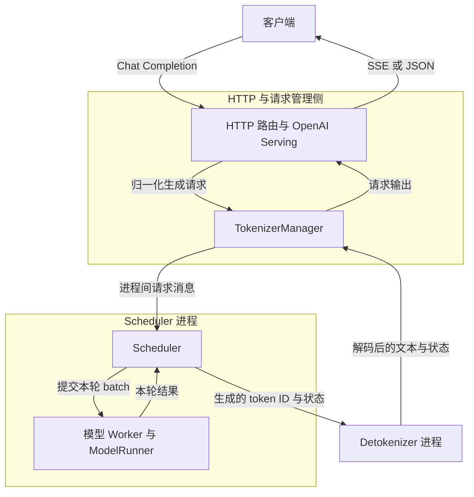
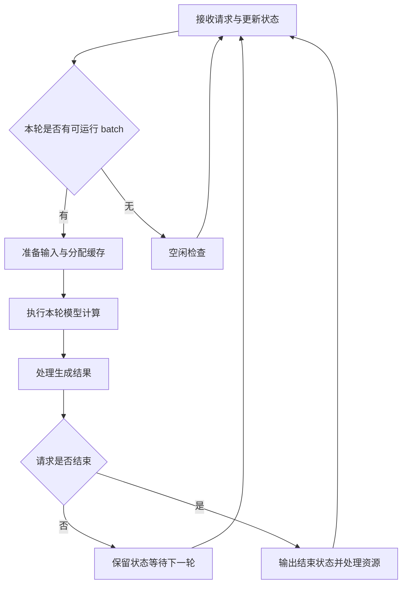
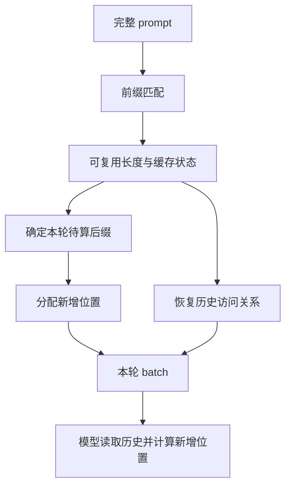
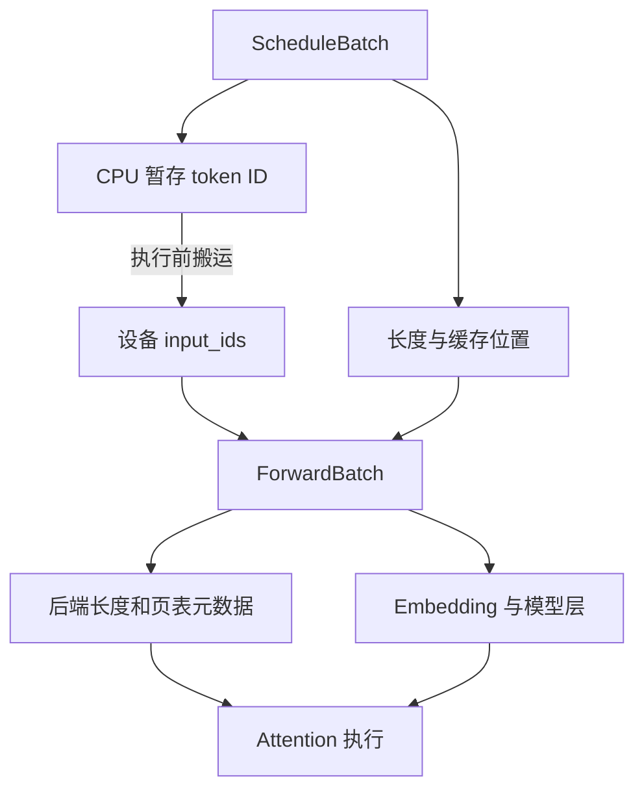
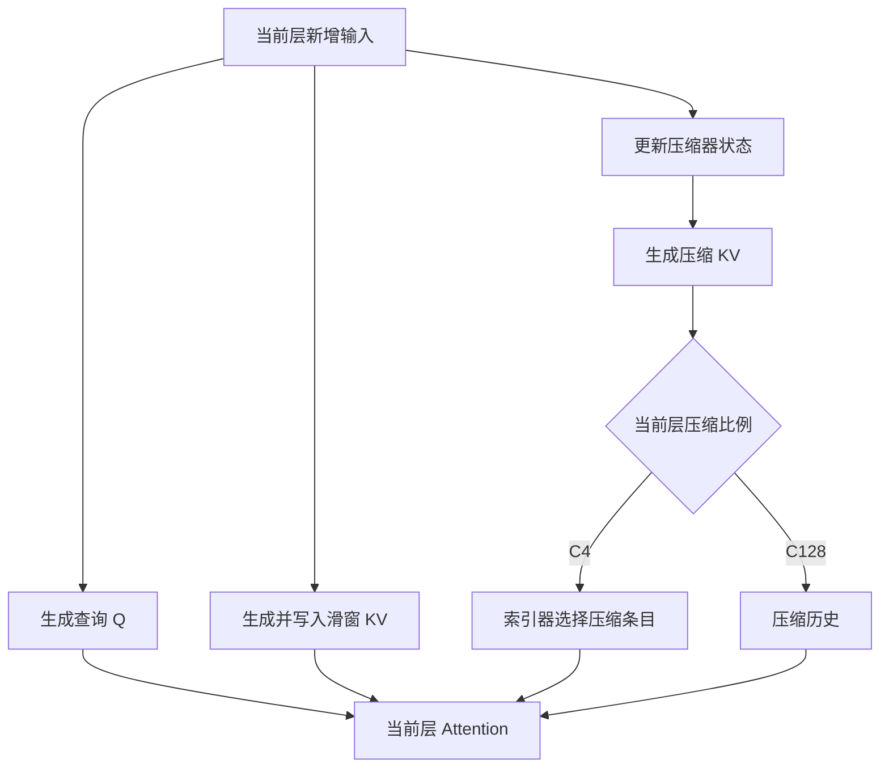
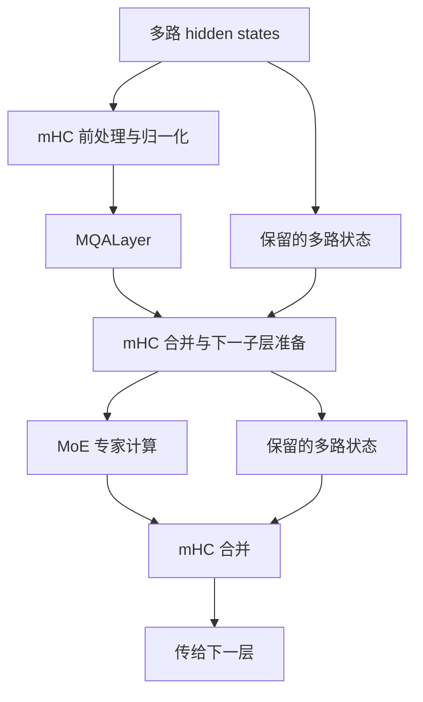
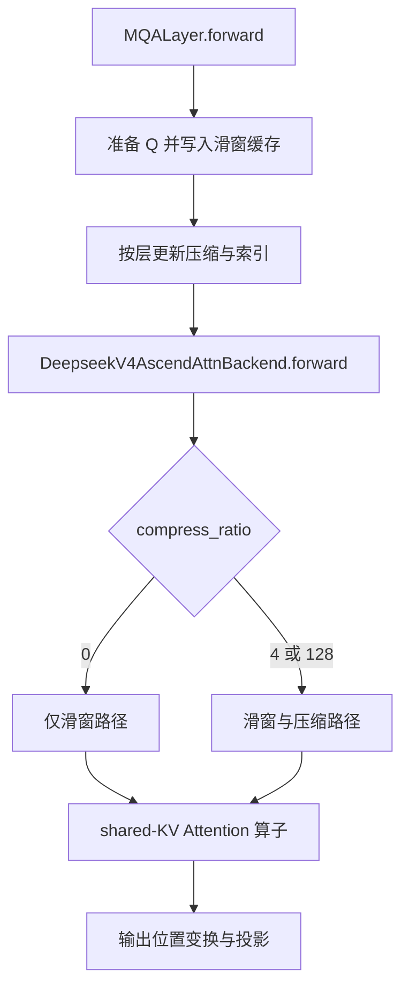
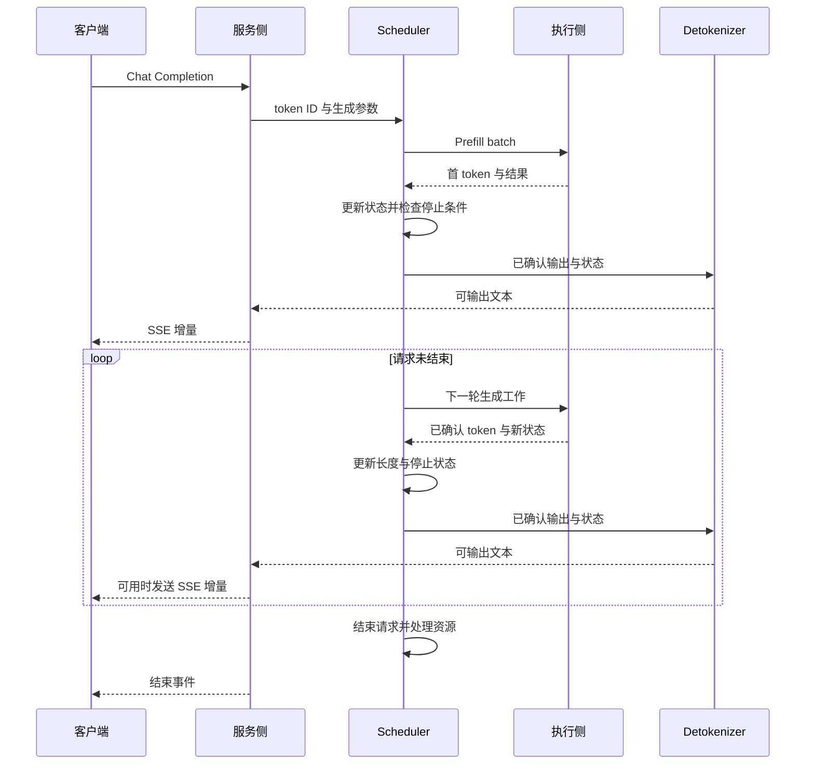
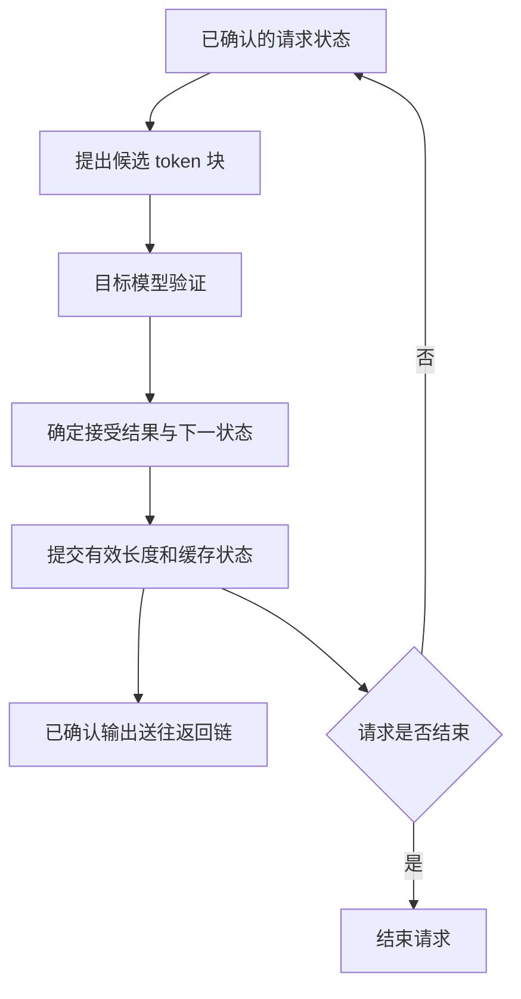

# SGLang 请求生命周期：从 Chat Completion 到 Ascend NPU

客户端问“中国的首都是哪里？”，回答随后逐渐返回。服务端先处理输入并采样首枚 Token，再把新 Token 逐轮送入模型，直到请求结束。要看清这段过程，需要同时跟踪生成进度和各层之间交接的数据。

下面沿一条普通生成请求走完全程：消息转成 Token ID，等待调度，进入模型，再将输出 ID 解码为文本。DeepSeek-V4 的缓存、算子细节放在可展开部分，第一次阅读可以先跟住请求的输入和输出。

生成通常分为 Prefill、Decode 两阶段，不熟悉时可先看 [两个阶段的性能差别](../fundamentals/prefill-vs-decode-performance.md)。这里从进程之间的交接讲起。

<details markdown="1">
<summary>源码版本与阅读范围</summary>

> 源码固定到 `sgl-project/sglang @ dd83b54611897a5f80f4df59e69756bd2fb4b8ab`，核对日期为 2026-09-20。模型使用公开 DeepSeek-V4 文本实现和 NPU `dsv4` 后端，主线为合设服务、普通自回归、直接执行，并展开非 A5 的 BF16 缓存路径，最后说明 DSPARK 的变化。Tensor 例子只观察一个参与 Rank，不逐项展开多机、量化和图回放。分析止于源码算子入口，Flash/Pro 的具体尺寸和部署镜像行为仍需对应配置与源码。

</details>

## 一、请求经过哪些进程

先区分请求和 batch：请求持续到生成结束，batch 只描述某一轮的工作。一条请求可以跨越很多 batch，其他请求随时加入或完成，HTTP 连接等待返回期间，调度器仍按轮次推进。

请求接入、模型生成、文本解码的工作节奏不同，SGLang 将它们拆开，以便接收新请求、推进生成和返回文本各自向前。

在一个服务实例中，HTTP 与请求管理侧接入、返回，Scheduler 组织模型执行，Detokenizer 将输出 Token ID 解码为文本，消息路径如下：



图里主要有两次消息交接：TokenizerManager 将请求送给 Scheduler，Scheduler 将结果送给 Detokenizer。Serving 衔接 HTTP 协议，Worker 和 ModelRunner 承担调度侧的执行工作。

多卡时执行侧有多个协作 Rank，图中只合并展示它们的职责，并不表示模型只占一个进程或一张卡。Scheduler 通过 Worker 提交设备工作，CPU 组织请求、NPU 执行算子；允许重叠的路径还会交错安排主机处理和设备计算。

输入链把消息变为可调度任务，输出链则把结果送回等待中的 HTTP 请求。可分别从这些实现查起：[HTTP 路由](https://github.com/sgl-project/sglang/blob/dd83b54611897a5f80f4df59e69756bd2fb4b8ab/python/sglang/srt/entrypoints/http_server.py) [TokenizerManager](https://github.com/sgl-project/sglang/blob/dd83b54611897a5f80f4df59e69756bd2fb4b8ab/python/sglang/srt/managers/tokenizer_manager.py) [DetokenizerManager](https://github.com/sgl-project/sglang/blob/dd83b54611897a5f80f4df59e69756bd2fb4b8ab/python/sglang/srt/managers/detokenizer_manager.py)

## 二、聊天消息怎样变成可调度请求

例如客户端提交下面的请求体，`model` 应填写服务实际暴露的名称，此处只示意协议结构。

```json
{
  "model": "your-served-model",
  "messages": [
    {"role": "user", "content": "中国的首都是哪里？"}
  ],
  "max_tokens": 32,
  "temperature": 0.7,
  "stream": true
}
```

客户端消息带有角色和轮次，模型接收的则是 Token 序列。Chat Template 等逻辑需要加入角色边界、分隔和 assistant 续写标记，因此真正送入模型的输入还包括用户不可见的模板内容。

固定实现中，`OpenAIServingChat._convert_to_internal_request()` 读取 `ChatCompletionRequest`，处理消息、构造采样参数，再生成 `GenerateReqInput`。prompt、流式开关、采样要求及部分路由或会话信息由此进入 Runtime 接口。[源码：请求转换](https://github.com/sgl-project/sglang/blob/dd83b54611897a5f80f4df59e69756bd2fb4b8ab/python/sglang/srt/entrypoints/openai/serving_chat.py#L1143-L1268)

内部输入可以是文本，也可以是模板等上游步骤已生成的 Token ID。TokenizerManager 按形式完成必要准备，再构造 `TokenizedGenerateReqInput` 送给调度侧；已有 ID 时走相应路径。[源码：TokenizerManager](https://github.com/sgl-project/sglang/blob/dd83b54611897a5f80f4df59e69756bd2fb4b8ab/python/sglang/srt/managers/tokenizer_manager.py)

后文将输入简化为 `[A, B, C, D, E, F]` 六个 Token。字母只是整数 ID 的代号，不表示这句中文恰好切成六块，也不表示一个字总对应一个 Token。

同一请求在各边界使用的对象如下：

| 对象 | 主要由谁使用 | 此时关心的问题 |
|---|---|---|
| `ChatCompletionRequest` | OpenAI Serving | 用户提交了什么对话和生成要求？ |
| `GenerateReqInput` | Serving、TokenizerManager | 怎样用内部生成接口表达这些要求？ |
| `TokenizedGenerateReqInput` | 输入消息处理链路 | token ID 和执行所需的请求参数是否准备好？ |
| `Req` | Scheduler | 这条请求进行了多少、生成了什么、是否结束？ |
| `ScheduleBatch` | 调度与批处理逻辑 | 这一轮把哪些请求、哪些 token 放在一起计算？ |
| `ForwardBatch` | 模型执行层 | 本轮计算所需的输入 Tensor、位置和执行信息是什么？ |

先记住 `Req` 保存持续进度，`ScheduleBatch`、`ForwardBatch` 则服务当前一轮。后续看到 batch 时，再核对它处理哪些位置、结果应写回哪条请求。

<details markdown="1">
<summary>沿固定版本源码继续追踪</summary>

读源码可以从入口逐站向下，带着当前产出的对象寻找下一步，不必先遍历仓库目录：

| 阅读顺序 | 固定版本中的入口 | 这一站只确认什么 | 接下来带着什么继续追 |
|---:|---|---|---|
| 1 | [`OpenAIServingChat._convert_to_internal_request()`](https://github.com/sgl-project/sglang/blob/dd83b54611897a5f80f4df59e69756bd2fb4b8ab/python/sglang/srt/entrypoints/openai/serving_chat.py#L1143-L1268) | OpenAI 请求怎样变成内部生成请求 | `GenerateReqInput` |
| 2 | [`TokenizerManager`](https://github.com/sgl-project/sglang/blob/dd83b54611897a5f80f4df59e69756bd2fb4b8ab/python/sglang/srt/managers/tokenizer_manager.py) | 文本、token ID 和生成参数怎样送往调度侧 | `TokenizedGenerateReqInput` |
| 3 | [`Scheduler.event_loop_normal()`](https://github.com/sgl-project/sglang/blob/dd83b54611897a5f80f4df59e69756bd2fb4b8ab/python/sglang/srt/managers/scheduler.py#L1932-L2020) | 请求何时被选入下一轮计算 | `Req` 与本轮 `ScheduleBatch` |
| 4 | [`ScheduleBatch.prepare_for_extend()`](https://github.com/sgl-project/sglang/blob/dd83b54611897a5f80f4df59e69756bd2fb4b8ab/python/sglang/srt/managers/schedule_batch.py#L2685-L2728) | 新增 token、序列长度和缓存位置怎样整理 | CPU 暂存输入与缓存映射 |
| 5 | [`TpModelWorker.forward_batch_generation()`](https://github.com/sgl-project/sglang/blob/dd83b54611897a5f80f4df59e69756bd2fb4b8ab/python/sglang/srt/managers/tp_worker.py#L631-L725) | 执行侧怎样构造输入、运行模型并采样 | `ForwardBatch` 与模型输出 |
| 6 | [`DeepseekV4ForCausalLM.forward()`](https://github.com/sgl-project/sglang/blob/dd83b54611897a5f80f4df59e69756bd2fb4b8ab/python/sglang/srt/models/deepseek_v4.py#L5081-L5155) | token 表示怎样进入 V4 模型层 | hidden states 与 Attention 输入 |
| 7 | [`DeepseekV4AscendAttnBackend.forward()`](https://github.com/sgl-project/sglang/blob/dd83b54611897a5f80f4df59e69756bd2fb4b8ab/python/sglang/srt/hardware_backend/npu/attention/ascend_dsv4_backend.py#L2047-L2189) | 窗口和压缩历史怎样进入 Ascend 算子 | Q、页表、缓存与算子参数 |

这是一张阅读路线表，七个入口之间仍有进程消息、batch 转换和模型调用，不能理解为七个函数直接依次调用。

</details>

到达调度器时，请求已带有 Token ID、采样要求与停止条件，等待资源。之后改变的是输出和执行进度，原始 Prompt 仍属于同一条请求。

## 三、本轮处理哪些请求与 Token

Scheduler 收到任务后，还需与已有生成协调计算预算和缓存空间。进入某轮 batch 后，才能准备这一次实际执行的输入。

Prefill 处理 Prompt、建立历史状态，并可产生首枚输出。后续普通 Decode 消费上一轮输出、读取历史、预测下一枚。DeepSeek-V4 的历史包含滑窗和压缩表示，后面的展开部分再具体说明。

省略空闲、暂停检查后，普通调度循环可写为下面的伪代码：

```python
while service_running:
    ingest_requests()
    plan = choose_next_batch(running_requests, previous_batch)
    batch = plan.batch_to_run
    if batch is not None:
        result = run_batch(batch)
        process_batch_result(batch, result)
```

`event_loop_normal()` 重复接收、选批、执行与结果处理；重叠调度允许先前结果处理和当前提交交错。每轮执行哪些请求，仍由 Token 预算、缓存和请求状态决定。[源码：调度循环](https://github.com/sgl-project/sglang/blob/dd83b54611897a5f80f4df59e69756bd2fb4b8ab/python/sglang/srt/managers/scheduler.py#L1932-L2020)



先假设六 Token 输入没有命中前缀。Prefill 计算 A 到 F，位置为 `[0, 1, 2, 3, 4, 5]`，采样结果记为 y1，再看下一轮如何继续。

把同一个 `Req` 放在三个时刻观察：

| 观察时点 | `Req` 持有的输入与已生成结果 | 本轮 batch 的任务 | 本轮结束后的变化 |
|---|---|---|---|
| 刚进入 Scheduler | prompt 为 `[A, B, C, D, E, F]`，尚无输出 token | 还在等待，没有设备计算 | 等待满足预算与缓存条件 |
| 被选入 Prefill | prompt 不变，输出仍为空 | 计算 A 到 F 六个位置 | 采样得到 y1，记录首个生成结果；请求若未结束则继续保留 |
| 再次被选入普通 Decode | prompt 不变，已生成结果为 `[y1]` | 只把 y1 作为本轮新增模型输入 | 采样得到 y2，已生成结果推进为 `[y1, y2]` |

Prompt 始终保留，增加的是输出。y1 来自 A 到 F 的计算，下一轮才将 y1 作为输入，因此采样到它时还未形成它自己的缓存状态。读长度与进度时，要保留这个先后关系。

如果已有相同前缀，且缓存能够恢复该模型所需的完整状态，命中部分便可复用。例如逻辑上复用前四个位置后，只需继续 E、F。这个例子说明输入区间，不保证 DeepSeek-V4 专用缓存允许四 Token 粒度匹配。

Radix 索引查找前缀，实际 Tensor 留在设备池。请求通过 `tree_cache.match_prefix()` 获取索引等结果后确定后缀。含压缩状态的模型还要满足粒度、状态和实现条件，文本相同本身并不足以证明可以复用。[源码：请求前缀准备](https://github.com/sgl-project/sglang/blob/dd83b54611897a5f80f4df59e69756bd2fb4b8ab/python/sglang/srt/managers/schedule_batch.py#L1585-L1668)



首 Token 需要下一位置的 Logits。通用 `_compute_max_prefix_len()` 将匹配上限限制为 `input_len - 1`，输入 logprob 还有额外条件，具体缓存也可能缩短匹配范围。这条生成路径仍需保留必要的模型计算。[源码：前缀长度上限](https://github.com/sgl-project/sglang/blob/dd83b54611897a5f80f4df59e69756bd2fb4b8ab/python/sglang/srt/managers/schedule_batch.py#L1677-L1682)

选中的请求和输入安排进入 `ScheduleBatch`。每轮后，完成的退出，新请求可加入，未完成的继续推进，构成 Continuous Batching。

## 四、输入与缓存怎样准备给 NPU

选批之后开始准备设备输入。Token ID 是整数索引，经 Embedding 才成为向量；长度、位置与缓存映射则携带这些输入行的请求关系。

`prepare_for_extend()` 先将 ID 放进 CPU staging，并保存序列长度的设备及 CPU 版本。执行前，`resolve_forward_inputs()` 上传暂存 ID，Worker 再构造 `ForwardBatch`，组织本轮输入、位置和模式。[源码：Extend 输入准备](https://github.com/sgl-project/sglang/blob/dd83b54611897a5f80f4df59e69756bd2fb4b8ab/python/sglang/srt/managers/schedule_batch.py#L2685-L2728) [设备输入解析](https://github.com/sgl-project/sglang/blob/dd83b54611897a5f80f4df59e69756bd2fb4b8ab/python/sglang/srt/managers/overlap_utils.py#L87-L114) [Worker 构造 ForwardBatch](https://github.com/sgl-project/sglang/blob/dd83b54611897a5f80f4df59e69756bd2fb4b8ab/python/sglang/srt/managers/tp_worker.py#L631-L685)

| 信息 | 六 token 主例 | 用途 |
|---|---|---|
| `input_ids` | A 到 F 的整数 ID，设备上的 `[6]` Tensor | Embedding 查表 |
| `positions` | `[0, 1, 2, 3, 4, 5]` | 位置编码和相关元数据 |
| `extend_seq_lens_cpu` | `[6]` | 本轮新增输入的长度 |
| `seq_lens` / `seq_lens_cpu` | `[6]` | 请求当前总长度，供设备或主机逻辑使用 |
| `out_cache_loc` | 为六个新位置分配的槽位索引 | 关联本轮输入与缓存写入位置 |
| `out_cache_loc_dsv4` | DeepSeek-V4 专用位置集合 | 关联压缩缓存等独立分配结果 |

若同时加入另一条新增三个 Token 的请求，打包 ID 就是 `[9]`，Embedding 得到 `[9, H]`。九行连续存放，各请求的边界与历史仍由元数据区分。



`positions` 描述序列内逻辑位置，`out_cache_loc` 描述设备写入槽位，二者不能互换。DSV4 NPU 的 `store_cache()` 还用 `get_swa_out_cache_loc()` 转为滑窗位置：已有 metadata 可直接提供，否则由缓存池映射。[源码：滑窗位置转换与写入](https://github.com/sgl-project/sglang/blob/dd83b54611897a5f80f4df59e69756bd2fb4b8ab/python/sglang/srt/hardware_backend/npu/attention/ascend_dsv4_backend.py#L2192-L2224)

继续跟请求时，先分清长度、逻辑位置和物理存储即可。下方展开 DeepSeek-V4 缓存，但输入始终需要 ID 与执行元数据共同描述。

<details markdown="1">
<summary>深入：V4 的 SWA、C4/C128 与 NPU 缓存布局</summary>

SWA 即 Sliding Window Attention，用较细表示保存近期内容；更长历史另有压缩表示。固定 V4 后端按层使用以下压缩比例：

| 当前层的 `compress_ratio` | Attention 使用的历史来源 |
|---|---|
| `0` | 滑窗缓存 |
| `4` | 滑窗缓存，加上索引器选出的 C4 压缩条目 |
| `128` | 滑窗缓存，加上 C128 压缩历史 |

C4、C128 表示压缩比例。压缩器结合模型参数、输入和中间状态生成表示，不能把它理解为每四个或一百二十八个 Token 简单求平均，或者仅修改普通 K/V shape。C4 还由索引器选择候选位置供后续读取。[源码：压缩器与索引器构造](https://github.com/sgl-project/sglang/blob/dd83b54611897a5f80f4df59e69756bd2fb4b8ab/python/sglang/srt/models/deepseek_v4.py#L1115-L1150) [压缩历史分发](https://github.com/sgl-project/sglang/blob/dd83b54611897a5f80f4df59e69756bd2fb4b8ab/python/sglang/srt/hardware_backend/npu/attention/ascend_dsv4_backend.py#L2047-L2189)



图展示数据依赖，实际写入、压缩和索引各有顺序，多流时还可能重叠。它们共同决定当前 Query 能读哪些历史表示。

非 A5 的 BF16 路径采用 PA_ND：单池可表示为 `[页数, 每页槽位数, 1, D]`，其中 `1` 是共享 KV head，D 包含非旋转和旋转分量。这里 `get_value_buffer()` 返回同一 key buffer，因此 K、V 访问共享这份缓存表示。[源码：NPU 缓存布局](https://github.com/sgl-project/sglang/blob/dd83b54611897a5f80f4df59e69756bd2fb4b8ab/python/sglang/srt/hardware_backend/npu/dsv4/dsv4_memory_pool.py#L40-L95) [共享缓存访问与写入](https://github.com/sgl-project/sglang/blob/dd83b54611897a5f80f4df59e69756bd2fb4b8ab/python/sglang/srt/hardware_backend/npu/dsv4/dsv4_memory_pool.py#L481-L569)

各池也有各自的映射。SWA 转换滑窗位置，C4 从完整 Token 映射派生页表，C128 使用独立请求页表；`DSV4OutCacheLoc` 负责携带专用分配结果。[源码：C4 与 C128 页表](https://github.com/sgl-project/sglang/blob/dd83b54611897a5f80f4df59e69756bd2fb4b8ab/python/sglang/srt/hardware_backend/npu/attention/ascend_dsv4_backend.py#L316-L391) [专用分配结果接入](https://github.com/sgl-project/sglang/blob/dd83b54611897a5f80f4df59e69756bd2fb4b8ab/python/sglang/srt/hardware_backend/npu/dsv4/dsv4_common_hooks.py#L1-L65)

六 Token 主例仍处理 A 到 F、逻辑位置 0 到 5，不同层按自身比例维护状态。长度 6 只说明处理进度，不能推出各层均保存六份完整且互相独立的多头 K、V。

</details>

## 五、DeepSeek-V4 一层怎样进入 Ascend 算子

直接执行经 ModelRunner、`EagerRunner` 进入 `DeepseekV4ForCausalLM.forward()`，依次完成 Embedding、Decoder Layers 及末端处理，再经 logits processor、LM Head 形成词表分数，采样后才得到输出 ID。[源码：EagerRunner](https://github.com/sgl-project/sglang/blob/dd83b54611897a5f80f4df59e69756bd2fb4b8ab/python/sglang/srt/model_executor/runner/eager_runner.py#L213-L378) [DeepSeek-V4 生成入口](https://github.com/sgl-project/sglang/blob/dd83b54611897a5f80f4df59e69756bd2fb4b8ab/python/sglang/srt/models/deepseek_v4.py#L5081-L5155)

Embedding 后，DeepSeek-V4 将 `[T, H]` 扩展到 `[T, hc_mult, H]` 保存多路状态，mHC 在子层前后混合这些表示。Attention 和专家网络使用整理后的输入，结果再合回多路状态。`hc_mult` 表示状态流数，与 Attention head 数不同。[源码：Embedding 与多路状态](https://github.com/sgl-project/sglang/blob/dd83b54611897a5f80f4df59e69756bd2fb4b8ab/python/sglang/srt/models/deepseek_v4.py#L4679-L4701)



图表示层内关系，融合实现可以合并相邻步骤。`DeepseekV4DecoderLayer` 使用 `MQALayer` 与设置 `is_deepseek_v4=True` 的 `DeepseekV2MoE`，后者名称来自复用。MoE 选择专家计算并合回贡献，是否跨设备仍取决于布局和 backend。[源码：Decoder Layer 构造](https://github.com/sgl-project/sglang/blob/dd83b54611897a5f80f4df59e69756bd2fb4b8ab/python/sglang/srt/models/deepseek_v4.py#L2603-L2705) [子层执行](https://github.com/sgl-project/sglang/blob/dd83b54611897a5f80f4df59e69756bd2fb4b8ab/python/sglang/srt/models/deepseek_v4.py#L3006-L3250)

<details markdown="1">
<summary>深入：从 Query、缓存写入到 Ascend Attention 算子</summary>

在 NPU 普通单流准备中，查询经 `wq_a`、归一化、`wq_b` 形成本地 Q，KV 经 `wkv`、归一化形成共享表示，RoPE 再作用到相关位置分量。前段投影可被融合，但数据职责不变。[源码：查询前段投影](https://github.com/sgl-project/sglang/blob/dd83b54611897a5f80f4df59e69756bd2fb4b8ab/python/sglang/srt/models/deepseek_v4.py#L1750-L1774) [NPU Q 与共享 KV 准备](https://github.com/sgl-project/sglang/blob/dd83b54611897a5f80f4df59e69756bd2fb4b8ab/python/sglang/srt/models/deepseek_v4.py#L1955-L1998)

设当前 Rank 有 `n_local_heads` 个 Attention heads，head 维度为 D，查询中间维度为 R，六 Token 的形状关系如下：

| 位置 | Tensor shape | 含义 |
|---|---|---|
| Embedding 输出 | `[6, H]` | 六个 token 的初始向量 |
| mHC 多路状态 | `[6, hc_mult, H]` | 在模型层间传递的多路表示 |
| Attention 子层输入 | `[6, H]` | 经过 mHC 前处理的输入 |
| 查询中间表示 | `[6, R]` | `wq_a` 对应的中间维度 |
| 投影并整理后的 Q | `[6, n_local_heads, D]` | 本 Rank 的有效查询 head |
| 送入 Attention 后端的 Q | `[6, n_kernel_heads, D]` | 可能按内核要求补齐 head 维 |
| 共享 KV 的写入数据 | `[6, D]` | 写入池时补成 `[6, 1, D]` |

表中用符号维度描述代码，不给 Flash、Pro 强填同样的数值。Attention TP 下 `n_local_heads` 只表示本 Rank 分片；`_kernel_num_heads()` 还会决定实际算子宽度，可能先补齐 Q 的 head 维，再切回有效输出。因此逻辑形状和后端实参需要分别看。[源码：head 维选择](https://github.com/sgl-project/sglang/blob/dd83b54611897a5f80f4df59e69756bd2fb4b8ab/python/sglang/srt/models/deepseek_v4.py#L960-L980) [补齐与切片](https://github.com/sgl-project/sglang/blob/dd83b54611897a5f80f4df59e69756bd2fb4b8ab/python/sglang/srt/models/deepseek_v4.py#L2219-L2255)

新增缓存先由 NPU `_forward_prepare()` 调 `store_cache()` 写入 SWA，再按层准备索引和压缩。返回后，`MQALayer.forward()` 直接调用 `attn_backend.forward(...)`，传 `save_kv_cache=False` 避免重复写。

此处 `attn_mqa` 虽是 `RadixAttention` 对象，但用来提供 head 数、缩放、layer ID 等参数。主调用边仍是 `MQALayer → attn_backend.forward`。[源码：准备、压缩与索引](https://github.com/sgl-project/sglang/blob/dd83b54611897a5f80f4df59e69756bd2fb4b8ab/python/sglang/srt/models/deepseek_v4.py#L1955-L2095) [直接调用后端](https://github.com/sgl-project/sglang/blob/dd83b54611897a5f80f4df59e69756bd2fb4b8ab/python/sglang/srt/models/deepseek_v4.py#L2260-L2380)

NPU 将 `dsv4` 注册为 `DeepseekV4AscendAttnBackend`，其 `forward()` 在 ratio 0 时走 `_forward_swa()`，其他受支持 V4 压缩层走 `_forward_compressed()`。Prefill、Decode 通过查询数、长度、页表和状态区别执行，不能套用通用 `ascend` 后端 FIA 分支。[源码：dsv4 后端注册](https://github.com/sgl-project/sglang/blob/dd83b54611897a5f80f4df59e69756bd2fb4b8ab/python/sglang/srt/layers/attention/attention_registry.py#L166-L174) [V4 后端分发](https://github.com/sgl-project/sglang/blob/dd83b54611897a5f80f4df59e69756bd2fb4b8ab/python/sglang/srt/hardware_backend/npu/attention/ascend_dsv4_backend.py#L2047-L2077)



非 A5 目标路径由 `_sparse_attn_ops()` 选择 `torch.ops.custom.npu_sparse_attn_sharedkv` 及 metadata 算子。Q 为 TND，即 Token、head、head_dim；缓存是 PA_ND。压缩路径比 SWA 路径额外提供压缩缓存及页表，C4 还提供 `cmp_sparse_indices`。[源码：设备算子选择](https://github.com/sgl-project/sglang/blob/dd83b54611897a5f80f4df59e69756bd2fb4b8ab/python/sglang/srt/hardware_backend/npu/attention/ascend_dsv4_backend.py#L41-L55) [窗口及压缩 Attention 参数](https://github.com/sgl-project/sglang/blob/dd83b54611897a5f80f4df59e69756bd2fb4b8ab/python/sglang/srt/hardware_backend/npu/attention/ascend_dsv4_backend.py#L2078-L2189)

本例单请求 Prefill 的 Query 边界为 `[0, 6]`，序列长为 6；若加上另一条三个 Token 请求，边界成为 `[0, 6, 9]`。边界划分 Q 属于谁，SWA、压缩页表进一步确定历史位置。[源码：查询边界构造](https://github.com/sgl-project/sglang/blob/dd83b54611897a5f80f4df59e69756bd2fb4b8ab/python/sglang/srt/hardware_backend/npu/attention/ascend_dsv4_backend.py#L1837-L1925)

| 算子参数 | 回答的问题 |
|---|---|
| `q`、`cu_seqlens_q` | 本轮有哪些查询，每条请求占哪一段？ |
| `seqused_kv` | 各请求当前推进到多长？ |
| `ori_kv`、`ori_block_table` | 窗口内的历史表示在哪里？ |
| `ori_win_left`、`ori_win_right` | 查询可以访问怎样的窗口？ |
| `cmp_kv`、`cmp_block_table`、`cmp_ratio` | 使用哪种压缩历史，如何定位？ |
| `cmp_sparse_indices` | C4 查询选择哪些压缩条目？ |
| `sinks`、`softmax_scale`、`metadata` | 这层 Attention 需要的其他计算参数 |

即便有效长度为 6，各 Query 的可读范围仍需结合窗口、因果约束、压缩比例和索引。Query 边界、有效长度、池容量分别描述请求划分、推进进度和可分配空间。

Attention 结果经过位置变换和输出投影，返回 mHC、MoE。所有层完成后，Prompt 末端表示提供下一位置预测，LM Head、logits processor 产生分数，再采样出 `y1`。[源码：Attention 输出处理](https://github.com/sgl-project/sglang/blob/dd83b54611897a5f80f4df59e69756bd2fb4b8ab/python/sglang/srt/models/deepseek_v4.py#L2380-L2600) [模型结果与采样](https://github.com/sgl-project/sglang/blob/dd83b54611897a5f80f4df59e69756bd2fb4b8ab/python/sglang/srt/managers/tp_worker.py#L631-L725)

下一轮普通 Decode 输入 y1，位置为 6。本地有效 Q 变为 `[1, n_local_heads, D]`，后端按规则组织成 `[1, n_kernel_heads, D]`，Query 边界 `[0, 1]`、序列长 7。继续写入新增 SWA、维护压缩状态，再走当前层相同的 Attention 分支。

压缩器还需看是否跨过比例边界。普通 C4 Decode 在长度 8 时跨入新四 Token 边界，长度 7 则不会仅因执行了一轮就多出有效 C4 条目，不过进行中的状态仍要维护。[源码：Decode 压缩边界](https://github.com/sgl-project/sglang/blob/dd83b54611897a5f80f4df59e69756bd2fb4b8ab/python/sglang/srt/hardware_backend/npu/attention/ascend_dsv4_backend.py#L393-L408)

一次生成到这里对应具体设备工作：准备 Q、更新状态、根据映射读历史、计算输出。Python 组织调用，`torch_npu` 与 Ascend 执行栈承接算子。Graph Replay 可复用捕获安排而不逐轮重走相同 Python 序列，数据依赖仍需满足。

</details>

## 六、结果返回与持续生成

若 y1 未使请求结束，就输入 y1 预测 y2，再输入 y2 预测 y3。将执行过的位置与刚采样的结果并排看：

| 轮次 | 执行前已经形成缓存的位置 | 本轮新增模型输入 | 本轮结束后的缓存进度 | C4 状态变化 | 采样输出 |
|---|---|---|---|---|---|
| Prefill | 无 | A 到 F，位置 0～5 | 位置 0～5 已处理，总长度 6 | 已处理到第一个四 token 边界之后 | y1 |
| 第一次普通 Decode | 位置 0～5 | y1，位置 6 | 位置 0～6 已处理，总长度 7 | 没有跨过新的四 token 边界 | y2 |
| 第二次普通 Decode | 位置 0～6 | y2，位置 7 | 位置 0～7 已处理，总长度 8 | 到达新的四 token 边界，可形成本边界对应的有效更新 | y3 |

“缓存进度”只表示哪些位置已作为输入执行，不代表连续显存或各层相同 K/V。C4 一列只标记是否跨比例边界，具体内容仍由压缩器、索引器形成。新输出要等下轮执行才有自身缓存；若 y3 触发停止，可直接结束。Chunked Prefill 还可能分多轮处理中间 Prompt，未必逐 chunk 返回输出。

设备结果同时服务两端：后续计算继续消费 Token，CPU 更新请求并准备返回。普通生成可从设备结果缓冲取下轮输入，省去逐轮先回 CPU 再上传的往返；输出链仍需取得主机可处理的数据。[源码：普通生成的后续设备输入](https://github.com/sgl-project/sglang/blob/dd83b54611897a5f80f4df59e69756bd2fb4b8ab/python/sglang/srt/managers/overlap_utils.py#L87-L114)

提交、设备完成、CPU 读取是不同时间。普通结果转列表需要实际值，overlap 可先安排异步复制，再等待 `copy_done`。非阻塞提交允许后续工作继续排队，不表示 CPU 已可立即读取结果。[源码：结果复制](https://github.com/sgl-project/sglang/blob/dd83b54611897a5f80f4df59e69756bd2fb4b8ab/python/sglang/srt/managers/utils.py#L150-L217) [结果处理](https://github.com/sgl-project/sglang/blob/dd83b54611897a5f80f4df59e69756bd2fb4b8ab/python/sglang/srt/managers/scheduler_components/batch_result_processor.py)



图中合并显示服务侧的 HTTP、Serving、TokenizerManager，以及执行侧的 Worker、ModelRunner、设备工作。Scheduler 更新状态后，文本路径经 Detokenizer 返回。计算轮次和 SSE 消息并非一一对应，Token 与汉字也不一一对应；解码缓冲、输出间隔、停止字符串都会影响文本增量。[源码：Detokenizer](https://github.com/sgl-project/sglang/blob/dd83b54611897a5f80f4df59e69756bd2fb4b8ab/python/sglang/srt/managers/detokenizer_manager.py#L443-L490) [Chat 流式返回](https://github.com/sgl-project/sglang/blob/dd83b54611897a5f80f4df59e69756bd2fb4b8ab/python/sglang/srt/entrypoints/openai/serving_chat.py)

<details markdown="1">
<summary>启用 DSPARK 后，生成循环怎样变化</summary>

启用 DSPARK 后，外部请求仍沿同一生命周期流转，后续生成内部则加入候选与验证。公开 Worker 的 Prefill 调用目标模型，并取得草稿所需 hidden states；后面由 proposer 生成候选块，目标模型验证，结果决定接受输出及新状态。[源码：DSPARK Prefill](https://github.com/sgl-project/sglang/blob/dd83b54611897a5f80f4df59e69756bd2fb4b8ab/python/sglang/srt/speculative/dspark_components/dspark_worker_v2.py#L528-L640) [候选、验证与提交](https://github.com/sgl-project/sglang/blob/dd83b54611897a5f80f4df59e69756bd2fb4b8ab/python/sglang/srt/speculative/dspark_components/dspark_worker_v2.py#L689-L939)



候选提出时尚未提交给用户。`accept_lens`、`new_seq_lens` 等决定本轮推进多少，`TARGET_VERIFY` 也需按每请求验证窗口组织多个 Query。普通 Decode 的 `[0, 1]` 只适用于这里的单 Token 输入。

这项适配需要 Scheduler、batch、模型、缓存共同处理候选组织、验证、接受数量和状态可见性。普通生成提供了基础时间线，DSPARK 在其中加入候选与提交边界；具体长度、并行方式仍需看配置和实现。

</details>

EOS、长度上限或其他停止条件满足后，请求退出运行集合，独占资源进入回收。可复用前缀是否保留由缓存策略决定，因此请求结束并不等于分配器立刻收回所有相关内存。

下一篇可继续跟踪请求从等待到接纳、从 Prefill 到 Decode、最后退出的调度状态，见 [Scheduler](sglang-scheduler-source-analysis.md)。
