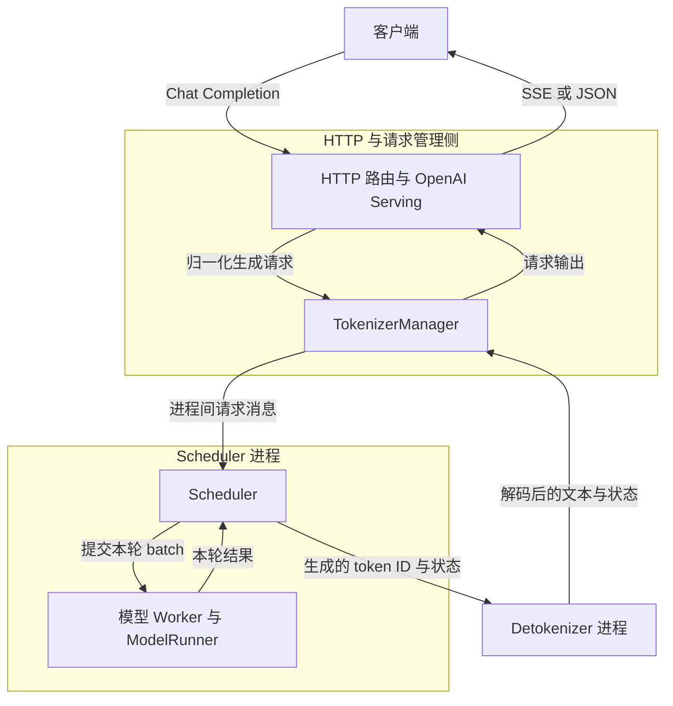
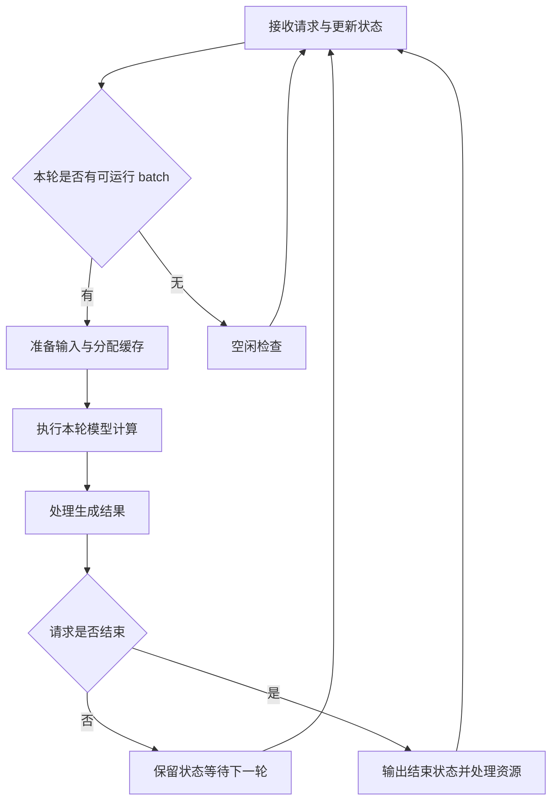
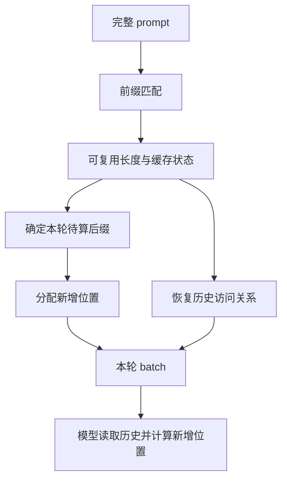
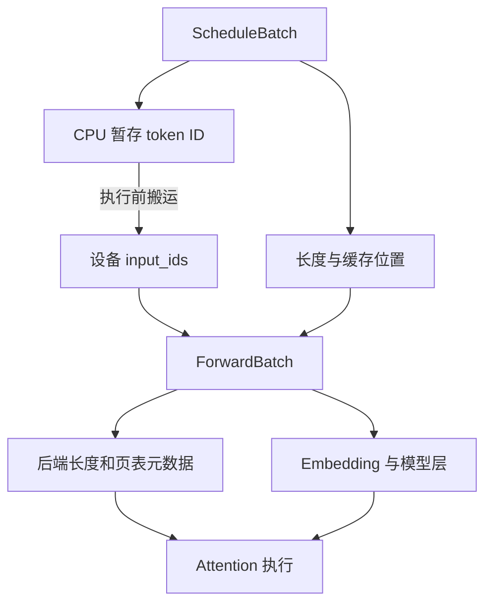
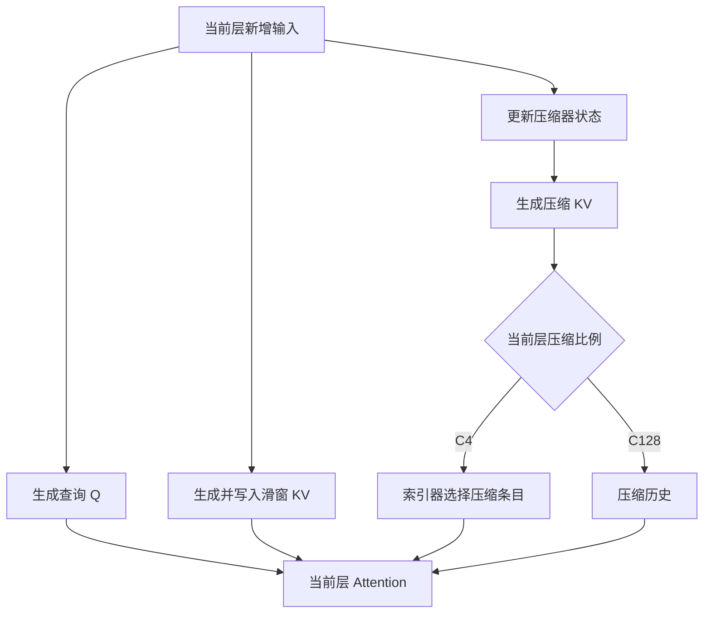
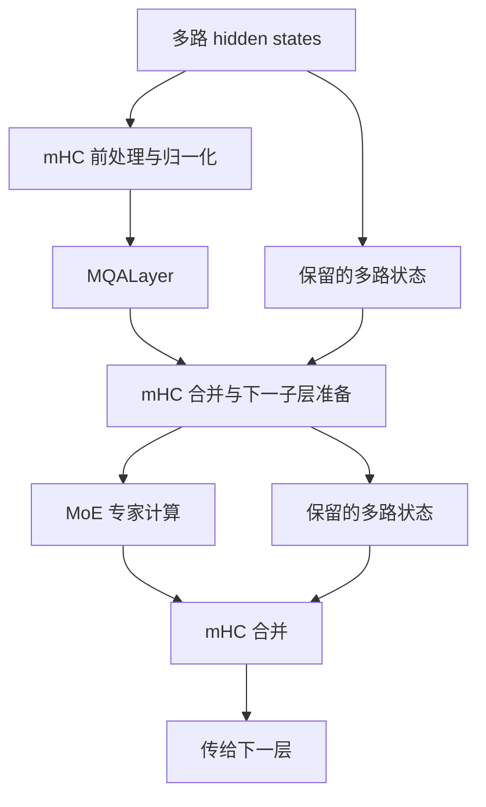
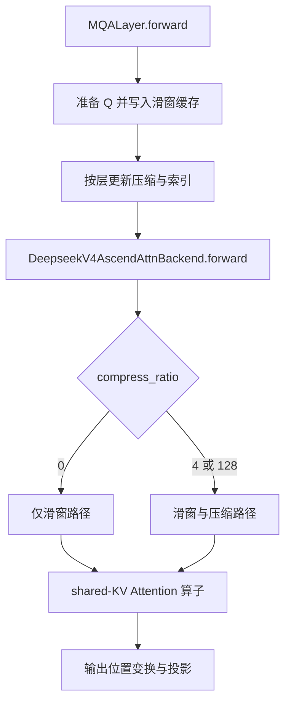
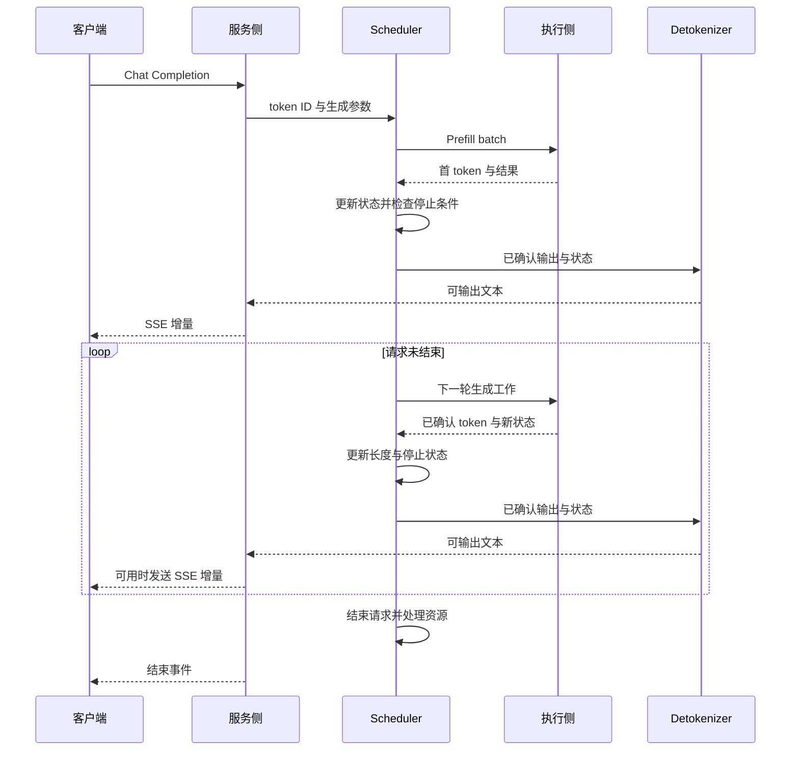
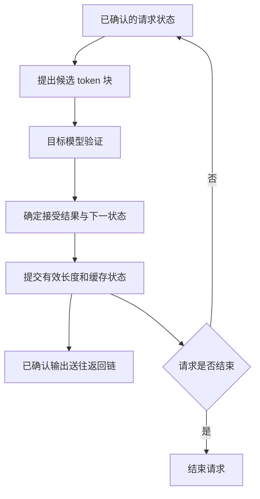

# SGLang 请求生命周期：从 Chat Completion 到 Ascend NPU

客户端发送一句“中国的首都是哪里？”，随后看到回答逐渐出现。服务端并没有在一次模型调用里把整段回答算完：它先处理输入，产生首枚 Token，再反复把新 Token 送回模型，直到满足结束条件。

这篇先沿一条普通生成请求走通全程：聊天消息怎样变成 Token ID，什么时候进入一轮计算，结果又怎样变回客户端收到的文本。涉及 DeepSeek-V4 的缓存和算子细节放在可展开部分；第一次读时，先跟住同一条请求的输入、输出和进度即可。

阅读前只需知道 Token 是模型处理文本的单位，以及生成通常分为 Prefill 和 Decode 两段；不熟悉时，可以先看[两个阶段的性能差别](../fundamentals/prefill-vs-decode-performance.md)。正文先解释进程之间的交接，再追踪一轮模型执行。查某个对象时，用本页目录直接定位；想继续深入调度和执行，则沿文末的系列文章阅读。

<details markdown="1">
<summary>源码版本与阅读范围</summary>

> **源码与适用范围**：基于 `sgl-project/sglang @ dd83b54611897a5f80f4df59e69756bd2fb4b8ab`，核对日期为 2026-09-20。模型案例采用公开源码中的 DeepSeek-V4 文本模型与 NPU `dsv4` 后端，以合设服务、普通自回归和直接执行为主线，展开非 A5 的 BF16 缓存路径，最后说明 DSPARK 如何改变生成循环。Tensor 示例观察一个参与计算的 Rank；多机通信、量化与图回放不逐项展开。本文分析到源码中的算子入口，具体 Flash/Pro 权重尺寸与部署镜像行为需对应配置和源码确认。

</details>

## 一、请求经过哪些进程

先分清两个对象：请求是一项持续中的生成任务，batch 是同一轮送去计算的一组工作。一条请求可能跨越很多个 batch；与它一起计算的其他请求，也会随着新任务加入、旧任务结束而变化。HTTP 连接在等待返回，调度器则按轮次推进生成。

接入、模型执行和文本解码的工作节奏不同。SGLang 将这些职责分开，让接收新请求、推进现有生成和返回文本能够各自向前走。

在一个服务实例中，HTTP 与请求管理侧负责接入和返回，Scheduler 侧组织并推进模型执行，Detokenizer 负责将输出 token ID 解码成文本。它们通过以下消息路径连接：



图里先看两次交接：TokenizerManager 把准备好的请求送给 Scheduler，Scheduler 再把生成结果送往 Detokenizer。Serving 衔接 HTTP 协议与请求管理；模型 Worker 和 ModelRunner 属于调度侧的执行职责。进程之间传递消息，模型计算则由执行侧发起。

多卡部署时，执行侧包含多个协作的 Rank，图中将它们合并为调度与执行职责；它不表示整个 DeepSeek 模型只占一个进程或一张卡。Scheduler 所在进程通过 Worker 发起设备计算。CPU 组织请求并提交工作，NPU 执行相应算子；在允许重叠执行的路径中，主机侧处理与设备计算可以交错推进。

输入与输出形成两条相连的路径：输入侧把聊天消息变成可调度请求；输出侧把生成结果送回仍在等待的 HTTP 请求。这些职责分别落在 [HTTP 路由](https://github.com/sgl-project/sglang/blob/dd83b54611897a5f80f4df59e69756bd2fb4b8ab/python/sglang/srt/entrypoints/http_server.py)、[TokenizerManager](https://github.com/sgl-project/sglang/blob/dd83b54611897a5f80f4df59e69756bd2fb4b8ab/python/sglang/srt/managers/tokenizer_manager.py) 和 [DetokenizerManager](https://github.com/sgl-project/sglang/blob/dd83b54611897a5f80f4df59e69756bd2fb4b8ab/python/sglang/srt/managers/detokenizer_manager.py) 等实现中。

## 二、聊天消息怎样变成可调度请求

假设客户端发送下面这段请求体。其中 `model` 应填写服务实际暴露的模型名称，这里只展示协议结构。

```json
{
  "model": "your-served-model",
  "messages": [
    {"role": "user", "content": "中国的首都是哪里？"}
  ],
  "max_tokens": 32,
  "temperature": 0.7,
  "stream": true
}
```

客户端给出的是带角色的消息，模型最终消费的是 Token 序列。角色边界、轮次分隔和提示 assistant 继续生成的标记，需要由对应模型的 Chat Template 等逻辑组织起来。因此，实际模型输入不只是用户可见的那一句话。

在这一版本中，`OpenAIServingChat._convert_to_internal_request()` 接收 `ChatCompletionRequest`，处理消息，构建采样参数，随后创建 `GenerateReqInput`。后者承载 Runtime 所需的生成输入和控制信息，例如 prompt、采样参数、流式开关以及部分路由或会话信息。对话中的生成要求由此转化为内部接口可以消费的字段。[源码：请求转换](https://github.com/sgl-project/sglang/blob/dd83b54611897a5f80f4df59e69756bd2fb4b8ab/python/sglang/srt/entrypoints/openai/serving_chat.py#L1143-L1268)

内部请求可以携带文本，也可以携带上游模板处理已经生成的 token ID。TokenizerManager 根据输入形式完成必要的分词与请求准备，构造送往调度侧的 `TokenizedGenerateReqInput`。已有 ID 的输入可以直接进入相应处理路径。[源码：TokenizerManager](https://github.com/sgl-project/sglang/blob/dd83b54611897a5f80f4df59e69756bd2fb4b8ab/python/sglang/srt/managers/tokenizer_manager.py)

为了把后面的变化看清，下面把模型输入简化为六个 Token：`[A, B, C, D, E, F]`。字母只是 ID 的代号，不代表这句中文恰好会被切成六块，也不代表一个字一定对应一个 Token。

同一请求在不同边界使用的对象，可以放在一张表里理解：

| 对象 | 主要由谁使用 | 此时关心的问题 |
|---|---|---|
| `ChatCompletionRequest` | OpenAI Serving | 用户提交了什么对话和生成要求？ |
| `GenerateReqInput` | Serving、TokenizerManager | 怎样用内部生成接口表达这些要求？ |
| `TokenizedGenerateReqInput` | 输入消息处理链路 | token ID 和执行所需的请求参数是否准备好？ |
| `Req` | Scheduler | 这条请求进行了多少、生成了什么、是否结束？ |
| `ScheduleBatch` | 调度与批处理逻辑 | 这一轮把哪些请求、哪些 token 放在一起计算？ |
| `ForwardBatch` | 模型执行层 | 本轮计算所需的输入 Tensor、位置和执行信息是什么？ |

读这张表时，不必一次记下所有类名。先记住 `Req` 跟随一条请求持续存在，`ScheduleBatch` 和 `ForwardBatch` 服务于本轮执行。后续每次看到 batch，都要再问一句：这轮处理哪些位置，结果写回哪条请求？

<details markdown="1">
<summary>沿固定版本源码继续追踪</summary>

如果要自己沿源码复现这条主线，不必从仓库目录逐层翻找。可以从请求入口开始，每次只追一个问题，并把上一层产出的对象带到下一层：

| 阅读顺序 | 固定版本中的入口 | 这一站只确认什么 | 接下来带着什么继续追 |
|---:|---|---|---|
| 1 | [`OpenAIServingChat._convert_to_internal_request()`](https://github.com/sgl-project/sglang/blob/dd83b54611897a5f80f4df59e69756bd2fb4b8ab/python/sglang/srt/entrypoints/openai/serving_chat.py#L1143-L1268) | OpenAI 请求怎样变成内部生成请求 | `GenerateReqInput` |
| 2 | [`TokenizerManager`](https://github.com/sgl-project/sglang/blob/dd83b54611897a5f80f4df59e69756bd2fb4b8ab/python/sglang/srt/managers/tokenizer_manager.py) | 文本、token ID 和生成参数怎样送往调度侧 | `TokenizedGenerateReqInput` |
| 3 | [`Scheduler.event_loop_normal()`](https://github.com/sgl-project/sglang/blob/dd83b54611897a5f80f4df59e69756bd2fb4b8ab/python/sglang/srt/managers/scheduler.py#L1932-L2020) | 请求何时被选入下一轮计算 | `Req` 与本轮 `ScheduleBatch` |
| 4 | [`ScheduleBatch.prepare_for_extend()`](https://github.com/sgl-project/sglang/blob/dd83b54611897a5f80f4df59e69756bd2fb4b8ab/python/sglang/srt/managers/schedule_batch.py#L2685-L2728) | 新增 token、序列长度和缓存位置怎样整理 | CPU 暂存输入与缓存映射 |
| 5 | [`TpModelWorker.forward_batch_generation()`](https://github.com/sgl-project/sglang/blob/dd83b54611897a5f80f4df59e69756bd2fb4b8ab/python/sglang/srt/managers/tp_worker.py#L631-L725) | 执行侧怎样构造输入、运行模型并采样 | `ForwardBatch` 与模型输出 |
| 6 | [`DeepseekV4ForCausalLM.forward()`](https://github.com/sgl-project/sglang/blob/dd83b54611897a5f80f4df59e69756bd2fb4b8ab/python/sglang/srt/models/deepseek_v4.py#L5081-L5155) | token 表示怎样进入 V4 模型层 | hidden states 与 Attention 输入 |
| 7 | [`DeepseekV4AscendAttnBackend.forward()`](https://github.com/sgl-project/sglang/blob/dd83b54611897a5f80f4df59e69756bd2fb4b8ab/python/sglang/srt/hardware_backend/npu/attention/ascend_dsv4_backend.py#L2047-L2189) | 窗口和压缩历史怎样进入 Ascend 算子 | Q、页表、缓存与算子参数 |

这张表是阅读路线，不表示七个函数彼此直接调用。进程间消息、batch 转换和模型内部调用仍然存在；后文会在它们影响请求状态的地方展开。

</details>

到调度侧时，协议转换已经完成，请求带着 Token ID、采样要求和停止条件等待资源。后面会持续变化的是处理进度和输出；原始 Prompt 不会因为生成了一枚 Token 就变成另一条请求。

## 三、本轮处理哪些请求与 Token

Scheduler 收到请求，不等于 NPU 已经开始处理它。新请求需要与现有生成共享计算和缓存空间，只有被选入某轮 batch 后，才会形成这一次设备执行的输入。

第一次处理 Prompt 的阶段叫 Prefill，它为后续生成建立所需状态，并能产生首枚输出。后面的普通 Decode 每轮消费上一轮生成的 Token，读取已有历史，再预测下一枚。缓存保留的是后续 Attention 需要的历史表示；DeepSeek-V4 还涉及滑窗和压缩状态，后面的展开部分再说明。

普通调度循环的核心职责如下。这里是省略空闲与暂停检查后的伪代码，不是源文件逐字摘录：

```python
while service_running:
    ingest_requests()
    plan = choose_next_batch(running_requests, previous_batch)
    batch = plan.batch_to_run
    if batch is not None:
        result = run_batch(batch)
        process_batch_result(batch, result)
```

`event_loop_normal()` 持续接收请求、选择 batch、执行并处理结果；重叠调度则允许本轮提交与先前 batch 的结果处理交错进行。调度器按 Token 预算、缓存容量与请求状态选择本轮执行集合。[源码：调度循环](https://github.com/sgl-project/sglang/blob/dd83b54611897a5f80f4df59e69756bd2fb4b8ab/python/sglang/srt/managers/scheduler.py#L1932-L2020)



回到六个 Token 的例子，先假设没有可复用前缀。第一次执行要处理 A 到 F，序列位置为 `[0, 1, 2, 3, 4, 5]`；采样得到的首枚输出记为 y1。接下来观察同一条请求如何跨过两轮计算。

把同一个 `Req` 连续观察三次，可以看出“请求状态”和“本轮 batch”为什么是两回事：

| 观察时点 | `Req` 持有的输入与已生成结果 | 本轮 batch 的任务 | 本轮结束后的变化 |
|---|---|---|---|
| 刚进入 Scheduler | prompt 为 `[A, B, C, D, E, F]`，尚无输出 token | 还在等待，没有设备计算 | 等待满足预算与缓存条件 |
| 被选入 Prefill | prompt 不变，输出仍为空 | 计算 A 到 F 六个位置 | 采样得到 y1，记录首个生成结果；请求若未结束则继续保留 |
| 再次被选入普通 Decode | prompt 不变，已生成结果为 `[y1]` | 只把 y1 作为本轮新增模型输入 | 采样得到 y2，已生成结果推进为 `[y1, y2]` |

表中 Prompt 始终不变，变化的是已生成输出和本轮输入。Prefill 算完 A 到 F 后得到 y1，下一轮才把 y1 送入模型。因此，已经拿到 y1，并不意味着已经计算过 y1 对应的缓存；请求进度与缓存进度需要按这个先后关系理解。

前缀缓存可以改变待算数量。若另一条请求已经留下相同前缀，并且缓存实现能够恢复该模型需要的完整状态，命中的部分就不必重新做全部模型计算。例如逻辑上复用了前四个位置，待处理后缀就只剩 E、F。这个例子说明输入如何切分，不表示 DeepSeek-V4 的实际缓存匹配一定允许四 token 粒度。

Radix 索引负责查找可复用前缀，实际 Tensor 保存在设备缓存池。请求准备逻辑通过 `tree_cache.match_prefix()` 获得索引等结果，再确定后缀。对于包含压缩状态的模型，只看到文本前缀一致还不够；缓存粒度、相关状态和实现条件也必须成立。[源码：请求前缀准备](https://github.com/sgl-project/sglang/blob/dd83b54611897a5f80f4df59e69756bd2fb4b8ab/python/sglang/srt/managers/schedule_batch.py#L1585-L1668)



首 token 还需要模型提供下一位置的 logits。通用请求逻辑中的 `_compute_max_prefix_len()` 将匹配上限限制在 `input_len - 1`，请求 logprob 时还有额外约束；具体缓存实现也可能进一步缩短可复用长度。因此，这条生成路径保留必要的模型计算来取得下一位置 Logits。[源码：前缀长度上限](https://github.com/sgl-project/sglang/blob/dd83b54611897a5f80f4df59e69756bd2fb4b8ab/python/sglang/srt/managers/schedule_batch.py#L1677-L1682)

这一轮选中的请求及其输入安排进入 `ScheduleBatch`。一轮结束后，完成的请求退出，新请求可以加入，仍需生成的请求继续运行。这就是 Continuous Batching 在请求生命周期中的作用。

## 四、输入与缓存怎样准备给 NPU

选好本轮工作后，还需要把输入送到设备。六个 Token ID 是整数索引，Embedding 之后才成为模型向量；同时准备的长度、位置和缓存映射，负责让模型知道这些行分别属于谁。

在 `prepare_for_extend()` 中，输入 ID 先进入 CPU 暂存区；序列长度保留设备 Tensor 和 CPU 版本。执行前，`resolve_forward_inputs()` 将暂存 ID 传到设备。Worker 随后构造 `ForwardBatch`，把模型执行所需的输入、位置和模式集中起来。[源码：Extend 输入准备](https://github.com/sgl-project/sglang/blob/dd83b54611897a5f80f4df59e69756bd2fb4b8ab/python/sglang/srt/managers/schedule_batch.py#L2685-L2728)、[设备输入解析](https://github.com/sgl-project/sglang/blob/dd83b54611897a5f80f4df59e69756bd2fb4b8ab/python/sglang/srt/managers/overlap_utils.py#L87-L114)、[Worker 构造 ForwardBatch](https://github.com/sgl-project/sglang/blob/dd83b54611897a5f80f4df59e69756bd2fb4b8ab/python/sglang/srt/managers/tp_worker.py#L631-L685)

| 信息 | 六 token 主例 | 用途 |
|---|---|---|
| `input_ids` | A 到 F 的整数 ID，设备上的 `[6]` Tensor | Embedding 查表 |
| `positions` | `[0, 1, 2, 3, 4, 5]` | 位置编码和相关元数据 |
| `extend_seq_lens_cpu` | `[6]` | 本轮新增输入的长度 |
| `seq_lens` / `seq_lens_cpu` | `[6]` | 请求当前总长度，供设备或主机逻辑使用 |
| `out_cache_loc` | 为六个新位置分配的槽位索引 | 关联本轮输入与缓存写入位置 |
| `out_cache_loc_dsv4` | DeepSeek-V4 专用位置集合 | 关联压缩缓存等独立分配结果 |

同一轮还可以打包其他请求。假设另一条请求本轮新增三个 Token，合起来就是 `[9]` 的 ID Tensor，Embedding 后得到 `[9, H]`。这九行连续存储，但各请求的边界和历史仍由元数据分别记录。



`positions` 回答“这个 Token 在自己的序列里排第几”，`out_cache_loc` 回答“新状态写进设备缓存的哪个槽位”。两套坐标不能互相替代。DeepSeek-V4 的 NPU 路径还会把完整槽位转换为滑窗槽位：`store_cache()` 通过 `get_swa_out_cache_loc()` 取得落点，已有元数据可直接提供位置，否则由缓存池完成映射。 [源码：滑窗位置转换与写入](https://github.com/sgl-project/sglang/blob/dd83b54611897a5f80f4df59e69756bd2fb4b8ab/python/sglang/srt/hardware_backend/npu/attention/ascend_dsv4_backend.py#L2192-L2224)

理解到这里，先抓住长度、逻辑位置和存储位置的区别，就能继续跟随请求。DeepSeek-V4 怎样将历史分成滑窗与压缩形式，可以在下面展开；这些模型细节不会改变“一轮输入由 ID 和执行元数据共同描述”的关系。

<details markdown="1">
<summary>深入：V4 的 SWA、C4/C128 与 NPU 缓存布局</summary>

这里的 SWA 是 Sliding Window Attention，即滑窗 Attention。它保留近期内容的细粒度表示，而压缩缓存以另一种形式保留更长历史。该版本的 V4 后端支持按层配置三种压缩比例：

| 当前层的 `compress_ratio` | Attention 使用的历史来源 |
|---|---|
| `0` | 滑窗缓存 |
| `4` | 滑窗缓存，加上索引器选出的 C4 压缩条目 |
| `128` | 滑窗缓存，加上 C128 压缩历史 |

C4、C128 表示压缩比例。压缩器根据模型参数处理输入和中间状态，形成压缩表示；它不是简单地每四个或一百二十八个 token 取平均，也不是把普通 K/V Tensor 改一个 shape。C4 的索引器还要计算候选历史的索引，后续 Attention 根据这些索引读取压缩条目。[源码：压缩器与索引器构造](https://github.com/sgl-project/sglang/blob/dd83b54611897a5f80f4df59e69756bd2fb4b8ab/python/sglang/srt/models/deepseek_v4.py#L1115-L1150)、[压缩历史分发](https://github.com/sgl-project/sglang/blob/dd83b54611897a5f80f4df59e69756bd2fb4b8ab/python/sglang/srt/hardware_backend/npu/attention/ascend_dsv4_backend.py#L2047-L2189)



这张图表示数据之间的依赖。滑窗写入、压缩和索引在具体实现中有自己的调度顺序，开启多流后也可能重叠。它们共同回答一个问题：本轮查询能够访问哪部分历史、以什么表示访问。

缓存本身也与普通多头 Attention 不同。非 A5 的 BF16 路径采用 PA_ND 布局，单个池的 Tensor 可写成 `[页数, 每页槽位数, 1, D]`；其中 `1` 是共享 KV head 维，D 包含非旋转与旋转位置分量。这个实现的 `get_value_buffer()` 返回同一个 key buffer，K、V 访问因而共享这份缓存表示。[源码：NPU 缓存布局](https://github.com/sgl-project/sglang/blob/dd83b54611897a5f80f4df59e69756bd2fb4b8ab/python/sglang/srt/hardware_backend/npu/dsv4/dsv4_memory_pool.py#L40-L95)、[共享缓存访问与写入](https://github.com/sgl-project/sglang/blob/dd83b54611897a5f80f4df59e69756bd2fb4b8ab/python/sglang/srt/hardware_backend/npu/dsv4/dsv4_memory_pool.py#L481-L569)

几类缓存使用各自的映射：滑窗位置有自己的转换，C4 页表由完整 token 映射派生，C128 使用独立的请求页表。专用位置集合 `DSV4OutCacheLoc` 把分配结果传到后续步骤。[源码：C4 与 C128 页表](https://github.com/sgl-project/sglang/blob/dd83b54611897a5f80f4df59e69756bd2fb4b8ab/python/sglang/srt/hardware_backend/npu/attention/ascend_dsv4_backend.py#L316-L391)、[专用分配结果接入](https://github.com/sgl-project/sglang/blob/dd83b54611897a5f80f4df59e69756bd2fb4b8ab/python/sglang/srt/hardware_backend/npu/dsv4/dsv4_common_hooks.py#L1-L65)

回到六 token 主例，新增输入始终是 A 到 F，逻辑位置始终是 0 到 5；不同层根据自己的压缩比例更新相应缓存。序列长度 6 表示请求处理进度，不表示每一层都存着六份完整、多头、彼此独立的 K 和 V。

</details>

## 五、DeepSeek-V4 一层怎样进入 Ascend 算子

直接执行路径经 ModelRunner、`EagerRunner` 进入模型。`DeepseekV4ForCausalLM.forward()` 调用模型主体，依次完成 Embedding、各 Decoder Layer 和末端处理，再由 logits processor 与 LM Head 产生词表分数。此时仍需采样，才能选出具体的下一枚 Token。 [源码：EagerRunner](https://github.com/sgl-project/sglang/blob/dd83b54611897a5f80f4df59e69756bd2fb4b8ab/python/sglang/srt/model_executor/runner/eager_runner.py#L213-L378) [DeepSeek-V4 生成入口](https://github.com/sgl-project/sglang/blob/dd83b54611897a5f80f4df59e69756bd2fb4b8ab/python/sglang/srt/models/deepseek_v4.py#L5081-L5155)

DeepSeek-V4 在 Embedding 后把 `[T, H]` 扩展为 `[T, hc_mult, H]`，保留多路表示；层内的 mHC 处理负责在子层前后混合这些表示。层内的数据流是：Attention 和专家网络消费整理后的输入，结果再合入持续向下传递的多路状态。这里的 `hc_mult` 是状态流数量，不是 Attention head 数。[源码：Embedding 与多路状态](https://github.com/sgl-project/sglang/blob/dd83b54611897a5f80f4df59e69756bd2fb4b8ab/python/sglang/srt/models/deepseek_v4.py#L4679-L4701)



图表示一层中的计算关系，融合实现可能把相邻步骤合在一起。`DeepseekV4DecoderLayer` 使用 `MQALayer` 和带有 `is_deepseek_v4=True` 的 `DeepseekV2MoE`；后者的名字来自代码复用。MoE 把 Token 交给选中的专家计算，再合并结果，是否跨设备通信取决于并行配置和后端。 [源码：Decoder Layer 构造](https://github.com/sgl-project/sglang/blob/dd83b54611897a5f80f4df59e69756bd2fb4b8ab/python/sglang/srt/models/deepseek_v4.py#L2603-L2705) [子层执行](https://github.com/sgl-project/sglang/blob/dd83b54611897a5f80f4df59e69756bd2fb4b8ab/python/sglang/srt/models/deepseek_v4.py#L3006-L3250)

<details markdown="1">
<summary>深入：从 Query、缓存写入到 Ascend Attention 算子</summary>

先沿 Attention 看六个输入怎样变化。以 NPU、未启用多流的准备路径为例：查询侧经过 `wq_a`、归一化和 `wq_b`，形成各个本地 head 的 Q；共享 KV 侧经过 `wkv` 和归一化。RoPE 将逻辑位置信息作用到相关分量。代码也允许融合前段投影，但不会改变这些数据各自承担的职责。[源码：查询前段投影](https://github.com/sgl-project/sglang/blob/dd83b54611897a5f80f4df59e69756bd2fb4b8ab/python/sglang/srt/models/deepseek_v4.py#L1750-L1774)、[NPU Q 与共享 KV 准备](https://github.com/sgl-project/sglang/blob/dd83b54611897a5f80f4df59e69756bd2fb4b8ab/python/sglang/srt/models/deepseek_v4.py#L1955-L1998)

设当前 Rank 的 Attention head 数为 `n_local_heads`，每个 head 的维度为 D，查询中间投影维度为 R。六 token 主例的形状关系是：

| 位置 | Tensor shape | 含义 |
|---|---|---|
| Embedding 输出 | `[6, H]` | 六个 token 的初始向量 |
| mHC 多路状态 | `[6, hc_mult, H]` | 在模型层间传递的多路表示 |
| Attention 子层输入 | `[6, H]` | 经过 mHC 前处理的输入 |
| 查询中间表示 | `[6, R]` | `wq_a` 对应的中间维度 |
| 投影并整理后的 Q | `[6, n_local_heads, D]` | 本 Rank 的有效查询 head |
| 送入 Attention 后端的 Q | `[6, n_kernel_heads, D]` | 可能按内核要求补齐 head 维 |
| 共享 KV 的写入数据 | `[6, D]` | 写入池时补成 `[6, 1, D]` |

这些是从代码操作推得的符号维度，没有把 Flash 或 Pro 的具体配置硬填成同一组数字。启用 Attention TP 时，`n_local_heads` 对应当前组内分片，而非全模型 head 数。当前实现还通过 `_kernel_num_heads()` 决定算子使用的 head 维。Attention TP 下，两者可能不同：入口前将 Q 的 head 维补齐，输出再切回本地有效 head。因此，表中同时列出了本地逻辑 shape 与后端实参 shape。[源码：head 维选择](https://github.com/sgl-project/sglang/blob/dd83b54611897a5f80f4df59e69756bd2fb4b8ab/python/sglang/srt/models/deepseek_v4.py#L960-L980)、[补齐与切片](https://github.com/sgl-project/sglang/blob/dd83b54611897a5f80f4df59e69756bd2fb4b8ab/python/sglang/srt/models/deepseek_v4.py#L2219-L2255)

**新增缓存先在准备阶段写入。** NPU 的 `_forward_prepare()` 调用后端 `store_cache()` 写入滑窗表示，随后按层运行索引器和压缩器。返回后，`MQALayer.forward()` 直接调用 `attn_backend.forward(...)`，并在这条路径上传入 `save_kv_cache=False`，避免重复写入。

在这条调用路径中，`attn_mqa` 虽然是 `RadixAttention` 对象，但本例把它作为描述 head 数、缩放、layer ID 等信息的参数传给后端，主调用边是 **`MQALayer → attn_backend.forward`**。本例由 `MQALayer` 直接调用后端，`RadixAttention` 对象提供计算参数。[源码：准备、压缩与索引](https://github.com/sgl-project/sglang/blob/dd83b54611897a5f80f4df59e69756bd2fb4b8ab/python/sglang/srt/models/deepseek_v4.py#L1955-L2095)、[直接调用后端](https://github.com/sgl-project/sglang/blob/dd83b54611897a5f80f4df59e69756bd2fb4b8ab/python/sglang/srt/models/deepseek_v4.py#L2260-L2380)

配置名 `dsv4` 在 NPU 上注册为 `DeepseekV4AscendAttnBackend`。这个后端重写了 `forward()`：比例为 0 时走 `_forward_swa()`，其余受支持的 V4 压缩层走 `_forward_compressed()`。Prefill 与 Decode 的差异则体现在查询数量、长度、页表和压缩状态等元数据中，而非照搬通用 `ascend` 后端的 FIA 分支。[源码：dsv4 后端注册](https://github.com/sgl-project/sglang/blob/dd83b54611897a5f80f4df59e69756bd2fb4b8ab/python/sglang/srt/layers/attention/attention_registry.py#L166-L174)、[V4 后端分发](https://github.com/sgl-project/sglang/blob/dd83b54611897a5f80f4df59e69756bd2fb4b8ab/python/sglang/srt/hardware_backend/npu/attention/ascend_dsv4_backend.py#L2047-L2077)



对非 A5 的目标模型路径，`_sparse_attn_ops()` 选择 `torch.ops.custom.npu_sparse_attn_sharedkv` 及配套 metadata 算子。查询使用 TND 布局，即 token、head、head_dim；缓存使用前文的 PA_ND 分页布局。滑窗路径传入原始窗口缓存，压缩路径还传入压缩缓存与对应页表；C4 额外传入索引器计算的 `cmp_sparse_indices`。[源码：设备算子选择](https://github.com/sgl-project/sglang/blob/dd83b54611897a5f80f4df59e69756bd2fb4b8ab/python/sglang/srt/hardware_backend/npu/attention/ascend_dsv4_backend.py#L41-L55)、[窗口及压缩 Attention 参数](https://github.com/sgl-project/sglang/blob/dd83b54611897a5f80f4df59e69756bd2fb4b8ab/python/sglang/srt/hardware_backend/npu/attention/ascend_dsv4_backend.py#L2078-L2189)

六 token 的 Prefill 中，后端为单请求建立查询边界 `[0, 6]`，当前序列长度为 6。如果还打包了另一条三个 token 的请求，查询边界就是 `[0, 6, 9]`。这些边界标明各段 Q 属于谁，滑窗和压缩页表则标明各段查询的历史在哪里。[源码：查询边界构造](https://github.com/sgl-project/sglang/blob/dd83b54611897a5f80f4df59e69756bd2fb4b8ab/python/sglang/srt/hardware_backend/npu/attention/ascend_dsv4_backend.py#L1837-L1925)

| 算子参数 | 回答的问题 |
|---|---|
| `q`、`cu_seqlens_q` | 本轮有哪些查询，每条请求占哪一段？ |
| `seqused_kv` | 各请求当前推进到多长？ |
| `ori_kv`、`ori_block_table` | 窗口内的历史表示在哪里？ |
| `ori_win_left`、`ori_win_right` | 查询可以访问怎样的窗口？ |
| `cmp_kv`、`cmp_block_table`、`cmp_ratio` | 使用哪种压缩历史，如何定位？ |
| `cmp_sparse_indices` | C4 查询选择哪些压缩条目？ |
| `sinks`、`softmax_scale`、`metadata` | 这层 Attention 需要的其他计算参数 |

有效序列长度为 6 时，每个 Query 的访问范围仍由窗口、因果约束、压缩比例和索引共同确定。查询边界标明 Token 属于哪条请求，有效长度描述进度，缓存池容量描述可分配空间。

Attention 输出随后经过相应位置变换及输出投影，回到层内 mHC 与 MoE 流程。全部层执行完成后，最后一个 prompt 位置提供预测下一 token 所需的表示；LM Head 与 logits processor 产生词表分数，运行时再采样出首枚 token `y1`。[源码：Attention 输出处理](https://github.com/sgl-project/sglang/blob/dd83b54611897a5f80f4df59e69756bd2fb4b8ab/python/sglang/srt/models/deepseek_v4.py#L2380-L2600)、[模型结果与采样](https://github.com/sgl-project/sglang/blob/dd83b54611897a5f80f4df59e69756bd2fb4b8ab/python/sglang/srt/managers/tp_worker.py#L631-L725)

**下一轮普通 Decode 输入 y1，逻辑位置为 6。** 此时本轮只有一个查询，本地有效 Q 为 `[1, n_local_heads, D]`，实际后端输入仍按上述规则组织为 `[1, n_kernel_heads, D]`，查询边界为 `[0, 1]`，序列长度增至 7。后端继续写入新增窗口表示、更新相关压缩状态，并沿相应层的同一 Attention 分支执行。

压缩状态并不意味着每个 Decode 都生成一个新压缩条目。该实现会检查长度是否跨过压缩比例对应的边界；例如在普通 C4 Decode 路径中，长度到 8 才满足新的四 token 边界，到 7 时不会仅因执行了 Decode 就多写一个有效 C4 条目。压缩器仍需维护进行中的状态。[源码：Decode 压缩边界](https://github.com/sgl-project/sglang/blob/dd83b54611897a5f80f4df59e69756bd2fb4b8ab/python/sglang/srt/hardware_backend/npu/attention/ascend_dsv4_backend.py#L393-L408)

至此，“再生成一步”已经落实为确定的设备工作：构造当前查询，更新该层所需状态，按窗口及压缩映射读取历史，计算输出。Python 负责组织调用，`torch_npu` 与 Ascend 执行栈承接设备算子。采用图回放时可以复用已捕获的执行安排，数据依赖仍然存在，但每轮不必重走相同的 Python 调用序列。

</details>

## 六、结果返回与持续生成

模型采样出 y1 后，请求若未结束，就继续执行：下一轮输入 y1、预测 y2，再下一轮输入 y2、预测 y3。下面将已算过的位置与刚生成的输出放在一起，避免把这两个进度混为一谈。

| 轮次 | 执行前已经形成缓存的位置 | 本轮新增模型输入 | 本轮结束后的缓存进度 | C4 状态变化 | 采样输出 |
|---|---|---|---|---|---|
| Prefill | 无 | A 到 F，位置 0～5 | 位置 0～5 已处理，总长度 6 | 已处理到第一个四 token 边界之后 | y1 |
| 第一次普通 Decode | 位置 0～5 | y1，位置 6 | 位置 0～6 已处理，总长度 7 | 没有跨过新的四 token 边界 | y2 |
| 第二次普通 Decode | 位置 0～6 | y2，位置 7 | 位置 0～7 已处理，总长度 8 | 到达新的四 token 边界，可形成本边界对应的有效更新 | y3 |

表中的“缓存进度”表示哪些逻辑位置已经作为模型输入处理，不表示它们占用连续显存，也不表示每层保存相同形式的 K/V。C4 一列只描述普通路径是否跨过比例边界；实际压缩内容仍由压缩器和索引器产生。刚采样出的 token 要到下一轮作为输入时，才形成它对应的缓存状态。若 y3 已触发停止条件，请求可以直接结束，不必为了它再执行一轮。采用 chunked prefill 时，prompt 可能分多轮处理，中间 chunk 不一定向用户产出 token。

设备上的结果有两个去向：后续计算需要继续消费 token，主机侧则需要更新请求并输出文本。普通生成路径可以从设备结果缓冲区取得下一轮输入，避免每轮先把 token 传回 CPU 再重新上传；客户端返回链仍需取得可处理的输出数据。[源码：普通生成的后续设备输入](https://github.com/sgl-project/sglang/blob/dd83b54611897a5f80f4df59e69756bd2fb4b8ab/python/sglang/srt/managers/overlap_utils.py#L87-L114)

主机提交、设备完成、CPU 消费结果是三个时间点。普通结果处理中的 Tensor 转列表要取得实际值；重叠路径可以先安排异步复制，再用 `copy_done` 事件等待数据可用。非阻塞提交只表示允许工作继续排队，并不表示 CPU 已经能读取结果。[源码：结果复制](https://github.com/sgl-project/sglang/blob/dd83b54611897a5f80f4df59e69756bd2fb4b8ab/python/sglang/srt/managers/utils.py#L150-L217)、[结果处理](https://github.com/sgl-project/sglang/blob/dd83b54611897a5f80f4df59e69756bd2fb4b8ab/python/sglang/srt/managers/scheduler_components/batch_result_processor.py)



图中的服务侧合并了 HTTP、Serving 和 TokenizerManager，执行侧合并了 Worker、ModelRunner 与设备工作。Scheduler 更新请求后，常规文本路径通过 Detokenizer 把 ID 解码为文本，再沿请求管理链路返回。计算轮次与 SSE 消息并不一一对应：一个 Token 未必是一个汉字，文本增量还受到解码缓冲、输出间隔和停止字符串的影响。 [源码：Detokenizer](https://github.com/sgl-project/sglang/blob/dd83b54611897a5f80f4df59e69756bd2fb4b8ab/python/sglang/srt/managers/detokenizer_manager.py#L443-L490) [Chat 流式返回](https://github.com/sgl-project/sglang/blob/dd83b54611897a5f80f4df59e69756bd2fb4b8ab/python/sglang/srt/entrypoints/openai/serving_chat.py)

<details markdown="1">
<summary>启用 DSPARK 后，生成循环怎样变化</summary>

启用 DSPARK 后，上图的外部请求生命周期仍然成立，但“下一轮生成工作”需要展开为草稿和验证。公开实现的 worker 在 Prefill 路径调用目标模型，并取得供后续草稿使用的 hidden states；后续生成路径由 proposer 提出候选块，再交给目标模型验证，按验证结果确定本轮接受的输出和新的状态。[源码：DSPARK Prefill](https://github.com/sgl-project/sglang/blob/dd83b54611897a5f80f4df59e69756bd2fb4b8ab/python/sglang/srt/speculative/dspark_components/dspark_worker_v2.py#L528-L640)、[候选、验证与提交](https://github.com/sgl-project/sglang/blob/dd83b54611897a5f80f4df59e69756bd2fb4b8ab/python/sglang/srt/speculative/dspark_components/dspark_worker_v2.py#L689-L939)



候选 token 并不在提出时就成为用户输出。源码中的 `accept_lens`、`new_seq_lens` 等结果决定这一轮推进多少；验证阶段可能为每条请求输入多个位置，后端也为 `TARGET_VERIFY` 构造对应的查询边界。DSPARK 因此按每请求的验证窗口组织查询，普通 Decode 的 `[0, 1]` 只对应单 Token 输入。

这也解释了为何投机推理适配会牵涉 Scheduler、batch、模型与缓存：需要协同的不只是草稿模型的 forward，还包括候选输入的组织、目标验证、接受数量以及后续可见状态。本文的普通生成例子提供基础时间线，DSPARK 在这条时间线上增加了候选与提交边界；具体草稿块长度和并行协作由相应配置与实现决定。

</details>

EOS、长度上限或其他停止条件触发后，请求退出持续运行集合，独占资源进入回收流程。可复用前缀是否留下，由缓存策略决定；请求已经结束，并不能直接推出设备分配器已收回它使用过的全部内存。

接着读 [Scheduler](sglang-scheduler-source-analysis.md) 时，可以把问题收窄到这条请求：它怎样从等待变成可执行工作，一次 Prefill 之后怎样继续 Decode，又在哪一轮退出运行集合。请求接入和文本返回先放在两端，集中观察中间的状态变化。
