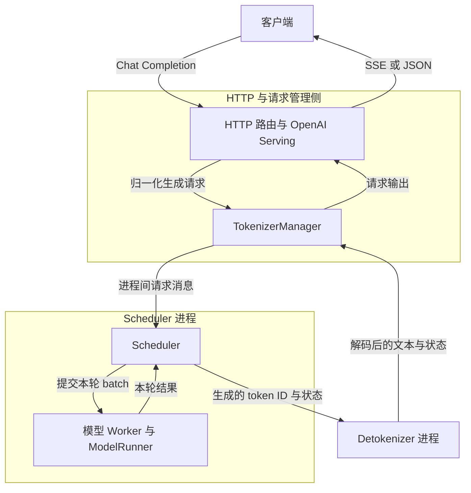
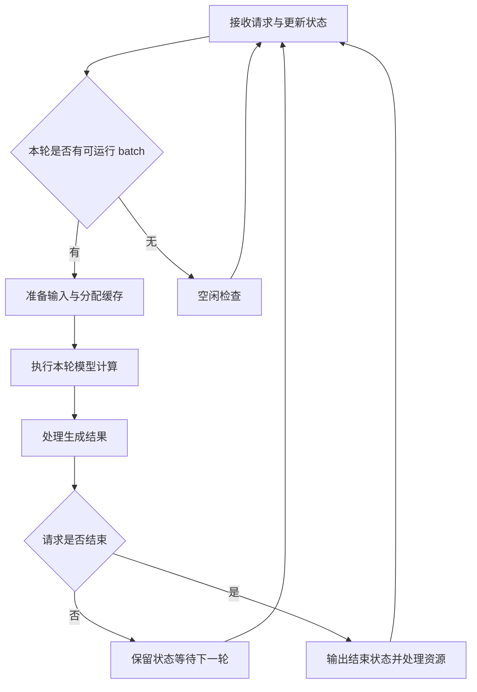
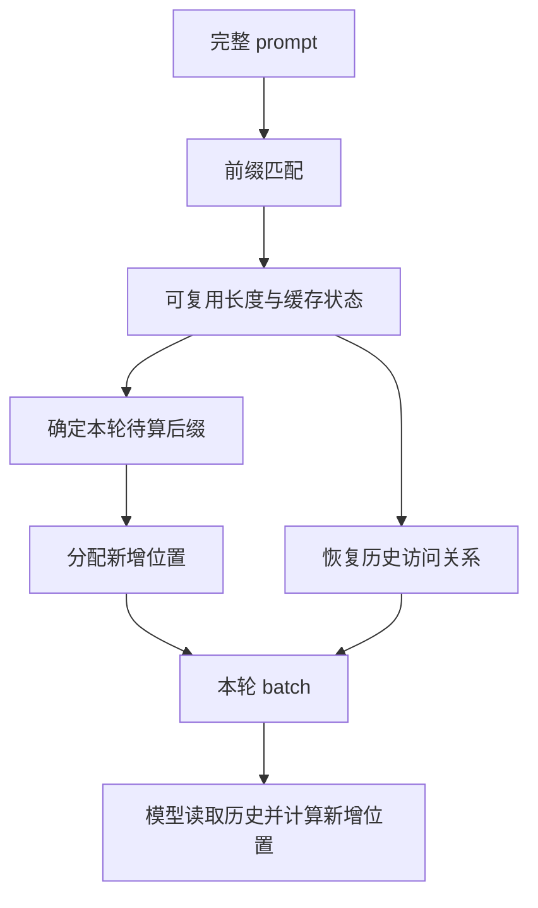
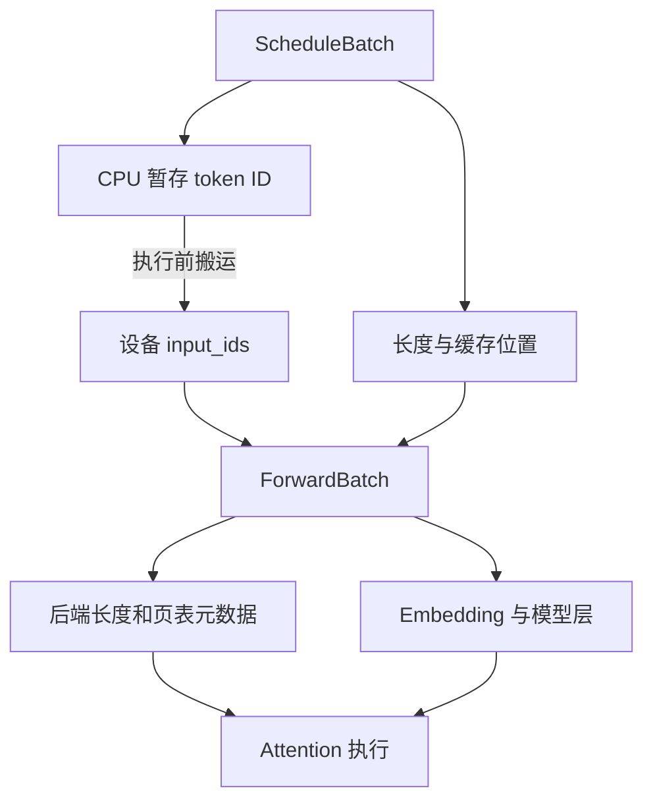
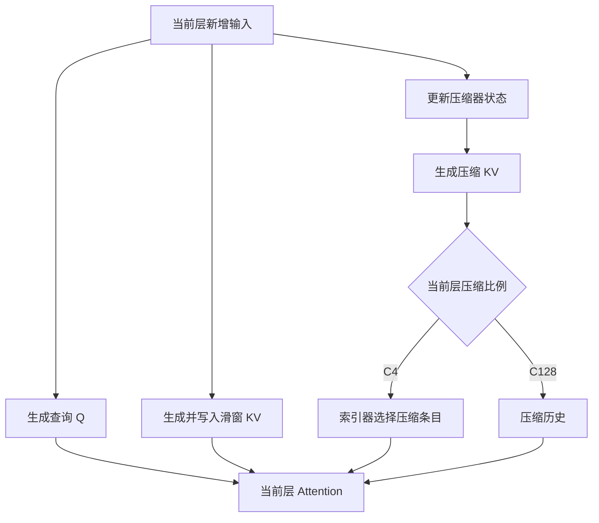
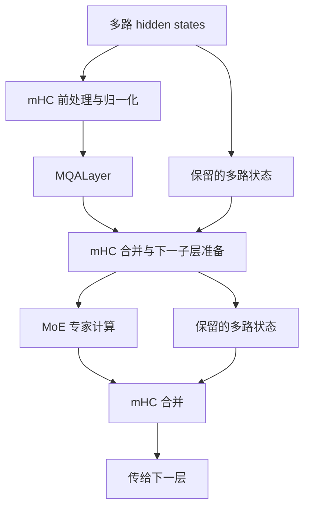
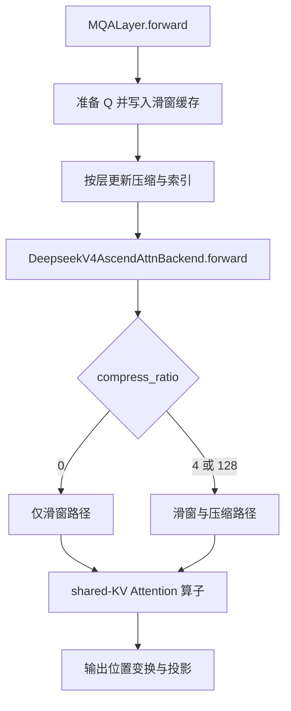
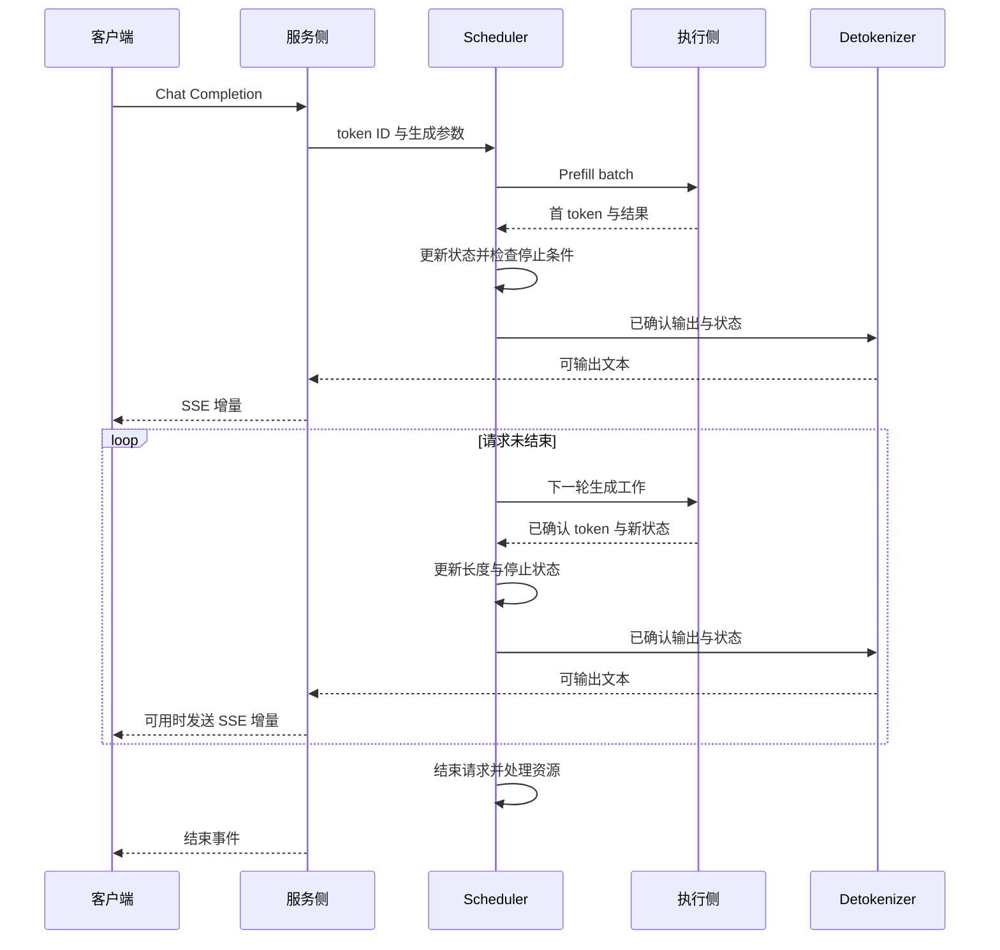
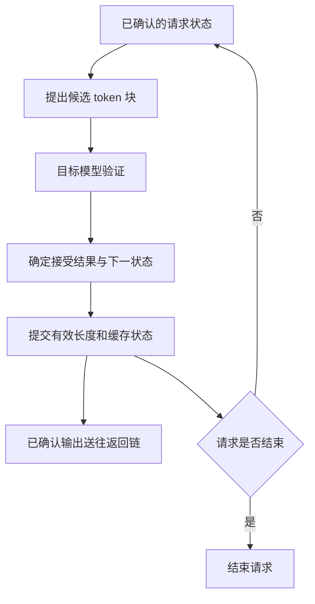

# SGLang 请求生命周期：从 Chat Completion 到 Ascend NPU

客户端问“中国的首都是哪里？”，服务端收到的是带角色和轮次的聊天消息。到了模型，输入已经变成整数 Token ID；模型采样出新的 ID，还要经过文本解码，客户端才能逐渐看到回答。

生成也不在一次模型调用里结束。服务端先算输入、采样首枚 Token，随后不断把刚生成的 Token 送回模型，直到停止。沿着这一条请求，既能看到进程间的数据交接，也能看到每轮计算怎样推进。DeepSeek-V4 的缓存与算子细节放在可展开部分。

Prefill 处理输入，Decode 继续生成，性能差别见 [两个阶段的性能差别](../fundamentals/prefill-vs-decode-performance.md)。一条请求在服务端经过的进程，从下面这张消息图开始。

<details markdown="1">
<summary>源码版本与阅读范围</summary>

> 源码固定到 `sgl-project/sglang @ dd83b54611897a5f80f4df59e69756bd2fb4b8ab`，核对日期为 2026-09-20。模型使用公开 DeepSeek-V4 文本实现和 NPU `dsv4` 后端，主线为合设服务、普通自回归、直接执行，并展开非 A5 的 BF16 缓存路径，最后说明 DSPARK 的变化。Tensor 例子只观察一个参与 Rank，不逐项展开多机、量化和图回放。分析止于源码算子入口，Flash/Pro 的具体尺寸和部署镜像行为仍需对应配置与源码。

</details>

## 一、请求经过哪些进程

请求会持续到生成结束，batch 描述的是当前这一轮的工作。一条请求跨过许多 batch，同行的其他请求可以加入或完成。客户端的 HTTP 连接还在等回答时，Scheduler 已经推进了多轮。

接收新请求、推进模型生成、把 ID 解码成文本，各自的工作节奏不同。SGLang 拆开这些工作，让它们能够继续接入和返回，不必都绑定在一轮模型计算上。

在一个服务实例里，HTTP 与请求管理侧接入、返回，Scheduler 组织模型执行，Detokenizer 负责文本解码。



TokenizerManager 把请求发给 Scheduler，Scheduler 再把输出结果发给 Detokenizer，这是图里的两次主要消息交接。Serving 衔接 HTTP 协议，Worker 和 ModelRunner 则在调度侧承担执行。

多卡部署的执行侧有多个协作 Rank，图里把它们合画在一起。Scheduler 经 Worker 提交设备工作，CPU 组织请求，NPU 运行算子；支持重叠的路径还会交错安排主机处理与设备计算。

消息在输入链上变成可调度任务，输出链再接回等待中的 HTTP 请求。对应实现是 [HTTP 路由](https://github.com/sgl-project/sglang/blob/dd83b54611897a5f80f4df59e69756bd2fb4b8ab/python/sglang/srt/entrypoints/http_server.py)、[TokenizerManager](https://github.com/sgl-project/sglang/blob/dd83b54611897a5f80f4df59e69756bd2fb4b8ab/python/sglang/srt/managers/tokenizer_manager.py) 和 [DetokenizerManager](https://github.com/sgl-project/sglang/blob/dd83b54611897a5f80f4df59e69756bd2fb4b8ab/python/sglang/srt/managers/detokenizer_manager.py)。

## 二、聊天消息怎样变成可调度请求

例如下面这份请求体，只示意协议结构，`model` 填服务实际暴露的名称。

```json
{
  "model": "your-served-model",
  "messages": [
    {"role": "user", "content": "中国的首都是哪里？"}
  ],
  "max_tokens": 32,
  "temperature": 0.7,
  "stream": true
}
```

Chat Template 等逻辑给聊天消息加上角色边界、分隔和 assistant 续写标记，再组织成模型输入。因此算子处理的序列里，还包括用户消息之外的模板内容。

固定实现中，`OpenAIServingChat._convert_to_internal_request()` 读取 `ChatCompletionRequest`，处理消息、构造采样参数，生成 `GenerateReqInput`。prompt、流式开关、采样要求，以及部分路由和会话信息，一起进入 Runtime。[源码：请求转换](https://github.com/sgl-project/sglang/blob/dd83b54611897a5f80f4df59e69756bd2fb4b8ab/python/sglang/srt/entrypoints/openai/serving_chat.py#L1143-L1268)

内部输入可以保留为文本，也可以已经由模板等上游步骤生成 Token ID。TokenizerManager 按相应形式准备，构造 `TokenizedGenerateReqInput`，发到调度侧；已有 ID 就走对应路径。[源码：TokenizerManager](https://github.com/sgl-project/sglang/blob/dd83b54611897a5f80f4df59e69756bd2fb4b8ab/python/sglang/srt/managers/tokenizer_manager.py)

后文用 `[A, B, C, D, E, F]` 六个 Token 表示输入。字母代替整数 ID，只为演示长度和位置，这句中文实际如何分词、一个字切出几个 Token，不从这个例子推断。

同一条请求，跨过各个接口时使用不同对象。

| 对象 | 主要由谁使用 | 此时关心的问题 |
|---|---|---|
| `ChatCompletionRequest` | OpenAI Serving | 用户提交了什么对话和生成要求？ |
| `GenerateReqInput` | Serving、TokenizerManager | 怎样用内部生成接口表达这些要求？ |
| `TokenizedGenerateReqInput` | 输入消息处理链路 | token ID 和执行所需的请求参数是否准备好？ |
| `Req` | Scheduler | 这条请求进行了多少、生成了什么、是否结束？ |
| `ScheduleBatch` | 调度与批处理逻辑 | 这一轮把哪些请求、哪些 token 放在一起计算？ |
| `ForwardBatch` | 模型执行层 | 本轮计算所需的输入 Tensor、位置和执行信息是什么？ |

`Req` 一直保存请求进度，本轮要计算哪些位置，则由 `ScheduleBatch` 和 `ForwardBatch` 组织。

<details markdown="1">
<summary>沿固定版本源码继续追踪</summary>

固定版本中，请求会经过这些入口。

| 阅读顺序 | 固定版本中的入口 | 这一站只确认什么 | 接下来带着什么继续追 |
|---:|---|---|---|
| 1 | [`OpenAIServingChat._convert_to_internal_request()`](https://github.com/sgl-project/sglang/blob/dd83b54611897a5f80f4df59e69756bd2fb4b8ab/python/sglang/srt/entrypoints/openai/serving_chat.py#L1143-L1268) | OpenAI 请求怎样变成内部生成请求 | `GenerateReqInput` |
| 2 | [`TokenizerManager`](https://github.com/sgl-project/sglang/blob/dd83b54611897a5f80f4df59e69756bd2fb4b8ab/python/sglang/srt/managers/tokenizer_manager.py) | 文本、token ID 和生成参数怎样送往调度侧 | `TokenizedGenerateReqInput` |
| 3 | [`Scheduler.event_loop_normal()`](https://github.com/sgl-project/sglang/blob/dd83b54611897a5f80f4df59e69756bd2fb4b8ab/python/sglang/srt/managers/scheduler.py#L1932-L2020) | 请求何时被选入下一轮计算 | `Req` 与本轮 `ScheduleBatch` |
| 4 | [`ScheduleBatch.prepare_for_extend()`](https://github.com/sgl-project/sglang/blob/dd83b54611897a5f80f4df59e69756bd2fb4b8ab/python/sglang/srt/managers/schedule_batch.py#L2685-L2728) | 新增 token、序列长度和缓存位置怎样整理 | CPU 暂存输入与缓存映射 |
| 5 | [`TpModelWorker.forward_batch_generation()`](https://github.com/sgl-project/sglang/blob/dd83b54611897a5f80f4df59e69756bd2fb4b8ab/python/sglang/srt/managers/tp_worker.py#L631-L725) | 执行侧怎样构造输入、运行模型并采样 | `ForwardBatch` 与模型输出 |
| 6 | [`DeepseekV4ForCausalLM.forward()`](https://github.com/sgl-project/sglang/blob/dd83b54611897a5f80f4df59e69756bd2fb4b8ab/python/sglang/srt/models/deepseek_v4.py#L5081-L5155) | token 表示怎样进入 V4 模型层 | hidden states 与 Attention 输入 |
| 7 | [`DeepseekV4AscendAttnBackend.forward()`](https://github.com/sgl-project/sglang/blob/dd83b54611897a5f80f4df59e69756bd2fb4b8ab/python/sglang/srt/hardware_backend/npu/attention/ascend_dsv4_backend.py#L2047-L2189) | 窗口和压缩历史怎样进入 Ascend 算子 | Q、页表、缓存与算子参数 |

七个入口之间还有进程消息、batch 转换和模型调用，这张表表示阅读路线，不是七个函数直接相接的调用栈。

</details>

到达 Scheduler 时，Token ID、采样要求和停止条件都已经备好，请求等着资源。往后增加的是输出和执行进度，原始 Prompt 仍留在同一条请求里。

## 三、本轮处理哪些请求与 Token

Scheduler 要把新输入和已有生成安排在一起，检查计算预算与缓存空间，选入本轮 batch，随后才准备设备输入。

Prefill 计算 Prompt、建立历史状态，完整输入算完后便可采样首枚输出。普通 Decode 读取这份历史，消费上一轮输出、预测下一枚。DeepSeek-V4 的历史还包含滑窗和压缩表示，不能只用普通多头 K/V 的形状概括。

省去空闲和暂停检查，普通循环可以写成下面的伪代码。

```python
while service_running:
    ingest_requests()
    plan = choose_next_batch(running_requests, previous_batch)
    batch = plan.batch_to_run
    if batch is not None:
        result = run_batch(batch)
        process_batch_result(batch, result)
```

`event_loop_normal()` 重复接收、选批、执行、处理结果。重叠调度则允许先前结果处理与当前提交交错；本轮能执行谁，仍受 Token 预算、缓存和请求状态约束。[源码：调度循环](https://github.com/sgl-project/sglang/blob/dd83b54611897a5f80f4df59e69756bd2fb4b8ab/python/sglang/srt/managers/scheduler.py#L1932-L2020)



假设六 Token 输入没有命中前缀，Prefill 计算 A 到 F，位置为 `[0, 1, 2, 3, 4, 5]`，采样得到 y1。下一轮把它作为新输入。

同一个 `Req` 在三个时刻的状态如下。

| 观察时点 | `Req` 持有的输入与已生成结果 | 本轮 batch 的任务 | 本轮结束后的变化 |
|---|---|---|---|
| 刚进入 Scheduler | prompt 为 `[A, B, C, D, E, F]`，尚无输出 token | 还在等待，没有设备计算 | 等待满足预算与缓存条件 |
| 被选入 Prefill | prompt 不变，输出仍为空 | 计算 A 到 F 六个位置 | 采样得到 y1，记录首个生成结果；请求若未结束则继续保留 |
| 再次被选入普通 Decode | prompt 不变，已生成结果为 `[y1]` | 只把 y1 作为本轮新增模型输入 | 采样得到 y2，已生成结果推进为 `[y1, y2]` |

Prompt 留着，输出不断追加。算 A 到 F 得到 y1，下一轮才算 y1 本身，所以刚采样出来时，它还没有自己的缓存状态。读执行长度时，这一拍的差别很重要。

如果有相同前缀，缓存又能恢复模型需要的完整状态，就可以复用命中部分。例如逻辑上复用前四个位置，这轮只需计算 E、F。实际匹配粒度仍由 DeepSeek-V4 专用缓存的实现决定，这里只演示输入区间。

Radix 索引负责找前缀，Tensor 实际留在设备池。请求从 `tree_cache.match_prefix()` 取得索引等结果，确定要继续算的后缀。压缩状态模型的复用还受粒度、状态和实现条件约束，文本相同只满足了其中一部分条件。[源码：请求前缀准备](https://github.com/sgl-project/sglang/blob/dd83b54611897a5f80f4df59e69756bd2fb4b8ab/python/sglang/srt/managers/schedule_batch.py#L1585-L1668)



首 Token 要用下一位置的 Logits。通用 `_compute_max_prefix_len()` 将匹配上限设为 `input_len - 1`，输入 logprob 另有条件，具体缓存还可能进一步缩短匹配范围。这条生成路径因此保留了必要的模型计算。[源码：前缀长度上限](https://github.com/sgl-project/sglang/blob/dd83b54611897a5f80f4df59e69756bd2fb4b8ab/python/sglang/srt/managers/schedule_batch.py#L1677-L1682)

选中的请求与输入安排进 `ScheduleBatch`。本轮结束，完成的退出，新请求可以加入，未完成的继续，这就是 Continuous Batching 中持续变化的执行集合。

## 四、输入与缓存怎样准备给 NPU

选批后，整数 Token ID 要先经过 Embedding 才成为向量。各行属于哪个请求、位于序列哪里、写到哪块缓存，则由长度、位置和映射信息描述。

`prepare_for_extend()` 把 ID 放入 CPU staging，保存设备及 CPU 版本的序列长度。执行前，`resolve_forward_inputs()` 上传暂存 ID，Worker 再构造 `ForwardBatch`，组织本轮输入、位置和模式。[源码：Extend 输入准备](https://github.com/sgl-project/sglang/blob/dd83b54611897a5f80f4df59e69756bd2fb4b8ab/python/sglang/srt/managers/schedule_batch.py#L2685-L2728) [设备输入解析](https://github.com/sgl-project/sglang/blob/dd83b54611897a5f80f4df59e69756bd2fb4b8ab/python/sglang/srt/managers/overlap_utils.py#L87-L114) [Worker 构造 ForwardBatch](https://github.com/sgl-project/sglang/blob/dd83b54611897a5f80f4df59e69756bd2fb4b8ab/python/sglang/srt/managers/tp_worker.py#L631-L685)

| 信息 | 六 token 主例 | 用途 |
|---|---|---|
| `input_ids` | A 到 F 的整数 ID，设备上的 `[6]` Tensor | Embedding 查表 |
| `positions` | `[0, 1, 2, 3, 4, 5]` | 位置编码和相关元数据 |
| `extend_seq_lens_cpu` | `[6]` | 本轮新增输入的长度 |
| `seq_lens` / `seq_lens_cpu` | `[6]` | 请求当前总长度，供设备或主机逻辑使用 |
| `out_cache_loc` | 为六个新位置分配的槽位索引 | 关联本轮输入与缓存写入位置 |
| `out_cache_loc_dsv4` | DeepSeek-V4 专用位置集合 | 关联压缩缓存等独立分配结果 |

再加入一条新增三个 Token 的请求，打包后的 ID 形状就是 `[9]`，Embedding 输出 `[9, H]`。九行连续放置，元数据仍分别描述两条请求的边界和历史。



`positions` 是序列内的逻辑位置，`out_cache_loc` 是设备写入槽位。DSV4 NPU 的 `store_cache()` 还会用 `get_swa_out_cache_loc()` 换成滑窗位置，有 metadata 时直接取得，没有时从缓存池映射。[源码：滑窗位置转换与写入](https://github.com/sgl-project/sglang/blob/dd83b54611897a5f80f4df59e69756bd2fb4b8ab/python/sglang/srt/hardware_backend/npu/attention/ascend_dsv4_backend.py#L2192-L2224)

<details markdown="1">
<summary>深入：V4 的 SWA、C4/C128 与 NPU 缓存布局</summary>

SWA 即 Sliding Window Attention，用较细的表示保存近期内容，较长历史另有压缩表示。固定 V4 后端各层使用的压缩比例如下。

| 当前层的 `compress_ratio` | Attention 使用的历史来源 |
|---|---|
| `0` | 滑窗缓存 |
| `4` | 滑窗缓存，加上索引器选出的 C4 压缩条目 |
| `128` | 滑窗缓存，加上 C128 压缩历史 |

C4、C128 表示压缩比例，结果由压缩器结合模型参数、输入和中间状态生成，和每四个或一百二十八个 Token 简单求均值不同，也不只是改一下普通 K/V shape。C4 另由索引器选出后续读取的候选位置。[源码：压缩器与索引器构造](https://github.com/sgl-project/sglang/blob/dd83b54611897a5f80f4df59e69756bd2fb4b8ab/python/sglang/srt/models/deepseek_v4.py#L1115-L1150) [压缩历史分发](https://github.com/sgl-project/sglang/blob/dd83b54611897a5f80f4df59e69756bd2fb4b8ab/python/sglang/srt/hardware_backend/npu/attention/ascend_dsv4_backend.py#L2047-L2189)



图画的是数据依赖。实际写入、压缩和索引各有执行顺序，多流还可能重叠，当前 Query 读到哪些历史表示，由这些状态共同决定。

非 A5 的 BF16 路径采用 PA_ND，单池可写为 `[页数, 每页槽位数, 1, D]`。其中 `1` 是共享 KV head，D 包含非旋转和旋转分量。`get_value_buffer()` 返回同一 key buffer，K、V 访问共享这份缓存表示。[源码：NPU 缓存布局](https://github.com/sgl-project/sglang/blob/dd83b54611897a5f80f4df59e69756bd2fb4b8ab/python/sglang/srt/hardware_backend/npu/dsv4/dsv4_memory_pool.py#L40-L95) [共享缓存访问与写入](https://github.com/sgl-project/sglang/blob/dd83b54611897a5f80f4df59e69756bd2fb4b8ab/python/sglang/srt/hardware_backend/npu/dsv4/dsv4_memory_pool.py#L481-L569)

映射也随池而变。SWA 使用滑窗位置，C4 从完整 Token 映射派生页表，C128 则有独立的请求页表，专用分配结果由 `DSV4OutCacheLoc` 携带。[源码：C4 与 C128 页表](https://github.com/sgl-project/sglang/blob/dd83b54611897a5f80f4df59e69756bd2fb4b8ab/python/sglang/srt/hardware_backend/npu/attention/ascend_dsv4_backend.py#L316-L391) [专用分配结果接入](https://github.com/sgl-project/sglang/blob/dd83b54611897a5f80f4df59e69756bd2fb4b8ab/python/sglang/srt/hardware_backend/npu/dsv4/dsv4_common_hooks.py#L1-L65)

回到 A 到 F，逻辑位置仍为 0 到 5。这个长度说明输入推进到哪里，各层实际维护的历史形态随压缩路径变化，并不都存六份完整、独立的多头 K、V。

</details>

## 五、DeepSeek-V4 一层怎样进入 Ascend 算子

直接执行从 ModelRunner、`EagerRunner` 进入 `DeepseekV4ForCausalLM.forward()`，做 Embedding、Decoder Layers 和末端处理。logits processor、LM Head 形成词表分数，采样后才有输出 ID。[源码：EagerRunner](https://github.com/sgl-project/sglang/blob/dd83b54611897a5f80f4df59e69756bd2fb4b8ab/python/sglang/srt/model_executor/runner/eager_runner.py#L213-L378) [DeepSeek-V4 生成入口](https://github.com/sgl-project/sglang/blob/dd83b54611897a5f80f4df59e69756bd2fb4b8ab/python/sglang/srt/models/deepseek_v4.py#L5081-L5155)

Embedding 后，DeepSeek-V4 把 `[T, H]` 扩成 `[T, hc_mult, H]`，保留多路状态。mHC 在子层前后混合这些表示，Attention、专家网络使用整理后的输入，再把结果合回去。`hc_mult` 计的是状态流，与 Attention head 数不同。[源码：Embedding 与多路状态](https://github.com/sgl-project/sglang/blob/dd83b54611897a5f80f4df59e69756bd2fb4b8ab/python/sglang/srt/models/deepseek_v4.py#L4679-L4701)



图中相邻步骤在融合实现里可以合并。`DeepseekV4DecoderLayer` 使用 `MQALayer`，并复用设置 `is_deepseek_v4=True` 的 `DeepseekV2MoE`。MoE 选专家计算、合回贡献，实际是否跨设备取决于布局与 backend。[源码：Decoder Layer 构造](https://github.com/sgl-project/sglang/blob/dd83b54611897a5f80f4df59e69756bd2fb4b8ab/python/sglang/srt/models/deepseek_v4.py#L2603-L2705) [子层执行](https://github.com/sgl-project/sglang/blob/dd83b54611897a5f80f4df59e69756bd2fb4b8ab/python/sglang/srt/models/deepseek_v4.py#L3006-L3250)

<details markdown="1">
<summary>深入：从 Query、缓存写入到 Ascend Attention 算子</summary>

NPU 普通单流准备中，查询经过 `wq_a`、归一化、`wq_b` 形成本地 Q，`wkv` 与归一化产生共享 KV 表示，RoPE 作用于相应位置分量。前段投影可以融合，输入输出之间的关系仍是这些。[源码：查询前段投影](https://github.com/sgl-project/sglang/blob/dd83b54611897a5f80f4df59e69756bd2fb4b8ab/python/sglang/srt/models/deepseek_v4.py#L1750-L1774) [NPU Q 与共享 KV 准备](https://github.com/sgl-project/sglang/blob/dd83b54611897a5f80f4df59e69756bd2fb4b8ab/python/sglang/srt/models/deepseek_v4.py#L1955-L1998)

设当前 Rank 有 `n_local_heads` 个 Attention heads，head 维度为 D，查询中间维度为 R，六 Token 输入的形状如下。

| 位置 | Tensor shape | 含义 |
|---|---|---|
| Embedding 输出 | `[6, H]` | 六个 token 的初始向量 |
| mHC 多路状态 | `[6, hc_mult, H]` | 在模型层间传递的多路表示 |
| Attention 子层输入 | `[6, H]` | 经过 mHC 前处理的输入 |
| 查询中间表示 | `[6, R]` | `wq_a` 对应的中间维度 |
| 投影并整理后的 Q | `[6, n_local_heads, D]` | 本 Rank 的有效查询 head |
| 送入 Attention 后端的 Q | `[6, n_kernel_heads, D]` | 可能按内核要求补齐 head 维 |
| 共享 KV 的写入数据 | `[6, D]` | 写入池时补成 `[6, 1, D]` |

这里保留符号维度，Flash、Pro 的数值各随配置。Attention TP 下，`n_local_heads` 是本 Rank 的分片数，`_kernel_num_heads()` 还会选实际算子宽度，可能把 Q 的 head 维补齐，再切回有效输出。[源码：head 维选择](https://github.com/sgl-project/sglang/blob/dd83b54611897a5f80f4df59e69756bd2fb4b8ab/python/sglang/srt/models/deepseek_v4.py#L960-L980) [补齐与切片](https://github.com/sgl-project/sglang/blob/dd83b54611897a5f80f4df59e69756bd2fb4b8ab/python/sglang/srt/models/deepseek_v4.py#L2219-L2255)

新增缓存先在 NPU `_forward_prepare()` 中由 `store_cache()` 写入 SWA，再按层准备索引和压缩。返回后，`MQALayer.forward()` 直接调用 `attn_backend.forward(...)`，带上 `save_kv_cache=False`，防止再写一遍。

`attn_mqa` 虽然是 `RadixAttention` 对象，这里提供的却是 head 数、缩放、layer ID 等参数。实际调用从 `MQALayer` 直接到 `attn_backend.forward`。[源码：准备、压缩与索引](https://github.com/sgl-project/sglang/blob/dd83b54611897a5f80f4df59e69756bd2fb4b8ab/python/sglang/srt/models/deepseek_v4.py#L1955-L2095) [直接调用后端](https://github.com/sgl-project/sglang/blob/dd83b54611897a5f80f4df59e69756bd2fb4b8ab/python/sglang/srt/models/deepseek_v4.py#L2260-L2380)

NPU 把 `dsv4` 注册为 `DeepseekV4AscendAttnBackend`。它的 `forward()` 在 ratio 0 时选 `_forward_swa()`，其余受支持的 V4 压缩层选 `_forward_compressed()`。Prefill 与 Decode 用查询数、长度、页表和状态区分，这条路径也与通用 `ascend` 后端的 FIA 分支不同。[源码：dsv4 后端注册](https://github.com/sgl-project/sglang/blob/dd83b54611897a5f80f4df59e69756bd2fb4b8ab/python/sglang/srt/layers/attention/attention_registry.py#L166-L174) [V4 后端分发](https://github.com/sgl-project/sglang/blob/dd83b54611897a5f80f4df59e69756bd2fb4b8ab/python/sglang/srt/hardware_backend/npu/attention/ascend_dsv4_backend.py#L2047-L2077)



非 A5 目标路径通过 `_sparse_attn_ops()` 选择 `torch.ops.custom.npu_sparse_attn_sharedkv` 及 metadata 算子。Q 用 TND，即 Token、head、head_dim，缓存用 PA_ND。压缩层另带压缩缓存和页表，C4 还带 `cmp_sparse_indices`。[源码：设备算子选择](https://github.com/sgl-project/sglang/blob/dd83b54611897a5f80f4df59e69756bd2fb4b8ab/python/sglang/srt/hardware_backend/npu/attention/ascend_dsv4_backend.py#L41-L55) [窗口及压缩 Attention 参数](https://github.com/sgl-project/sglang/blob/dd83b54611897a5f80f4df59e69756bd2fb4b8ab/python/sglang/srt/hardware_backend/npu/attention/ascend_dsv4_backend.py#L2078-L2189)

单请求六 Token Prefill，Query 边界是 `[0, 6]`、序列长是 6；加入另一条三个 Token 的请求，边界变成 `[0, 6, 9]`。它给算子划出各请求的新 Q 区间，SWA 和压缩页表再指出历史的位置。[源码：查询边界构造](https://github.com/sgl-project/sglang/blob/dd83b54611897a5f80f4df59e69756bd2fb4b8ab/python/sglang/srt/hardware_backend/npu/attention/ascend_dsv4_backend.py#L1837-L1925)

| 算子参数 | 回答的问题 |
|---|---|
| `q`、`cu_seqlens_q` | 本轮有哪些查询，每条请求占哪一段？ |
| `seqused_kv` | 各请求当前推进到多长？ |
| `ori_kv`、`ori_block_table` | 窗口内的历史表示在哪里？ |
| `ori_win_left`、`ori_win_right` | 查询可以访问怎样的窗口？ |
| `cmp_kv`、`cmp_block_table`、`cmp_ratio` | 使用哪种压缩历史，如何定位？ |
| `cmp_sparse_indices` | C4 查询选择哪些压缩条目？ |
| `sinks`、`softmax_scale`、`metadata` | 这层 Attention 需要的其他计算参数 |

有效长度同为 6，每个 Query 能读的历史还受窗口、因果约束、压缩比例和索引控制。Query 边界划分请求，长度记录推进进度，池容量决定可分配空间，三个值各有用途。

Attention 输出经位置变换和输出投影，再回到 mHC、MoE。所有层算完，Prompt 末端表示用来预测下一位置，LM Head、logits processor 形成分数，采样得到 `y1`。[源码：Attention 输出处理](https://github.com/sgl-project/sglang/blob/dd83b54611897a5f80f4df59e69756bd2fb4b8ab/python/sglang/srt/models/deepseek_v4.py#L2380-L2600) [模型结果与采样](https://github.com/sgl-project/sglang/blob/dd83b54611897a5f80f4df59e69756bd2fb4b8ab/python/sglang/srt/managers/tp_worker.py#L631-L725)

下一轮普通 Decode 输入 y1，逻辑位置为 6。本地有效 Q 变成 `[1, n_local_heads, D]`，后端整理为 `[1, n_kernel_heads, D]`，Query 边界是 `[0, 1]`，序列长为 7。接着写新增 SWA、维护压缩状态，进入本层同样的 Attention 分支。

压缩器还会检查比例边界。普通 C4 Decode 长度到 8，才跨入新的四 Token 边界；长度为 7 时仍要维护进行中的状态，但不会仅因多跑一轮就增加有效 C4 条目。[源码：Decode 压缩边界](https://github.com/sgl-project/sglang/blob/dd83b54611897a5f80f4df59e69756bd2fb4b8ab/python/sglang/srt/hardware_backend/npu/attention/ascend_dsv4_backend.py#L393-L408)

Python 组织这些调用，`torch_npu` 和 Ascend 执行栈承接设备算子。Graph Replay 则复用已捕获的安排，减少逐轮重走相同 Python 序列，执行仍要满足相应数据依赖。

</details>

## 六、结果返回与持续生成

y1 没有让请求停止，就输入 y1 预测 y2，再输入 y2 预测 y3。执行过的位置与刚采样的输出，是这样的先后关系。

| 轮次 | 执行前已经形成缓存的位置 | 本轮新增模型输入 | 本轮结束后的缓存进度 | C4 状态变化 | 采样输出 |
|---|---|---|---|---|---|
| Prefill | 无 | A 到 F，位置 0～5 | 位置 0～5 已处理，总长度 6 | 已处理到第一个四 token 边界之后 | y1 |
| 第一次普通 Decode | 位置 0～5 | y1，位置 6 | 位置 0～6 已处理，总长度 7 | 没有跨过新的四 token 边界 | y2 |
| 第二次普通 Decode | 位置 0～6 | y2，位置 7 | 位置 0～7 已处理，总长度 8 | 到达新的四 token 边界，可形成本边界对应的有效更新 | y3 |

表里的“缓存进度”记录哪些位置作为输入执行过，不表示连续显存或所有层都有相同 K/V。C4 列只记是否跨比例边界，内容还由压缩器、索引器生成。y3 若触发停止，可以直接结束，不必再为它执行一轮；Chunked Prefill 则可能分多轮算完 Prompt，中间 chunk 未必返回输出。

新 Token 同时交给后续生成和文本返回。普通生成可以从设备结果缓冲取得下一轮输入，少一次先回 CPU 再上传的往返；输出链仍要取得主机能处理的数据。[源码：普通生成的后续设备输入](https://github.com/sgl-project/sglang/blob/dd83b54611897a5f80f4df59e69756bd2fb4b8ab/python/sglang/srt/managers/overlap_utils.py#L87-L114)

提交设备任务时，CPU 还不一定能读到结果。普通结果转列表需要实际值，overlap 可先安排异步复制，随后等 `copy_done`；非阻塞提交只让后续工作继续入队，没有提前完成这次复制。[源码：结果复制](https://github.com/sgl-project/sglang/blob/dd83b54611897a5f80f4df59e69756bd2fb4b8ab/python/sglang/srt/managers/utils.py#L150-L217) [结果处理](https://github.com/sgl-project/sglang/blob/dd83b54611897a5f80f4df59e69756bd2fb4b8ab/python/sglang/srt/managers/scheduler_components/batch_result_processor.py)



图里把 HTTP、Serving、TokenizerManager 合成服务侧，把 Worker、ModelRunner 和设备工作合成执行侧。Scheduler 更新请求后，输出 ID 经 Detokenizer 返回文本。一次计算和一条 SSE 消息不必一一对应，Token 也不等于汉字，解码缓冲、输出间隔和停止字符串都会影响文本增量。[源码：Detokenizer](https://github.com/sgl-project/sglang/blob/dd83b54611897a5f80f4df59e69756bd2fb4b8ab/python/sglang/srt/managers/detokenizer_manager.py#L443-L490) [Chat 流式返回](https://github.com/sgl-project/sglang/blob/dd83b54611897a5f80f4df59e69756bd2fb4b8ab/python/sglang/srt/entrypoints/openai/serving_chat.py)

<details markdown="1">
<summary>启用 DSPARK 后，生成循环怎样变化</summary>

DSPARK 仍使用同一条外部请求链，内部生成增加候选与验证。公开 Worker 的 Prefill 调目标模型，同时取得草稿需要的 hidden states；后续 proposer 提出候选块，目标模型验证，根据结果接受输出、推进状态。[源码：DSPARK Prefill](https://github.com/sgl-project/sglang/blob/dd83b54611897a5f80f4df59e69756bd2fb4b8ab/python/sglang/srt/speculative/dspark_components/dspark_worker_v2.py#L528-L640) [候选、验证与提交](https://github.com/sgl-project/sglang/blob/dd83b54611897a5f80f4df59e69756bd2fb4b8ab/python/sglang/srt/speculative/dspark_components/dspark_worker_v2.py#L689-L939)



候选提出后还没有交给用户。`accept_lens`、`new_seq_lens` 等决定本轮能推进多少，`TARGET_VERIFY` 也按每请求验证窗口组织多个 Query。上面普通 Decode 的 `[0, 1]` 对应单 Token 输入，验证窗口需要自己的边界。

这些候选、验证与提交状态，由 Scheduler、batch、模型和缓存共同衔接。普通生成的时间线仍在，DSPARK 在其中增加接受数量和状态可见性的约束，具体长度、并行方式各随配置与实现。

</details>

满足 EOS、长度上限或其他停止条件，请求退出运行集合，独占资源进入回收。可复用前缀可能按缓存策略留下，所以请求结束后，相关内存未必立即全部交回分配器。

请求从等待到接纳，再从 Prefill 转入 Decode 的具体选择过程，在 [Scheduler](sglang-scheduler-source-analysis.md) 一篇继续展开。
