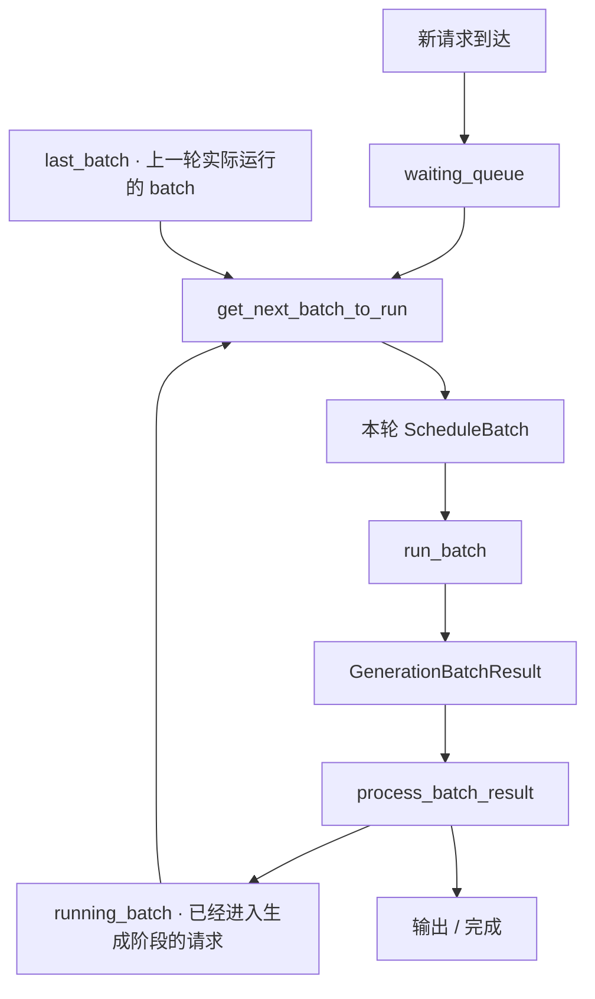
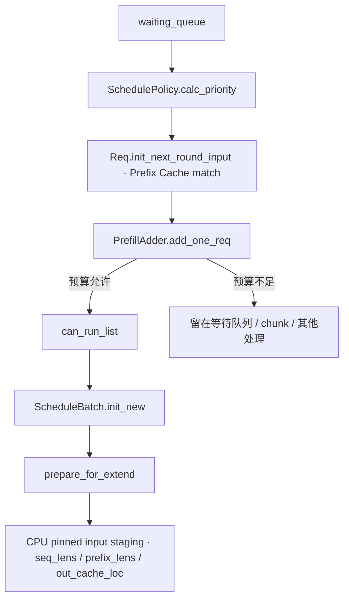
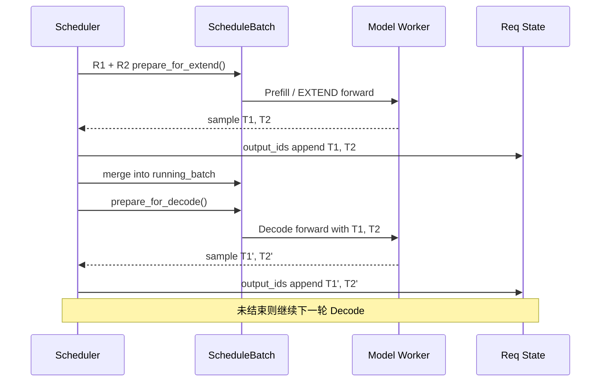
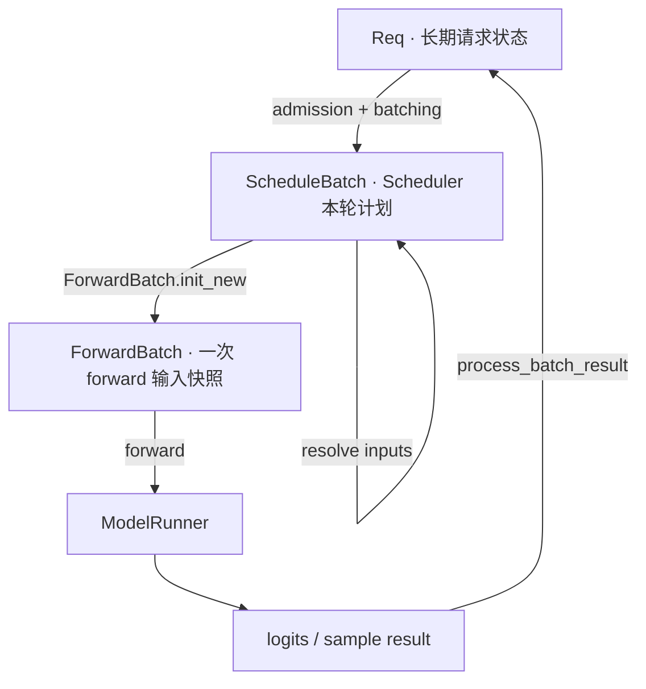
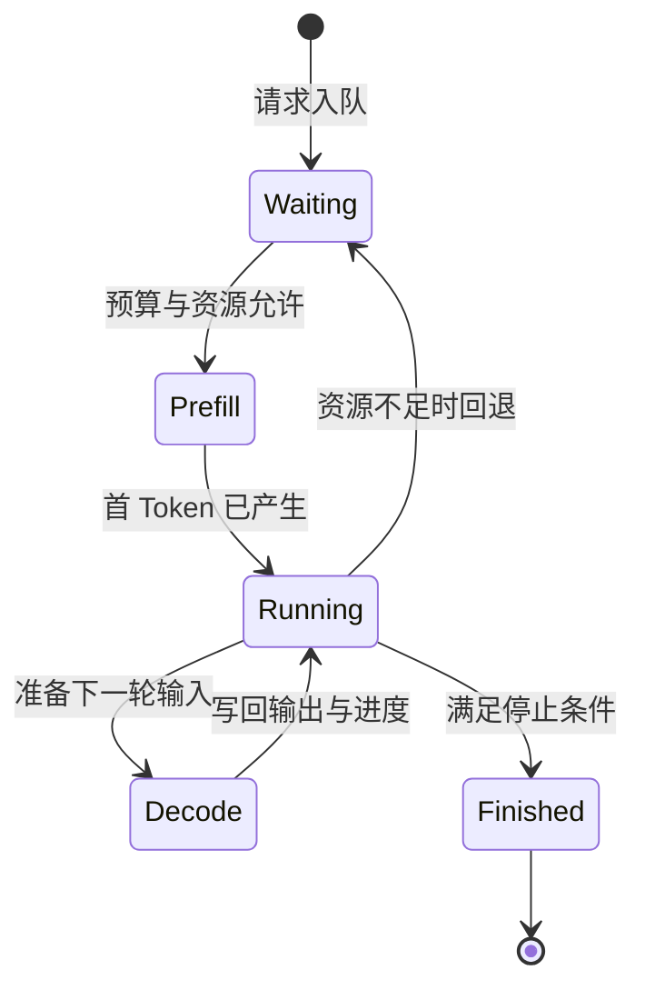

# SGLang Scheduler：请求怎样组批、执行和持续生成

两条请求到达服务端后，能否在同一轮计算，还得由 Scheduler 决定。它检查未计算的输入、可复用前缀、本轮预算和缓存空间，再选出能执行的工作。生成持续多轮，后面每轮的请求集合也可能不同。

前一篇已经走过请求接入到返回的全程，这里停在调度器，跟着两条请求进入队列、完成 Prefill、继续 Decode，观察本轮计划如何形成，又怎样接回请求状态。模型内部的输入与输出形状留给 ModelRunner 篇。全程可对照 [请求生命周期](sglang-ascend-request-lifecycle.md)。

<details markdown="1">
<summary>源码版本与阅读范围</summary>

> 源码固定到 `sgl-project/sglang @ 5c69e32abe013fa1b913022682a3104c79105f37`，核对日期为 2026-09-20。主线为普通文本生成、非 PD 分离、非投机 Scheduler，并说明 overlap schedule、Chunked Prefill、mixed batch 的影响。例子采用 DeepSeek serving，但这里多数机制与具体 Transformer 结构解耦。下文调用关系均以这个提交为准。

</details>

## 一、请求状态与本轮执行计划

先看普通 `event_loop_normal()`：接收请求，选择 batch，执行，再处理结果。省略空闲、暂停等分支后，循环主干如下：

```text
ingest_requests()
      |
      v
get_next_batch_to_run()
      |
      v
run_batch(batch)
      |
      v
process_batch_result(batch, result)
      |
      v
下一轮
```

`get_next_batch_to_run()` 返回的 `NextBatchPlan` 包含 `batch_to_run`，描述这一轮实际做的工作；`running_batch` 则保存仍在生成的请求。每轮结束后，调度器会重新检查执行集合，一条请求不必一直独占设备直到结束。[`Scheduler.event_loop_normal()`](https://github.com/sgl-project/sglang/blob/5c69e32abe013fa1b913022682a3104c79105f37/python/sglang/srt/managers/scheduler.py#L1932-L1963)



后面还会频繁遇到三个状态：`waiting_queue`、`running_batch`、`last_batch`，它们描述的时间范围不同。

`waiting_queue` 等待接纳；`running_batch` 主要保留持续生成、还需 Decode 的请求；`last_batch` 记录上一轮实际执行的 batch。若上一轮是 Prefill / Extend，下一次选批可把它并入 `running_batch`，继续生成。[`get_next_batch_to_run()`](https://github.com/sgl-project/sglang/blob/5c69e32abe013fa1b913022682a3104c79105f37/python/sglang/srt/managers/scheduler.py#L3648-L3794)

请求仍需生成是一种跨轮状态，能否在当前轮执行则是另一个判断。KV 空间、Token 预算、新请求和已有请求的状态都会参与这次选择。

普通循环便于理解先后关系，`event_loop_overlap()` 则交错安排上一轮 CPU 结果处理与下一轮设备工作。重叠增加了交接依赖，但仍需明确本轮执行谁、输入来自哪里、结果属于哪条请求。[源码](https://github.com/sgl-project/sglang/blob/5c69e32abe013fa1b913022682a3104c79105f37/python/sglang/srt/managers/scheduler.py#L1966-L2021)

## 二、请求进入等待队列

TokenizerManager 完成准备后，将 `TokenizedGenerateReqInput` 交给 Scheduler。分发器调用 `handle_generate_request()`，创建后续可持续更新的 `Req`。[源码：dispatcher](https://github.com/sgl-project/sglang/blob/5c69e32abe013fa1b913022682a3104c79105f37/python/sglang/srt/managers/scheduler.py#L1752-L1764)

`Req` 保存原输入、已生成输出、采样要求、缓存进度和停止条件。LoRA、会话、reasoning、logprob 等可选信息也会在此绑定，以下先跟踪普通生成的状态。[源码：创建 Req](https://github.com/sgl-project/sglang/blob/5c69e32abe013fa1b913022682a3104c79105f37/python/sglang/srt/managers/scheduler.py#L2776-L2845)

关键字段如下：[`Req` 定义](https://github.com/sgl-project/sglang/blob/5c69e32abe013fa1b913022682a3104c79105f37/python/sglang/srt/managers/schedule_batch.py#L977-L1060)

| 字段 | 含义 |
| --- | --- |
| `origin_input_ids` | 原始输入 token |
| `output_ids` | 已经生成并确认的输出 token |
| `full_untruncated_fill_ids` | 当前完整输入序列视图 |
| `prefix_indices` | 已被 Prefix Cache 命中的 KV 位置 |
| `extend_range` | 本轮需要 Extend / Prefill 的 token 范围 |
| `kv` | 这条请求自己的 KV 相关状态 |
| `finished_reason` | 请求是否以及为什么结束 |

后续 Prefill 和 Decode 的输出都追加到同一个 `Req.output_ids`，直到 EOS、长度上限或中止等条件结束请求。临时 batch 可以变化，请求进度需要连续。

通过校验后，普通请求调用 `_add_request_to_queue(req)`。非 PD 模式将它放入 `waiting_queue`，同时记录等待队列的进入时间。[源码：入队](https://github.com/sgl-project/sglang/blob/5c69e32abe013fa1b913022682a3104c79105f37/python/sglang/srt/managers/scheduler.py#L3277-L3292)

此时可简化为下面的队列状态：

```text
TokenizedGenerateReqInput
          |
          v
         Req
          |
          v
    waiting_queue
```

入队之后还要 admission，也就是接纳进入本轮计算。这个步骤同时检查计算预算和缓存能否容纳新工作。

## 三、根据缓存、预算和空间组批

`get_new_batch_prefill()` / `_get_new_batch_prefill_raw()` 为新 Prefill 选候选、检查可接纳的输入范围，再构成 batch。[源码](https://github.com/sgl-project/sglang/blob/5c69e32abe013fa1b913022682a3104c79105f37/python/sglang/srt/managers/scheduler.py#L3816-L3901)

首先，`SchedulePolicy.calc_priority()` 调整 `waiting_queue` 的候选顺序。固定实现支持 FCFS，也有 LPM、HRRN、shortest-prefill-first 等 cache-aware 策略，必要时在这里准备 Prefix Cache 匹配信息。[源码：调度策略](https://github.com/sgl-project/sglang/blob/5c69e32abe013fa1b913022682a3104c79105f37/python/sglang/srt/managers/schedule_policy.py#L259-L341)

`PrefillAdder` 管理接纳预算，输入包括 page size、前缀缓存、KV 分配器、运行中的请求，以及 Prefill Token、分块和请求数限制。每接纳一条，就更新剩余预算。[源码：PrefillAdder](https://github.com/sgl-project/sglang/blob/5c69e32abe013fa1b913022682a3104c79105f37/python/sglang/srt/managers/schedule_policy.py#L620-L664)

前缀命中减少未缓存的输入计算，但请求仍有历史状态和后续输出。因此预算不能只根据客户端 Prompt 的总 Token 数判断。

`req.init_next_round_input(self.tree_cache)` 刷新完整输入，查询可复用前缀，将命中位置写入 `prefix_indices` 等字段，再确定本轮还要计算的区间。[源码：Prefix Cache 匹配](https://github.com/sgl-project/sglang/blob/5c69e32abe013fa1b913022682a3104c79105f37/python/sglang/srt/managers/schedule_batch.py#L1556-L1657)

`PrefillAdder.add_one_req()` 结合未缓存输入、潜在后续输出和分页开销，调用 `_select_prefill_admission()`。长 Prompt 可以只接纳一个 chunk，尚未计算的部分留待后续轮次。[源码：admission](https://github.com/sgl-project/sglang/blob/5c69e32abe013fa1b913022682a3104c79105f37/python/sglang/srt/managers/schedule_policy.py#L1232-L1430)

接纳成功后，`_commit_prefill_admission()` 把当前区间写回请求：

```python
req.set_extend_range(
    admission.prefix_len,
    admission.prefix_len + admission.extend_len,
)
```

再将请求加入 `can_run_list`，扣减本轮预算。[源码](https://github.com/sgl-project/sglang/blob/5c69e32abe013fa1b913022682a3104c79105f37/python/sglang/srt/managers/schedule_policy.py#L1432-L1452)

到这里，才得到这一轮真正可执行的请求和输入范围。

用下面两条请求代入。整数只是 Token ID 代号，假设 R2 命中前三个位置的 KV；这是长度示例，不表示 DeepSeek-V4 专用缓存支持三个 Token 粒度的匹配。

| 请求 | 当前完整序列 | 已命中的 Prefix Cache | 本轮 `extend_range` | 本轮要计算 |
| --- | --- | ---: | --- | ---: |
| R1 | `[11,12,13,14,15,16]` | 0 token | `[0,6)` | 6 token |
| R2 | `[21,22,23,24,25,26]` | 3 token | `[3,6)` | 3 token |

如果预算足够，R1 计算六行、R2 计算后三行，得到 `can_run_list = [R1, R2]`。二者总序列长度都是六，新输入合计却为九行。

Scheduler 据此创建并准备 batch：

```python
new_batch = ScheduleBatch.init_new(can_run_list, ...)
new_batch.prepare_for_extend()
```

对应源码在 [`Scheduler._get_new_batch_prefill_raw()`](https://github.com/sgl-project/sglang/blob/5c69e32abe013fa1b913022682a3104c79105f37/python/sglang/srt/managers/scheduler.py#L4063-L4111)。

接纳结果进入 `ScheduleBatch` 后，`prepare_for_extend()` 将请求区间整理为本轮字段。这时仍有部分输入处于暂存状态，尚不是 NPU 最终读取的 Tensor。[源码](https://github.com/sgl-project/sglang/blob/5c69e32abe013fa1b913022682a3104c79105f37/python/sglang/srt/managers/schedule_batch.py#L2686-L2753) [`ScheduleBatch` 定义](https://github.com/sgl-project/sglang/blob/5c69e32abe013fa1b913022682a3104c79105f37/python/sglang/srt/managers/schedule_batch.py#L2305-L2393)

本例的关键状态为：

| Batch 字段 | 示例 |
| --- | --- |
| `forward_mode` | `EXTEND` |
| `prefix_lens` | `[0, 3]` |
| `extend_lens` | `[6, 3]` |
| `seq_lens` | `[6, 6]` |
| `extend_num_tokens` | `9` |
| Prefill 输入 | R1 的 6 个 token + R2 未命中的 3 个 token |
| `out_cache_loc` | 为这 9 个新增 KV token 分配的写入位置 |

固定版本在 `prepare_for_extend()` 中先把扁平输入放入 pinned CPU staging，保存为 `prefill_input_ids_cpu`，暂将 `self.input_ids` 留为 `None`。设备 Tensor 会在后面的执行边界准备。[源码](https://github.com/sgl-project/sglang/blob/5c69e32abe013fa1b913022682a3104c79105f37/python/sglang/srt/managers/schedule_batch.py#L2686-L2728) [字段写入](https://github.com/sgl-project/sglang/blob/5c69e32abe013fa1b913022682a3104c79105f37/python/sglang/srt/managers/schedule_batch.py#L2870-L2915)

因此，调度计划已经知道各请求计算哪段、九个位置写在哪里，即使 input IDs 尚在 CPU，计划仍然完整。



对照原请求时，可以分别核对 `seq_lens` 的总序列长度、`extend_lens` 的新增长度和 `out_cache_loc` 的写入位置。Prefix Cache 改变的是当前重算范围。

## 四、Prefill 结束后继续 Decode

假设 Prefill 的九行已计算完成，两条请求分别得到 `T1`、`T2` 且都继续生成。下一轮普通 Decode 会消费这两枚输出，无需再提交整段 Prompt。

不过下一轮是否立刻运行它们，还要经过调度。普通 `get_next_batch_to_run()` 先尝试准备新的 Prefill：

```python
prefill_plan = self.get_new_batch_prefill(running_batch)
new_batch = prefill_plan.batch_to_run
```

若拿到 `new_batch`，主路径优先执行新 Prefill；没有新的 Prefill 工作且 `running_batch` 非空时，才进入 `update_running_batch()` 继续 Decode。[源码](https://github.com/sgl-project/sglang/blob/5c69e32abe013fa1b913022682a3104c79105f37/python/sglang/srt/managers/scheduler.py#L3736-L3794)

Continuous Batching 允许请求逐轮加入、完成、退出，并重新选择执行集合。是否把新 Prefill 与 Decode 直接放入同一物理 batch，还受其他条件控制。

`update_running_batch()` 先过滤完成请求，再检查 Decode 所需 KV。空间不足时可以 retract 部分请求、释放空间并重新入队；还能继续时，调用 `batch.prepare_for_decode()`。[源码](https://github.com/sgl-project/sglang/blob/5c69e32abe013fa1b913022682a3104c79105f37/python/sglang/srt/managers/scheduler.py#L4193-L4275)

例如 R1、R2 都未完成，但空间不够，可能有一条被 retract。它只是退出当前运行集合，尚未以成功结果结束，后面仍需结合入队与缓存策略恢复。这个例子不指定具体回退哪条。

允许继续时，`prepare_for_decode()` 分配新增位置的缓存，推进执行长度：

| 动作 | 为什么 |
| --- | --- |
| `forward_mode = DECODE` | 这一轮不再处理整段 prompt |
| `alloc_for_decode(..., token_per_req=1)` | 每个活跃请求为一个新 token 分配 KV 写入位置 |
| `seq_lens = seq_lens + 1` | 每条序列向前推进一个位置 |
| 清理 Prefill 专属状态 | 避免上一阶段的输入或 CP 元数据泄漏进 Decode |

[源码：`prepare_for_decode()`](https://github.com/sgl-project/sglang/blob/5c69e32abe013fa1b913022682a3104c79105f37/python/sglang/srt/managers/schedule_batch.py#L3504-L3566)

结果处理先把 `T1`、`T2` 放入各自 `req.output_ids`。下一轮普通 Decode 的 batch size 仍为二，输入却变成两行：它们各位于本序列的位置六，执行后再预测后续输出。



若满足 mixed-style Chunked Prefill 条件，还可以在同一轮处理新输入与 Decode tail。代码先对 `running_batch` 调用 `prepare_for_decode()`，再用 `new_batch.mix_with_running(running_batch)` 将 tail 作为 1-token extend 合入，并设置 `forward_mode=MIXED`。[源码](https://github.com/sgl-project/sglang/blob/5c69e32abe013fa1b913022682a3104c79105f37/python/sglang/srt/managers/scheduler.py#L4130-L4163) [`mix_with_running()`](https://github.com/sgl-project/sglang/blob/5c69e32abe013fa1b913022682a3104c79105f37/python/sglang/srt/managers/schedule_batch.py#L3096-L3167)

因此，请求集合动态变化与本轮采用 MIXED 是两个判断，不能仅凭 continuous batching 推导执行形状。

先按本例独立的 Prefill、Decode 两轮走通，再遇到 Mixed 分支时核对 tail 如何加入。

## 五、从 ScheduleBatch 到 ForwardBatch

执行前，`run_batch()` 与 Worker 继续把调度计划整理为模型输入。`ScheduleBatch` 中的暂存字段到这里才逐步物化。

`Scheduler.run_batch()` 首先调用 `resolve_forward_inputs()`。[源码：run_batch 主路径](https://github.com/sgl-project/sglang/blob/5c69e32abe013fa1b913022682a3104c79105f37/python/sglang/srt/managers/scheduler.py#L4337-L4598)

它根据模式处理不同输入来源：

| 模式 | `input_ids` 从哪里来 |
| --- | --- |
| Prefill | `prefill_input_ids_cpu` 从 pinned CPU staging H2D 到设备 |
| Decode | 从 `FutureMap.output_tokens_buf` 取上一轮采样 token |
| Mixed | Prefill staging 与正在 Decode 的 tail token 拼起来 |

所以查 `input_ids` 时，要先确认当前模式：Prefill 来自 CPU staging，普通 Decode 可以直接取上一轮设备结果缓冲，Mixed 还需拼接 tail。[ `resolve_forward_inputs()` ](https://github.com/sgl-project/sglang/blob/5c69e32abe013fa1b913022682a3104c79105f37/python/sglang/srt/managers/overlap_utils.py#L82-L119)

这份固定实现将准备拆成了两步：

```text
调度阶段：
ScheduleBatch.input_ids 可能还是 None
        |
        | resolve_forward_inputs()
        v
forward 入口：
ScheduleBatch.input_ids 已物化为本轮设备输入
```

把输入解析放在 forward 附近，有利于沿执行流安排 Prefill H2D、上轮采样交接和当前计算。是否需要等待、怎样保证依赖，要沿该路径继续看；调度阶段的 `input_ids=None` 本身并不表示输入丢失。

随后 `Scheduler.run_batch()` 调用 `forward_batch_generation(batch)`。普通 Tensor Parallel Worker 在这里构造 `ForwardBatch`：

```python
forward_batch = ForwardBatch.init_new(
    batch,
    self.model_runner,
    ...
)

out = self.model_runner.forward(forward_batch)
```

[源码：`TpModelWorker.forward_batch_generation()`](https://github.com/sgl-project/sglang/blob/5c69e32abe013fa1b913022682a3104c79105f37/python/sglang/srt/managers/tp_worker.py#L631-L678)

它按单次执行组织输入，并向模型传递位置、长度和缓存信息。[`ForwardBatch` 定义](https://github.com/sgl-project/sglang/blob/5c69e32abe013fa1b913022682a3104c79105f37/python/sglang/srt/model_executor/forward_batch_info.py#L468-L605)

| 字段 | 执行层关心什么 |
| --- | --- |
| `forward_mode` | 这是 Decode、Extend、Mixed 还是其他执行模式 |
| `input_ids` | 本轮送入模型的 token |
| `req_pool_indices` | batch 中每条请求在 request-token pool 的位置 |
| `seq_lens` | 每条序列当前长度 |
| `out_cache_loc` | 本轮新 KV 要写到哪里 |
| `positions` | 本轮 token 对应的位置 |
| `sampling_info` | 采样阶段需要的 batch 信息 |
| `spec_info` | 若启用投机推理，本轮需要的额外状态 |

`ForwardBatch.init_new()` 借用或整理 `ScheduleBatch` 字段，再补齐执行派生信息。Decode positions 沿当前 `seq_lens` 路径计算，Extend 则使用 `extend_prefix_lens`、`extend_seq_lens`、`extend_num_tokens`。[源码](https://github.com/sgl-project/sglang/blob/5c69e32abe013fa1b913022682a3104c79105f37/python/sglang/srt/model_executor/forward_batch_info.py#L847-L1073)

三个对象各有职责：`Req` 保存跨轮进度，`ScheduleBatch` 描述本轮计划，`ForwardBatch` 承接模型输入。它们的关系如下：



`ModelRunner.forward()` 收到这份输入后，由 `_forward_raw()` 按模式、能力判断 Graph Replay、Prefill Graph 或 Eager Runner。[源码：`ModelRunner.forward()`](https://github.com/sgl-project/sglang/blob/5c69e32abe013fa1b913022682a3104c79105f37/python/sglang/srt/model_executor/model_runner.py#L1703-L1799) [执行分派](https://github.com/sgl-project/sglang/blob/5c69e32abe013fa1b913022682a3104c79105f37/python/sglang/srt/model_executor/model_runner.py#L1849-L1947)

模型内部的 Attention、MoE 计算将在下一篇展开。这里先回到 Scheduler，把本轮输出接回原来的两条请求。

## 六、把执行结果写回请求

模型返回后，结果处理器将输出追加到原请求的 `req.output_ids`，更新完成状态，再决定继续或结束。Prefill 采样出的首 Token 由此接入后续 Decode，临时 batch 的结果也成为了请求的持续进度。

未结束的请求下一轮仍要检查空间与预算；EOS、停止条件、长度上限或中止则让它退出。资源释放和可复用前缀保留，继续由各自缓存策略处理。



本例到这里形成一条完整链：入队，接纳六行和三行，共计算九行 Prefill，各追加一枚输出，下一轮再消费这两枚。接着读 [ModelRunner 的九 Token 示例](sglang-modelrunner-source-analysis.md)，可以继续看九行输入怎样只留下两行待采样 Logits。

### 源码阅读入口

| 目标 | 固定版本入口 |
| --- | --- |
| Scheduler 主循环 | [`scheduler.py::event_loop_normal`](https://github.com/sgl-project/sglang/blob/5c69e32abe013fa1b913022682a3104c79105f37/python/sglang/srt/managers/scheduler.py#L1932-L1963) |
| 请求进入 `Req` / waiting queue | [`handle_generate_request`](https://github.com/sgl-project/sglang/blob/5c69e32abe013fa1b913022682a3104c79105f37/python/sglang/srt/managers/scheduler.py#L2776-L3130)、[`_add_request_to_queue`](https://github.com/sgl-project/sglang/blob/5c69e32abe013fa1b913022682a3104c79105f37/python/sglang/srt/managers/scheduler.py#L3277-L3306) |
| 选择本轮 Prefill / Decode | [`get_next_batch_to_run`](https://github.com/sgl-project/sglang/blob/5c69e32abe013fa1b913022682a3104c79105f37/python/sglang/srt/managers/scheduler.py#L3648-L3794) |
| Prefill admission | [`get_new_batch_prefill`](https://github.com/sgl-project/sglang/blob/5c69e32abe013fa1b913022682a3104c79105f37/python/sglang/srt/managers/scheduler.py#L3816-L4163)、[`PrefillAdder`](https://github.com/sgl-project/sglang/blob/5c69e32abe013fa1b913022682a3104c79105f37/python/sglang/srt/managers/schedule_policy.py#L620-L664) |
| `ScheduleBatch` | [`schedule_batch.py`](https://github.com/sgl-project/sglang/blob/5c69e32abe013fa1b913022682a3104c79105f37/python/sglang/srt/managers/schedule_batch.py#L2305-L2393) |
| Prefill 准备 | [`prepare_for_extend`](https://github.com/sgl-project/sglang/blob/5c69e32abe013fa1b913022682a3104c79105f37/python/sglang/srt/managers/schedule_batch.py#L2686-L2915) |
| Decode 准备 | [`prepare_for_decode`](https://github.com/sgl-project/sglang/blob/5c69e32abe013fa1b913022682a3104c79105f37/python/sglang/srt/managers/schedule_batch.py#L3504-L3566) |
| Forward 入口输入物化 | [`resolve_forward_inputs`](https://github.com/sgl-project/sglang/blob/5c69e32abe013fa1b913022682a3104c79105f37/python/sglang/srt/managers/overlap_utils.py#L82-L119) |
| `ScheduleBatch -> ForwardBatch` | [`TpModelWorker.forward_batch_generation`](https://github.com/sgl-project/sglang/blob/5c69e32abe013fa1b913022682a3104c79105f37/python/sglang/srt/managers/tp_worker.py#L631-L749) |
| `ForwardBatch` 构造 | [`ForwardBatch.init_new`](https://github.com/sgl-project/sglang/blob/5c69e32abe013fa1b913022682a3104c79105f37/python/sglang/srt/model_executor/forward_batch_info.py#L847-L1073) |
| ModelRunner 执行入口 | [`ModelRunner.forward`](https://github.com/sgl-project/sglang/blob/5c69e32abe013fa1b913022682a3104c79105f37/python/sglang/srt/model_executor/model_runner.py#L1703-L1947) |
| Prefill / Decode 结果写回 | [Prefill](https://github.com/sgl-project/sglang/blob/5c69e32abe013fa1b913022682a3104c79105f37/python/sglang/srt/managers/scheduler_components/batch_result_processor.py#L286-L414)、[Decode](https://github.com/sgl-project/sglang/blob/5c69e32abe013fa1b913022682a3104c79105f37/python/sglang/srt/managers/scheduler_components/batch_result_processor.py#L921-L1069) |
