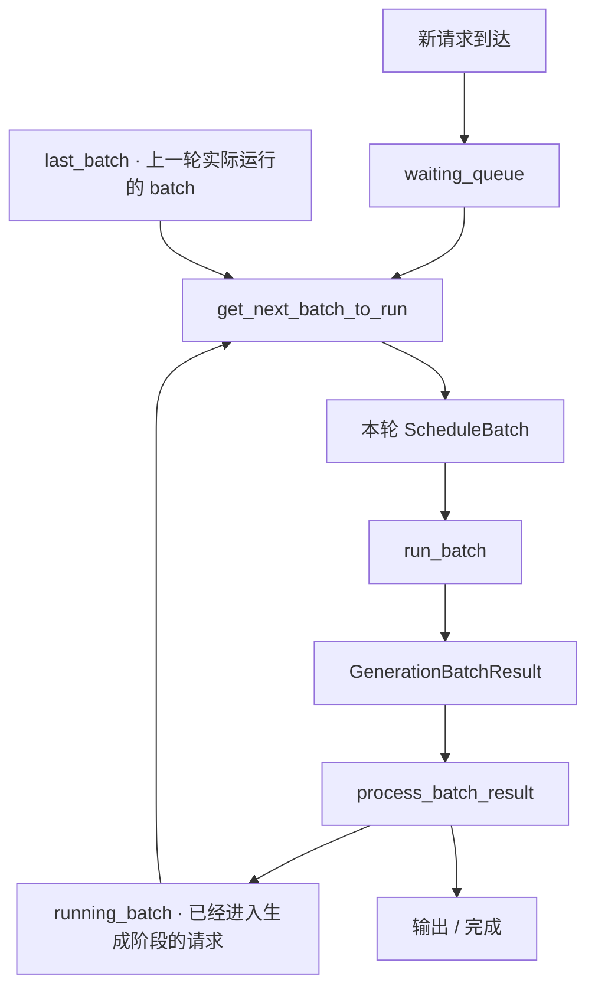
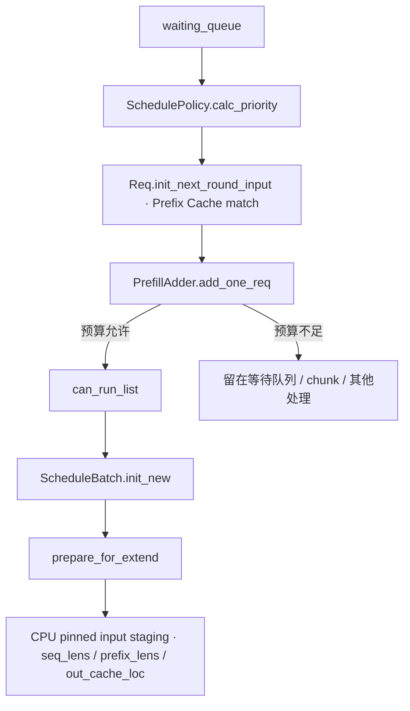
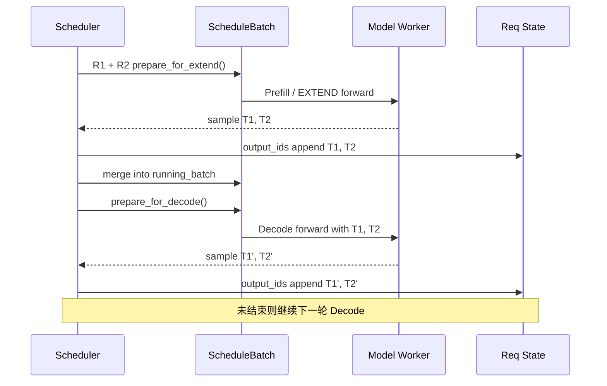
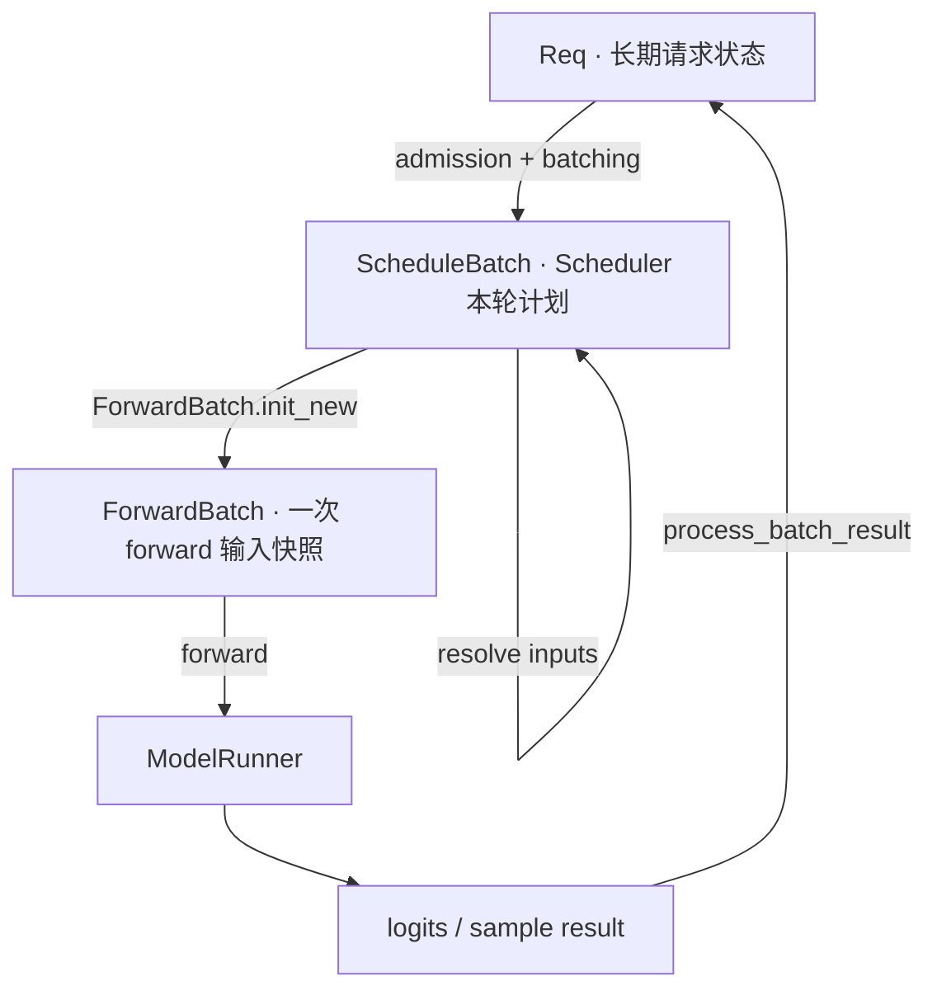
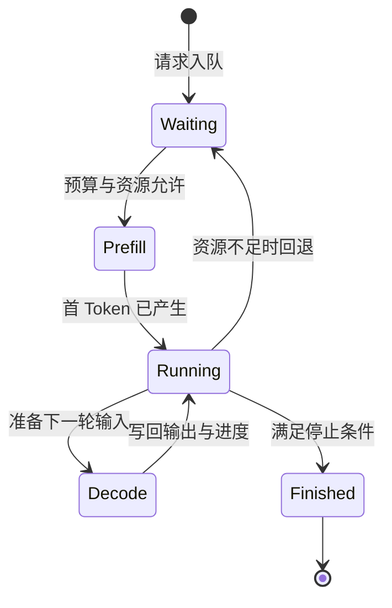

# SGLang Scheduler：请求怎样组批、执行和持续生成

两条请求的输入都长六个 token，一条没有命中缓存，另一条复用了前三个位置的 KV。这一轮如果能放在一起，模型实际要计算的是九行输入。下一轮开始生成时，同样两条请求又只需要两行输入。

Scheduler 要选出这一轮执行哪些请求、各计算哪一段，再把结果接回请求，留到下一轮。下面跟着这两条请求，从等待队列走到持续 Decode。完整的接入和返回过程见 [请求生命周期](sglang-ascend-request-lifecycle.md)。

<details markdown="1">
<summary>源码版本与阅读范围</summary>

> 源码固定到 `sgl-project/sglang @ 5c69e32abe013fa1b913022682a3104c79105f37`，核对日期为 2026-09-20。主线为普通文本生成、非 PD 分离、非投机 Scheduler，并说明 overlap schedule、Chunked Prefill、mixed batch 的影响。例子采用 DeepSeek serving，但这里多数机制与具体 Transformer 结构解耦。下文调用关系均以这个提交为准。

</details>

<a id="_1"></a>

## 谁留在队列，谁进入本轮 batch

普通 `event_loop_normal()` 不断接收请求、选批、执行、处理结果。省去空闲、暂停等分支，循环主干如下。

```text
ingest_requests()
      |
      v
get_next_batch_to_run()
      |
      v
run_batch(batch)
      |
      v
process_batch_result(batch, result)
      |
      v
下一轮
```

`get_next_batch_to_run()` 返回一个 `NextBatchPlan`，其中 `batch_to_run` 是本轮要执行的工作。`running_batch` 留着仍在生成的请求，每轮再选执行集合，一条请求不必独占设备直到生成结束。[`Scheduler.event_loop_normal()`](https://github.com/sgl-project/sglang/blob/5c69e32abe013fa1b913022682a3104c79105f37/python/sglang/srt/managers/scheduler.py#L1932-L1963)



新请求先在 `waiting_queue` 等接纳。`running_batch` 主要放持续生成、还需 Decode 的请求，`last_batch` 则记住上一轮实际执行过的 batch。上一轮如果是 Prefill / Extend，下一次选批可以把它并入 `running_batch`，继续生成。[`get_next_batch_to_run()`](https://github.com/sgl-project/sglang/blob/5c69e32abe013fa1b913022682a3104c79105f37/python/sglang/srt/managers/scheduler.py#L3648-L3794)

不过，请求还没生成完，不保证本轮就能执行。新请求、已有请求的状态、KV 空间和 Token 预算，都影响本轮选择。

`event_loop_overlap()` 会交错安排上一轮 CPU 结果处理和下一轮设备工作。两轮工作有了重叠，输入与结果的交接也就多了依赖；每份结果仍得对应回原请求。[源码](https://github.com/sgl-project/sglang/blob/5c69e32abe013fa1b913022682a3104c79105f37/python/sglang/srt/managers/scheduler.py#L1966-L2021)

<a id="_2"></a>

## 接入时创建的 Req 会一直保留

TokenizerManager 准备好 `TokenizedGenerateReqInput` 后，把它发给 Scheduler。分发器进入 `handle_generate_request()`，创建这条请求的 `Req`。[源码：dispatcher](https://github.com/sgl-project/sglang/blob/5c69e32abe013fa1b913022682a3104c79105f37/python/sglang/srt/managers/scheduler.py#L1752-L1764)

原输入、已生成输出、采样要求、缓存进度和停止条件都存在 `Req` 里。启用 LoRA、会话、reasoning、logprob 时，相应的可选信息也在这里绑定。[源码：创建 Req](https://github.com/sgl-project/sglang/blob/5c69e32abe013fa1b913022682a3104c79105f37/python/sglang/srt/managers/scheduler.py#L2776-L2845)

[`Req` 定义](https://github.com/sgl-project/sglang/blob/5c69e32abe013fa1b913022682a3104c79105f37/python/sglang/srt/managers/schedule_batch.py#L977-L1060) 中，与这条生成过程直接相关的字段如下。

| 字段 | 含义 |
| --- | --- |
| `origin_input_ids` | 原始输入 token |
| `output_ids` | 已经生成并确认的输出 token |
| `full_untruncated_fill_ids` | 当前完整输入序列视图 |
| `prefix_indices` | 已被 Prefix Cache 命中的 KV 位置 |
| `extend_range` | 本轮需要 Extend / Prefill 的 token 范围 |
| `kv` | 这条请求自己的 KV 相关状态 |
| `finished_reason` | 请求是否以及为什么结束 |

Prefill 产生的首个输出、后续 Decode 的输出，都会追加到同一个 `Req.output_ids`。换了一批同行的请求，自己的进度还在，直到 EOS、长度上限或中止等条件让请求结束。

校验通过后调用 `_add_request_to_queue(req)`。这条非 PD 普通请求进入 `waiting_queue`，同时记下入队时间。[源码：入队](https://github.com/sgl-project/sglang/blob/5c69e32abe013fa1b913022682a3104c79105f37/python/sglang/srt/managers/scheduler.py#L3277-L3292)

这时请求刚走到等待队列。

```text
TokenizedGenerateReqInput
          |
          v
         Req
          |
          v
    waiting_queue
```

入队还没拿到本轮的计算与缓存空间。接下来的 admission 检查决定接纳多少输入。

<a id="_3"></a>

## Prefill 怎样选出这九行输入

`get_new_batch_prefill()` / `_get_new_batch_prefill_raw()` 为新的 Prefill 选择候选，确定每条能接纳的输入范围，组成 batch。[源码](https://github.com/sgl-project/sglang/blob/5c69e32abe013fa1b913022682a3104c79105f37/python/sglang/srt/managers/scheduler.py#L3816-L3901)

候选顺序先由 `SchedulePolicy.calc_priority()` 调整。这份实现支持 FCFS，也有 LPM、HRRN、shortest-prefill-first 等 cache-aware 策略，需要时会在这里准备 Prefix Cache 匹配信息。[源码：调度策略](https://github.com/sgl-project/sglang/blob/5c69e32abe013fa1b913022682a3104c79105f37/python/sglang/srt/managers/schedule_policy.py#L259-L341)

接纳预算交给 `PrefillAdder`。它读取 page size、前缀缓存、KV 分配器和正在运行的请求，并受 Prefill Token、chunk 和请求数限制约束；放进一条，就扣掉相应预算。[源码：PrefillAdder](https://github.com/sgl-project/sglang/blob/5c69e32abe013fa1b913022682a3104c79105f37/python/sglang/srt/managers/schedule_policy.py#L620-L664)

命中前缀能省掉一部分输入计算，请求的历史状态和后续输出仍得占空间。所以 Prompt 总长度还不足以说明这条请求需要多少预算。

`req.init_next_round_input(self.tree_cache)` 刷新完整输入，查找可复用前缀，把命中的位置记到 `prefix_indices` 等字段，再确定剩余待计算区间。[源码：Prefix Cache 匹配](https://github.com/sgl-project/sglang/blob/5c69e32abe013fa1b913022682a3104c79105f37/python/sglang/srt/managers/schedule_batch.py#L1556-L1657)

`PrefillAdder.add_one_req()` 结合未缓存输入、潜在后续输出和分页开销，调用 `_select_prefill_admission()`。Prompt 太长时可以只接纳一个 chunk，其余输入留给后面的轮次。[源码：admission](https://github.com/sgl-project/sglang/blob/5c69e32abe013fa1b913022682a3104c79105f37/python/sglang/srt/managers/schedule_policy.py#L1232-L1430)

接纳结果由 `_commit_prefill_admission()` 写回请求，区间起点是已复用前缀的长度，终点再加上本轮新输入的长度。

```python
req.set_extend_range(
    admission.prefix_len,
    admission.prefix_len + admission.extend_len,
)
```

请求随后进入 `can_run_list`，剩余预算扣减。[源码](https://github.com/sgl-project/sglang/blob/5c69e32abe013fa1b913022682a3104c79105f37/python/sglang/srt/managers/schedule_policy.py#L1432-L1452)

把开头的两条请求代入，整数只作 Token ID 代号。假设 R2 命中前三个位置的 KV，这里演示长度关系，不代表 DeepSeek-V4 专用缓存支持三个 Token 粒度的匹配。

| 请求 | 当前完整序列 | 已命中的 Prefix Cache | 本轮 `extend_range` | 本轮要计算 |
| --- | --- | ---: | --- | ---: |
| R1 | `[11,12,13,14,15,16]` | 0 token | `[0,6)` | 6 token |
| R2 | `[21,22,23,24,25,26]` | 3 token | `[3,6)` | 3 token |

预算允许时，R1 送六行，R2 送后三行，形成 `can_run_list = [R1, R2]`。两条序列总长都是六，本轮要算的新增输入合起来是九。

这份接纳结果用来创建并准备 `ScheduleBatch`。

```python
new_batch = ScheduleBatch.init_new(can_run_list, ...)
new_batch.prepare_for_extend()
```

创建过程在 [`Scheduler._get_new_batch_prefill_raw()`](https://github.com/sgl-project/sglang/blob/5c69e32abe013fa1b913022682a3104c79105f37/python/sglang/srt/managers/scheduler.py#L4063-L4111)。

`prepare_for_extend()` 把各请求的区间整理成本轮字段。此时部分输入还在暂存，没有全部变成 NPU 最后读取的 Tensor。[源码](https://github.com/sgl-project/sglang/blob/5c69e32abe013fa1b913022682a3104c79105f37/python/sglang/srt/managers/schedule_batch.py#L2686-L2753) [`ScheduleBatch` 定义](https://github.com/sgl-project/sglang/blob/5c69e32abe013fa1b913022682a3104c79105f37/python/sglang/srt/managers/schedule_batch.py#L2305-L2393)

本例整理后的字段如下。

| Batch 字段 | 示例 |
| --- | --- |
| `forward_mode` | `EXTEND` |
| `prefix_lens` | `[0, 3]` |
| `extend_lens` | `[6, 3]` |
| `seq_lens` | `[6, 6]` |
| `extend_num_tokens` | `9` |
| Prefill 输入 | R1 的 6 个 token + R2 未命中的 3 个 token |
| `out_cache_loc` | 为这 9 个新增 KV token 分配的写入位置 |

固定版本在 `prepare_for_extend()` 里先把扁平输入放入 pinned CPU staging，存成 `prefill_input_ids_cpu`，`self.input_ids` 暂留 `None`。设备 Tensor 到后面的执行入口再准备。[源码](https://github.com/sgl-project/sglang/blob/5c69e32abe013fa1b913022682a3104c79105f37/python/sglang/srt/managers/schedule_batch.py#L2686-L2728) [字段写入](https://github.com/sgl-project/sglang/blob/5c69e32abe013fa1b913022682a3104c79105f37/python/sglang/srt/managers/schedule_batch.py#L2870-L2915)



这时 `seq_lens` 已经记下两条完整序列的长度，`extend_lens` 记下各自新增多少，`out_cache_loc` 也有了九个新增 KV 的写入位置。调度已经选好计算范围，只是 input IDs 还在 CPU。

<a id="prefill-decode"></a>

## T1 和 T2 成为下一轮 Decode 的输入

假设这九行 Prefill 已经算完，两条请求各采样出 `T1`、`T2`，还没满足停止条件。下一次普通 Decode 消费的就是这两枚输出，整段 Prompt 不用再送一遍。

它们也可能先等一轮。普通 `get_next_batch_to_run()` 会先尝试准备新的 Prefill。

```python
prefill_plan = self.get_new_batch_prefill(running_batch)
new_batch = prefill_plan.batch_to_run
```

拿到 `new_batch`，主路径优先执行它；没有新 Prefill、`running_batch` 又非空，才调用 `update_running_batch()` 继续 Decode。[源码](https://github.com/sgl-project/sglang/blob/5c69e32abe013fa1b913022682a3104c79105f37/python/sglang/srt/managers/scheduler.py#L3736-L3794)

Continuous Batching 让请求逐轮加入、完成或退出，执行集合不断变化。新 Prefill 是否和 Decode 混成同一个物理 batch，还取决于下面的 Mixed 分支条件。

`update_running_batch()` 滤掉已完成请求，再查 Decode 所需 KV。空间够就走 `batch.prepare_for_decode()`；不够时可以 retract 一部分请求，释放空间、重新入队。[源码](https://github.com/sgl-project/sglang/blob/5c69e32abe013fa1b913022682a3104c79105f37/python/sglang/srt/managers/scheduler.py#L4193-L4275)

例如 R1、R2 都没结束，空间却不够继续，两条中的一条可能被 retract。它从当前运行集合退出，之后还要结合入队和缓存策略恢复，不能当作已经成功完成。

还能继续的请求由 `prepare_for_decode()` 分配新位置的缓存，推进执行长度。

| 动作 | 为什么 |
| --- | --- |
| `forward_mode = DECODE` | 这一轮不再处理整段 prompt |
| `alloc_for_decode(..., token_per_req=1)` | 每个活跃请求为一个新 token 分配 KV 写入位置 |
| `seq_lens = seq_lens + 1` | 每条序列向前推进一个位置 |
| 清理 Prefill 专属状态 | 避免上一阶段的输入或 CP 元数据泄漏进 Decode |

[源码：`prepare_for_decode()`](https://github.com/sgl-project/sglang/blob/5c69e32abe013fa1b913022682a3104c79105f37/python/sglang/srt/managers/schedule_batch.py#L3504-L3566)

结果处理已经将 `T1`、`T2` 写进各自的 `req.output_ids`。这次 Decode 的 batch size 仍是二，新输入却只有两行，它们各在本序列的位置六，计算后再预测后续输出。



满足 mixed-style Chunked Prefill 条件时，新输入和 Decode tail 可以同轮执行。代码先为 `running_batch` 做 `prepare_for_decode()`，再用 `new_batch.mix_with_running(running_batch)`，把 tail 作为 1-token extend 加入，设置 `forward_mode=MIXED`。[源码](https://github.com/sgl-project/sglang/blob/5c69e32abe013fa1b913022682a3104c79105f37/python/sglang/srt/managers/scheduler.py#L4130-L4163) [`mix_with_running()`](https://github.com/sgl-project/sglang/blob/5c69e32abe013fa1b913022682a3104c79105f37/python/sglang/srt/managers/schedule_batch.py#L3096-L3167)

<a id="schedulebatch-forwardbatch"></a>

## input_ids 到执行入口才变成设备输入

轮到 `run_batch()`，Scheduler 与 Worker 开始把选好的计划交给模型，暂存的输入也在这里逐步准备好。

`Scheduler.run_batch()` 调用 `resolve_forward_inputs()`，按本轮模式取得输入。[源码：run_batch 主路径](https://github.com/sgl-project/sglang/blob/5c69e32abe013fa1b913022682a3104c79105f37/python/sglang/srt/managers/scheduler.py#L4337-L4598)

三种模式的来源不同。

| 模式 | `input_ids` 从哪里来 |
| --- | --- |
| Prefill | `prefill_input_ids_cpu` 从 pinned CPU staging H2D 到设备 |
| Decode | 从 `FutureMap.output_tokens_buf` 取上一轮采样 token |
| Mixed | Prefill staging 与正在 Decode 的 tail token 拼起来 |

Prefill 走 pinned CPU staging 的 H2D，普通 Decode 可直接读上一轮设备结果缓冲，Mixed 再拼上 tail；对应分支在 [ `resolve_forward_inputs()` ](https://github.com/sgl-project/sglang/blob/5c69e32abe013fa1b913022682a3104c79105f37/python/sglang/srt/managers/overlap_utils.py#L82-L119)。

因此调度结束和 forward 入口看到的 `input_ids` 会不一样。

```text
调度阶段：
ScheduleBatch.input_ids 可能还是 None
        |
        | resolve_forward_inputs()
        v
forward 入口：
ScheduleBatch.input_ids 已物化为本轮设备输入
```

把解析留到 forward 附近，可以沿执行流安排 Prefill H2D、上一轮采样交接和当前计算。调度时看到 `input_ids=None`，要结合这个准备时机理解，不能据此认定输入丢失。

接着 `Scheduler.run_batch()` 调用 `forward_batch_generation(batch)`，普通 Tensor Parallel Worker 构造本轮的 `ForwardBatch`。

```python
forward_batch = ForwardBatch.init_new(
    batch,
    self.model_runner,
    ...
)

out = self.model_runner.forward(forward_batch)
```

[源码：`TpModelWorker.forward_batch_generation()`](https://github.com/sgl-project/sglang/blob/5c69e32abe013fa1b913022682a3104c79105f37/python/sglang/srt/managers/tp_worker.py#L631-L678)

模型拿到的是按这一次执行组织的输入，以及相应位置、长度和缓存信息。[`ForwardBatch` 定义](https://github.com/sgl-project/sglang/blob/5c69e32abe013fa1b913022682a3104c79105f37/python/sglang/srt/model_executor/forward_batch_info.py#L468-L605)

| 字段 | 执行层关心什么 |
| --- | --- |
| `forward_mode` | 这是 Decode、Extend、Mixed 还是其他执行模式 |
| `input_ids` | 本轮送入模型的 token |
| `req_pool_indices` | batch 中每条请求在 request-token pool 的位置 |
| `seq_lens` | 每条序列当前长度 |
| `out_cache_loc` | 本轮新 KV 要写到哪里 |
| `positions` | 本轮 token 对应的位置 |
| `sampling_info` | 采样阶段需要的 batch 信息 |
| `spec_info` | 若启用投机推理，本轮需要的额外状态 |

`ForwardBatch.init_new()` 借用或整理 `ScheduleBatch` 字段，补出执行所需的派生信息。Decode positions 根据当前 `seq_lens` 计算，Extend 则使用 `extend_prefix_lens`、`extend_seq_lens` 和 `extend_num_tokens`。[源码](https://github.com/sgl-project/sglang/blob/5c69e32abe013fa1b913022682a3104c79105f37/python/sglang/srt/model_executor/forward_batch_info.py#L847-L1073)

跨轮进度保存在 `Req`，本轮计划在 `ScheduleBatch`，交到模型的是 `ForwardBatch`。结果最终还会回到原请求。



`ModelRunner.forward()` 收到输入，`_forward_raw()` 再按模式和能力分派到 Graph Replay、Prefill Graph 或 Eager Runner。[源码：`ModelRunner.forward()`](https://github.com/sgl-project/sglang/blob/5c69e32abe013fa1b913022682a3104c79105f37/python/sglang/srt/model_executor/model_runner.py#L1703-L1799) [执行分派](https://github.com/sgl-project/sglang/blob/5c69e32abe013fa1b913022682a3104c79105f37/python/sglang/srt/model_executor/model_runner.py#L1849-L1947)

<a id="_4"></a>

## 采样结果回到同一个 Req

模型返回后，结果处理器追加 `req.output_ids`，更新完成状态。Prefill 的首 Token 到这里成为后续 Decode 的输入，执行 batch 可以重建，这条请求的进度接着往前走。

EOS、停止条件、长度上限或中止让请求退出，其余请求下一轮还要过空间与预算检查。释放资源、留下可复用前缀，各自遵循相应缓存策略。



九行 Prefill 最后怎样得到两行待采样 Logits，可以接着看 [ModelRunner 的九 Token 示例](sglang-modelrunner-source-analysis.md)。这里的 Scheduler 已经把两条请求的执行区间、缓存位置和下一轮输入衔接起来。

<a id="_5"></a>

### Scheduler 源码入口

| 目标 | 固定版本入口 |
| --- | --- |
| Scheduler 主循环 | [`scheduler.py::event_loop_normal`](https://github.com/sgl-project/sglang/blob/5c69e32abe013fa1b913022682a3104c79105f37/python/sglang/srt/managers/scheduler.py#L1932-L1963) |
| 请求进入 `Req` / waiting queue | [`handle_generate_request`](https://github.com/sgl-project/sglang/blob/5c69e32abe013fa1b913022682a3104c79105f37/python/sglang/srt/managers/scheduler.py#L2776-L3130)、[`_add_request_to_queue`](https://github.com/sgl-project/sglang/blob/5c69e32abe013fa1b913022682a3104c79105f37/python/sglang/srt/managers/scheduler.py#L3277-L3306) |
| 选择本轮 Prefill / Decode | [`get_next_batch_to_run`](https://github.com/sgl-project/sglang/blob/5c69e32abe013fa1b913022682a3104c79105f37/python/sglang/srt/managers/scheduler.py#L3648-L3794) |
| Prefill admission | [`get_new_batch_prefill`](https://github.com/sgl-project/sglang/blob/5c69e32abe013fa1b913022682a3104c79105f37/python/sglang/srt/managers/scheduler.py#L3816-L4163)、[`PrefillAdder`](https://github.com/sgl-project/sglang/blob/5c69e32abe013fa1b913022682a3104c79105f37/python/sglang/srt/managers/schedule_policy.py#L620-L664) |
| `ScheduleBatch` | [`schedule_batch.py`](https://github.com/sgl-project/sglang/blob/5c69e32abe013fa1b913022682a3104c79105f37/python/sglang/srt/managers/schedule_batch.py#L2305-L2393) |
| Prefill 准备 | [`prepare_for_extend`](https://github.com/sgl-project/sglang/blob/5c69e32abe013fa1b913022682a3104c79105f37/python/sglang/srt/managers/schedule_batch.py#L2686-L2915) |
| Decode 准备 | [`prepare_for_decode`](https://github.com/sgl-project/sglang/blob/5c69e32abe013fa1b913022682a3104c79105f37/python/sglang/srt/managers/schedule_batch.py#L3504-L3566) |
| Forward 入口输入物化 | [`resolve_forward_inputs`](https://github.com/sgl-project/sglang/blob/5c69e32abe013fa1b913022682a3104c79105f37/python/sglang/srt/managers/overlap_utils.py#L82-L119) |
| `ScheduleBatch -> ForwardBatch` | [`TpModelWorker.forward_batch_generation`](https://github.com/sgl-project/sglang/blob/5c69e32abe013fa1b913022682a3104c79105f37/python/sglang/srt/managers/tp_worker.py#L631-L749) |
| `ForwardBatch` 构造 | [`ForwardBatch.init_new`](https://github.com/sgl-project/sglang/blob/5c69e32abe013fa1b913022682a3104c79105f37/python/sglang/srt/model_executor/forward_batch_info.py#L847-L1073) |
| ModelRunner 执行入口 | [`ModelRunner.forward`](https://github.com/sgl-project/sglang/blob/5c69e32abe013fa1b913022682a3104c79105f37/python/sglang/srt/model_executor/model_runner.py#L1703-L1947) |
| Prefill / Decode 结果写回 | [Prefill](https://github.com/sgl-project/sglang/blob/5c69e32abe013fa1b913022682a3104c79105f37/python/sglang/srt/managers/scheduler_components/batch_result_processor.py#L286-L414)、[Decode](https://github.com/sgl-project/sglang/blob/5c69e32abe013fa1b913022682a3104c79105f37/python/sglang/srt/managers/scheduler_components/batch_result_processor.py#L921-L1069) |
