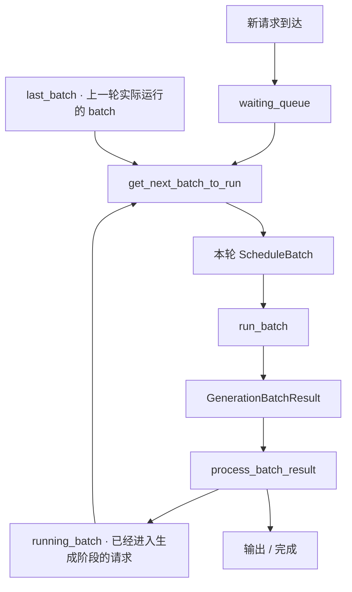
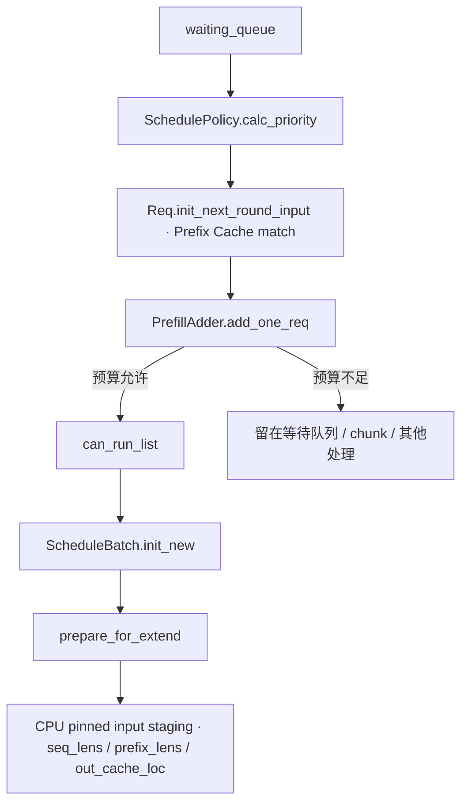
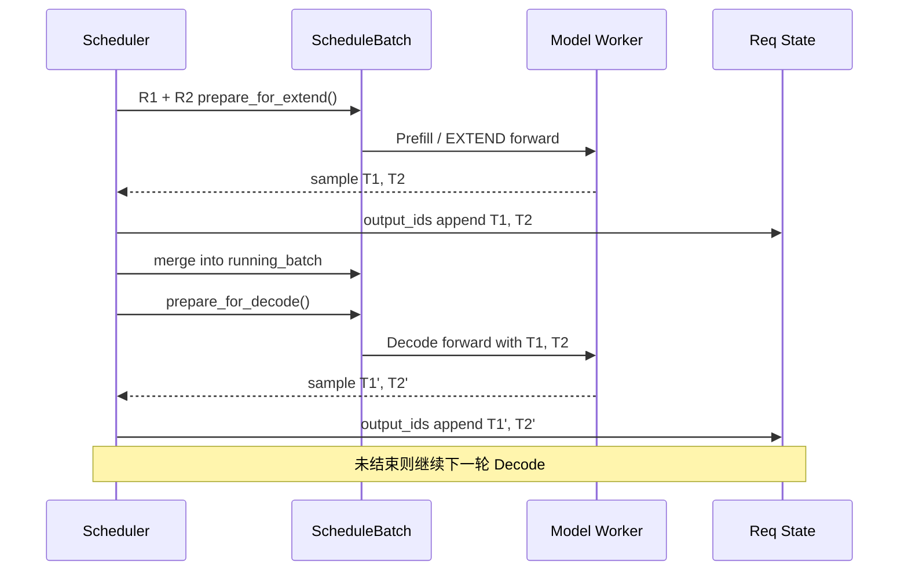
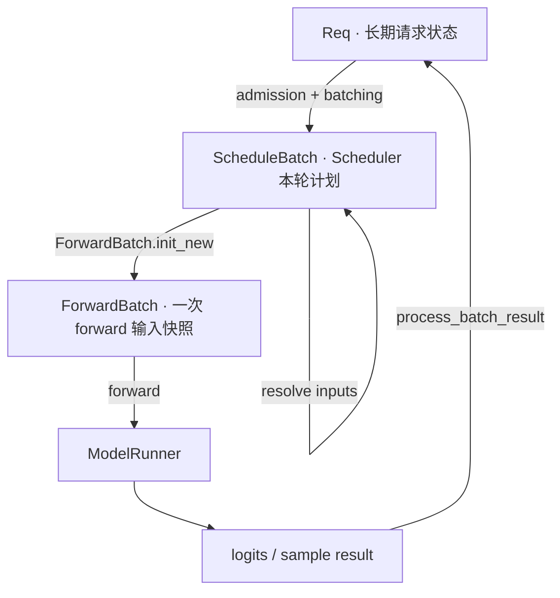
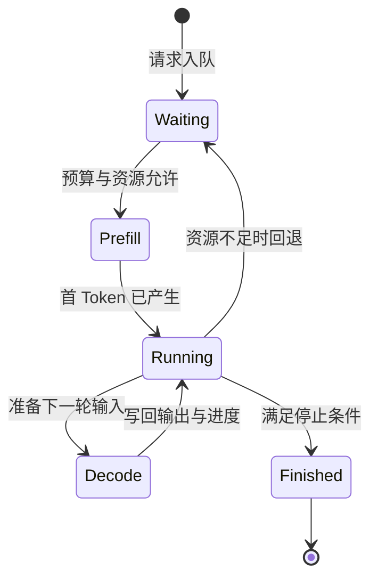

# SGLang Scheduler：请求怎样组批、执行和持续生成

两条请求都已经到达服务端，不代表它们会立即一起进入模型。Scheduler 要先看各自还有多少输入没算、能复用多少历史，以及本轮还有多少计算预算和缓存空间。一次生成可能持续很多轮，每轮的请求集合都可以变化。

在[请求生命周期](sglang-ascend-request-lifecycle.md)中，我们看过接入到返回的全程。这一篇停在调度侧，跟随两条请求从等待、Prefill 到持续 Decode，弄清本轮计划怎样形成、结果又怎样写回。执行模型内部的形状变化，留给下一篇 ModelRunner。

<details markdown="1">
<summary>源码版本与阅读范围</summary>

> **源码与适用范围**：本文基于 `sgl-project/sglang @ 5c69e32abe013fa1b913022682a3104c79105f37`，核对日期为 2026-09-20。主线分析普通文本生成、非 PD 分离、非投机推理的 Scheduler 路径，并补充 overlap schedule、Chunked Prefill 与 mixed batch 对主线的影响。示例以 DeepSeek serving 请求为背景，但 Scheduler 这一层的大部分机制与具体 Transformer 模型结构解耦。SGLang 源码仍在快速演进，阅读时应以文中固定 commit 为准。

</details>

## 一、请求状态与本轮执行计划

先看每轮循环做什么。普通 `event_loop_normal()` 不断接收输入，选出本轮 batch，执行后处理结果。下面只保留主干调用，空闲、暂停等分支在对应源码中：

```text
ingest_requests()
      |
      v
get_next_batch_to_run()
      |
      v
run_batch(batch)
      |
      v
process_batch_result(batch, result)
      |
      v
下一轮
```

选批函数 `get_next_batch_to_run()` 返回 `NextBatchPlan`，其中 `batch_to_run` 是实际准备执行的工作。`running_batch` 则保留仍在生成、需要跨轮推进的请求。循环没有为一条请求一直占着设备：这一轮结束后，还会重新检查可运行集合。 [`Scheduler.event_loop_normal()`](https://github.com/sgl-project/sglang/blob/5c69e32abe013fa1b913022682a3104c79105f37/python/sglang/srt/managers/scheduler.py#L1932-L1963)



`waiting_queue`、`running_batch` 和 `last_batch` 保存的是不同阶段的状态，读后面的组批逻辑时需要分开看。

`waiting_queue` 里是等待被 admission 的请求；`running_batch` 主要保存已经进入持续生成阶段、后续还要继续 Decode 的请求；`last_batch` 则只是“上一轮实际跑过的 batch”。上一轮如果是 Prefill / Extend，下一轮调度时它可能被并入 `running_batch`，从而开始后续 Decode。这个合并逻辑就在 [`get_next_batch_to_run()`](https://github.com/sgl-project/sglang/blob/5c69e32abe013fa1b913022682a3104c79105f37/python/sglang/srt/managers/scheduler.py#L3648-L3794)。

因此，读调度逻辑时要把长期状态与本轮计划分开。某条请求仍在生成，只说明它需要后续计算；能否进入本轮，还要由 KV 空间、Token 预算、新请求与现有请求的状态共同决定。

普通循环便于看清先后顺序，`event_loop_overlap()` 则让上一轮结果的 CPU 处理与下一轮设备工作交错。重叠会增加状态交接的要求，但仍需回答同一组问题：本轮算谁、输入是什么、结果写回哪条请求。 [源码](https://github.com/sgl-project/sglang/blob/5c69e32abe013fa1b913022682a3104c79105f37/python/sglang/srt/managers/scheduler.py#L1966-L2021)

## 二、请求进入等待队列

TokenizerManager 完成请求准备后，Scheduler 收到的是 `TokenizedGenerateReqInput`。请求分发器将它交给 `handle_generate_request()`，在调度侧创建可持续更新的 `Req`。 [源码：dispatcher](https://github.com/sgl-project/sglang/blob/5c69e32abe013fa1b913022682a3104c79105f37/python/sglang/srt/managers/scheduler.py#L1752-L1764)

`Req` 需要保留原始输入、已生成输出和采样要求，也要记录缓存状态及停止条件。LoRA、会话、reasoning、logprob 等可选信息同样在请求处理时绑定，供后续对应路径使用。这里先关注普通文本生成需要的状态。 [源码：创建 Req](https://github.com/sgl-project/sglang/blob/5c69e32abe013fa1b913022682a3104c79105f37/python/sglang/srt/managers/scheduler.py#L2776-L2845)

在 [`Req` 定义](https://github.com/sgl-project/sglang/blob/5c69e32abe013fa1b913022682a3104c79105f37/python/sglang/srt/managers/schedule_batch.py#L977-L1060) 中，可以看到几类关键状态：

| 字段 | 含义 |
| --- | --- |
| `origin_input_ids` | 原始输入 token |
| `output_ids` | 已经生成并确认的输出 token |
| `full_untruncated_fill_ids` | 当前完整输入序列视图 |
| `prefix_indices` | 已被 Prefix Cache 命中的 KV 位置 |
| `extend_range` | 本轮需要 Extend / Prefill 的 token 范围 |
| `kv` | 这条请求自己的 KV 相关状态 |
| `finished_reason` | 请求是否以及为什么结束 |

后面每轮都回到同一个 `Req`：Prefill 产生的首枚 Token 追加到 `output_ids`，普通 Decode 再继续追加，直到 EOS、长度上限或中止条件触发。batch 可以换，请求的生成进度仍要连续。

通过校验的普通请求最终会调用 `_add_request_to_queue(req)`。在非 PD 分离模式下，请求会进入 `waiting_queue`，同时记录进入等待队列的时间。[源码：入队](https://github.com/sgl-project/sglang/blob/5c69e32abe013fa1b913022682a3104c79105f37/python/sglang/srt/managers/scheduler.py#L3277-L3292)

因此这时系统状态可以先简化成：

```text
TokenizedGenerateReqInput
          |
          v
         Req
          |
          v
    waiting_queue
```

这一步只完成入队。接下来还要判断能否把请求接纳进本轮计算，源码里称为 admission。它需要同时考虑算多少和缓存能否容纳这些工作。

## 三、根据缓存、预算和空间组批

准备新 Prefill 工作时，Scheduler 进入 `get_new_batch_prefill()` / `_get_new_batch_prefill_raw()`。这条路径先确定候选顺序，再逐条检查可接纳的输入范围，最后组成 batch。 [源码](https://github.com/sgl-project/sglang/blob/5c69e32abe013fa1b913022682a3104c79105f37/python/sglang/srt/managers/scheduler.py#L3816-L3901)

首先让 `SchedulePolicy.calc_priority()` 重新组织 `waiting_queue`。当前实现支持 FCFS，也存在 LPM、HRRN、shortest-prefill-first 等 cache-aware 策略；当策略需要时，还会在这里计算 Prefix Cache 匹配信息。[源码：调度策略](https://github.com/sgl-project/sglang/blob/5c69e32abe013fa1b913022682a3104c79105f37/python/sglang/srt/managers/schedule_policy.py#L259-L341)

`PrefillAdder` 负责这次接纳过程的预算管理。它拿到 page size、前缀缓存、KV 分配器、当前运行请求，以及 Prefill Token、分块和请求数等限制，后面每接纳一条就相应扣减。 [源码：PrefillAdder](https://github.com/sgl-project/sglang/blob/5c69e32abe013fa1b913022682a3104c79105f37/python/sglang/srt/managers/schedule_policy.py#L620-L664)

前缀缓存会减少本轮需要重算的输入，却不等于取消请求的历史与后续生成开销。因此，预算检查不能只数客户端提交了多少个 Token。

对每个候选，`req.init_next_round_input(self.tree_cache)` 先刷新完整输入并查找可复用前缀，把命中位置写入 `prefix_indices` 等字段。随后才能确定本轮还需要计算哪一段。 [源码：Prefix Cache 匹配](https://github.com/sgl-project/sglang/blob/5c69e32abe013fa1b913022682a3104c79105f37/python/sglang/srt/managers/schedule_batch.py#L1556-L1657)

`PrefillAdder.add_one_req()` 结合未缓存输入、后续可能生成的 Token 和分页开销等条件，进入 `_select_prefill_admission()` 判断能否接纳。长 Prompt 也可能只被截取为本轮允许的一个 chunk，剩余输入留到后面继续。 [源码：admission](https://github.com/sgl-project/sglang/blob/5c69e32abe013fa1b913022682a3104c79105f37/python/sglang/srt/managers/schedule_policy.py#L1232-L1430)

 admission 成功时，`_commit_prefill_admission()` 会把本轮区间写进请求：

```python
req.set_extend_range(
    admission.prefix_len,
    admission.prefix_len + admission.extend_len,
)
```

然后把请求加入 `can_run_list`，并扣减相应预算。[源码](https://github.com/sgl-project/sglang/blob/5c69e32abe013fa1b913022682a3104c79105f37/python/sglang/srt/managers/schedule_policy.py#L1432-L1452)

这时才回答了“这一轮有哪些请求能跑”。

下面固定两条请求。整数只是 Token ID 的代号，示例假设 R2 可以复用前三个位置的 KV，用来解释长度与组批；它不承诺 DeepSeek-V4 专用缓存实际按三个 Token 的粒度匹配。

| 请求 | 当前完整序列 | 已命中的 Prefix Cache | 本轮 `extend_range` | 本轮要计算 |
| --- | --- | ---: | --- | ---: |
| R1 | `[11,12,13,14,15,16]` | 0 token | `[0,6)` | 6 token |
| R2 | `[21,22,23,24,25,26]` | 3 token | `[3,6)` | 3 token |

R1 本轮要算六个位置，R2 只算后三个。若本轮预算允许同时接纳两条请求，就得到 `can_run_list = [R1, R2]`。它们的总序列长度都是六，但这轮模型新增输入合计九行。

Scheduler 随后执行：

```python
new_batch = ScheduleBatch.init_new(can_run_list, ...)
new_batch.prepare_for_extend()
```

对应源码在 [`Scheduler._get_new_batch_prefill_raw()`](https://github.com/sgl-project/sglang/blob/5c69e32abe013fa1b913022682a3104c79105f37/python/sglang/srt/managers/scheduler.py#L4063-L4111)。

接纳结果进入 `ScheduleBatch` 后，`prepare_for_extend()` 将各请求的范围整理为本轮字段。这里还在准备执行计划，不能把每个字段都当作已经可供 NPU 读取的最终输入。 [源码](https://github.com/sgl-project/sglang/blob/5c69e32abe013fa1b913022682a3104c79105f37/python/sglang/srt/managers/schedule_batch.py#L2686-L2753) [`ScheduleBatch` 定义](https://github.com/sgl-project/sglang/blob/5c69e32abe013fa1b913022682a3104c79105f37/python/sglang/srt/managers/schedule_batch.py#L2305-L2393)

在上面的例子里，核心状态可以这样理解：

| Batch 字段 | 示例 |
| --- | --- |
| `forward_mode` | `EXTEND` |
| `prefix_lens` | `[0, 3]` |
| `extend_lens` | `[6, 3]` |
| `seq_lens` | `[6, 6]` |
| `extend_num_tokens` | `9` |
| Prefill 输入 | R1 的 6 个 token + R2 未命中的 3 个 token |
| `out_cache_loc` | 为这 9 个新增 KV token 分配的写入位置 |

当前版本不会在 `prepare_for_extend()` 里立刻把 Prefill input IDs 全部物化成设备 Tensor。它先把扁平化后的输入保存在 pinned CPU staging 中，`self.input_ids` 暂时保持 `None`，并把 staging 保存到 `prefill_input_ids_cpu`。[源码](https://github.com/sgl-project/sglang/blob/5c69e32abe013fa1b913022682a3104c79105f37/python/sglang/srt/managers/schedule_batch.py#L2686-L2728) [字段写入](https://github.com/sgl-project/sglang/blob/5c69e32abe013fa1b913022682a3104c79105f37/python/sglang/srt/managers/schedule_batch.py#L2870-L2915)

`ScheduleBatch` 至此知道了两条请求分别计算哪些区间、九个新增位置写到哪里。输入 ID 暂存在 CPU，并不妨碍调度计划已经成立；真正发起执行前还会完成设备输入准备。



把这轮计划与原请求并排看，可以检查一个很实际的关系：`seq_lens` 记录两条请求各自的长度，`extend_lens` 记录本轮新增长度，`out_cache_loc` 为新增行提供写入位置。缓存命中减少的是本轮重算范围。

## 四、Prefill 结束后继续 Decode

假设九行 Prefill 已完成，R1、R2 分别采样出 `T1`、`T2`，请求也没有触发停止条件。后面仍要生成，但不再每轮重算 Prompt：下一次普通 Decode 将消费这两枚新 Token。

能否马上进入 Decode，仍由下一轮调度决定。固定版本的普通主路径在 `get_next_batch_to_run()` 中先尝试构造新的 Prefill batch：

```python
prefill_plan = self.get_new_batch_prefill(running_batch)
new_batch = prefill_plan.batch_to_run
```

如果成功拿到 `new_batch`，主路径优先让这个新 Prefill batch 运行；如果没有新的 Prefill 工作，且 `running_batch` 还不为空，就调用 `update_running_batch()` 继续 Decode。[源码](https://github.com/sgl-project/sglang/blob/5c69e32abe013fa1b913022682a3104c79105f37/python/sglang/srt/managers/scheduler.py#L3736-L3794)

这里的 Continuous Batching 指请求可以动态加入、完成和退出，每轮重新确定执行集合。它并不要求新 Prefill 与正在 Decode 的请求一定混进同一个物理 batch，后者还有额外条件。

`update_running_batch()` 会先过滤已经完成的请求，然后检查 Decode 所需 KV 空间。如果 KV pool 不够，当前实现可以 retract 一部分请求、释放空间并把它们重新放回队列；如果仍能继续，则最后调用 `batch.prepare_for_decode()`。[源码](https://github.com/sgl-project/sglang/blob/5c69e32abe013fa1b913022682a3104c79105f37/python/sglang/srt/managers/scheduler.py#L4193-L4275)

若 R1、R2 仍需生成，但下一轮 KV 空间不足，调度器可能把其中一条 retract 回等待队列。这个请求没有作为成功结果结束；后续还要通过重入队与缓存策略恢复。这里只演示状态变化，不指定一定回退哪条。

空间允许继续时，`prepare_for_decode()` 为本轮新增位置分配缓存，并推进执行所需的长度：

| 动作 | 为什么 |
| --- | --- |
| `forward_mode = DECODE` | 这一轮不再处理整段 prompt |
| `alloc_for_decode(..., token_per_req=1)` | 每个活跃请求为一个新 token 分配 KV 写入位置 |
| `seq_lens = seq_lens + 1` | 每条序列向前推进一个位置 |
| 清理 Prefill 专属状态 | 避免上一阶段的输入或 CP 元数据泄漏进 Decode |

[源码：`prepare_for_decode()`](https://github.com/sgl-project/sglang/blob/5c69e32abe013fa1b913022682a3104c79105f37/python/sglang/srt/managers/schedule_batch.py#L3504-L3566)

结果处理把 `T1`、`T2` 追加到各自的 `req.output_ids`。下一轮若走普通 Decode，batch size 仍为二，输入却从九行 Prompt 变成 `T1`、`T2` 两行。两条请求此前都已处理六个位置，新 Token 各位于逻辑位置六；处理完它们后，才继续预测后面的 Token。



SGLang 在对应条件下将新 Prefill 与正在 Decode 的请求合入同一轮。当前代码在 mixed-style Chunked Prefill 满足一组条件时，会先对 `running_batch` 执行 `prepare_for_decode()`，再通过 `new_batch.mix_with_running(running_batch)` 把 Decode tail 作为 1-token extend 合入新 batch，并把 `forward_mode` 设为 `MIXED`。[源码](https://github.com/sgl-project/sglang/blob/5c69e32abe013fa1b913022682a3104c79105f37/python/sglang/srt/managers/scheduler.py#L4130-L4163) [`mix_with_running()`](https://github.com/sgl-project/sglang/blob/5c69e32abe013fa1b913022682a3104c79105f37/python/sglang/srt/managers/schedule_batch.py#L3096-L3167)

因此，需要分别确认“请求集合随轮次变化”与“本轮是否使用 MIXED”，不能只看到 continuous batching 就推断执行形状。

对于本例，先按独立的 Prefill、Decode 两轮追踪；遇到 Mixed 分支时，再对照其 1-token extend tail 如何组织。

## 五、从 ScheduleBatch 到 ForwardBatch

调度计划形成后，`ModelRunner` 需要的是执行输入。中间由 `run_batch()` 和 Worker 把本轮安排接到设备，不能把 `ScheduleBatch` 中的暂存状态直接等同于模型最终消费的 Tensor。

`Scheduler.run_batch()` 在发起模型计算前，先调用 `resolve_forward_inputs()`。[源码：run_batch 主路径](https://github.com/sgl-project/sglang/blob/5c69e32abe013fa1b913022682a3104c79105f37/python/sglang/srt/managers/scheduler.py#L4337-L4598)

这个函数把 Prefill 与 Decode 两种输入来源统一起来：

| 模式 | `input_ids` 从哪里来 |
| --- | --- |
| Prefill | `prefill_input_ids_cpu` 从 pinned CPU staging H2D 到设备 |
| Decode | 从 `FutureMap.output_tokens_buf` 取上一轮采样 token |
| Mixed | Prefill staging 与正在 Decode 的 tail token 拼起来 |

同样是 `input_ids`，Prefill 来自暂存输入，普通 Decode 可以来自上一轮的设备结果缓冲区。查输入问题时，应先分清当前模式，再沿对应来源追踪。 [ `resolve_forward_inputs()` ](https://github.com/sgl-project/sglang/blob/5c69e32abe013fa1b913022682a3104c79105f37/python/sglang/srt/managers/overlap_utils.py#L82-L119)

这份固定版本把输入准备分成两个阶段：

```text
调度阶段：
ScheduleBatch.input_ids 可能还是 None
        |
        | resolve_forward_inputs()
        v
forward 入口：
ScheduleBatch.input_ids 已物化为本轮设备输入
```

将输入解析放到 forward 附近，使 Prefill 的 H2D、上一轮采样结果的交接和下一轮计算能够围绕执行流安排。重叠调度涉及的等待与依赖需要在该路径里检查；仅看到调度阶段 `input_ids` 还是 `None`，不能据此判定输入丢失。

随后 `Scheduler.run_batch()` 调用模型 Worker 的 `forward_batch_generation(batch)`。在普通 Tensor Parallel Worker 中，这里才创建 `ForwardBatch`：

```python
forward_batch = ForwardBatch.init_new(
    batch,
    self.model_runner,
    ...
)

out = self.model_runner.forward(forward_batch)
```

[源码：`TpModelWorker.forward_batch_generation()`](https://github.com/sgl-project/sglang/blob/5c69e32abe013fa1b913022682a3104c79105f37/python/sglang/srt/managers/tp_worker.py#L631-L678)

`ForwardBatch` 将这些输入按单次执行组织，模型层会继续使用其中的位置、长度和缓存信息： [`ForwardBatch` 定义](https://github.com/sgl-project/sglang/blob/5c69e32abe013fa1b913022682a3104c79105f37/python/sglang/srt/model_executor/forward_batch_info.py#L468-L605)

| 字段 | 执行层关心什么 |
| --- | --- |
| `forward_mode` | 这是 Decode、Extend、Mixed 还是其他执行模式 |
| `input_ids` | 本轮送入模型的 token |
| `req_pool_indices` | batch 中每条请求在 request-token pool 的位置 |
| `seq_lens` | 每条序列当前长度 |
| `out_cache_loc` | 本轮新 KV 要写到哪里 |
| `positions` | 本轮 token 对应的位置 |
| `sampling_info` | 采样阶段需要的 batch 信息 |
| `spec_info` | 若启用投机推理，本轮需要的额外状态 |

`ForwardBatch.init_new()` 会从 `ScheduleBatch` 借用或整理这些字段，并在 forward 边界上补出执行层需要的派生信息。Decode 的 position 由当前 `seq_lens` 路径计算，Extend 则根据 `extend_prefix_lens`、`extend_seq_lens` 与 `extend_num_tokens` 生成 positions。[源码](https://github.com/sgl-project/sglang/blob/5c69e32abe013fa1b913022682a3104c79105f37/python/sglang/srt/model_executor/forward_batch_info.py#L847-L1073)

同一条请求由此跨过三个对象：`Req` 保存持续进度，`ScheduleBatch` 表示本轮计划，`ForwardBatch` 把计划转换为模型输入。它们的关系可以放在一张图里对照：



`ModelRunner.forward()` 收到 `ForwardBatch` 后，再进入模型执行选择。当前 `_forward_raw()` 会根据模式与能力判断是否走 graph replay、Prefill graph 或 eager runner。[源码：`ModelRunner.forward()`](https://github.com/sgl-project/sglang/blob/5c69e32abe013fa1b913022682a3104c79105f37/python/sglang/srt/model_executor/model_runner.py#L1703-L1799) [执行分派](https://github.com/sgl-project/sglang/blob/5c69e32abe013fa1b913022682a3104c79105f37/python/sglang/srt/model_executor/model_runner.py#L1849-L1947)

到这一步，本轮计算的输入已经交给 ModelRunner，接下来会选择 Graph 或 Eager，再进入 Attention、MoE 等模型计算。下一篇将沿两条请求的九行输入继续追踪；这里先回到 Scheduler，看执行结果怎样接回原请求。

## 六、把执行结果写回请求

执行产生的确认输出需要写回原来的请求。Scheduler 追加 `req.output_ids`、更新完成状态，再决定继续运行还是结束。这个回写让本轮临时 batch 与长期存在的 `Req` 接上，也让 Prefill 的首枚输出成为后续 Decode 的输入。

请求仍需生成时，后续轮次还要重新检查 KV 空间和调度预算。EOS、停止条件、长度上限或中止会使它退出运行集合；独占资源如何释放、前缀能否保留，继续交给对应缓存策略处理。



如果想检查本例是否前后接得上，可以依次对照：两条请求进入队列，接纳范围为六行和三行，Prefill 共算九行，结果各追加一枚 Token，下一轮再消费这两枚输出。继续看 [ModelRunner 的九 Token 示例](sglang-modelrunner-source-analysis.md)，会追到九行输入为何只需两行用于采样的 Logits。

### 源码阅读入口

| 目标 | 固定版本入口 |
| --- | --- |
| Scheduler 主循环 | [`scheduler.py::event_loop_normal`](https://github.com/sgl-project/sglang/blob/5c69e32abe013fa1b913022682a3104c79105f37/python/sglang/srt/managers/scheduler.py#L1932-L1963) |
| 请求进入 `Req` / waiting queue | [`handle_generate_request`](https://github.com/sgl-project/sglang/blob/5c69e32abe013fa1b913022682a3104c79105f37/python/sglang/srt/managers/scheduler.py#L2776-L3130)、[`_add_request_to_queue`](https://github.com/sgl-project/sglang/blob/5c69e32abe013fa1b913022682a3104c79105f37/python/sglang/srt/managers/scheduler.py#L3277-L3306) |
| 选择本轮 Prefill / Decode | [`get_next_batch_to_run`](https://github.com/sgl-project/sglang/blob/5c69e32abe013fa1b913022682a3104c79105f37/python/sglang/srt/managers/scheduler.py#L3648-L3794) |
| Prefill admission | [`get_new_batch_prefill`](https://github.com/sgl-project/sglang/blob/5c69e32abe013fa1b913022682a3104c79105f37/python/sglang/srt/managers/scheduler.py#L3816-L4163)、[`PrefillAdder`](https://github.com/sgl-project/sglang/blob/5c69e32abe013fa1b913022682a3104c79105f37/python/sglang/srt/managers/schedule_policy.py#L620-L664) |
| `ScheduleBatch` | [`schedule_batch.py`](https://github.com/sgl-project/sglang/blob/5c69e32abe013fa1b913022682a3104c79105f37/python/sglang/srt/managers/schedule_batch.py#L2305-L2393) |
| Prefill 准备 | [`prepare_for_extend`](https://github.com/sgl-project/sglang/blob/5c69e32abe013fa1b913022682a3104c79105f37/python/sglang/srt/managers/schedule_batch.py#L2686-L2915) |
| Decode 准备 | [`prepare_for_decode`](https://github.com/sgl-project/sglang/blob/5c69e32abe013fa1b913022682a3104c79105f37/python/sglang/srt/managers/schedule_batch.py#L3504-L3566) |
| Forward 入口输入物化 | [`resolve_forward_inputs`](https://github.com/sgl-project/sglang/blob/5c69e32abe013fa1b913022682a3104c79105f37/python/sglang/srt/managers/overlap_utils.py#L82-L119) |
| `ScheduleBatch -> ForwardBatch` | [`TpModelWorker.forward_batch_generation`](https://github.com/sgl-project/sglang/blob/5c69e32abe013fa1b913022682a3104c79105f37/python/sglang/srt/managers/tp_worker.py#L631-L749) |
| `ForwardBatch` 构造 | [`ForwardBatch.init_new`](https://github.com/sgl-project/sglang/blob/5c69e32abe013fa1b913022682a3104c79105f37/python/sglang/srt/model_executor/forward_batch_info.py#L847-L1073) |
| ModelRunner 执行入口 | [`ModelRunner.forward`](https://github.com/sgl-project/sglang/blob/5c69e32abe013fa1b913022682a3104c79105f37/python/sglang/srt/model_executor/model_runner.py#L1703-L1947) |
| Prefill / Decode 结果写回 | [Prefill](https://github.com/sgl-project/sglang/blob/5c69e32abe013fa1b913022682a3104c79105f37/python/sglang/srt/managers/scheduler_components/batch_result_processor.py#L286-L414)、[Decode](https://github.com/sgl-project/sglang/blob/5c69e32abe013fa1b913022682a3104c79105f37/python/sglang/srt/managers/scheduler_components/batch_result_processor.py#L921-L1069) |
