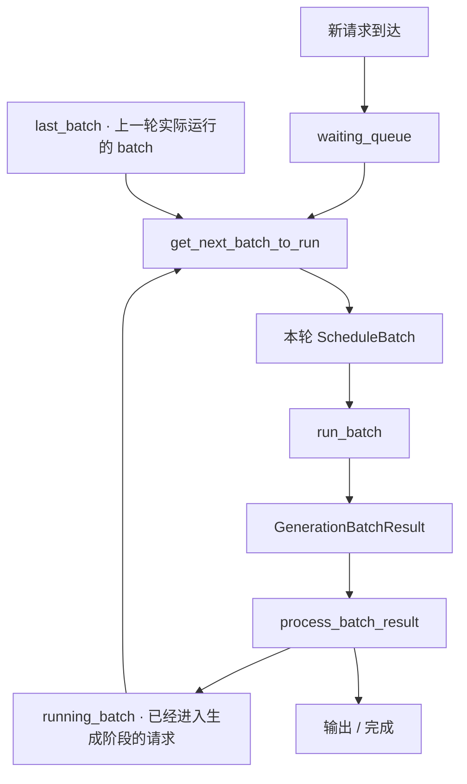
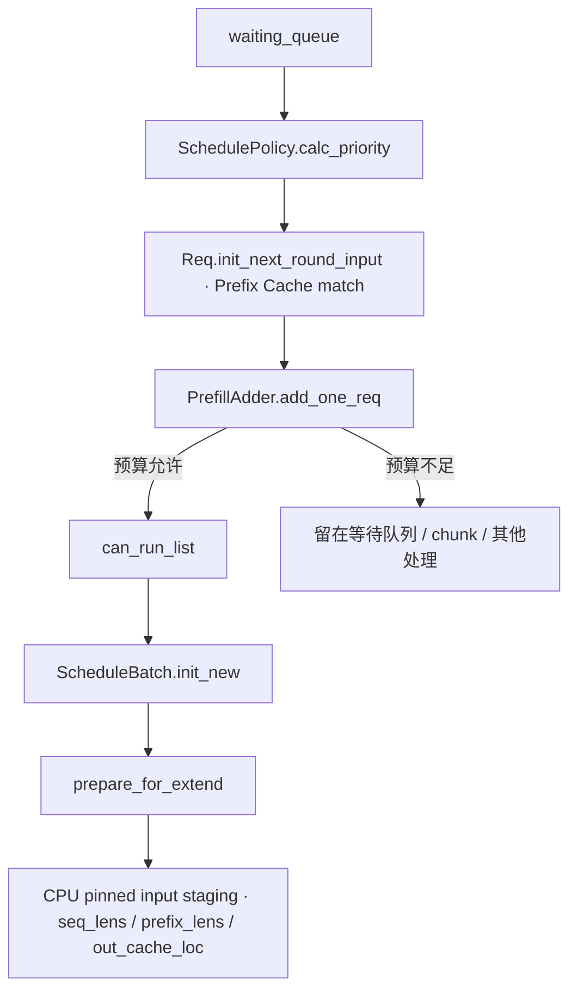
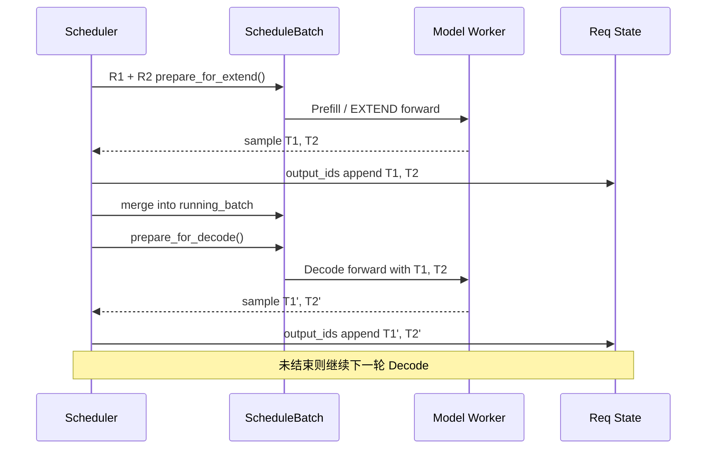
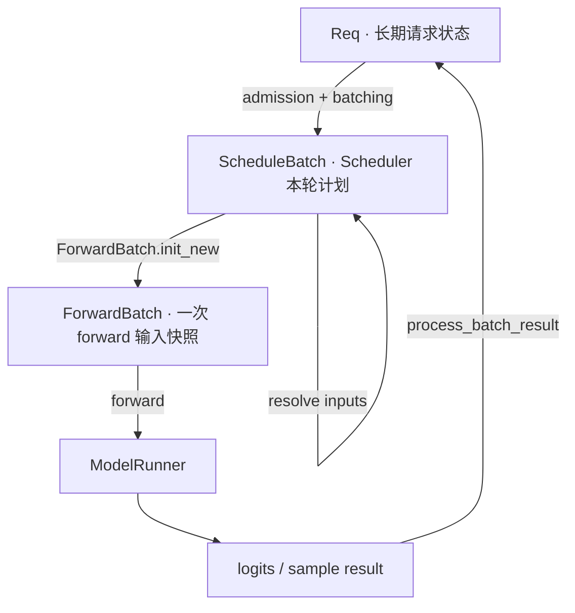
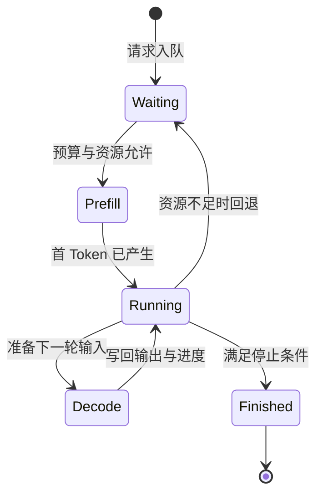

# SGLang Scheduler：请求怎样组批、执行和持续生成

一条生成请求会在服务端存在很多轮，但每次设备执行只处理它当前的一段输入。Scheduler 负责连接这两种时间尺度：长期保存请求进度，每轮根据前缀缓存、Token 预算和 KV 空间决定哪些工作可以进入 batch。

下面从已经完成分词的请求开始，追踪它如何进入等待队列、参与 Prefill、转入持续 Decode，再结束并回收资源。`Req` 表示跨轮请求，`ScheduleBatch` 表示调度计划，`ForwardBatch` 表示本次执行所需的 Tensor 与元数据。

> **源码与适用范围**：本文基于 `sgl-project/sglang @ 5c69e32abe013fa1b913022682a3104c79105f37`，核对日期为 2026-09-20。主线分析普通文本生成、非 PD 分离、非投机推理的 Scheduler 路径，并补充 overlap schedule、Chunked Prefill 与 mixed batch 对主线的影响。示例以 DeepSeek serving 请求为背景，但 Scheduler 这一层的大部分机制与具体 Transformer 模型结构解耦。SGLang 源码仍在快速演进，阅读时应以文中固定 commit 为准。

## 一、请求状态与本轮执行计划

先从 Scheduler 最外层循环看起。当前普通调度循环 `event_loop_normal()` 的骨架很清楚：

```text
ingest_requests()
      |
      v
get_next_batch_to_run()
      |
      v
run_batch(batch)
      |
      v
process_batch_result(batch, result)
      |
      v
下一轮
```

对应源码在 [`Scheduler.event_loop_normal()`](https://github.com/sgl-project/sglang/blob/5c69e32abe013fa1b913022682a3104c79105f37/python/sglang/srt/managers/scheduler.py#L1932-L1963)。每一轮循环先接收新请求，然后通过 `get_next_batch_to_run()` 产出一个 `NextBatchPlan`；其中 `batch_to_run` 是本轮准备执行的 batch，`running_batch` 则保存需要跨轮继续推进的生成请求。



这里最容易混淆的是 `waiting_queue`、`running_batch` 和 `last_batch`。

`waiting_queue` 里是等待被 admission 的请求；`running_batch` 主要保存已经进入持续生成阶段、后续还要继续 Decode 的请求；`last_batch` 则只是“上一轮实际跑过的 batch”。上一轮如果是 Prefill / Extend，下一轮调度时它可能被并入 `running_batch`，从而开始后续 Decode。这个合并逻辑就在 [`get_next_batch_to_run()`](https://github.com/sgl-project/sglang/blob/5c69e32abe013fa1b913022682a3104c79105f37/python/sglang/srt/managers/scheduler.py#L3648-L3794)。

Scheduler 每轮按资源和请求状态安排执行：现有的 KV 空间够不够、有哪些新请求值得进入、当前正在 Decode 的请求还能不能继续、本轮更适合做 Prefill 还是 Decode，以及这几类工作能不能被合并。

SGLang 还提供 `event_loop_overlap()`，让上一轮结果的 CPU 处理与下一轮设备计算交错推进。[源码](https://github.com/sgl-project/sglang/blob/5c69e32abe013fa1b913022682a3104c79105f37/python/sglang/srt/managers/scheduler.py#L1966-L2021) 这会让 batch 对象的状态管理更谨慎，但不会改变本文要抓住的主干：**Scheduler 持有长期请求状态，按轮次构造执行计划，再把结果写回请求状态。**

## 二、请求进入等待队列

当上游 TokenizerManager 已经完成必要的请求准备后，Scheduler 收到的是 `TokenizedGenerateReqInput`。在当前源码里，请求分发器把这种输入映射到 `handle_generate_request()`。[源码：dispatcher](https://github.com/sgl-project/sglang/blob/5c69e32abe013fa1b913022682a3104c79105f37/python/sglang/srt/managers/scheduler.py#L1752-L1764)

`handle_generate_request()` 会创建一个 `Req`。这里不是简单保存 input IDs；它还把采样参数、流式输出、LoRA、会话、reasoning、logprob、路由信息等都绑定到这个长期请求对象上。[源码：创建 Req](https://github.com/sgl-project/sglang/blob/5c69e32abe013fa1b913022682a3104c79105f37/python/sglang/srt/managers/scheduler.py#L2776-L2845)

`Req` 自己的注释很直接：

> “The input and output status of a request.”

在 [`Req` 定义](https://github.com/sgl-project/sglang/blob/5c69e32abe013fa1b913022682a3104c79105f37/python/sglang/srt/managers/schedule_batch.py#L977-L1060) 中，可以看到几类关键状态：

| 字段 | 含义 |
| --- | --- |
| `origin_input_ids` | 原始输入 token |
| `output_ids` | 已经生成并确认的输出 token |
| `full_untruncated_fill_ids` | 当前完整输入序列视图 |
| `prefix_indices` | 已被 Prefix Cache 命中的 KV 位置 |
| `extend_range` | 本轮需要 Extend / Prefill 的 token 范围 |
| `kv` | 这条请求自己的 KV 相关状态 |
| `finished_reason` | 请求是否以及为什么结束 |

`Req` 保存跨调度轮次的生成进度。一次 Prefill 完成之后，第一个生成 token 会进入 `output_ids`；下一轮 Decode 再生成一个；如此反复，直到 EOS、长度限制、abort 等完成条件触发。

通过校验的普通请求最终会调用 `_add_request_to_queue(req)`。在非 PD 分离模式下，请求会进入 `waiting_queue`，同时记录进入等待队列的时间。[源码：入队](https://github.com/sgl-project/sglang/blob/5c69e32abe013fa1b913022682a3104c79105f37/python/sglang/srt/managers/scheduler.py#L3277-L3292)

因此这时系统状态可以先简化成：

```text
TokenizedGenerateReqInput
          |
          v
         Req
          |
          v
    waiting_queue
```

到这里，模型还没有开始算。决定“这条请求能不能在这一轮跑”的，是下一步的 admission。

## 三、根据缓存、预算和空间组批

Scheduler 每轮准备新 Prefill 工作时，会进入 `get_new_batch_prefill()` / `_get_new_batch_prefill_raw()`。[源码](https://github.com/sgl-project/sglang/blob/5c69e32abe013fa1b913022682a3104c79105f37/python/sglang/srt/managers/scheduler.py#L3816-L3901)

首先让 `SchedulePolicy.calc_priority()` 重新组织 `waiting_queue`。当前实现支持 FCFS，也存在 LPM、HRRN、shortest-prefill-first 等 cache-aware 策略；当策略需要时，还会在这里计算 Prefix Cache 匹配信息。[源码：调度策略](https://github.com/sgl-project/sglang/blob/5c69e32abe013fa1b913022682a3104c79105f37/python/sglang/srt/managers/schedule_policy.py#L259-L341)

然后 Scheduler 创建 `PrefillAdder`。它初始化时就拿到了 page size、Prefix Cache、KV allocator、当前 `running_batch`、剩余 Prefill token 预算、Chunked Prefill 预算以及最大运行请求数等信息。[源码：PrefillAdder](https://github.com/sgl-project/sglang/blob/5c69e32abe013fa1b913022682a3104c79105f37/python/sglang/srt/managers/schedule_policy.py#L620-L664)

Admission 同时检查内存与计算预算，再决定哪些请求进入 Batch。

Scheduler 随后遍历 `waiting_queue`。对每个候选请求，先执行 `req.init_next_round_input(self.tree_cache)`，刷新当前完整输入，并与 Prefix Cache 做匹配；命中结果会写入 `prefix_indices` 等状态。[源码：Prefix Cache 匹配](https://github.com/sgl-project/sglang/blob/5c69e32abe013fa1b913022682a3104c79105f37/python/sglang/srt/managers/schedule_batch.py#L1556-L1657)

接下来调用 `PrefillAdder.add_one_req()`。当前实现会估算这条请求尚未缓存的输入 token、后续可能生成的 token、分页额外开销等，再进入 `_select_prefill_admission()` 判断预算是否允许；必要时还可能把长 Prefill 截成一个 chunk。[源码：admission](https://github.com/sgl-project/sglang/blob/5c69e32abe013fa1b913022682a3104c79105f37/python/sglang/srt/managers/schedule_policy.py#L1232-L1430)

 admission 成功时，`_commit_prefill_admission()` 会把本轮区间写进请求：

```python
req.set_extend_range(
    admission.prefix_len,
    admission.prefix_len + admission.extend_len,
)
```

然后把请求加入 `can_run_list`，并扣减相应预算。[源码](https://github.com/sgl-project/sglang/blob/5c69e32abe013fa1b913022682a3104c79105f37/python/sglang/srt/managers/schedule_policy.py#L1432-L1452)

这时才回答了“这一轮有哪些请求能跑”。

为了让这个过程具体一点，假设我们在提供 DeepSeek 文本生成服务，当前有两个候选请求。这里只用整数表示 token ID，不依赖具体 tokenizer：

| 请求 | 当前完整序列 | 已命中的 Prefix Cache | 本轮 `extend_range` | 本轮要计算 |
| --- | --- | ---: | --- | ---: |
| R1 | `[11,12,13,14,15,16]` | 0 token | `[0,6)` | 6 token |
| R2 | `[21,22,23,24,25,26]` | 3 token | `[3,6)` | 3 token |

这里 R2 的前 3 个 token 已经有可复用 KV，因此 Scheduler 不需要让模型重新计算这 3 个 token。假设预算允许 R1 和 R2 同时 admission，那么 `can_run_list = [R1, R2]`。

Scheduler 随后执行：

```python
new_batch = ScheduleBatch.init_new(can_run_list, ...)
new_batch.prepare_for_extend()
```

对应源码在 [`Scheduler._get_new_batch_prefill_raw()`](https://github.com/sgl-project/sglang/blob/5c69e32abe013fa1b913022682a3104c79105f37/python/sglang/srt/managers/scheduler.py#L4063-L4111)。

`ScheduleBatch` 的源码注释是：

> “Store all information of a batch on the scheduler.”

[`ScheduleBatch` 定义](https://github.com/sgl-project/sglang/blob/5c69e32abe013fa1b913022682a3104c79105f37/python/sglang/srt/managers/schedule_batch.py#L2305-L2393)

到了 `prepare_for_extend()`，R1 和 R2 的请求级状态开始被整理成 batch 数据。[源码](https://github.com/sgl-project/sglang/blob/5c69e32abe013fa1b913022682a3104c79105f37/python/sglang/srt/managers/schedule_batch.py#L2686-L2753)

在上面的例子里，核心状态可以这样理解：

| Batch 字段 | 示例 |
| --- | --- |
| `forward_mode` | `EXTEND` |
| `prefix_lens` | `[0, 3]` |
| `extend_lens` | `[6, 3]` |
| `seq_lens` | `[6, 6]` |
| `extend_num_tokens` | `9` |
| Prefill 输入 | R1 的 6 个 token + R2 未命中的 3 个 token |
| `out_cache_loc` | 为这 9 个新增 KV token 分配的写入位置 |

这里有一个很值得注意的实现细节：当前版本不会在 `prepare_for_extend()` 里立刻把 Prefill input IDs 全部物化成设备 Tensor。它先把扁平化后的输入保存在 pinned CPU staging 中，`self.input_ids` 暂时保持 `None`，并把 staging 保存到 `prefill_input_ids_cpu`。[源码](https://github.com/sgl-project/sglang/blob/5c69e32abe013fa1b913022682a3104c79105f37/python/sglang/srt/managers/schedule_batch.py#L2686-L2728) [字段写入](https://github.com/sgl-project/sglang/blob/5c69e32abe013fa1b913022682a3104c79105f37/python/sglang/srt/managers/schedule_batch.py#L2870-L2915)

此时的 `ScheduleBatch` 保存已完成 Admission、KV 分配与批次组织的执行计划，后续继续转换为设备输入。



组批过程结合缓存命中与资源预算，确定每条请求本轮计算的 Token 区间，并准备 KV 写入映射。

## 四、Prefill 结束后继续 Decode

新请求第一次被选中时通常走 Extend / Prefill，但生成式请求不会在一次 forward 后结束。Prefill 会得到第一个待输出 token，随后请求进入逐 token Decode。

当前普通主路径在 `get_next_batch_to_run()` 中做了一个很清楚的选择。Scheduler 先尝试构造新的 Prefill batch：

```python
prefill_plan = self.get_new_batch_prefill(running_batch)
new_batch = prefill_plan.batch_to_run
```

如果成功拿到 `new_batch`，主路径优先让这个新 Prefill batch 运行；如果没有新的 Prefill 工作，且 `running_batch` 还不为空，就调用 `update_running_batch()` 继续 Decode。[源码](https://github.com/sgl-project/sglang/blob/5c69e32abe013fa1b913022682a3104c79105f37/python/sglang/srt/managers/scheduler.py#L3736-L3794)

Continuous Batching 允许请求动态加入、完成和退出，Scheduler 每轮重新选择实际执行集合。Prefill 与 Decode 是否组成 Mixed Batch，再由当轮策略与后端能力决定。

`update_running_batch()` 会先过滤已经完成的请求，然后检查 Decode 所需 KV 空间。如果 KV pool 不够，当前实现可以 retract 一部分请求、释放空间并把它们重新放回队列；如果仍能继续，则最后调用 `batch.prepare_for_decode()`。[源码](https://github.com/sgl-project/sglang/blob/5c69e32abe013fa1b913022682a3104c79105f37/python/sglang/srt/managers/scheduler.py#L4193-L4275)

例如，R1、R2 都在生成，而下一轮可用空间不足，调度器可能先让其中一条请求退回等待队列，腾出资源让另一条继续。被退回的请求并未作为成功结果结束，后续仍要按重入队和缓存策略恢复执行。这个例子只说明状态变化，不指定实现一定选择哪条请求。

普通非投机 Decode 的 `prepare_for_decode()` 做了几件非常有代表性的事：

| 动作 | 为什么 |
| --- | --- |
| `forward_mode = DECODE` | 这一轮不再处理整段 prompt |
| `alloc_for_decode(..., token_per_req=1)` | 每个活跃请求为一个新 token 分配 KV 写入位置 |
| `seq_lens = seq_lens + 1` | 每条序列向前推进一个位置 |
| 清理 Prefill 专属状态 | 避免上一阶段的输入或 CP 元数据泄漏进 Decode |

[源码：`prepare_for_decode()`](https://github.com/sgl-project/sglang/blob/5c69e32abe013fa1b913022682a3104c79105f37/python/sglang/srt/managers/schedule_batch.py#L3504-L3566)

假设上一节 R1、R2 的 Prefill 分别采样出了 `T1`、`T2`。结果处理阶段会把它们追加到各自的 `req.output_ids`。下一轮如果没有新的 Prefill 进入主路径，这两个请求组成的 `running_batch` 就被准备成 Decode batch：batch size 仍然是 2，但本轮输入不再是 9 个 prompt token，而是每个请求各自最新的那个生成 token。



SGLang 在对应条件下将新 Prefill 与正在 Decode 的请求合入同一轮。当前代码在 mixed-style Chunked Prefill 满足一组条件时，会先对 `running_batch` 执行 `prepare_for_decode()`，再通过 `new_batch.mix_with_running(running_batch)` 把 Decode tail 作为 1-token extend 合入新 batch，并把 `forward_mode` 设为 `MIXED`。[源码](https://github.com/sgl-project/sglang/blob/5c69e32abe013fa1b913022682a3104c79105f37/python/sglang/srt/managers/scheduler.py#L4130-L4163) [`mix_with_running()`](https://github.com/sgl-project/sglang/blob/5c69e32abe013fa1b913022682a3104c79105f37/python/sglang/srt/managers/schedule_batch.py#L3096-L3167)

这也是读源码时一个很重要的区分：

**动态请求集合是 continuous batching 的核心；Prefill 和 Decode 是否在同一个物理 batch 内混合，则取决于具体调度模式和条件。**

## 五、从 ScheduleBatch 到 ForwardBatch

到这里 Scheduler 已经决定了“这一轮算什么”，但 `ModelRunner` 仍然没有直接拿 `ScheduleBatch` 执行。

`Scheduler.run_batch()` 在发起模型计算前，先调用 `resolve_forward_inputs()`。[源码：run_batch 主路径](https://github.com/sgl-project/sglang/blob/5c69e32abe013fa1b913022682a3104c79105f37/python/sglang/srt/managers/scheduler.py#L4337-L4598)

这个函数把 Prefill 与 Decode 两种输入来源统一起来：

| 模式 | `input_ids` 从哪里来 |
| --- | --- |
| Prefill | `prefill_input_ids_cpu` 从 pinned CPU staging H2D 到设备 |
| Decode | 从 `FutureMap.output_tokens_buf` 取上一轮采样 token |
| Mixed | Prefill staging 与正在 Decode 的 tail token 拼起来 |

源码注释直接写明了这两个主要来源。[ `resolve_forward_inputs()` ](https://github.com/sgl-project/sglang/blob/5c69e32abe013fa1b913022682a3104c79105f37/python/sglang/srt/managers/overlap_utils.py#L82-L119)

这意味着最新实现里的一个关键边界是：

```text
调度阶段：
ScheduleBatch.input_ids 可能还是 None
        |
        | resolve_forward_inputs()
        v
forward 入口：
ScheduleBatch.input_ids 已物化为本轮设备输入
```

这样做的价值在 overlap schedule 下尤其明显：Prefill 的 H2D、上一轮采样结果的 relay 与下一轮 forward 可以更好地围绕 forward stream 安排，而不是在较早的 Scheduler 准备阶段就强制完成所有输入搬运。

随后 `Scheduler.run_batch()` 调用模型 Worker 的 `forward_batch_generation(batch)`。在普通 Tensor Parallel Worker 中，这里才创建 `ForwardBatch`：

```python
forward_batch = ForwardBatch.init_new(
    batch,
    self.model_runner,
    ...
)

out = self.model_runner.forward(forward_batch)
```

[源码：`TpModelWorker.forward_batch_generation()`](https://github.com/sgl-project/sglang/blob/5c69e32abe013fa1b913022682a3104c79105f37/python/sglang/srt/managers/tp_worker.py#L631-L678)

`ForwardBatch` 自己的源码注释也非常直接：

> “Store all inputs of a forward pass.”

[`ForwardBatch` 定义](https://github.com/sgl-project/sglang/blob/5c69e32abe013fa1b913022682a3104c79105f37/python/sglang/srt/model_executor/forward_batch_info.py#L468-L605)

它的核心字段已经完全是“单次模型执行”视角：

| 字段 | 执行层关心什么 |
| --- | --- |
| `forward_mode` | 这是 Decode、Extend、Mixed 还是其他执行模式 |
| `input_ids` | 本轮送入模型的 token |
| `req_pool_indices` | batch 中每条请求在 request-token pool 的位置 |
| `seq_lens` | 每条序列当前长度 |
| `out_cache_loc` | 本轮新 KV 要写到哪里 |
| `positions` | 本轮 token 对应的位置 |
| `sampling_info` | 采样阶段需要的 batch 信息 |
| `spec_info` | 若启用投机推理，本轮需要的额外状态 |

`ForwardBatch.init_new()` 会从 `ScheduleBatch` 借用或整理这些字段，并在 forward 边界上补出执行层需要的派生信息。Decode 的 position 由当前 `seq_lens` 路径计算，Extend 则根据 `extend_prefix_lens`、`extend_seq_lens` 与 `extend_num_tokens` 生成 positions。[源码](https://github.com/sgl-project/sglang/blob/5c69e32abe013fa1b913022682a3104c79105f37/python/sglang/srt/model_executor/forward_batch_info.py#L847-L1073)

到这里，三个对象的边界就非常清楚了：



`ModelRunner.forward()` 收到 `ForwardBatch` 后，再进入模型执行选择。当前 `_forward_raw()` 会根据模式与能力判断是否走 graph replay、Prefill graph 或 eager runner。[源码：`ModelRunner.forward()`](https://github.com/sgl-project/sglang/blob/5c69e32abe013fa1b913022682a3104c79105f37/python/sglang/srt/model_executor/model_runner.py#L1703-L1799) [执行分派](https://github.com/sgl-project/sglang/blob/5c69e32abe013fa1b913022682a3104c79105f37/python/sglang/srt/model_executor/model_runner.py#L1849-L1947)

这也是本文选择在 `ModelRunner` 边界停下来的原因：再往下已经从“Scheduler 怎样构造一次执行”进入“模型层和 backend 怎样完成这次执行”。对于 DeepSeek + Ascend 场景，后面的 Attention、MoE、通信、NPU backend 是另一条更适合单独拆开的源码链。

## 六、把执行结果写回请求

设备完成 Prefill 或 Decode 后，Scheduler 将确认的输出追加到 `req.output_ids`，更新完成状态，再决定请求继续运行还是结束。Prefill 的首枚输出因此成为下一轮 Decode 输入；长期请求对象保存进度，本轮 Batch 负责描述这次计算。

对于仍在生成的请求，后续轮次继续检查可用 KV 空间和调度预算。EOS、停止条件、长度上限或中止使请求退出运行集合；资源回收与可复用前缀的保留则由对应缓存策略处理。



图只表示请求状态的主线。一次 Scheduler 迭代可以同时处理多条请求，结果处理也可能与后续设备工作重叠。继续向模型内部阅读时，可以接着看 [ModelRunner 的九 Token 示例](sglang-modelrunner-source-analysis.md)：调度计划如何成为具体模型输入。

### 源码阅读入口

| 目标 | 固定版本入口 |
| --- | --- |
| Scheduler 主循环 | [`scheduler.py::event_loop_normal`](https://github.com/sgl-project/sglang/blob/5c69e32abe013fa1b913022682a3104c79105f37/python/sglang/srt/managers/scheduler.py#L1932-L1963) |
| 请求进入 `Req` / waiting queue | [`handle_generate_request`](https://github.com/sgl-project/sglang/blob/5c69e32abe013fa1b913022682a3104c79105f37/python/sglang/srt/managers/scheduler.py#L2776-L3130)、[`_add_request_to_queue`](https://github.com/sgl-project/sglang/blob/5c69e32abe013fa1b913022682a3104c79105f37/python/sglang/srt/managers/scheduler.py#L3277-L3306) |
| 选择本轮 Prefill / Decode | [`get_next_batch_to_run`](https://github.com/sgl-project/sglang/blob/5c69e32abe013fa1b913022682a3104c79105f37/python/sglang/srt/managers/scheduler.py#L3648-L3794) |
| Prefill admission | [`get_new_batch_prefill`](https://github.com/sgl-project/sglang/blob/5c69e32abe013fa1b913022682a3104c79105f37/python/sglang/srt/managers/scheduler.py#L3816-L4163)、[`PrefillAdder`](https://github.com/sgl-project/sglang/blob/5c69e32abe013fa1b913022682a3104c79105f37/python/sglang/srt/managers/schedule_policy.py#L620-L664) |
| `ScheduleBatch` | [`schedule_batch.py`](https://github.com/sgl-project/sglang/blob/5c69e32abe013fa1b913022682a3104c79105f37/python/sglang/srt/managers/schedule_batch.py#L2305-L2393) |
| Prefill 准备 | [`prepare_for_extend`](https://github.com/sgl-project/sglang/blob/5c69e32abe013fa1b913022682a3104c79105f37/python/sglang/srt/managers/schedule_batch.py#L2686-L2915) |
| Decode 准备 | [`prepare_for_decode`](https://github.com/sgl-project/sglang/blob/5c69e32abe013fa1b913022682a3104c79105f37/python/sglang/srt/managers/schedule_batch.py#L3504-L3566) |
| Forward 入口输入物化 | [`resolve_forward_inputs`](https://github.com/sgl-project/sglang/blob/5c69e32abe013fa1b913022682a3104c79105f37/python/sglang/srt/managers/overlap_utils.py#L82-L119) |
| `ScheduleBatch -> ForwardBatch` | [`TpModelWorker.forward_batch_generation`](https://github.com/sgl-project/sglang/blob/5c69e32abe013fa1b913022682a3104c79105f37/python/sglang/srt/managers/tp_worker.py#L631-L749) |
| `ForwardBatch` 构造 | [`ForwardBatch.init_new`](https://github.com/sgl-project/sglang/blob/5c69e32abe013fa1b913022682a3104c79105f37/python/sglang/srt/model_executor/forward_batch_info.py#L847-L1073) |
| ModelRunner 执行入口 | [`ModelRunner.forward`](https://github.com/sgl-project/sglang/blob/5c69e32abe013fa1b913022682a3104c79105f37/python/sglang/srt/model_executor/model_runner.py#L1703-L1947) |
| Prefill / Decode 结果写回 | [Prefill](https://github.com/sgl-project/sglang/blob/5c69e32abe013fa1b913022682a3104c79105f37/python/sglang/srt/managers/scheduler_components/batch_result_processor.py#L286-L414)、[Decode](https://github.com/sgl-project/sglang/blob/5c69e32abe013fa1b913022682a3104c79105f37/python/sglang/srt/managers/scheduler_components/batch_result_processor.py#L921-L1069) |
