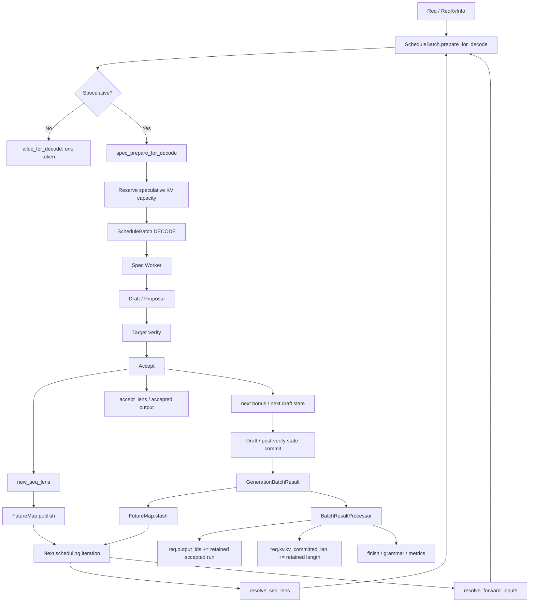

# SGLang 投机解码调度：请求进度、设备状态与跨轮交接

Scheduler 将一次投机周期交给 Spec Worker，内部再展开 Draft、Verify、Accept 和提交。Worker 返回后，Scheduler 处理输出、更新请求，并安排下一轮。

Overlap 允许设备侧下一轮输入先就绪，CPU 结果处理稍后完成。下面跟随请求，看长度、KV 预留、publish、FutureMap 怎样接住这种时差；Mixed Tail 的特殊转换放到后半部分。

<details markdown="1">
<summary>源码版本与阅读范围</summary>

> 源码固定到 `sgl-project/sglang @ 5f017ffabb6ab8d214f6a4616ee8bd98a376034a`，核对日期为 2026-09-20。覆盖 Spec V2 Scheduler、EAGLE/EAGLE3、DSpark、DFLASH、UNO、NGRAM 和 overlap relay，重点看各对象的修改责任、跨轮进度、KV 边界与执行交接。

</details>

## 一、Scheduler 与 Spec Worker 的分工

Scheduler 管执行机会和容量，Spec Worker 管本轮候选算法。同一轮工作，在两者眼中有不同的粒度。

### 第一层：Scheduler Macro State

Scheduler 通过 `Req`、`ScheduleBatch` 判断请求能否运行、处于 Prefill 还是 Decode、本轮要预留多少 KV、可以和谁组批，以及是否完成、retract 或继续留在 `running_batch`。请求的外层状态可画为：

```text
WAITING
   │
   ▼
PREFILL / EXTEND
   │
   ▼
RUNNING / DECODE
   │
   ├───────────────┐
   │               │
   ▼               ▼
FINISHED         RETRACT
```

### 第二层：Spec Worker Micro State

选定本轮 DECODE 后，Worker 才展开 Draft / Proposal、Target Verify、Accept、设备状态提交，以及 Draft Extend 或下一轮状态准备。这些阶段可以发生在同一次 Scheduler iteration 内。

EAGLE 依次执行 `draft()`、`verify()`、`eagle_sample()`、accepted-path commit，再进入 `_draft_extend_for_decode()`。[`EAGLEWorkerV2.forward_batch_generation()`](https://github.com/sgl-project/sglang/blob/5f017ffabb6ab8d214f6a4616ee8bd98a376034a/python/sglang/srt/speculative/eagle_worker_v2.py)

DSpark 则由 `proposer.propose()` 开始，经过 `resolve_verify_token_budget()`、`schedule_layout()`、Target Verify、`accept_and_finalize()`，最后提交 hidden / state。[`DSparkWorkerV2._forward_decode()`](https://github.com/sgl-project/sglang/blob/5f017ffabb6ab8d214f6a4616ee8bd98a376034a/python/sglang/srt/speculative/dspark_components/dspark_worker_v2.py)

算法内部步骤不同，外层 `ScheduleBatch.forward_mode` 都仍可为 DECODE。Worker 为实际模型调用另建 Draft、TARGET_VERIFY、DRAFT_EXTEND_V2 等 ForwardBatch。

### 为什么 `model_worker` 是这个边界的关键

Scheduler 初始化时选择普通 Worker 或 Spec Worker：

```python
if self.spec_algorithm.is_none() or self.draft_worker is None:
    self.model_worker = self.tp_worker
else:
    self.model_worker = self.draft_worker
```

普通路径由 `TpModelWorker` 运行 Target；投机路径则由 Spec Worker 编排 Draft side 与 Target Worker。Scheduler 始终调用 `self.model_worker.forward_batch_generation(batch)`，由已选中的 Worker 展开这一周期。[`Scheduler.init_model_worker()`](https://github.com/sgl-project/sglang/blob/5f017ffabb6ab8d214f6a4616ee8bd98a376034a/python/sglang/srt/managers/scheduler.py)

### `ForwardMode` 也说明了两层状态

`EXTEND`、`DECODE`、`MIXED`、`IDLE` 用于描述外层调度工作，`TARGET_VERIFY`、`DRAFT_EXTEND_V2` 等模式再说明内部单次 forward 的设备输入。因此，看到一次 Scheduler DECODE，不能据此数成一次普通模型 Decode。

## 二、CPU、设备与下一轮状态怎样错开

跨轮交接从 `Req`、`ReqKvInfo` 保存的请求状态开始，经 `ScheduleBatch` 形成本轮计划，再整理成 `ForwardBatch` 的 Tensor 与执行 metadata。Worker 用 `GenerationBatchResult` 返回结果，`FutureMap` 则承接 overlap 下的下一轮输入与长度。

固定源码将 `ScheduleBatch` 作为 Scheduler 管理的高层调度数据，将 `ForwardBatch` 作为模型执行层使用的低层 Tensor 视图。[`schedule_batch.py`](https://github.com/sgl-project/sglang/blob/5f017ffabb6ab8d214f6a4616ee8bd98a376034a/python/sglang/srt/managers/schedule_batch.py)

这些对象分别服务 CPU 结果结算、当前设备执行和下一轮交接。Overlap 下更新时刻不同，长度不必瞬间相等，读取时要先确定所处阶段。

### `Req.seqlen`：用户逻辑序列时钟

Req.seqlen 定义为：

```python
@property
def seqlen(self) -> int:
    return len(self.origin_input_ids) + len(self.output_ids)
```

它统计 CPU 请求记录已经接受的逻辑长度。


其中 output_ids 只在 Result Processor 处理结果时追加。


所以这个进度需要等 Host 结算。


### `kv_committed_len`：Host KV Ledger 的 committed boundary

`ReqKvInfo` 的 `kv_committed_len`、`kv_allocated_len` 都初始化为 0。前者记录 Host 已结算的正式 KV 边界，后者记录已分配容量，并保持 `kv_committed_len <= kv_allocated_len`。[`ReqKvInfo`](https://github.com/sgl-project/sglang/blob/5f017ffabb6ab8d214f6a4616ee8bd98a376034a/python/sglang/srt/managers/schedule_batch.py)

Spec V2 的正常修改者是 `SchedulerBatchResultProcessor._resolve_spec_v2_tokens()`。Draft Worker 不能提前推进 Host committed，而要由结果处理统一提交实际接受的完整区间。固定 AST 回归检查也约束了这份修改责任。[`test_decode_bookkeeping_ownership.py`](https://github.com/sgl-project/sglang/blob/5f017ffabb6ab8d214f6a4616ee8bd98a376034a/test/registered/unit/spec/test_decode_bookkeeping_ownership.py)

### `ScheduleBatch.seq_lens`：本轮 Device Forward Frontier

ScheduleBatch.seq_lens 则描述本轮设备边界，约定为：

```text
batch.seq_lens
=
当前这一轮 forward 能安全认为已经 KV-ready 的 prefix boundary
```

EAGLE、DSpark Verify 后会产生：

```python
new_seq_lens = old_seq_lens + accept_lens
```

并经 `FutureMap.publish()` 提前交给下一轮。

所以 overlap 时设备长度可已到 Verify N 的新 frontier，CPU 却仍停留于：


```text
Req.seqlen
Req.kv.kv_committed_len
```

等待上轮结果处理。


### 允许错开“最多一个 Verify iteration”，不是“一个 Token”

相关窗口注释明确为：

```text
kv_committed_len lags device seq_lens
by up to one verify under overlap;
the 2x window absorbs it.
```


固定入口见 [`mamba_lazy_spec_in_window()`](https://github.com/sgl-project/sglang/blob/5f017ffabb6ab8d214f6a4616ee8bd98a376034a/python/sglang/srt/managers/schedule_batch.py)。

限制是一轮 Verify 的差距，并非只差一枚 Token。


例如 `accept_lens = 4` 时：


```text
Device frontier:
ScheduleBatch.seq_lens = C + 4

Host ledger:
Req.kv.kv_committed_len = C
```

相差 4 个 Token，仍只是一轮尚未 CPU 结算的 Verify。


普通 overlap 循环也只保留前一批未处理结果：


```text
run current batch
    ↓
append result
    ↓
process previous batch result
```

由此形成一轮 forward lookahead。


### 为什么 reserve 要做 2x？

reserve 的设计见 [`get_alloc_reserve_per_decode()`](https://github.com/sgl-project/sglang/blob/5f017ffabb6ab8d214f6a4616ee8bd98a376034a/python/sglang/srt/mem_cache/allocation_sizing.py)。


实现为：

```python
def get_alloc_reserve_per_decode() -> int:
    """
    The 2x is a double-buffer that absorbs
    the kv_committed_len lag in overlap mode.
    """
    return 2 * get_alloc_len_per_decode()
```

它为 Host 落后的一轮进度留空间。

N+1 规划时，Host committed 可能仍在 C，而设备已到 C+accepted_N。


仅保留一轮最大 footprint 可能低估需求，当前采用 `2 × alloc_len`。


覆盖下面两部分：

```text
one-verify host lag
+
current speculative working set
```


### `Req.seqlen` 与 `kv_committed_len` 为什么经常差 1？

另外还有 pending bonus 带来的一位差。它已经追加到 `output_ids`，但要到下一轮作为输入执行，才有自己的 KV。

例如 `kv_committed_len=P` 时，已形成的 KV 覆盖 `[0,P)`，pending bonus 位于 P，`Req.seqlen=P+1`。下一轮以它为 root，若输出为 `D1 D2 D3 B2`，实际执行的输入就是 old_bonus、D1、D2、D3。

CPU 结算时，两份进度分别更新：

```python
req.kv.kv_committed_len += 4
req.output_ids.extend([D1, D2, D3, B2])
```

此时仍有 `Req.seqlen = kv_committed_len + 1`，只是 pending Token 换成 B2。这是一条活跃稳态请求的关系；Transition、Mixed、Finished 要按各自阶段读取，不能无条件套用差一公式。

## 三、预留 KV 空间并保留提交边界

下一轮从 `batch.prepare_for_decode()` 开始准备。普通路径为每请求分配一个 Token 的位置，写入 req_to_token 并推进相应长度；投机路径则进入 `spec_prepare_for_decode(batch)`，先为候选执行留空间。[`ScheduleBatch.prepare_for_decode()`](https://github.com/sgl-project/sglang/blob/5f017ffabb6ab8d214f6a4616ee8bd98a376034a/python/sglang/srt/managers/schedule_batch.py)

### EAGLE 做的是 speculative reserve

EAGLE 最终调用 `eagle_prepare_for_decode(batch)`。它取得 `get_alloc_reserve_per_decode()` 的 reserve，调用 `page_aligned_decode_alloc_lens()` 算出 `cur_kv_lens`、`nxt_kv_lens`、`num_needed_tokens`，再交给 `alloc_for_spec_decode(...)` 分配。[`eagle_prepare_for_decode()`](https://github.com/sgl-project/sglang/blob/5f017ffabb6ab8d214f6a4616ee8bd98a376034a/python/sglang/srt/speculative/eagle_utils.py) [`alloc_for_spec_decode()`](https://github.com/sgl-project/sglang/blob/5f017ffabb6ab8d214f6a4616ee8bd98a376034a/python/sglang/srt/mem_cache/allocation.py)

更新的是持有容量，即 `req.kv.kv_allocated_len = max(req.kv.kv_allocated_len, nxt_kv_len)`，不会同时执行 `kv_committed_len += speculative width`。

<a id="watermark"></a>

两个边界因此各有含义：allocated 限制当前可写容量，committed 表示 Host 已结算的有效历史。空间要在候选计算前准备，正式 Host commit 则等待接受结果处理，预留容量本身不确认候选正确。

### 一个典型状态

```text
0
│
├──────── committed ────────┤──────── reserve ────────┤
│                           │                          │
                            C                          A
                            ▲                          ▲
                    kv_committed_len          kv_allocated_len
```

Draft、Verify 可暂写 `[C,A)`，接受结果才决定其中哪段成为正式前缀。

## 四、on_publish 发布哪一部分进度

接着看本轮执行与发布。

外层循环为：

```text
get_next_batch_to_run()
        ↓
prepare_for_decode()
        ↓
run_batch()
        ↓
process_batch_result()
```

Spec V2 调用：

```text
run_batch()
   ↓
self.model_worker.forward_batch_generation()
```

model_worker 已是对应投机编排者。


### EAGLE：一次 Scheduler DECODE 包含 Draft → Verify → Accept → Draft Extend

EAGLE 的 Decode 内部为：

```text
ScheduleBatch(DECODE)
        ↓
draft()
        ↓
EagleVerifyInput
        ↓
verify()
        ↓
eagle_sample()
        ↓
accept_lens / accept_index / new_seq_lens
        ↓
_draft_extend_for_decode()
        ↓
GenerationBatchResult
```

Verify 临时切为 TARGET_VERIFY，构造 Target ForwardBatch。


```text
Scheduler Macro State:
DECODE

Worker Micro State:
DRAFT
→ TARGET_VERIFY
→ ACCEPT
→ DRAFT_EXTEND
```

外层管理请求、batch，内部执行候选周期，再以结果交接。


### DSpark：内部算法完全不同，但 Scheduler Contract 一样

DSpark 虽使用另一算法，最后仍返回相同类别信息：

```text
Proposal
  ↓
Confidence
  ↓
Verify Budget
  ↓
schedule_layout()
  ↓
Target Verify
  ↓
accept_and_finalize()
  ↓
commit_hidden / Mamba state
```


```python
GenerationBatchResult(
    next_token_ids=...,
    accept_lens=...,
    next_draft_input=...,
    new_seq_lens=...,
)
```

所以外层无需展开候选树或预算算法。


它只需要得到：

```text
本轮接受了什么？
下一轮 frontier 在哪？
下一轮 draft state 是什么？
```


### 所有 `on_publish(new_seq_lens)` 的语义边界是一致的，但物理位置不完全一致

共同含义是下一轮可以安全取得已确定的 frontier，具体发布位置则不同：

<a id="eagle-multi-layer-eagle-frozen-kv-mtp"></a>
<a id="dspark"></a>
<a id="dflash"></a>
<a id="ngram-uno"></a>

| 路径 | `on_publish(new_seq_lens)` 与其他工作的顺序 |
| --- | --- |
| EAGLE / Multi-layer EAGLE / Frozen-KV MTP | Target Verify、Accept 确定新长度后发布，再由 Draft Extend 追平 Draft 状态 |
| DSpark | `accept_and_finalize()` 后发布，部分 post-verify state commit 继续执行 |
| DFLASH | Verify / Accept 后，必要时先更新 Target Mamba state，再发布；之后将接受的 Target hidden 物化到 Draft KV |
| NGRAM | accepted KV 搬运后发布，之后更新 Host corpus |
| UNO | 接受得到新长度后直接发布 |

EAGLE 注释将 fence 放在 verify-end，DSpark 也明确在 publish 之后继续一部分提交。发布长度、设备尾部完成、Worker 返回，是三个不同的时刻。[`DSparkWorkerV2._forward_decode()`](https://github.com/sgl-project/sglang/blob/5f017ffabb6ab8d214f6a4616ee8bd98a376034a/python/sglang/srt/speculative/dspark_components/dspark_worker_v2.py)

### 为什么这样仍然安全？

这允许 schedule_stream 提前做 Host、allocation 准备。


下一次模型仍不能越过当前 forward stream 上的：

```text
Draft Extend
Mamba commit
hidden materialization
```

这些依赖保持程序顺序。

所以可以形成：

```text
Forward Stream:
Verify N
   ↓
Accept N
   ↓
publish(frontier N)
   ↓
Draft/State Commit N
   ↓
Forward N+1


Schedule Stream:
             publish fence
                   ↓
          Prepare Schedule N+1
```

重叠的是准备与本轮尾部设备工作，依赖状态的模型执行并未乱序。


### Prefill 的 publish 也遵守同一个思想

Prefill 也按以下方式发布：

```text
Target Prefill
      ↓
new_seq_lens = batch.seq_lens
      ↓
publish()
      ↓
Draft prefill / hidden injection
```

这里不加一，是因为：


```text
batch.seq_lens
=
当前已经 KV-ready 的 prompt boundary
```

新采样 Token 仍是下轮 pending root，不属于已物化 Prefix。


因此 frontier 继续为 batch.seq_lens，与 Decode 末尾 bonus 一致。


## 五、隔离临时字段与保护共享对象

再区分字段重新绑定与共享对象原地修改。

Worker 可临时替换 `forward_mode`、`input_ids`、`seq_lens`、`seq_lens_cpu`、`seq_lens_sum`、`spec_info`、`out_cache_loc`、`sampling_info` 等字段。

例如：

```text
DECODE
  ↓
TARGET_VERIFY
```

或替换为 `batch.spec_info = EagleVerifyInput`。

若这些模式、位置泄漏到外层，下轮可能误判为：

```text
EXTEND
TARGET_VERIFY
```

再造成重复合并或错误分配。


### `_forward_isolation()` 恢复字段绑定，不深拷贝整个 Batch

isolation 先保存：

```python
snapshot_v2_full = not batch.spec_algorithm.is_none()

sched_snapshot = {
    f.name: getattr(batch, f.name)
    for f in dataclasses.fields(batch)
}
```

退出时恢复：

```python
for name, value in sched_snapshot.items():
    setattr(batch, name, value)
```


实现见 [`Scheduler._forward_isolation()`](https://github.com/sgl-project/sglang/blob/5f017ffabb6ab8d214f6a4616ee8bd98a376034a/python/sglang/srt/managers/scheduler.py)。

保存的是字段引用，而非整对象深拷贝。操作效果分别为：

| Worker 内的操作 | 退出 isolation 后 |
| --- | --- |
| `batch.seq_lens = new_tensor` | 字段重新指向原 Tensor |
| `batch.seq_lens.add_(1)` | 原 Tensor 的内容已改变，恢复引用不能撤销它 |
| 修改字段所引用的列表或嵌套对象 | 不会因 `setattr` 自动恢复内部内容 |

因此临时替换由 isolation 恢复，共享内容还需单独复制、同步；sampling_info.copy_for_forward 负责其中一项。


### `sampling_info` 为什么还要额外换成 forward-only copy？

进入隔离前还会创建：

```python
batch.sampling_info =
    sched_sampling_info.copy_for_forward()
```

因为内部可能多次 ForwardBatch.init_new，直接共用 Scheduler sampling state 会重复累计 penalty。


所以将 Scheduler 状态与 forward-local view 分开。


### Overlap 下还要保活两轮 tensor reference

record_batch_in_overlap 另将以下 Tensor 保存在两槽 ring：

```text
batch
+
attr_snapshot
```


这用于保活引用。

Worker 可能执行：

```text
rebind batch.input_ids
rebind batch.out_cache_loc
rebind batch.spec_info
```

若旧引用过早释放，allocator 可在 forward stream 尚未读完时复用空间。

字段语义恢复与设备 Tensor lifetime 都需处理，恢复绑定并不能替代保活。


### 那么哪些字段最终必须显式 re-commit？

退出恢复后，跨轮新状态还要显式接回。

先恢复旧绑定，再按 next-iteration contract 提交结果。


#### Overlap 路径

Overlap 返回后接入：

```python
batch.input_ids = None

batch.spec_info =
    batch_result.next_draft_input

batch.spec_info.future_indices =
    future_indices
```

这里不会直接用 new_seq_lens 覆盖 batch.seq_lens。


长度已进入 FutureMap.publish relay，下轮从以下入口解析：


```python
future_map.resolve_seq_lens_cpu(batch)
```

取得 fresh frontier。

所以两类显式提交分别为：

```text
ScheduleBatch object:
next_draft_input / relay handle

FutureMap:
new_seq_lens
bonus/topk/hidden...
```


#### Non-overlap 路径

Non-overlap 没有该 relay，恢复后需要直接接入：

```python
batch.spec_info = batch_result.next_draft_input

batch.seq_lens = batch_result.new_seq_lens

batch.seq_lens_cpu =
    batch_result.new_seq_lens.to("cpu")

batch.seq_lens_sum =
    int(batch.seq_lens_cpu.sum())

batch.input_ids = None
```

这是同步路径的跨轮提交。


### 哪些字段必须保持 rollback？

临时 forward_mode 需恢复为外层 DECODE。


不能保留内部的：

```text
TARGET_VERIFY
DRAFT_EXTEND_V2
```

其他临时绑定还有：

```text
verify-time input_ids
verify-time out_cache_loc
temporary EagleVerifyInput
temporary verify seq_lens
```

本次结束后恢复，下一轮状态从结果接入。


### 字段隔离与显式提交的边界

因此可临时改变本轮模式、缓存位置、spec_info、长度，但仅通过规定结果提交下一轮。

| 对象变化 | 隔离区退出后的处理 |
| --- | --- |
| `ScheduleBatch` 字段被重新绑定 | 恢复进入时保存的字段值或对象引用 |
| 原 Tensor 或嵌套对象被原地修改 | 浅快照不会自动撤销，需要调用方单独保护 |
| 下一轮 Draft 输入、长度与 bonus | 通过对应结果和交接路径显式发布或提交 |

调试还要查看共享对象是否原地写入，只比字段最终引用不能覆盖此类修改。

前面是普通 Spec Decode，Mixed Tail 还要将边界 Token 当作单 Token EXTEND，下面另看。

## 六、进阶：Mixed Tail 的 FutureMap 重建

<details markdown="1">
<summary>展开 Mixed Tail 的字段变化与 +1 来源</summary>

Mixed Tail 的 +1 必须放在这条路径里理解。

resolve 中会设置：

```python
fresh = self.new_seq_lens_buf[idx]

seq_lens = batch.seq_lens.clone()
seq_lens[-n:] = fresh + 1
batch.seq_lens = seq_lens
```

同时重绑：

```python
out_cache_loc[-n:] =
    req_to_token[idx, fresh]
```

这里需要 +1，而通常的定义是：


```text
new_seq_lens
=
next KV-ready frontier
```

---

### 先看 Mixed Chunk 在做什么

mixed chunked prefill 将以下工作放到一起：

```text
new prefill requests
+
running decode requests
```

形成 ForwardMode.MIXED。


已有 Decode 在此被改写为 1-token EXTEND tail，尚不是普通投机 Verify。

mix_with_running 注释为 `a tail's prefix is its row length - 1`。

Spec 行则停在 committed base。


### 对 speculative request 来说，那个“1 token tail”是什么？

这个 tail 正是 pending bonus。

若 fresh frontier 为 C，表示 `[0,C)` 已有 KV，bonus 位于 C 尚未执行。


Mixed Extend 要做的是：

```text
prefix:
[0, C)

extend token:
bonus at C
```

所以 EXTEND 的 full length 应为 C+1。

相应设置为：

```python
seq_lens = fresh + 1
```


并将：

```python
out_cache_loc =
    req_to_token[idx, fresh]
```

定位到 bonus 在 C 的写入槽。

整段关系可画为：

```text
FutureMap new_seq_lens = C

KV-ready:
|====================|
0                    C

                     B
                     ▲
               pending bonus


Mixed 1-token EXTEND:

prefix_len = C

input = B

write position = C

full seq_len = C + 1
```

它将 KV-ready base 转为这次单 Token 执行后的完整长度。


### 为什么 Result Processor 还要专门 `kv_committed_len += 1`？

本次确实执行了 bonus，所以 prefill Result Processor 有单独的提交分支：


```python
if (
    not req.finished()
    and batch.decoding_reqs
    and req in batch.decoding_reqs
    and not batch.spec_algorithm.is_none()
):
    req.kv.kv_committed_len += 1
```

其注释为：

```text
A mixed spec tail committed its pending bonus token;
advance so the next spec prepare_for_decode
reserves from the right base.
```


入口见 [`SchedulerBatchResultProcessor.process_batch_result_prefill()`](https://github.com/sgl-project/sglang/blob/5f017ffabb6ab8d214f6a4616ee8bd98a376034a/python/sglang/srt/managers/scheduler_components/batch_result_processor.py)。

因此这里 +1 具有局部含义：Mixed Extend 将 pending bonus 物化并提交。


### 为什么不是所有 FutureMap resolve 都 `+1`？

普通 Spec 下轮则仍要从 C 开始，把 bonus 作为 Verify root。


若先把 seq_lens 设 C+1，就提前宣称该 Token 已有 KV。


所以普通解析使用 `seq_lens = new_seq_lens`。

只有 Mixed Tail 改作 EXTEND 才转换为 new_seq_lens+1。


### 这个 `+1` 也不是 DP Attention 的通用规则

这还不能推广为 DPA 规则。

Spec+DPA 明确采用：


```text
make sure prefill and decode batches
will not be mixed
```

merge 前先协调 Prefill/Decode 模式，避免当成普通 mixed chunk。


入口见 [`Scheduler.get_next_batch_to_run()` 附近](https://github.com/sgl-project/sglang/blob/5f017ffabb6ab8d214f6a4616ee8bd98a376034a/python/sglang/srt/managers/scheduler.py)。

DPA 另有：

```python
maybe_convert_decode_to_extend()
```

其他 DP 跑 Extend、本地跑 Decode 时，可为 mode-homogeneous 和 Extend Graph，将整个 Decode 暂转 1-token EXTEND view。

对应入口为：

[`SchedulerDPAttnAdapter.maybe_convert_decode_to_extend()`](https://github.com/sgl-project/sglang/blob/5f017ffabb6ab8d214f6a4616ee8bd98a376034a/python/sglang/srt/managers/scheduler_components/dp_attn.py)

该路径调用：

```python
batch.convert_decode_to_extend()
```

直接按已准备的 full sequence length 解释：

```text
prefix = seq_len - 1
extend_len = 1
```

它不是 FutureMap.resolve_mixed_spec_tails。

所以 new_seq_lens+1 只属于 overlap mixed-tail 的 late binding，不是 FutureMap 或 DPA 的统一长度定义。


### 为什么要 late-bind？

schedule time 的 Host 可能仍落后一轮，mix_with_running 先据此构造 provisional tail。


到真正执行入口：

```python
resolve_forward_inputs()
```

再等待 publish_ready，读取最新 FutureMap.new_seq_lens_buf。

重新绑定：

```text
fresh prefix
fresh out_cache_loc
fresh seq_lens
```

这样才能以最新设备进度执行本次 tail。


</details>

## 七、把跨轮状态交还 Scheduler

将整条交接放在一起：



图中分别是 Host 已结算、本轮执行、下一轮已发布三种进度。它们短暂错开，由各自负责的组件更新：

<a id="pastcpu-settle"></a>
<a id="present-scheduler-transaction"></a>
<a id="futurecpu-settle-gpu"></a>

| 进度 | 对应对象 | 此时表示什么 |
| --- | --- | --- |
| Host 已结算 | `Req.output_ids`、`Req.kv.kv_committed_len` | 已处理请求结果及正式 KV 边界 |
| 本轮执行 | `ScheduleBatch`、`ForwardBatch` | 当前调度事务及临时 TARGET_VERIFY / DRAFT_EXTEND 状态 |
| 下一轮已发布 | `FutureMap.new_seq_lens`、`FutureMap.output_tokens_buf`、`next_draft_input`，以及 topk / hidden / confidence | 下一轮可以依赖的输入和进度 |

### 四个跨轮状态边界

对齐日志时，先保留这几处差别：设备 frontier 可以领先 Host 一轮 Verify，差距可大于一枚 Token；publish 可以早于 Draft Extend、Mamba commit 或 hidden 注入结束，但后续模型受流依赖保护；isolation 恢复字段绑定，跨轮新状态仍需经结果或 FutureMap 接入，原地修改也需单独保护。

Mixed Tail 的 `+1` 还要另看：KV-ready base 为 C，本次单 Token EXTEND 正在物化位置 C 的 bonus，才将 full length 转成 C+1。这个转换不属于普通 Spec 或 DPA 的统一规则。

### Debug Scheduler 时建议同时打印这些字段

记录字段时按请求、轮次并排：

```text
rid

len(origin_input_ids)
len(output_ids)
Req.seqlen

req.kv.cache_protected_len
req.kv.kv_committed_len
req.kv.kv_allocated_len

batch.forward_iter
batch.forward_mode
batch.seq_lens
batch.seq_lens_cpu

type(batch.spec_info)
future_indices

result.accept_lens
result.new_seq_lens

FutureMap.new_seq_lens_buf[req_pool_idx]
FutureMap.output_tokens_buf[req_pool_idx]
```

再问四个具体问题：当前值属于 Host 结算还是设备执行？由 Scheduler、Worker、ResultProcessor 还是 FutureMap 修改？它表示 committed、allocated 还是 pending bonus？当前是普通 Decode、TARGET_VERIFY、Mixed 单 Token Extend，还是 DPA 的 decode→extend view？

这样可先区分长度属于哪个阶段、由谁修改，再检查是否漏提交、重复处理或共享对象被改写。

## 源码阅读入口

源码版本仍为开头固定的 `sgl-project/sglang @ 5f017ffabb6ab8d214f6a4616ee8bd98a376034a`。

源码可按以下顺序进入：

| 目标 | 固定版本源码 |
| --- | --- |
| `Req / ReqKvInfo / ScheduleBatch` | [`schedule_batch.py`](https://github.com/sgl-project/sglang/blob/5f017ffabb6ab8d214f6a4616ee8bd98a376034a/python/sglang/srt/managers/schedule_batch.py) |
| `ForwardMode / ForwardBatch.init_new()` | [`forward_batch_info.py`](https://github.com/sgl-project/sglang/blob/5f017ffabb6ab8d214f6a4616ee8bd98a376034a/python/sglang/srt/model_executor/forward_batch_info.py) |
| Scheduler Event Loop / `run_batch()` | [`scheduler.py`](https://github.com/sgl-project/sglang/blob/5f017ffabb6ab8d214f6a4616ee8bd98a376034a/python/sglang/srt/managers/scheduler.py) |
| Spec Worker dispatch | [`Scheduler.init_model_worker()`](https://github.com/sgl-project/sglang/blob/5f017ffabb6ab8d214f6a4616ee8bd98a376034a/python/sglang/srt/managers/scheduler.py) |
| `_forward_isolation()` | [`scheduler.py`](https://github.com/sgl-project/sglang/blob/5f017ffabb6ab8d214f6a4616ee8bd98a376034a/python/sglang/srt/managers/scheduler.py) |
| Spec Decode Preparation | [`spec_utils.py::spec_prepare_for_decode()`](https://github.com/sgl-project/sglang/blob/5f017ffabb6ab8d214f6a4616ee8bd98a376034a/python/sglang/srt/speculative/spec_utils.py) |
| EAGLE reserve | [`eagle_utils.py::eagle_prepare_for_decode()`](https://github.com/sgl-project/sglang/blob/5f017ffabb6ab8d214f6a4616ee8bd98a376034a/python/sglang/srt/speculative/eagle_utils.py) |
| Spec KV sizing / double reserve | [`allocation_sizing.py`](https://github.com/sgl-project/sglang/blob/5f017ffabb6ab8d214f6a4616ee8bd98a376034a/python/sglang/srt/mem_cache/allocation_sizing.py) |
| Spec KV allocation | [`allocation.py::alloc_for_spec_decode()`](https://github.com/sgl-project/sglang/blob/5f017ffabb6ab8d214f6a4616ee8bd98a376034a/python/sglang/srt/mem_cache/allocation.py) |
| EAGLE V2 micro-state machine | [`eagle_worker_v2.py`](https://github.com/sgl-project/sglang/blob/5f017ffabb6ab8d214f6a4616ee8bd98a376034a/python/sglang/srt/speculative/eagle_worker_v2.py) |
| Shared EAGLE Verify | [`eagle_worker_common.py`](https://github.com/sgl-project/sglang/blob/5f017ffabb6ab8d214f6a4616ee8bd98a376034a/python/sglang/srt/speculative/eagle_worker_common.py) |
| DSpark decode state machine | [`dspark_worker_v2.py`](https://github.com/sgl-project/sglang/blob/5f017ffabb6ab8d214f6a4616ee8bd98a376034a/python/sglang/srt/speculative/dspark_components/dspark_worker_v2.py) |
| DFLASH publish / draft-KV materialization | [`dflash_worker_v2.py`](https://github.com/sgl-project/sglang/blob/5f017ffabb6ab8d214f6a4616ee8bd98a376034a/python/sglang/srt/speculative/dflash_worker_v2.py) |
| UNO publish contract | [`uno_worker_v2.py`](https://github.com/sgl-project/sglang/blob/5f017ffabb6ab8d214f6a4616ee8bd98a376034a/python/sglang/srt/speculative/uno_worker_v2.py) |
| NGRAM publish contract | [`ngram_worker.py`](https://github.com/sgl-project/sglang/blob/5f017ffabb6ab8d214f6a4616ee8bd98a376034a/python/sglang/srt/speculative/ngram_worker.py) |
| `GenerationBatchResult` | [`managers/utils.py`](https://github.com/sgl-project/sglang/blob/5f017ffabb6ab8d214f6a4616ee8bd98a376034a/python/sglang/srt/managers/utils.py) |
| Spec host commit | [`batch_result_processor.py::_resolve_spec_v2_tokens()`](https://github.com/sgl-project/sglang/blob/5f017ffabb6ab8d214f6a4616ee8bd98a376034a/python/sglang/srt/managers/scheduler_components/batch_result_processor.py) |
| Mixed spec tail commit | [`batch_result_processor.py`](https://github.com/sgl-project/sglang/blob/5f017ffabb6ab8d214f6a4616ee8bd98a376034a/python/sglang/srt/managers/scheduler_components/batch_result_processor.py) |
| `FutureMap.publish / stash / resolve` | [`overlap_utils.py`](https://github.com/sgl-project/sglang/blob/5f017ffabb6ab8d214f6a4616ee8bd98a376034a/python/sglang/srt/managers/overlap_utils.py) |
| DP decode→extend conversion | [`dp_attn.py`](https://github.com/sgl-project/sglang/blob/5f017ffabb6ab8d214f6a4616ee8bd98a376034a/python/sglang/srt/managers/scheduler_components/dp_attn.py) |
| Bookkeeping ownership regression test | [`test_decode_bookkeeping_ownership.py`](https://github.com/sgl-project/sglang/blob/5f017ffabb6ab8d214f6a4616ee8bd98a376034a/test/registered/unit/spec/test_decode_bookkeeping_ownership.py) |

跨轮日志先标 Host、设备或已发布结果，再追 publish、resolve、结果处理的消费时刻。长度不同可能是预期滞后，也可能是漏提交、重复提交或原地修改，需要沿同一请求逐步判断。
