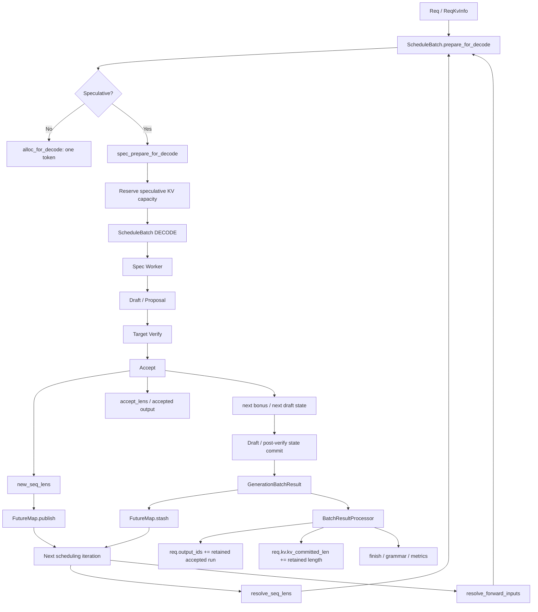

# SGLang 投机解码调度：请求进度、设备状态与跨轮交接

一次 Verify 推进了 4 枚 Token，设备已经准备下一轮，CPU 的请求长度却还没变。这在 Overlap 中可以是正常状态：设备执行、Host 结果处理、下一轮发布，使用各自的进度。

Scheduler 将一个投机周期交给 Spec Worker，内部的 Draft、Verify、Accept、状态提交完成后，再结算请求输出。理解这段交接，需要沿同一条请求追长度、KV 预留和 FutureMap，而不能只比两个字段是否相等。

<details markdown="1">
<summary>源码版本与阅读范围</summary>

源码固定为 `sgl-project/sglang @ 5f017ffabb6ab8d214f6a4616ee8bd98a376034a`，核对日期为 2026-09-20。范围包括 Spec V2 Scheduler、EAGLE/EAGLE3、DSpark、DFLASH、UNO、NGRAM 与 overlap relay，重点跟踪各对象由谁修改、何时交接。

</details>

## 一、Scheduler 与 Spec Worker 的分工

Scheduler 决定请求何时运行、容量是否足够；Spec Worker 再把本轮工作展开为候选算法。两者观察同一轮的粒度不同。

<a id="scheduler-macro-state"></a>

### Scheduler 管理请求与 batch

`Req`、`ScheduleBatch` 保存外层计划：请求处于 Prefill 还是 Decode，和谁组批，预留多少 KV，以及完成、retract 或继续留在 `running_batch`。外层状态为：

```text
WAITING
   │
   ▼
PREFILL / EXTEND
   │
   ▼
RUNNING / DECODE
   │
   ├───────────────┐
   │               │
   ▼               ▼
FINISHED         RETRACT
```

<a id="spec-worker-micro-state"></a>

### Spec Worker 展开本轮候选周期

Scheduler 选定 DECODE，Worker 才运行 Draft / Proposal、Target Verify、Accept，提交设备状态，并准备 Draft Extend 或下一轮输入。这些步骤可以都落在同一次 Scheduler iteration 中。

EAGLE 的顺序是 `draft()`、`verify()`、`eagle_sample()`、accepted-path commit，随后 `_draft_extend_for_decode()`。[`EAGLEWorkerV2.forward_batch_generation()`](https://github.com/sgl-project/sglang/blob/5f017ffabb6ab8d214f6a4616ee8bd98a376034a/python/sglang/srt/speculative/eagle_worker_v2.py)

DSpark 则从 `proposer.propose()` 进入，经过 `resolve_verify_token_budget()`、`schedule_layout()`、Target Verify、`accept_and_finalize()`，最后提交 hidden / state。[`DSparkWorkerV2._forward_decode()`](https://github.com/sgl-project/sglang/blob/5f017ffabb6ab8d214f6a4616ee8bd98a376034a/python/sglang/srt/speculative/dspark_components/dspark_worker_v2.py)

算法内部步骤不同，外层 `ScheduleBatch.forward_mode` 仍可统一为 DECODE。实际模型调用再构建 Draft、TARGET_VERIFY、DRAFT_EXTEND_V2 等 ForwardBatch。

### model_worker 连接两层调用

Scheduler 初始化时选择普通 Worker 或 Spec Worker：

```python
if self.spec_algorithm.is_none() or self.draft_worker is None:
    self.model_worker = self.tp_worker
else:
    self.model_worker = self.draft_worker
```

普通路径用 `TpModelWorker` 运行 Target；投机路径由 Spec Worker 编排 Draft side 和 Target Worker。选好以后，Scheduler 都调用 `self.model_worker.forward_batch_generation(batch)`。[`Scheduler.init_model_worker()`](https://github.com/sgl-project/sglang/blob/5f017ffabb6ab8d214f6a4616ee8bd98a376034a/python/sglang/srt/managers/scheduler.py)

### ForwardMode 描述不同层次的工作

外层以 `EXTEND`、`DECODE`、`MIXED`、`IDLE` 描述调度工作；内部再用 `TARGET_VERIFY`、`DRAFT_EXTEND_V2` 描述单次 forward 的设备输入。统计一次 Scheduler DECODE，可能已经包含多次模型调用。

## 二、CPU、设备与下一轮状态怎样错开

请求从 `Req`、`ReqKvInfo` 进入 `ScheduleBatch` 的本轮计划，再整理为 `ForwardBatch` 的 Tensor 和 metadata。执行结果由 `GenerationBatchResult` 返回；Overlap 还通过 `FutureMap` 传递下一轮输入和长度。

源码也据此将 `ScheduleBatch` 定义为高层调度数据，将 `ForwardBatch` 定义为模型执行使用的低层 Tensor 视图。[`schedule_batch.py`](https://github.com/sgl-project/sglang/blob/5f017ffabb6ab8d214f6a4616ee8bd98a376034a/python/sglang/srt/managers/schedule_batch.py)

CPU 结果结算、设备执行、下一轮交接各自在不同时间修改数据。下面分别看它们的长度。

### `Req.seqlen`：用户逻辑序列时钟

`Req.seqlen` 按逻辑输入、输出计数：

```python
@property
def seqlen(self) -> int:
    return len(self.origin_input_ids) + len(self.output_ids)
```

这里能看到的是 CPU 请求记录已接受的长度。

`output_ids` 由 Result Processor 处理结果时追加：

Host 尚未结算，`Req.seqlen` 就还没有推进。

### `kv_committed_len`：Host KV Ledger 的 committed boundary

`ReqKvInfo` 将 `kv_committed_len`、`kv_allocated_len` 初始化为 0。前者记 Host 已结算的正式 KV 边界，后者记已分配容量，始终有 `kv_committed_len <= kv_allocated_len`。[`ReqKvInfo`](https://github.com/sgl-project/sglang/blob/5f017ffabb6ab8d214f6a4616ee8bd98a376034a/python/sglang/srt/managers/schedule_batch.py)

Spec V2 正常由 `SchedulerBatchResultProcessor._resolve_spec_v2_tokens()` 推进 Host committed，Draft Worker 只准备执行，接受区间留给结果处理统一提交。固定 AST 回归检查也约束了修改者。[`test_decode_bookkeeping_ownership.py`](https://github.com/sgl-project/sglang/blob/5f017ffabb6ab8d214f6a4616ee8bd98a376034a/test/registered/unit/spec/test_decode_bookkeeping_ownership.py)

### `ScheduleBatch.seq_lens`：本轮 Device Forward Frontier

设备这一轮使用的 `ScheduleBatch.seq_lens` 约定为：

```text
batch.seq_lens
=
当前这一轮 forward 能安全认为已经 KV-ready 的 prefix boundary
```

EAGLE、DSpark 在 Verify 后产生新边界：

```python
new_seq_lens = old_seq_lens + accept_lens
```

`FutureMap.publish()` 将它提前交给下一轮。

于是设备可能已到 Verify N 的新 frontier，CPU 仍停在旧位置：

```text
Req.seqlen
Req.kv.kv_committed_len
```

等上轮结果处理完成，Host 才追上。

<a id="verify-iteration-token"></a>

### Overlap 允许领先一轮 Verify

窗口注释给出的限制是：

```text
kv_committed_len lags device seq_lens
by up to one verify under overlap;
the 2x window absorbs it.
```

判断入口为 [`mamba_lazy_spec_in_window()`](https://github.com/sgl-project/sglang/blob/5f017ffabb6ab8d214f6a4616ee8bd98a376034a/python/sglang/srt/managers/schedule_batch.py)。

这里限制的是 Verify 轮次，一轮可以推进多枚 Token。

例如 `accept_lens = 4`：

```text
Device frontier:
ScheduleBatch.seq_lens = C + 4

Host ledger:
Req.kv.kv_committed_len = C
```

设备与 Host 相差 4 个 Token，仍只有一轮 Verify 等待 CPU 结算。

普通 overlap 循环也只保留前一批未处理结果：

```text
run current batch
    ↓
append result
    ↓
process previous batch result
```

它由此向前准备一轮 forward。

<a id="reserve-2x"></a>

### KV reserve 怎样覆盖这段领先

[`get_alloc_reserve_per_decode()`](https://github.com/sgl-project/sglang/blob/5f017ffabb6ab8d214f6a4616ee8bd98a376034a/python/sglang/srt/mem_cache/allocation_sizing.py) 据此计算 reserve。

实现使用：

```python
def get_alloc_reserve_per_decode() -> int:
    """
    The 2x is a double-buffer that absorbs
    the kv_committed_len lag in overlap mode.
    """
    return 2 * get_alloc_len_per_decode()
```

N+1 开始规划时，Host committed 可能还在 C，设备已经到 C+accepted_N。

预留空间要同时容纳尚未结算的推进，以及接下来的一轮：

只留一次最大 footprint 可能不够，所以当前采用 `2 × alloc_len`。

这两段分别是：

```text
one-verify host lag
+
current speculative working set
```

### `Req.seqlen` 与 `kv_committed_len` 为什么经常差 1？

活跃请求还常有一枚 pending bonus。它已追加进 `output_ids`，要到下轮当作输入计算，才会拥有 KV。

`kv_committed_len=P` 时，KV 覆盖 `[0,P)`，pending bonus 位于 P，因此 `Req.seqlen=P+1`。下轮以它为 root，若输出 `D1 D2 D3 B2`，实际算过的输入就是 old_bonus、D1、D2、D3。

CPU 结算后：

```python
req.kv.kv_committed_len += 4
req.output_ids.extend([D1, D2, D3, B2])
```

两份进度仍相差一位，pending Token 换为 B2。这描述活跃稳态请求；Transition、Mixed、Finished 要按各自执行阶段解释长度。

## 三、预留 KV 空间并保留提交边界

`batch.prepare_for_decode()` 为下一轮准备空间。普通路径给每请求分配一个 Token 位置、写入 req_to_token、推进对应长度；投机路径转入 `spec_prepare_for_decode(batch)`，先给候选留容量。[`ScheduleBatch.prepare_for_decode()`](https://github.com/sgl-project/sglang/blob/5f017ffabb6ab8d214f6a4616ee8bd98a376034a/python/sglang/srt/managers/schedule_batch.py)

### EAGLE 做的是 speculative reserve

EAGLE 进入 `eagle_prepare_for_decode(batch)`，取得 reserve，经 `page_aligned_decode_alloc_lens()` 算出 `cur_kv_lens`、`nxt_kv_lens`、`num_needed_tokens`，再调用 `alloc_for_spec_decode(...)`。[`eagle_prepare_for_decode()`](https://github.com/sgl-project/sglang/blob/5f017ffabb6ab8d214f6a4616ee8bd98a376034a/python/sglang/srt/speculative/eagle_utils.py) [`alloc_for_spec_decode()`](https://github.com/sgl-project/sglang/blob/5f017ffabb6ab8d214f6a4616ee8bd98a376034a/python/sglang/srt/mem_cache/allocation.py)

这时更新 `req.kv.kv_allocated_len = max(req.kv.kv_allocated_len, nxt_kv_len)`，Host committed 保持原值。

<a id="watermark"></a>

allocated 表示可写容量，committed 表示 Host 已确认的历史。候选必须先有写入空间，是否提交则要等接受结果。

### 预留区间中的候选

```text
0
│
├──────── committed ────────┤──────── reserve ────────┤
│                           │                          │
                            C                          A
                            ▲                          ▲
                    kv_committed_len          kv_allocated_len
```

Draft、Verify 可以暂写 `[C,A)`；接受结果再从中确定有效前缀。

## 四、on_publish 发布哪一部分进度

本轮执行结束前，Worker 会发布下一轮所需的长度。外层循环首先调用：

```text
get_next_batch_to_run()
        ↓
prepare_for_decode()
        ↓
run_batch()
        ↓
process_batch_result()
```

Spec V2 走到：

```text
run_batch()
   ↓
self.model_worker.forward_batch_generation()
```

此时 model_worker 已是投机编排者。

### EAGLE：一次 Scheduler DECODE 包含 Draft → Verify → Accept → Draft Extend

EAGLE 在 Decode 内部执行：

```text
ScheduleBatch(DECODE)
        ↓
draft()
        ↓
EagleVerifyInput
        ↓
verify()
        ↓
eagle_sample()
        ↓
accept_lens / accept_index / new_seq_lens
        ↓
_draft_extend_for_decode()
        ↓
GenerationBatchResult
```

Verify 暂时切换 TARGET_VERIFY，创建 Target ForwardBatch：

```text
Scheduler Macro State:
DECODE

Worker Micro State:
DRAFT
→ TARGET_VERIFY
→ ACCEPT
→ DRAFT_EXTEND
```

完成候选周期后，Worker 把结果交回外层管理请求和 batch。

<a id="dspark-scheduler-contract"></a>

### DSpark 的 GenerationBatchResult

DSpark 的候选算法不同，返回信息仍包括：

```text
Proposal
  ↓
Confidence
  ↓
Verify Budget
  ↓
schedule_layout()
  ↓
Target Verify
  ↓
accept_and_finalize()
  ↓
commit_hidden / Mamba state
```

```python
GenerationBatchResult(
    next_token_ids=...,
    accept_lens=...,
    next_draft_input=...,
    new_seq_lens=...,
)
```

Scheduler 据此继续工作，无需自己展开候选树或重算预算。

外层消费的是这些交接结果：

```text
本轮接受了什么？
下一轮 frontier 在哪？
下一轮 draft state 是什么？
```

<a id="on_publishnew_seq_lens"></a>

### on_publish 发布确定的 frontier

各 Worker 都通过 `on_publish(new_seq_lens)` 发布下一轮可用的 frontier，调用位置有所不同：

<a id="eagle-multi-layer-eagle-frozen-kv-mtp"></a>
<a id="dspark"></a>
<a id="dflash"></a>
<a id="ngram-uno"></a>

| 路径 | `on_publish(new_seq_lens)` 与其他工作的顺序 |
| --- | --- |
| EAGLE / Multi-layer EAGLE / Frozen-KV MTP | Target Verify、Accept 确定新长度后发布，再由 Draft Extend 追平 Draft 状态 |
| DSpark | `accept_and_finalize()` 后发布，部分 post-verify state commit 继续执行 |
| DFLASH | Verify / Accept 后，必要时先更新 Target Mamba state，再发布；之后将接受的 Target hidden 物化到 Draft KV |
| NGRAM | accepted KV 搬运后发布，之后更新 Host corpus |
| UNO | 接受得到新长度后直接发布 |

EAGLE 将 fence 注释放在 verify-end；DSpark 在 publish 以后还继续部分提交。长度已发布、设备尾部工作完成、Worker 返回，因而可能是三个时刻。[`DSparkWorkerV2._forward_decode()`](https://github.com/sgl-project/sglang/blob/5f017ffabb6ab8d214f6a4616ee8bd98a376034a/python/sglang/srt/speculative/dspark_components/dspark_worker_v2.py)

### 发布之后怎样保证依赖

publish 之后，schedule_stream 能提前进行 Host 和 allocation 准备。

下一次模型仍受当前 forward stream 上这些工作约束：

```text
Draft Extend
Mamba commit
hidden materialization
```

它们通过流依赖保持程序顺序。

时间上形成：

```text
Forward Stream:
Verify N
   ↓
Accept N
   ↓
publish(frontier N)
   ↓
Draft/State Commit N
   ↓
Forward N+1


Schedule Stream:
             publish fence
                   ↓
          Prepare Schedule N+1
```

下一轮准备与本轮设备尾部重叠；真正依赖状态的模型执行仍要等待。

<a id="prefill-publish"></a>

### Prefill 发布已物化的 Prefix

Prefill 的发布为：

```text
Target Prefill
      ↓
new_seq_lens = batch.seq_lens
      ↓
publish()
      ↓
Draft prefill / hidden injection
```

这里沿用当前长度，因为：

```text
batch.seq_lens
=
当前已经 KV-ready 的 prompt boundary
```

新采样 Token 留作下一轮 pending root，本次尚未为它计算 KV。

所以发布 frontier 仍为 batch.seq_lens，与 Decode 的末尾 bonus 处理相同。

## 五、隔离临时字段与保护共享对象

Worker 临时替换一个字段，与原地修改字段指向的共享对象，后果不同。

内部可能重绑 `forward_mode`、`input_ids`、`seq_lens`、`seq_lens_cpu`、`seq_lens_sum`、`spec_info`、`out_cache_loc`、`sampling_info`。

例如切换模式：

```text
DECODE
  ↓
TARGET_VERIFY
```

也可能替换 `batch.spec_info = EagleVerifyInput`。

临时模式、位置留到外层，会让下一轮误以为仍在内部阶段：

```text
EXTEND
TARGET_VERIFY
```

结果可能是重复合并，或按错误形态分配缓存。

### `_forward_isolation()` 恢复字段绑定，不深拷贝整个 Batch

`_forward_isolation()` 进入时保存字段引用：

```python
snapshot_v2_full = not batch.spec_algorithm.is_none()

sched_snapshot = {
    f.name: getattr(batch, f.name)
    for f in dataclasses.fields(batch)
}
```

退出时恢复原绑定：

```python
for name, value in sched_snapshot.items():
    setattr(batch, name, value)
```

实现为 [`Scheduler._forward_isolation()`](https://github.com/sgl-project/sglang/blob/5f017ffabb6ab8d214f6a4616ee8bd98a376034a/python/sglang/srt/managers/scheduler.py)。

它没有深拷贝整个 batch，因此替换引用与修改共享内容会出现不同结果：

| Worker 内的操作 | 退出 isolation 后 |
| --- | --- |
| `batch.seq_lens = new_tensor` | 字段重新指向原 Tensor |
| `batch.seq_lens.add_(1)` | 原 Tensor 的内容已改变，恢复引用不能撤销它 |
| 修改字段所引用的列表或嵌套对象 | 不会因 `setattr` 自动恢复内部内容 |

isolation 负责恢复临时绑定，共享内容另靠复制或同步保护，`sampling_info.copy_for_forward` 就处理其中一项。

### `sampling_info` 为什么还要额外换成 forward-only copy？

进入隔离前，先创建 forward-only copy：

```python
batch.sampling_info =
    sched_sampling_info.copy_for_forward()
```

内部可能多次调用 `ForwardBatch.init_new`。若一直共用 Scheduler sampling state，penalty 会被重复累计。

这份副本让每次内部 forward 使用自己的 view，Scheduler 保留原状态。

### Overlap 下还要保活两轮 tensor reference

`record_batch_in_overlap` 还用两槽 ring 保存这些 Tensor：

```text
batch
+
attr_snapshot
```

即使字段后来被重绑，旧 Tensor 也要保活。

例如 Worker 执行：

```text
rebind batch.input_ids
rebind batch.out_cache_loc
rebind batch.spec_info
```

forward stream 可能仍在读取旧 Tensor；引用提前释放，就可能让 allocator 复用那块空间。

恢复字段保证外层含义正确，保活引用保证设备仍读到原数据，两项工作缺一不可。

<a id="re-commit"></a>

### isolation 之后怎样接回跨轮状态

退出 isolation 会恢复旧绑定。本轮产生的下一轮状态，需要通过明确的结果字段重新接入。

两条执行路径分别处理这一步。

#### Overlap 路径

Overlap 接入：

```python
batch.input_ids = None

batch.spec_info =
    batch_result.next_draft_input

batch.spec_info.future_indices =
    future_indices
```

这里不直接用 new_seq_lens 覆盖 batch.seq_lens。

新长度先进入 `FutureMap.publish` relay，下轮到这里解析：

```python
future_map.resolve_seq_lens_cpu(batch)
```

解析后才取得本次要用的 fresh frontier。

所以结果字段和长度 relay 分别接入：

```text
ScheduleBatch object:
next_draft_input / relay handle

FutureMap:
new_seq_lens
bonus/topk/hidden...
```

#### Non-overlap 路径

Non-overlap 没有 relay，恢复旧绑定后直接更新：

```python
batch.spec_info = batch_result.next_draft_input

batch.seq_lens = batch_result.new_seq_lens

batch.seq_lens_cpu =
    batch_result.new_seq_lens.to("cpu")

batch.seq_lens_sum =
    int(batch.seq_lens_cpu.sum())

batch.input_ids = None
```

新状态由此进入下一轮同步执行。

<a id="rollback"></a>

### ForwardMode 临时绑定的恢复

内部 forward_mode 要恢复为外层 DECODE。

这些内部模式只描述本轮调用：

```text
TARGET_VERIFY
DRAFT_EXTEND_V2
```

其他临时字段包括：

```text
verify-time input_ids
verify-time out_cache_loc
temporary EagleVerifyInput
temporary verify seq_lens
```

它们在本次执行结束后恢复，下一轮数据从结果重新接入。

### 字段隔离与显式提交的边界

本轮可以换模式、缓存位置、spec_info、长度，跨轮则通过规定的结果交接：

| 对象变化 | 隔离区退出后的处理 |
| --- | --- |
| `ScheduleBatch` 字段被重新绑定 | 恢复进入时保存的字段值或对象引用 |
| 原 Tensor 或嵌套对象被原地修改 | 浅快照不会自动撤销，需要调用方单独保护 |
| 下一轮 Draft 输入、长度与 bonus | 通过对应结果和交接路径显式发布或提交 |

如果修改发生在共享对象内部，最终字段引用即使相同，内容也可能已经改变，需要沿实际写入追踪。

到这里讨论的是普通 Spec Decode。Mixed Tail 会将 pending bonus 改作单 Token EXTEND，长度解释也随之转换。

## 六、进阶：Mixed Tail 的 FutureMap 重建

<details markdown="1">
<summary>展开 Mixed Tail 的字段变化与 +1 来源</summary>

Mixed Tail 在 resolve 时执行了一个局部的长度转换：

设置：

```python
fresh = self.new_seq_lens_buf[idx]

seq_lens = batch.seq_lens.clone()
seq_lens[-n:] = fresh + 1
batch.seq_lens = seq_lens
```

同时重绑：

```python
out_cache_loc[-n:] =
    req_to_token[idx, fresh]
```

它与普通 Spec 的定义相差一位：

```text
new_seq_lens
=
next KV-ready frontier
```

<a id="mixed-chunk"></a>

### Mixed Chunk 合并 Prefill 与单 Token tail

mixed chunked prefill 合并这些工作：

```text
new prefill requests
+
running decode requests
```

外层模式成为 ForwardMode.MIXED。

原 Decode 请求在这里作为 1-token EXTEND tail 执行，还没有进入普通投机 Verify。

`mix_with_running` 的注释是 `a tail's prefix is its row length - 1`。

Spec 行在这之前停留在 committed base。

<a id="speculative-request-1-token-tail"></a>

### tail 物化的是 pending bonus

这一个输入就是 pending bonus。

fresh frontier 为 C，表示 `[0,C)` 已有 KV；bonus 在位置 C，等待本次执行。

Mixed Extend 要完成：

```text
prefix:
[0, C)

extend token:
bonus at C
```

因此本次 EXTEND 的 full length 是 C+1。

字段设置为：

```python
seq_lens = fresh + 1
```

缓存位置也改为：

```python
out_cache_loc =
    req_to_token[idx, fresh]
```

指向 bonus 在 C 的写入槽。

执行关系为：

```text
FutureMap new_seq_lens = C

KV-ready:
|====================|
0                    C

                     B
                     ▲
               pending bonus


Mixed 1-token EXTEND:

prefix_len = C

input = B

write position = C

full seq_len = C + 1
```

这次转换从 KV-ready base，得到单 Token 执行后的 full length。

<a id="result-processor-kv_committed_len-1"></a>

### Result Processor 提交已执行的 bonus

本次确实算过 bonus，因此 prefill Result Processor 单独提交它：

```python
if (
    not req.finished()
    and batch.decoding_reqs
    and req in batch.decoding_reqs
    and not batch.spec_algorithm.is_none()
):
    req.kv.kv_committed_len += 1
```

代码注释为：

```text
A mixed spec tail committed its pending bonus token;
advance so the next spec prepare_for_decode
reserves from the right base.
```

调用见 [`SchedulerBatchResultProcessor.process_batch_result_prefill()`](https://github.com/sgl-project/sglang/blob/5f017ffabb6ab8d214f6a4616ee8bd98a376034a/python/sglang/srt/managers/scheduler_components/batch_result_processor.py)。

这里 `kv_committed_len += 1` 提交的是 Mixed Extend 刚物化的 pending bonus。

<a id="futuremap-resolve-1"></a>

### 普通 FutureMap resolve 保留原 frontier

普通 Spec 下轮仍从 C 开始，让 bonus 作为 Verify root。

若提前设成 C+1，就会把尚无 KV 的 Token 当成历史。

所以普通解析使用 `seq_lens = new_seq_lens`。

Mixed Tail 改作 EXTEND 时，才使用 new_seq_lens+1。

<a id="1-dp-attention"></a>

### DP Attention 有另一条模式转换路径

Spec+DPA 的组批约定为：

```text
make sure prefill and decode batches
will not be mixed
```

它在 merge 前协调 Prefill/Decode 模式，避免直接当成普通 mixed chunk。

入口位于 [`Scheduler.get_next_batch_to_run()` 附近](https://github.com/sgl-project/sglang/blob/5f017ffabb6ab8d214f6a4616ee8bd98a376034a/python/sglang/srt/managers/scheduler.py)。

DPA 还可能执行：

```python
maybe_convert_decode_to_extend()
```

其他 DP 跑 Extend、本地跑 Decode 时，为了 mode-homogeneous 和 Extend Graph，会将整个 Decode 临时转为 1-token EXTEND view。

实现位于：

[`SchedulerDPAttnAdapter.maybe_convert_decode_to_extend()`](https://github.com/sgl-project/sglang/blob/5f017ffabb6ab8d214f6a4616ee8bd98a376034a/python/sglang/srt/managers/scheduler_components/dp_attn.py)

该路径调用：

```python
batch.convert_decode_to_extend()
```

并按已经准备的 full sequence length 解释：

```text
prefix = seq_len - 1
extend_len = 1
```

这条路径没有经过 FutureMap.resolve_mixed_spec_tails。

new_seq_lens+1 属于 overlap mixed-tail 的 late binding。DPA 的模式转换，要按自己的长度来源理解。

<a id="late-bind"></a>

### FutureMap 执行前再绑定长度

schedule time 的 Host 可能还落后一轮，`mix_with_running` 先用旧进度构造 provisional tail。

到了真正执行入口：

```python
resolve_forward_inputs()
```

代码等待 publish_ready，再读取最新 FutureMap.new_seq_lens_buf。

随后重新绑定：

```text
fresh prefix
fresh out_cache_loc
fresh seq_lens
```

这时 tail 才会从最新设备 frontier 开始执行。

</details>

## 七、对齐 Scheduler 跨轮日志

把 Host、当前执行、下一轮发布放到同一条时间线上：



图中三种进度由各自的组件更新：

<a id="pastcpu-settle"></a>
<a id="present-scheduler-transaction"></a>
<a id="futurecpu-settle-gpu"></a>

| 进度 | 对应对象 | 此时表示什么 |
| --- | --- | --- |
| Host 已结算 | `Req.output_ids`、`Req.kv.kv_committed_len` | 已处理请求结果及正式 KV 边界 |
| 本轮执行 | `ScheduleBatch`、`ForwardBatch` | 当前调度事务及临时 TARGET_VERIFY / DRAFT_EXTEND 状态 |
| 下一轮已发布 | `FutureMap.new_seq_lens`、`FutureMap.output_tokens_buf`、`next_draft_input`，以及 topk / hidden / confidence | 下一轮可以依赖的输入和进度 |

<a id="debug-scheduler"></a>

### 按请求、轮次记录交接字段

这些字段可以放在同一条请求的逐轮日志里：

```text
rid

len(origin_input_ids)
len(output_ids)
Req.seqlen

req.kv.cache_protected_len
req.kv.kv_committed_len
req.kv.kv_allocated_len

batch.forward_iter
batch.forward_mode
batch.seq_lens
batch.seq_lens_cpu

type(batch.spec_info)
future_indices

result.accept_lens
result.new_seq_lens

FutureMap.new_seq_lens_buf[req_pool_idx]
FutureMap.output_tokens_buf[req_pool_idx]
```

一条日志还需要标出写入者、所属阶段，以及 committed、allocated 或 pending bonus 的含义。同样的长度，在普通 Decode、TARGET_VERIFY、Mixed 单 Token Extend、DPA decode→extend view 中可能对应不同输入。

这样才能沿 publish、resolve、结果处理的先后顺序，定位漏提交、重复处理或共享内容被改写的位置。

## 源码阅读入口

以下入口采用本文固定版本 `sgl-project/sglang @ 5f017ffabb6ab8d214f6a4616ee8bd98a376034a`。

按调用顺序查阅：

| 目标 | 固定版本源码 |
| --- | --- |
| `Req / ReqKvInfo / ScheduleBatch` | [`schedule_batch.py`](https://github.com/sgl-project/sglang/blob/5f017ffabb6ab8d214f6a4616ee8bd98a376034a/python/sglang/srt/managers/schedule_batch.py) |
| `ForwardMode / ForwardBatch.init_new()` | [`forward_batch_info.py`](https://github.com/sgl-project/sglang/blob/5f017ffabb6ab8d214f6a4616ee8bd98a376034a/python/sglang/srt/model_executor/forward_batch_info.py) |
| Scheduler Event Loop / `run_batch()` | [`scheduler.py`](https://github.com/sgl-project/sglang/blob/5f017ffabb6ab8d214f6a4616ee8bd98a376034a/python/sglang/srt/managers/scheduler.py) |
| Spec Worker dispatch | [`Scheduler.init_model_worker()`](https://github.com/sgl-project/sglang/blob/5f017ffabb6ab8d214f6a4616ee8bd98a376034a/python/sglang/srt/managers/scheduler.py) |
| `_forward_isolation()` | [`scheduler.py`](https://github.com/sgl-project/sglang/blob/5f017ffabb6ab8d214f6a4616ee8bd98a376034a/python/sglang/srt/managers/scheduler.py) |
| Spec Decode Preparation | [`spec_utils.py::spec_prepare_for_decode()`](https://github.com/sgl-project/sglang/blob/5f017ffabb6ab8d214f6a4616ee8bd98a376034a/python/sglang/srt/speculative/spec_utils.py) |
| EAGLE reserve | [`eagle_utils.py::eagle_prepare_for_decode()`](https://github.com/sgl-project/sglang/blob/5f017ffabb6ab8d214f6a4616ee8bd98a376034a/python/sglang/srt/speculative/eagle_utils.py) |
| Spec KV sizing / double reserve | [`allocation_sizing.py`](https://github.com/sgl-project/sglang/blob/5f017ffabb6ab8d214f6a4616ee8bd98a376034a/python/sglang/srt/mem_cache/allocation_sizing.py) |
| Spec KV allocation | [`allocation.py::alloc_for_spec_decode()`](https://github.com/sgl-project/sglang/blob/5f017ffabb6ab8d214f6a4616ee8bd98a376034a/python/sglang/srt/mem_cache/allocation.py) |
| EAGLE V2 micro-state machine | [`eagle_worker_v2.py`](https://github.com/sgl-project/sglang/blob/5f017ffabb6ab8d214f6a4616ee8bd98a376034a/python/sglang/srt/speculative/eagle_worker_v2.py) |
| Shared EAGLE Verify | [`eagle_worker_common.py`](https://github.com/sgl-project/sglang/blob/5f017ffabb6ab8d214f6a4616ee8bd98a376034a/python/sglang/srt/speculative/eagle_worker_common.py) |
| DSpark decode state machine | [`dspark_worker_v2.py`](https://github.com/sgl-project/sglang/blob/5f017ffabb6ab8d214f6a4616ee8bd98a376034a/python/sglang/srt/speculative/dspark_components/dspark_worker_v2.py) |
| DFLASH publish / draft-KV materialization | [`dflash_worker_v2.py`](https://github.com/sgl-project/sglang/blob/5f017ffabb6ab8d214f6a4616ee8bd98a376034a/python/sglang/srt/speculative/dflash_worker_v2.py) |
| UNO publish contract | [`uno_worker_v2.py`](https://github.com/sgl-project/sglang/blob/5f017ffabb6ab8d214f6a4616ee8bd98a376034a/python/sglang/srt/speculative/uno_worker_v2.py) |
| NGRAM publish contract | [`ngram_worker.py`](https://github.com/sgl-project/sglang/blob/5f017ffabb6ab8d214f6a4616ee8bd98a376034a/python/sglang/srt/speculative/ngram_worker.py) |
| `GenerationBatchResult` | [`managers/utils.py`](https://github.com/sgl-project/sglang/blob/5f017ffabb6ab8d214f6a4616ee8bd98a376034a/python/sglang/srt/managers/utils.py) |
| Spec host commit | [`batch_result_processor.py::_resolve_spec_v2_tokens()`](https://github.com/sgl-project/sglang/blob/5f017ffabb6ab8d214f6a4616ee8bd98a376034a/python/sglang/srt/managers/scheduler_components/batch_result_processor.py) |
| Mixed spec tail commit | [`batch_result_processor.py`](https://github.com/sgl-project/sglang/blob/5f017ffabb6ab8d214f6a4616ee8bd98a376034a/python/sglang/srt/managers/scheduler_components/batch_result_processor.py) |
| `FutureMap.publish / stash / resolve` | [`overlap_utils.py`](https://github.com/sgl-project/sglang/blob/5f017ffabb6ab8d214f6a4616ee8bd98a376034a/python/sglang/srt/managers/overlap_utils.py) |
| DP decode→extend conversion | [`dp_attn.py`](https://github.com/sgl-project/sglang/blob/5f017ffabb6ab8d214f6a4616ee8bd98a376034a/python/sglang/srt/managers/scheduler_components/dp_attn.py) |
| Bookkeeping ownership regression test | [`test_decode_bookkeeping_ownership.py`](https://github.com/sgl-project/sglang/blob/5f017ffabb6ab8d214f6a4616ee8bd98a376034a/test/registered/unit/spec/test_decode_bookkeeping_ownership.py) |
